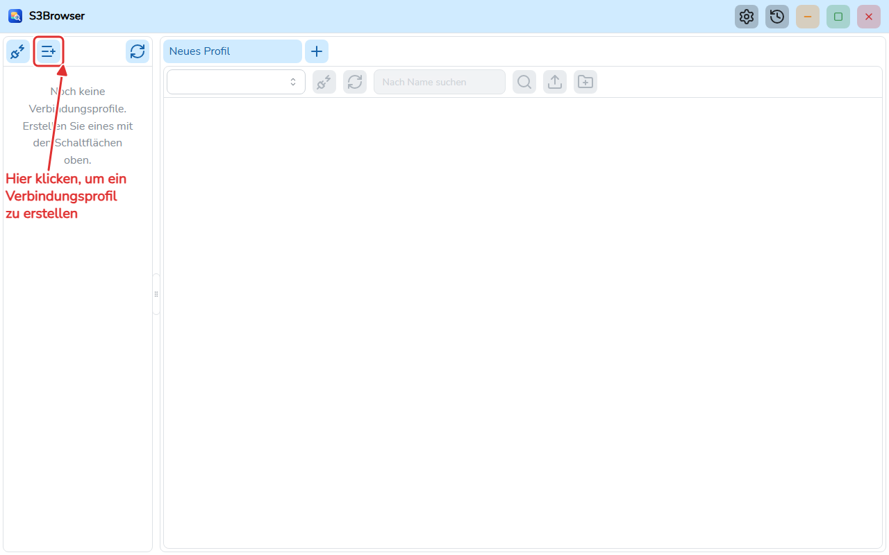
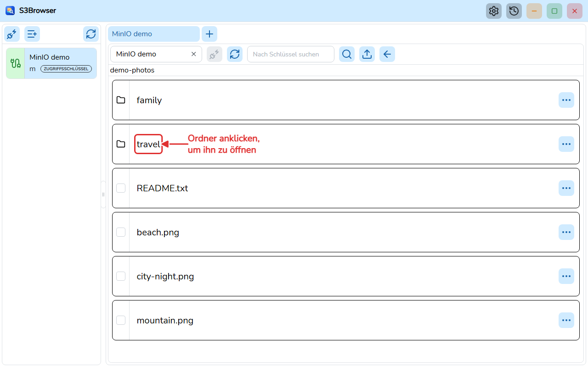
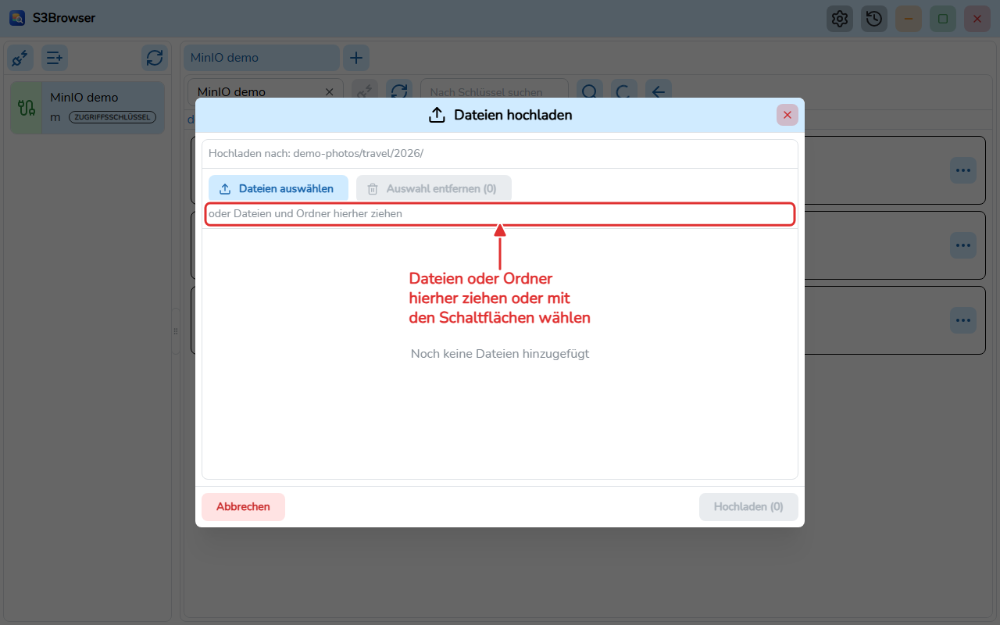
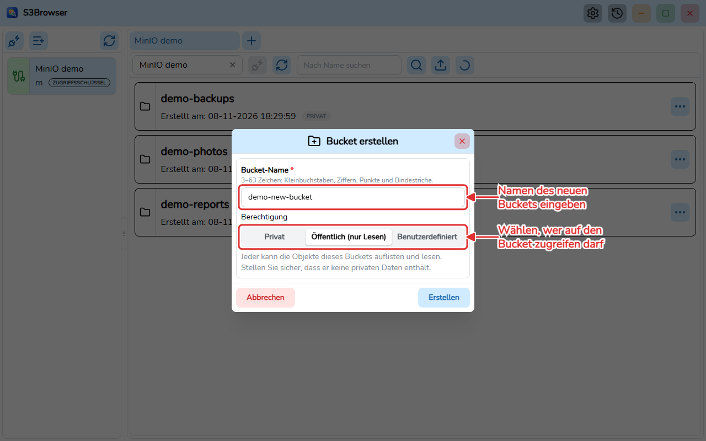
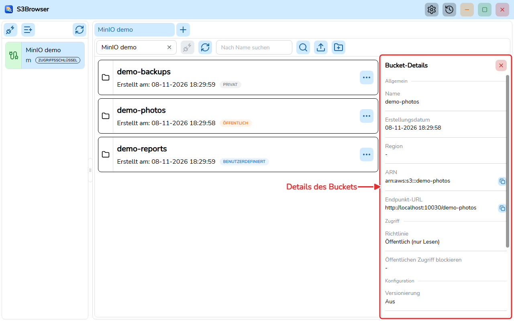

# S3Browser

[English](README.md) | [Tiếng Việt](README.vi.md) | [日本語](README.ja.md) | [简体中文](README.zh-CN.md) | [繁體中文](README.zh-TW.md) | [Русский](README.ru.md) | **Deutsch**


S3Browser ist eine Desktop-Anwendung auf Basis von **Wails v3** (Go-Backend, React + TypeScript-Frontend) zum Durchsuchen und Verwalten von Buckets und Objekten auf **AWS S3** und S3-kompatiblen Servern wie **MinIO**.

> Diese Übersetzung wurde noch nicht von einem Muttersprachler geprüft.



## Funktionen

- Verbindungsprofile speichern (Geheimnisse werden verschlüsselt abgelegt) und sich gleichzeitig mit mehreren Konten verbinden, ein Tab pro Verbindung. Tabs lassen sich per Drag-and-drop umsortieren und werden zwischen den Sitzungen gespeichert.
- AWS S3 und MinIO (eigener Endpunkt, Region, Path style) mit vielen Authentifizierungsmethoden: Zugriffsschlüssel, AWS-CLI-Profil, Rolle übernehmen (mit MFA), AWS SSO, Standardkette für Anmeldedaten, anonym, MinIO STS, LDAP, OpenID Connect (OIDC) und TLS-Clientzertifikat. Für MinIO-Server mit selbstsigniertem Zertifikat kann eine zusätzliche CA-Zertifikatsdatei angegeben werden.
- Buckets, Ordner und Objekte in seitenweise geladenen, virtualisierten Listen durchsuchen; Buckets und Objekte suchen.
- Details eines Buckets (Region, ARN, Richtlinie, Öffentlichen Zugriff blockieren, Versionierung, Verschlüsselung, Objektsperre, Tags) und eines Objekts ansehen.
- Buckets mit einer Berechtigung erstellen (privat, öffentlich nur lesend oder eine benutzerdefinierte JSON-Richtlinie), die Berechtigung später ändern und Buckets löschen (einschließlich ihrer Objekte und Versionen). Ein Badge an jedem Bucket zeigt seinen Richtlinientyp.
- Dateien und Ordner über einen Dialog oder per Drag-and-drop hochladen, mit Grenzen und einem Live-Fortschrittsfenster.
- Ein oder mehrere Objekte mit parallelen Bereichs-Downloads herunterladen, mit Fortschrittsfenster, Abbruch und einem dauerhaft gespeicherten Download-Verlauf.
- Objekte und Ordner löschen (mit Bestätigung).
- Einstellungsdialog: Design (hell / dunkel / Systemvorgabe), Schriftart, Sprache und Start mit Windows; gespeichert in `settings.json` und geladen, bevor die Oberfläche erscheint.
- Oberfläche auf Englisch, Vietnamesisch, Japanisch, Vereinfachtem Chinesisch, Traditionellem Chinesisch, Russisch und Deutsch.
- Automatische Updates über GitHub Releases (installierte Windows-Version), mit optionalem Beta-Kanal.
- Portable Version, die ohne Installation läuft.

| Objekte | Upload |
| --- | --- |
|  |  |

| Bucket mit einer Berechtigung erstellen | Bucket-Details |
| --- | --- |
|  |  |

## Systemanforderungen

- Windows 10/11 (x64) mit der [WebView2 Runtime](https://developer.microsoft.com/microsoft-edge/webview2/). Die portable Version bringt ihr eigenes WebView2 mit.

## Installation

Laden Sie das Installationsprogramm von der Seite [GitHub Releases](https://github.com/TranMinhTruyen/s3-browser/releases) herunter:

- **Latest**-Release: die stabile Version, gebaut aus `master`.
- **Pre-release**: die Beta-Version, gebaut aus `staging`.

Führen Sie `S3Browser-<version>-windows-amd64-installer.exe` aus und folgen Sie den Schritten. Jedes Release enthält außerdem `checksums.txt` (SHA-256) zur Überprüfung des Downloads. Die installierte Anwendung sucht selbst nach Updates und kann in den Einstellungen auf den Beta-Kanal umgestellt werden.

Die portable Version wird nicht veröffentlicht: Bauen Sie sie aus dem Quellcode (siehe [Aus dem Quellcode bauen](#aus-dem-quellcode-bauen)).

- **Installationsprogramm (NSIS)**: `go tool wails3 task package` erstellt `build/bin/S3Browser-amd64-installer.exe`.
- **Portabel**: `go tool wails3 task build:portable WEBVIEW2_DIR=<folder>` erstellt den Ordner `build/bin/S3Browser-portable` mit `S3Browser.exe`, `data/` und `webview2/`. Kopieren Sie den Ordner an einen beliebigen Ort und führen Sie `S3Browser.exe` aus. Alle Daten bleiben in `data/` neben der exe, und es wird die WebView2-Fixed-Version-Laufzeit in `webview2/` verwendet. Verschieben Sie diese Ordner nicht von der exe weg. Die portable Version aktualisiert sich nicht selbst.

## Aus dem Quellcode bauen

Voraussetzungen:

- [Go](https://go.dev/dl/) 1.27 oder neuer (siehe `go.mod`). Wails, sqlc und golangci-lint sind in `go.mod` als Go-Tools deklariert, dafür ist also nichts weiter zu installieren.
- [bun](https://bun.sh/) für das Frontend.
- [NSIS](https://nsis.sourceforge.io/) (`makensis`), um das Installationsprogramm zu bauen.
- Die WebView2 Fixed Version (entpacktes CAB von Microsoft), um das portable Paket zu bauen.
- [Node.js](https://nodejs.org/) nur zum Erzeugen der Dokumentation.

Befehle, sofern nicht anders angegeben im Repo-Stammverzeichnis auszuführen:

```bash
# Install frontend dependencies
bun install --cwd frontend

# Generate the TypeScript bindings (after changing Go handlers or models)
go tool wails3 generate bindings -clean=true -ts

# Run in development mode
go tool wails3 task dev

# Build the Windows installer
go tool wails3 task package

# Build the portable package (WEBVIEW2_DIR contains msedgewebview2.exe)
go tool wails3 task build:portable WEBVIEW2_DIR=C:/path/to/webview2
```

Lint und Tests (in `frontend/` ausführen; unter Windows `.exe` verwenden, zum Beispiel `node_modules/.bin/biome.exe`):

```bash
node_modules/.bin/biome check src
npx oxlint src
node_modules/.bin/tsc --noEmit
node_modules/.bin/vitest run
```

Backend (im Projektstamm):

```bash
go build ./...
go vet ./...
go tool golangci-lint run ./...
```

Die PDFs des Benutzerhandbuchs erzeugen (eines pro Sprache mit einer `user-guide.md`):

```bash
bun install --cwd docs
(cd docs && bunx playwright install chromium)
bun run --cwd docs build:pdf
```

## Projektstruktur

```
main.go            Wails app entry, registers services
internal/          Go backend: handlers, modules (bucket, profile, master, global, setting, update), pkg (db, logger, portable...)
models/            Input/output models shared with the frontend
frontend/          React 19 + TypeScript UI (src/pages/tab holds the tab page with the bucket and object views, bindings generated by Wails)
build/             Wails build assets and platform Taskfiles (windows)
docs/              Architecture notes, user guide, tools to build the PDFs and take the screenshots
sprints/           Requirements and plans per sprint
```

- Architektur: [docs/ARCHITECTURE.md](docs/ARCHITECTURE.md) (auf Englisch)
- Benutzerhandbuch (PDF): [docs/user-guide/de/S3Browser-user-guide.de.pdf](docs/user-guide/de/S3Browser-user-guide.de.pdf), Quelle [user-guide.md](docs/user-guide/de/user-guide.md)
- [Änderungsprotokoll](CHANGELOG.md) (auf Englisch)

## Mitwirken

Eröffnen Sie ein Issue, um einen Fehler oder eine Idee zu besprechen, und senden Sie dann einen Pull Request. Führen Sie vor dem Senden die oben genannten Lint- und Test-Befehle aus und stellen Sie sicher, dass sie erfolgreich sind. Verwenden Sie für Commit-Nachrichten [Conventional Commits](https://www.conventionalcommits.org/) (zum Beispiel `feat(bucket): add object search`). Die Code-Konventionen finden Sie in [CLAUDE.md](CLAUDE.md).

## Lizenz

[MIT](LICENSE) (c) 2026 minh-truyen
