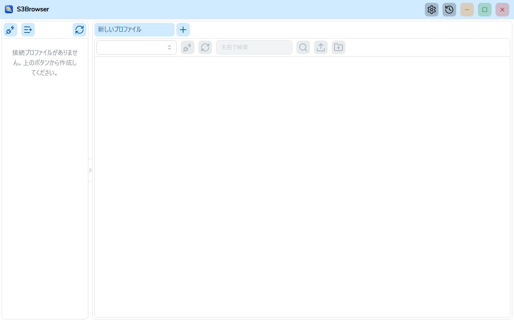
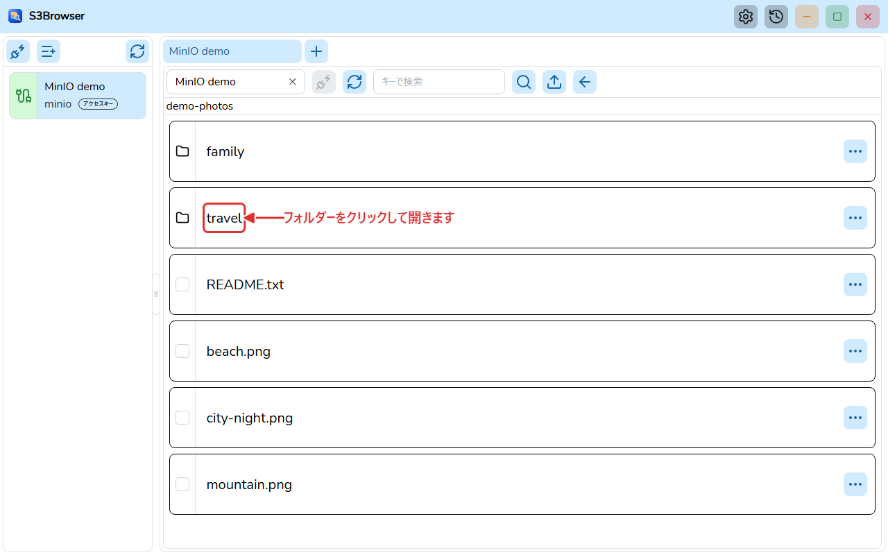
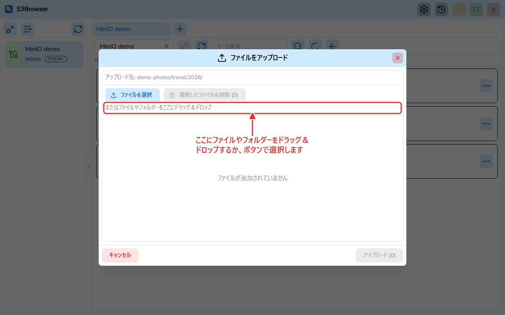
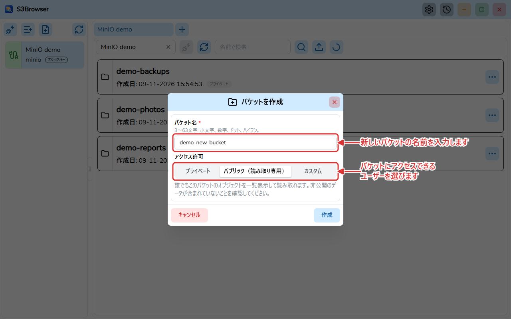
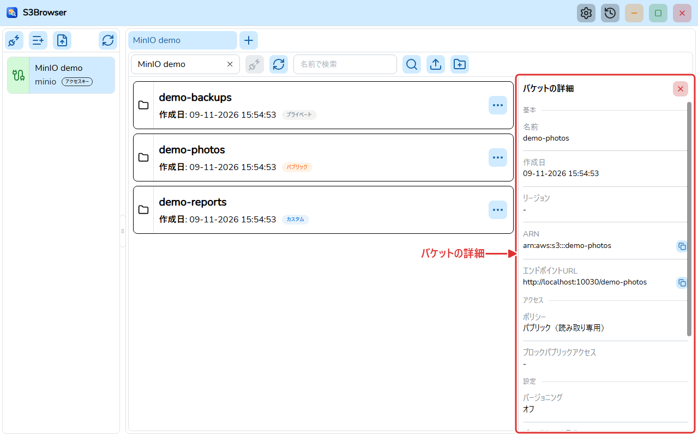

# S3Browser

[English](README.md) | [Tiếng Việt](README.vi.md) | **日本語** | [简体中文](README.zh-CN.md) | [繁體中文](README.zh-TW.md) | [Русский](README.ru.md) | [Deutsch](README.de.md)


S3Browser は **Wails v3**（Go バックエンド、React + TypeScript フロントエンド）で作られたデスクトップアプリです。**AWS S3** と **MinIO** などの S3 互換サーバーのバケットやオブジェクトを閲覧・操作できます。



## 主な機能

- 接続プロファイルの保存（シークレットは暗号化して保存）と、複数アカウントへの同時接続（接続ごとに 1 タブ）。タブはドラッグ＆ドロップで並べ替えられ、開いているタブは次回起動時にも記憶されます。
- 接続プロファイルを JSON ファイルにエクスポートし、別のコンピューターでインポートできます。シークレットを含めるかは任意で、含める場合は自分で決めたパスワードで暗号化されます。
- AWS S3 と MinIO に対応（カスタムエンドポイント、リージョン、パススタイル）。認証方式はアクセスキー、AWS CLI プロファイル、ロールの引き受け（MFA 対応）、AWS SSO、デフォルト認証情報チェーン、匿名、MinIO STS、LDAP、OpenID Connect (OIDC)、TLS クライアント証明書。自己署名証明書を使う MinIO サーバー向けに、追加の CA 証明書ファイルを指定できます。
- ページ分割・仮想化された一覧でバケット、フォルダ、オブジェクトを閲覧し、バケットとオブジェクトを検索。
- バケット（リージョン、ARN、ポリシー、ブロックパブリックアクセス、バージョニング、暗号化、オブジェクトロック、タグ）とオブジェクトの詳細表示。
- 権限（プライベート、パブリック読み取り専用、カスタム JSON ポリシー）を指定したバケットの作成、後からの権限変更、バケットの削除（中のオブジェクトとバージョンを含む）。各バケットのバッジでポリシーの種類が分かります。
- ダイアログまたはドラッグ＆ドロップでのファイル・フォルダのアップロード（上限あり、リアルタイムの進捗ウィンドウ付き）。
- 1 件または複数のオブジェクトのダウンロード（分割並列取得）、進捗ウィンドウ、キャンセル、保存されるダウンロード履歴。
- オブジェクトとフォルダの削除（確認付き）。
- 設定ダイアログ: テーマ（ライト / ダーク / システムに合わせる）、フォント、言語、Windows 起動時の自動起動。`settings.json` に保存され、UI 表示前に読み込まれます。
- 英語、ベトナム語、日本語、簡体字中国語、繁体字中国語、ロシア語、ドイツ語の UI。
- GitHub Releases からの自動アップデート（Windows のインストール版）。ベータ版の受け取りは任意です。
- インストール不要のポータブル版。

| オブジェクト | アップロード |
| --- | --- |
|  |  |

| 権限付きでバケットを作成 | バケットの詳細 |
| --- | --- |
|  |  |

## システム要件

- Windows 10/11 (x64) と [WebView2 Runtime](https://developer.microsoft.com/microsoft-edge/webview2/)。ポータブル版には専用の WebView2 が同梱されます。

## インストール

[GitHub Releases](https://github.com/TranMinhTruyen/s3-browser/releases) のページからインストーラーをダウンロードします。

- **Latest** リリース: `master` からビルドされた安定版。
- **Pre-release**: `staging` からビルドされたベータ版。

`S3Browser-<バージョン>-windows-amd64-installer.exe` を実行し、画面の指示に従ってください。各リリースにはダウンロードを検証するための `checksums.txt` (SHA-256) も含まれます。インストールしたアプリは自動的にアップデートを確認し、設定でベータ版の受け取りに切り替えられます。

ポータブル版は配布されていません。ソースからビルドしてください（[ソースからのビルド](#ソースからのビルド)を参照）。

- **インストーラー (NSIS)**: `go tool wails3 task package` で `build/bin/S3Browser-amd64-installer.exe` が作成されます。
- **ポータブル版**: `go tool wails3 task build:portable WEBVIEW2_DIR=<フォルダ>` で、`S3Browser.exe`、`data/`、`webview2/` を含むフォルダ `build/bin/S3Browser-portable` が作成されます。フォルダを任意の場所にコピーして `S3Browser.exe` を実行します。データはすべて exe の隣の `data/` に保存され、`webview2/` の WebView2 Fixed Version が使われます。これらのフォルダを exe から離さないでください。ポータブル版は自動アップデートしません。

## ソースからのビルド

必要なもの:

- [Go](https://go.dev/dl/) 1.27 以上（`go.mod` を参照）。Wails、sqlc、golangci-lint は `go.mod` に Go tool として宣言されているため、別途インストールは不要です。
- フロントエンド用の [bun](https://bun.sh/)。
- インストーラー作成用の [NSIS](https://nsis.sourceforge.io/) (`makensis`)。
- ポータブル版作成用の WebView2 Fixed Version（Microsoft の CAB を展開したもの）。
- ドキュメント生成のみに [Node.js](https://nodejs.org/)。

コマンド（特記なき限りリポジトリのルートで実行）:

```bash
# フロントエンドの依存関係をインストール
bun install --cwd frontend

# TypeScript バインディングを生成（Go のハンドラーやモデルを変更した後）
go tool wails3 generate bindings -clean=true -ts

# 開発モードで実行
go tool wails3 task dev

# Windows インストーラーを作成
go tool wails3 task package

# ポータブル版を作成（WEBVIEW2_DIR には msedgewebview2.exe があるフォルダを指定）
go tool wails3 task build:portable WEBVIEW2_DIR=C:/path/to/webview2
```

Lint とテスト（`frontend/` で実行。Windows では `.exe` を付けます。例: `node_modules/.bin/biome.exe`）:

```bash
node_modules/.bin/biome check src
npx oxlint src
node_modules/.bin/tsc --noEmit
node_modules/.bin/vitest run
```

バックエンド（プロジェクトルート）:

```bash
go build ./...
go vet ./...
go tool golangci-lint run ./...
```

ユーザーガイドの PDF（`user-guide.md` がある言語ごとに 1 つ）を生成:

```bash
bun install --cwd docs
(cd docs && bunx playwright install chromium)
bun run --cwd docs build:pdf
```

## ディレクトリ構成

```
main.go            Wails アプリのエントリーポイント、サービス登録
internal/          Go バックエンド: handlers、modules (bucket, profile, master, global, setting, update)、pkg (db, logger, portable など)
models/            フロントエンドと共有する入出力モデル
frontend/          React 19 + TypeScript の UI (src/pages/s3 に S3 のビュー (バケットとオブジェクト)、src/pages/sql に SQL のビュー、bindings は Wails が生成)
build/             Wails のビルド資産とプラットフォーム別 Taskfile (windows)
docs/              アーキテクチャ文書、ユーザーガイド、PDF とスクリーンショットの生成ツール
sprints/           スプリントごとの要件と計画
```

- アーキテクチャ: [docs/ARCHITECTURE.ja.md](docs/ARCHITECTURE.ja.md)
- ユーザーガイド (PDF): [docs/user-guide/ja/S3Browser-user-guide.ja.pdf](docs/user-guide/ja/S3Browser-user-guide.ja.pdf)、ソース [user-guide.md](docs/user-guide/ja/user-guide.md)
- [変更履歴](CHANGELOG.ja.md)

## コントリビュート

バグやアイデアは issue で相談し、その後 pull request を送ってください。送る前に上記の lint とテストを実行し、すべて成功することを確認してください。コミットメッセージは [Conventional Commits](https://www.conventionalcommits.org/) に従います（例: `feat(bucket): add object search`）。コード規約は [CLAUDE.md](CLAUDE.md) を参照してください。

## ライセンス

[MIT](LICENSE) (c) 2026 minh-truyen
