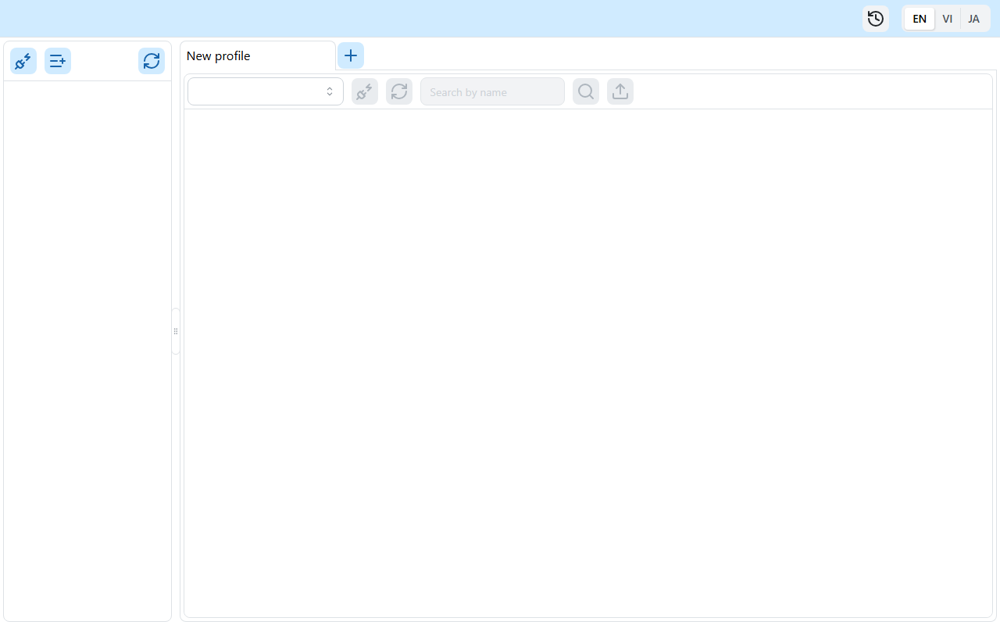
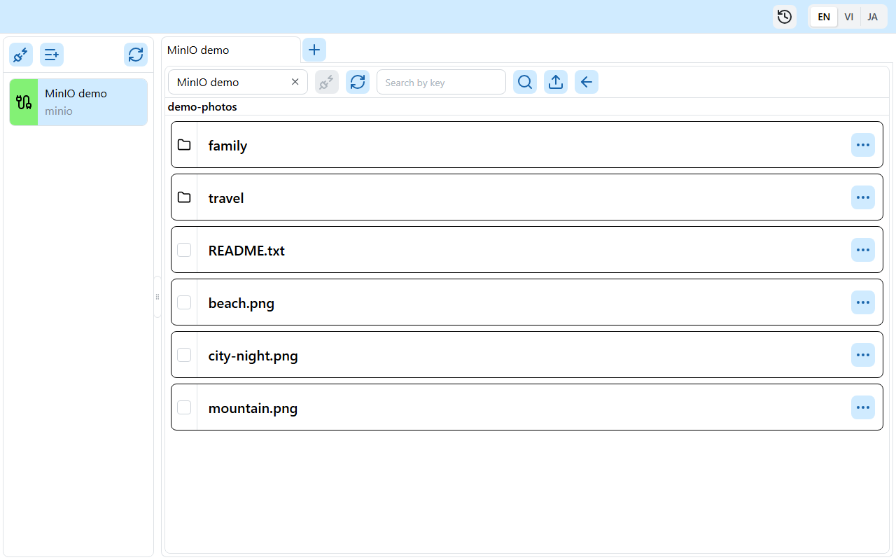
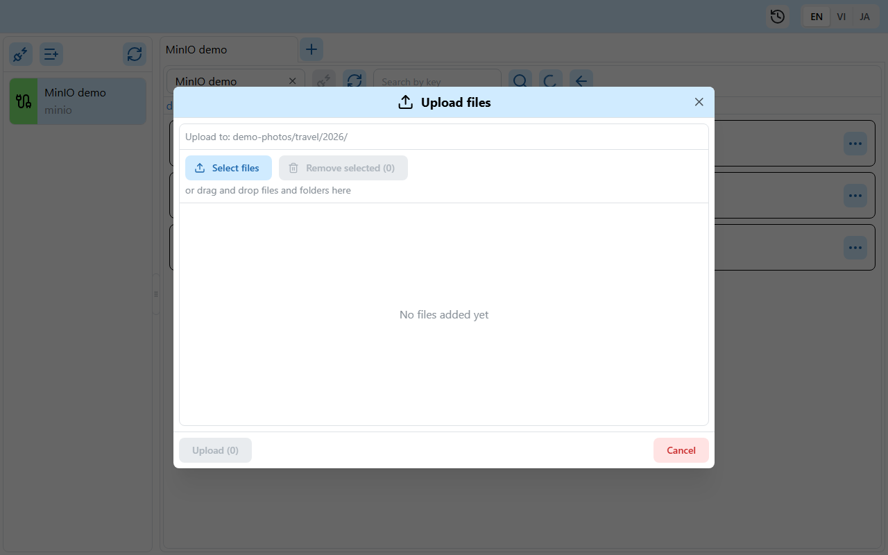

# S3Browser

**English** | [Tiếng Việt](README.vi.md) | [日本語](README.ja.md)


S3Browser is a desktop application built with **Wails v3** (Go backend, React + TypeScript frontend) to browse and manage buckets and objects on **AWS S3** and S3-compatible servers such as **MinIO**.



## Features

- Save connection profiles (secrets are stored encrypted) and connect to several accounts at once, one tab per connection.
- Support for AWS S3 and MinIO (custom endpoint, region, path style).
- Browse buckets, folders and objects with paginated lists.
- Search buckets and objects with paginated results.
- View the details of an object.
- Upload files and folders from a dialog or by drag and drop, with limits and a live progress window.
- Download one or several objects with parallel ranged downloads, a progress window, cancel, and a persistent download history.
- Delete objects and folders (with confirmation).
- Interface in English, Vietnamese and Japanese.
- Portable build that runs without installation.

| Objects | Upload |
| --- | --- |
|  |  |

## System requirements

- Windows 10/11 (x64) with the [WebView2 Runtime](https://developer.microsoft.com/microsoft-edge/webview2/). The portable build ships its own WebView2.
- macOS and Linux: build from source. These platforms have not been tested.

## Installation

Build the artifacts as described in [Build from source](#build-from-source).

- **Installer (NSIS)**: `go tool wails3 task package` creates `build/windows/nsis/S3Browser-installer.exe`. Run it and follow the steps.
- **Portable**: `go tool wails3 task build:portable WEBVIEW2_DIR=<folder>` creates the folder `build/bin/S3Browser-portable` containing `S3Browser.exe`, `data/` and `webview2/`. Copy the folder anywhere and run `S3Browser.exe`. All data stays in `data/` next to the exe, and the WebView2 Fixed Version runtime in `webview2/` is used. Do not move these folders away from the exe.

## Build from source

Prerequisites:

- [Go](https://go.dev/dl/) 1.27 or later (see `go.mod`). Wails, sqlc and golangci-lint are declared as Go tools in `go.mod`, so there is nothing else to install for them.
- [bun](https://bun.sh/) for the frontend.
- [NSIS](https://nsis.sourceforge.io/) (`makensis`) to build the installer.
- The WebView2 Fixed Version (extracted CAB from Microsoft) to build the portable package.
- [Node.js](https://nodejs.org/) only to generate the docs.

Commands, run in the project root `App/S3Browser` unless noted:

```bash
# Install frontend dependencies
bun install --cwd frontend

# Generate the TypeScript bindings (after changing Go handlers or models)
go tool wails3 generate bindings -clean=true -ts

# Run in development mode
go tool wails3 task dev

# Build the Windows installer
go tool wails3 task package

# Build the portable package (WEBVIEW2_DIR contains msedgewebview2.exe)
go tool wails3 task build:portable WEBVIEW2_DIR=C:/path/to/webview2
```

Lint and test (run in `frontend/`; on Windows use `.exe`, for example `node_modules/.bin/biome.exe`):

```bash
node_modules/.bin/biome check src
npx oxlint src
node_modules/.bin/tsc --noEmit
node_modules/.bin/vitest run
```

Backend (in the project root):

```bash
go build ./...
go vet ./...
go tool golangci-lint run ./...
```

Generate the user guide PDFs (en, vi, ja):

```bash
bun install --cwd docs
(cd docs && bunx playwright install chromium)
bun run --cwd docs build:pdf
```

## Project structure

```
main.go            Wails app entry, registers services
internal/          Go backend: handlers, modules (bucket, profile, master, global), pkg (db, logger, portable...)
models/            Input/output models shared with the frontend
frontend/          React 19 + TypeScript UI (src, bindings generated by Wails)
build/             Wails build assets and platform Taskfiles (windows, darwin)
docs/              Architecture notes, user guide, tools to build the PDFs
sprints/           Requirements and plans per sprint
```

- Architecture: [docs/ARCHITECTURE.md](docs/ARCHITECTURE.md)
- User guide (PDF): [docs/user-guide/en/S3Browser-user-guide.en.pdf](docs/user-guide/en/S3Browser-user-guide.en.pdf), source [user-guide.md](docs/user-guide/en/user-guide.md)
- [Changelog](CHANGELOG.md)

## Contributing

Open an issue to discuss a bug or an idea, then send a pull request. Before sending, run the lint and test commands above and make sure they pass. Use [Conventional Commits](https://www.conventionalcommits.org/) for commit messages (for example `feat(bucket): add object search`). See [CLAUDE.md](CLAUDE.md) for the code conventions.

## License

[MIT](LICENSE) (c) 2026 minh-truyen
