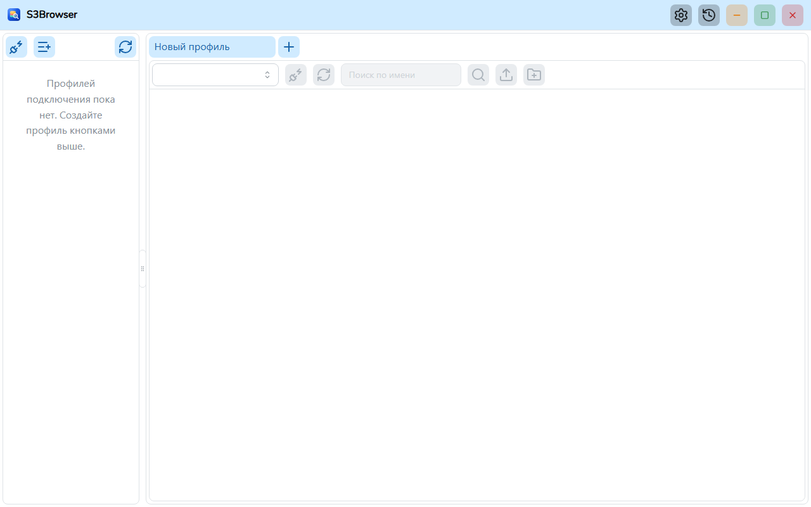
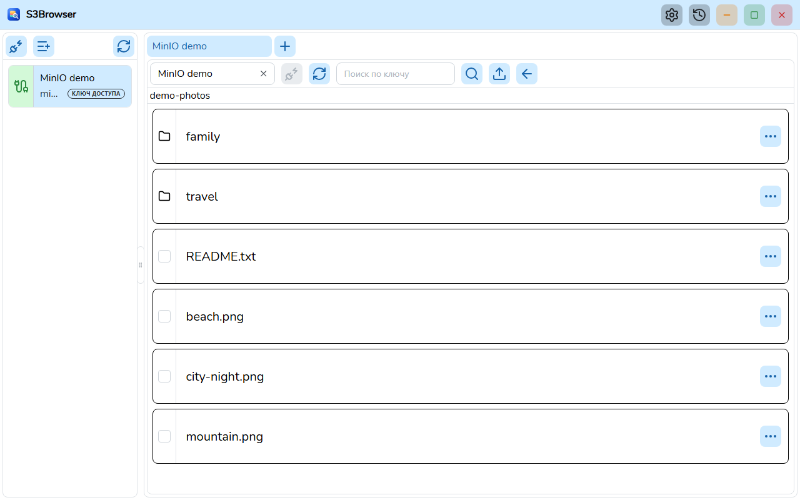
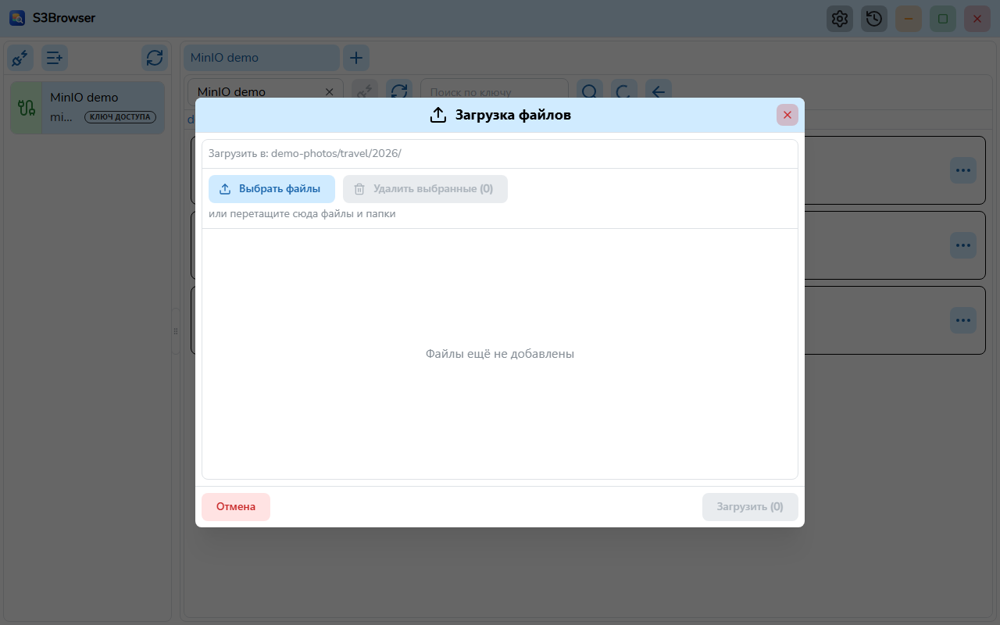
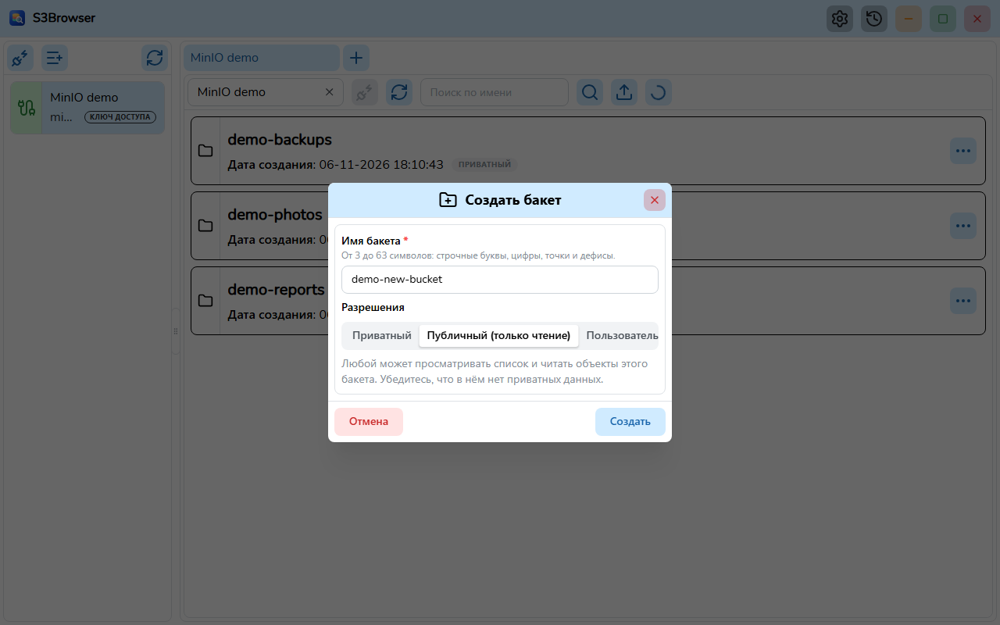
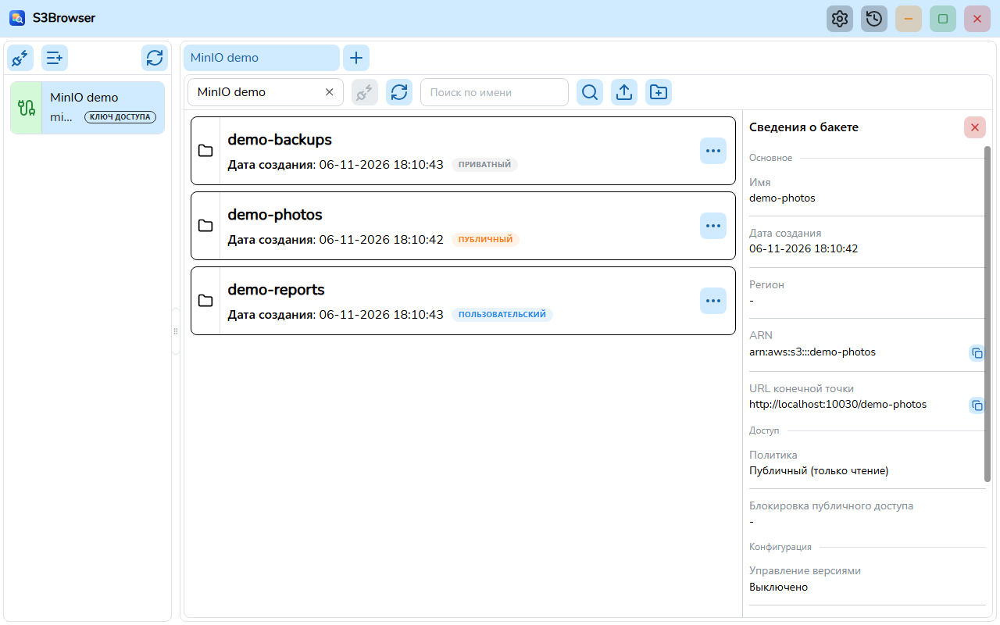

# S3Browser

[English](README.md) | [Tiếng Việt](README.vi.md) | [日本語](README.ja.md) | [简体中文](README.zh-CN.md) | [繁體中文](README.zh-TW.md) | **Русский** | [Deutsch](README.de.md)


S3Browser — настольное приложение на **Wails v3** (бэкенд на Go, фронтенд на React + TypeScript) для просмотра бакетов и объектов и управления ими на **AWS S3** и S3-совместимых серверах, таких как **MinIO**.

> Этот перевод ещё не проверен носителем языка.



## Возможности

- Сохранение профилей подключения (секреты хранятся в зашифрованном виде) и одновременное подключение к нескольким учётным записям, по одной вкладке на подключение. Вкладки можно переупорядочивать перетаскиванием, они запоминаются между сеансами.
- AWS S3 и MinIO (собственная конечная точка, регион, path style) и множество способов аутентификации: ключ доступа, профиль AWS CLI, принятие роли (с MFA), AWS SSO, цепочка учётных данных по умолчанию, анонимный доступ, MinIO STS, LDAP, OpenID Connect (OIDC) и клиентский сертификат TLS. Для серверов MinIO с самоподписанным сертификатом можно указать дополнительный файл сертификата CA.
- Просмотр бакетов, папок и объектов в постраничных виртуализированных списках; поиск бакетов и объектов.
- Просмотр сведений о бакете (регион, ARN, политика, блокировка публичного доступа, управление версиями, шифрование, блокировка объектов, теги) и об объекте.
- Создание бакетов с указанием прав доступа (приватный, публичный только для чтения или пользовательская политика в JSON), последующее изменение прав и удаление бакетов (вместе с объектами и версиями). Значок на каждом бакете показывает тип его политики.
- Загрузка файлов и папок через диалог или перетаскиванием, с ограничениями и окном хода выполнения в реальном времени.
- Скачивание одного или нескольких объектов с параллельной загрузкой по диапазонам, окном хода выполнения, отменой и постоянной историей скачиваний.
- Удаление объектов и папок (с подтверждением).
- Диалог настроек: тема (светлая / тёмная / как в системе), шрифт, язык и запуск при старте Windows; сохраняется в `settings.json` и загружается до появления интерфейса.
- Интерфейс на английском, вьетнамском, японском, упрощённом китайском, традиционном китайском, русском и немецком языках.
- Автоматические обновления через GitHub Releases (установленная сборка для Windows) с необязательным каналом бета-версий.
- Портативная сборка, работающая без установки.

| Объекты | Загрузка |
| --- | --- |
|  |  |

| Создание бакета с правами доступа | Сведения о бакете |
| --- | --- |
|  |  |

## Системные требования

- Windows 10/11 (x64) с [WebView2 Runtime](https://developer.microsoft.com/microsoft-edge/webview2/). Портативная сборка содержит собственный WebView2.
- macOS и Linux: собирайте из исходников. Эти платформы не тестировались.

## Установка

Скачайте установщик со страницы [GitHub Releases](https://github.com/TranMinhTruyen/s3-browser/releases):

- Выпуск **Latest**: стабильная версия, собранная из `master`.
- **Pre-release**: бета-версия, собранная из `staging`.

Запустите `S3Browser-<version>-windows-amd64-installer.exe` и следуйте шагам. В каждом выпуске также есть `checksums.txt` (SHA-256) для проверки скачанного файла. Установленное приложение само проверяет обновления, а в настройках его можно переключить на канал бета-версий.

Портативная сборка не публикуется: соберите её из исходников (см. [Сборка из исходников](#сборка-из-исходников)).

- **Установщик (NSIS)**: `go tool wails3 task package` создаёт `build/bin/S3Browser-amd64-installer.exe`.
- **Портативная версия**: `go tool wails3 task build:portable WEBVIEW2_DIR=<folder>` создаёт папку `build/bin/S3Browser-portable` с `S3Browser.exe`, `data/` и `webview2/`. Скопируйте папку в любое место и запустите `S3Browser.exe`. Все данные хранятся в `data/` рядом с exe, используется среда WebView2 Fixed Version из `webview2/`. Не переносите эти папки отдельно от exe. Портативная версия не обновляется самостоятельно.

## Сборка из исходников

Предварительные требования:

- [Go](https://go.dev/dl/) 1.27 или новее (см. `go.mod`). Wails, sqlc и golangci-lint объявлены как инструменты Go в `go.mod`, поэтому устанавливать их отдельно не нужно.
- [bun](https://bun.sh/) для фронтенда.
- [NSIS](https://nsis.sourceforge.io/) (`makensis`) для сборки установщика.
- WebView2 Fixed Version (распакованный CAB от Microsoft) для сборки портативного пакета.
- [Node.js](https://nodejs.org/) только для генерации документации.

Команды выполняются в корне репозитория, если не указано иное:

```bash
# Install frontend dependencies
bun install --cwd frontend

# Generate the TypeScript bindings (after changing Go handlers or models)
go tool wails3 generate bindings -clean=true -ts

# Run in development mode
go tool wails3 task dev

# Build the Windows installer
go tool wails3 task package

# Build the portable package (WEBVIEW2_DIR contains msedgewebview2.exe)
go tool wails3 task build:portable WEBVIEW2_DIR=C:/path/to/webview2
```

Линтер и тесты (выполняются в `frontend/`; в Windows используйте `.exe`, например `node_modules/.bin/biome.exe`):

```bash
node_modules/.bin/biome check src
npx oxlint src
node_modules/.bin/tsc --noEmit
node_modules/.bin/vitest run
```

Бэкенд (в корне проекта):

```bash
go build ./...
go vet ./...
go tool golangci-lint run ./...
```

Генерация PDF руководства пользователя (по одному для каждого языка, у которого есть `user-guide.md`):

```bash
bun install --cwd docs
(cd docs && bunx playwright install chromium)
bun run --cwd docs build:pdf
```

## Структура проекта

```
main.go            Wails app entry, registers services
internal/          Go backend: handlers, modules (bucket, profile, master, global, setting, update), pkg (db, logger, portable...)
models/            Input/output models shared with the frontend
frontend/          React 19 + TypeScript UI (src/pages/tab holds the tab page with the bucket and object views, bindings generated by Wails)
build/             Wails build assets and platform Taskfiles (windows, darwin)
docs/              Architecture notes, user guide, tools to build the PDFs and take the screenshots
sprints/           Requirements and plans per sprint
```

- Архитектура: [docs/ARCHITECTURE.md](docs/ARCHITECTURE.md) (на английском)
- Руководство пользователя (PDF): [docs/user-guide/ru/S3Browser-user-guide.ru.pdf](docs/user-guide/ru/S3Browser-user-guide.ru.pdf), исходник [user-guide.md](docs/user-guide/ru/user-guide.md)
- [Журнал изменений](CHANGELOG.md) (на английском)

## Участие в разработке

Создайте issue, чтобы обсудить ошибку или идею, затем отправьте pull request. Перед отправкой выполните команды линтера и тестов, приведённые выше, и убедитесь, что они проходят. Для сообщений коммитов используйте [Conventional Commits](https://www.conventionalcommits.org/) (например, `feat(bucket): add object search`). Соглашения по коду см. в [CLAUDE.md](CLAUDE.md).

## Лицензия

[MIT](LICENSE) (c) 2026 minh-truyen
