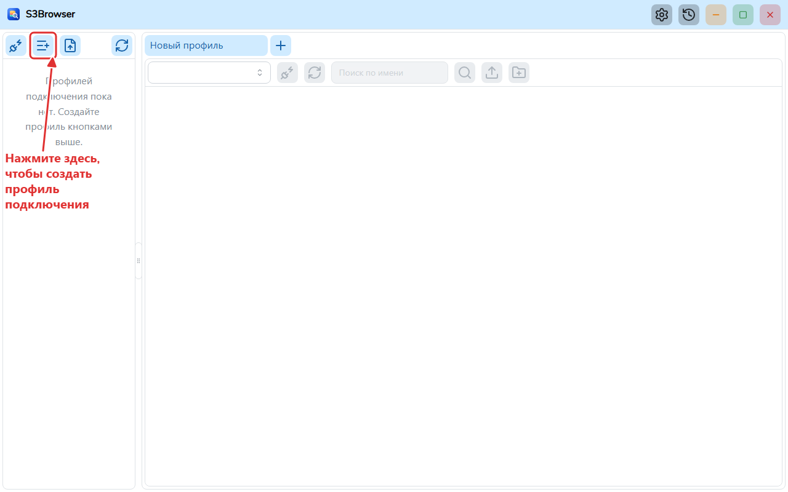
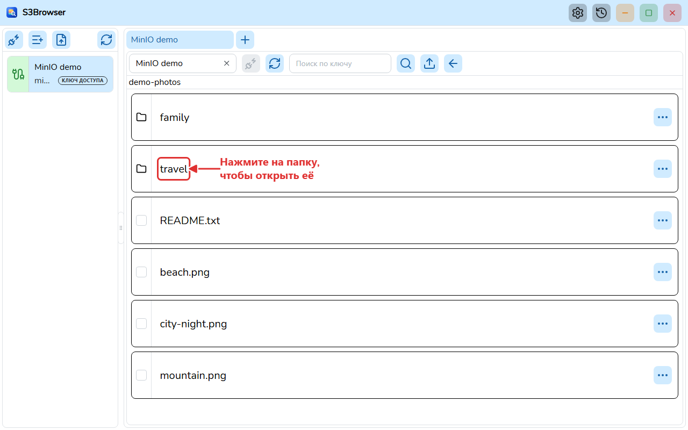
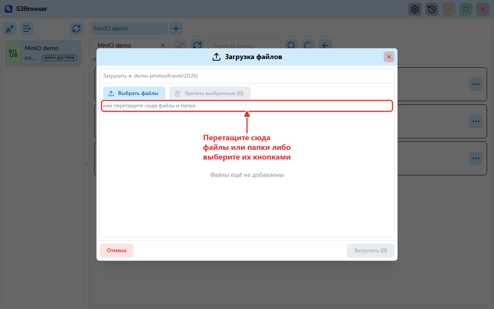
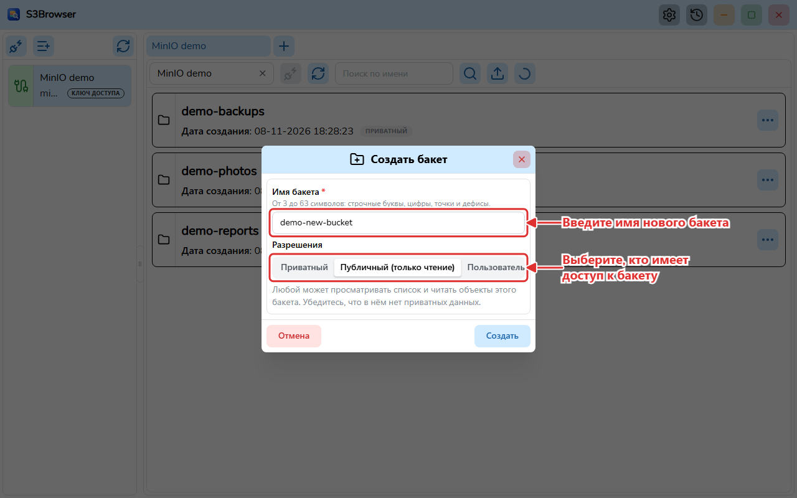
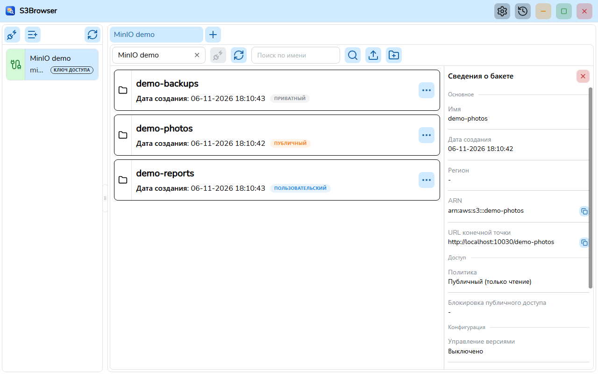

# S3Browser

[English](README.md) | [Tiếng Việt](README.vi.md) | [日本語](README.ja.md) | [简体中文](README.zh-CN.md) | [繁體中文](README.zh-TW.md) | **Русский** | [Deutsch](README.de.md)


S3Browser — настольное приложение на **Wails v3** (бэкенд на Go, фронтенд на React + TypeScript) для просмотра бакетов и объектов и управления ими на **AWS S3** и S3-совместимых серверах, таких как **MinIO**.

> Этот перевод ещё не проверен носителем языка.



## Возможности

- Сохранение профилей подключения (секреты хранятся в зашифрованном виде) и одновременное подключение к нескольким учётным записям, по одной вкладке на подключение. Вкладки можно переупорядочивать перетаскиванием, они запоминаются между сеансами.
- Экспорт профиля подключения в файл JSON и импорт на другом компьютере. Секреты необязательны; если они включены, они шифруются выбранным вами паролем.
- AWS S3 и MinIO (собственная конечная точка, регион, path style) и множество способов аутентификации: ключ доступа, профиль AWS CLI, принятие роли (с MFA), AWS SSO, цепочка учётных данных по умолчанию, анонимный доступ, MinIO STS, LDAP, OpenID Connect (OIDC) и клиентский сертификат TLS. Для серверов MinIO с самоподписанным сертификатом можно указать дополнительный файл сертификата CA.
- Просмотр бакетов, папок и объектов в постраничных виртуализированных списках; поиск бакетов и объектов.
- Просмотр сведений о бакете (регион, ARN, политика, блокировка публичного доступа, управление версиями, шифрование, блокировка объектов, теги) и об объекте.
- Создание бакетов с указанием прав доступа (приватный, публичный только для чтения или пользовательская политика в JSON), последующее изменение прав и удаление бакетов (вместе с объектами и версиями). Значок на каждом бакете показывает тип его политики.
- Загрузка файлов и папок через диалог или перетаскиванием, с ограничениями и окном хода выполнения в реальном времени.
- Скачивание одного или нескольких объектов с параллельной загрузкой по диапазонам, окном хода выполнения, отменой и постоянной историей скачиваний.
- Удаление объектов и папок (с подтверждением).
- **Режим SQL** (переключатель S3 / SQL в заголовке окна): открытие файла базы данных SQLite, просмотр таблиц, представлений, индексов и триггеров в дереве объектов, выполнение SQL в нескольких вкладках (редактор с поиском и заменой, отмена выполняемого запроса), постраничный просмотр больших результатов, просмотр структуры и данных таблицы. Ядро работы с БД — нативная библиотека на Rust для высокой скорости. Другие базы данных (PostgreSQL, MySQL, MariaDB, SQL Server, MongoDB, Redis) в разработке.
- Диалог настроек: тема (светлая / тёмная / как в системе), шрифт, размер интерфейса (мелкий / средний / крупный), язык и запуск при старте Windows; сохраняется в `settings.json` и загружается до появления интерфейса.
- Интерфейс на английском, вьетнамском, японском, упрощённом китайском, традиционном китайском, русском и немецком языках.
- Автоматические обновления через GitHub Releases (установленная сборка для Windows) с необязательным каналом бета-версий.
- Портативная сборка, работающая без установки.

| Объекты | Загрузка |
| --- | --- |
|  |  |

| Создание бакета с правами доступа | Сведения о бакете |
| --- | --- |
|  |  |

## Системные требования

- Windows 10/11 (x64) с [WebView2 Runtime](https://developer.microsoft.com/microsoft-edge/webview2/). Портативная сборка содержит собственный WebView2.

## Установка

Скачайте установщик со страницы [GitHub Releases](https://github.com/TranMinhTruyen/s3-browser/releases):

- Выпуск **Latest**: стабильная версия, собранная из `master`.
- **Pre-release**: бета-версия, собранная из `staging`.

Запустите `S3Browser-<version>-windows-amd64-installer.exe` и следуйте шагам. В каждом выпуске также есть `checksums.txt` (SHA-256) для проверки скачанного файла. Установленное приложение само проверяет обновления, а в настройках его можно переключить на канал бета-версий.

Портативная сборка не публикуется: соберите её из исходников (см. [Сборка из исходников](#сборка-из-исходников)).

- **Установщик (NSIS)**: `go tool wails3 task package` создаёт `build/bin/S3Browser-amd64-installer.exe`.
- **Портативная версия**: `go tool wails3 task build:portable WEBVIEW2_DIR=<folder>` создаёт папку `build/bin/S3Browser-portable` с `S3Browser.exe`, `data/` и `webview2/`. Скопируйте папку в любое место и запустите `S3Browser.exe`. Все данные хранятся в `data/` рядом с exe, используется среда WebView2 Fixed Version из `webview2/`. Не переносите эти папки отдельно от exe. Портативная версия не обновляется самостоятельно.

## Сборка из исходников

Предварительные требования:

- [Go](https://go.dev/dl/) 1.27 или новее (см. `go.mod`). Wails, sqlc и golangci-lint объявлены как инструменты Go в `go.mod`, поэтому устанавливать их отдельно не нужно.
- [bun](https://bun.sh/) для фронтенда.
- [Rust](https://rustup.rs/) stable с целью `x86_64-pc-windows-msvc` и [Visual Studio Build Tools](https://visualstudio.microsoft.com/visual-cpp-build-tools/) (рабочая нагрузка C++) для сборки нативной библиотеки БД `s3b_db.dll`. `setup/setup-project.sh` устанавливает их вместе с Go и bun; на новой машине скрипт также ставит Docker Desktop, Chromium для Playwright и пакеты frontend и docs, собирает приложение и серверную сборку для E2E и запускает тестовое окружение (`test-env/docker-compose.yml`). Отдельные шаги отключаются через `SETUP_E2E=0`, `SETUP_TEST_ENV=0`, `SETUP_GRAPHIFY=0`.
- [NSIS](https://nsis.sourceforge.io/) (`makensis`) для сборки установщика.
- WebView2 Fixed Version (распакованный CAB от Microsoft) для сборки портативного пакета.
- [Node.js](https://nodejs.org/) только для генерации документации.

Команды выполняются в корне репозитория, если не указано иное:

```bash
# Install frontend dependencies
bun install --cwd frontend

# Generate the TypeScript bindings (after changing Go handlers or models; the wailsgen tag is required)
go tool wails3 generate bindings -f "-tags=wailsgen" -clean=true -ts

# Run in development mode (also builds s3b_db.dll from rust/ and copies it next to the exe)
go tool wails3 task dev

# Build the Windows installer
go tool wails3 task package

# Build the portable package (WEBVIEW2_DIR contains msedgewebview2.exe)
go tool wails3 task build:portable WEBVIEW2_DIR=C:/path/to/webview2
```

Линтер и тесты (выполняются в `frontend/`; в Windows используйте `.exe`, например `node_modules/.bin/biome.exe`):

```bash
node_modules/.bin/biome check src
npx oxlint src
node_modules/.bin/tsc --noEmit
node_modules/.bin/vitest run
```

Бэкенд (в корне проекта):

```bash
go build ./...
go vet ./...
go tool golangci-lint run ./...
```

Нативная библиотека (в `rust/`):

```bash
cargo fmt --check
cargo clippy --target x86_64-pc-windows-msvc --all-targets -- -D warnings
cargo test
```

Сквозные тесты (Playwright, в `frontend/`, только локально, не в CI): управляют настоящим приложением в режиме сервера (бэкенд Go и `s3b_db.dll`) через Chromium. При каждом запуске приложение копируется в `frontend/e2e/.run/`, поэтому ваши профили и настройки не затрагиваются. Тестам SQL и настроек больше ничего не нужно; тестам S3 нужен сервер S3/MinIO (например, `test-env/docker-compose.yml`), без переменных `E2E_S3_*` они пропускаются. Предупреждение или ошибка в консоли браузера проваливает тест. HTML-отчёт и трассировки упавших тестов лежат в `frontend/e2e/.run/`.

```bash
bun run e2e:build
E2E_S3_ENDPOINT=http://localhost:10010 E2E_S3_ACCESS_KEY=<access key> E2E_S3_SECRET_KEY=<secret key> bun run e2e
```

Генерация PDF руководства пользователя (по одному для каждого языка, у которого есть `user-guide.md`):

```bash
bun install --cwd docs
(cd docs && bunx playwright install chromium)
bun run --cwd docs build:pdf
```

## Структура проекта

```
main.go            Wails app entry, registers services
internal/          Go backend: handlers, modules (bucket, db, profile, master, global, setting, update), pkg (db, logger, portable...)
models/            Input/output models shared with the frontend
rust/              Native database library s3b_db.dll (Rust), called by internal/modules/db without cgo
frontend/          React 19 + TypeScript UI (src/pages/s3 holds the S3 views (bucket and object), src/pages/sql the SQL views, bindings generated by Wails)
build/             Wails build assets and platform Taskfiles (windows)
docs/              Architecture notes, user guide, tools to build the PDFs and take the screenshots
test-env/          Docker test servers (MinIO, Keycloak, LDAP, databases) and bench scripts
sprints/           Requirements and plans per sprint
```

- Архитектура: [docs/ARCHITECTURE.ru.md](docs/ARCHITECTURE.ru.md) (в разделе 2.11 описано, как Go вызывает библиотеку Rust)
- Руководство пользователя (PDF): [docs/user-guide/ru/S3Browser-user-guide.ru.pdf](docs/user-guide/ru/S3Browser-user-guide.ru.pdf), исходник [user-guide.md](docs/user-guide/ru/user-guide.md)
- [Журнал изменений](CHANGELOG.md) (на английском)

## Участие в разработке

Создайте issue, чтобы обсудить ошибку или идею, затем отправьте pull request. Перед отправкой выполните команды линтера и тестов, приведённые выше, и убедитесь, что они проходят. Для сообщений коммитов используйте [Conventional Commits](https://www.conventionalcommits.org/) (например, `feat(bucket): add object search`). Соглашения по коду см. в [CLAUDE.md](CLAUDE.md).

## Лицензия

[MIT](LICENSE) (c) 2026 minh-truyen
