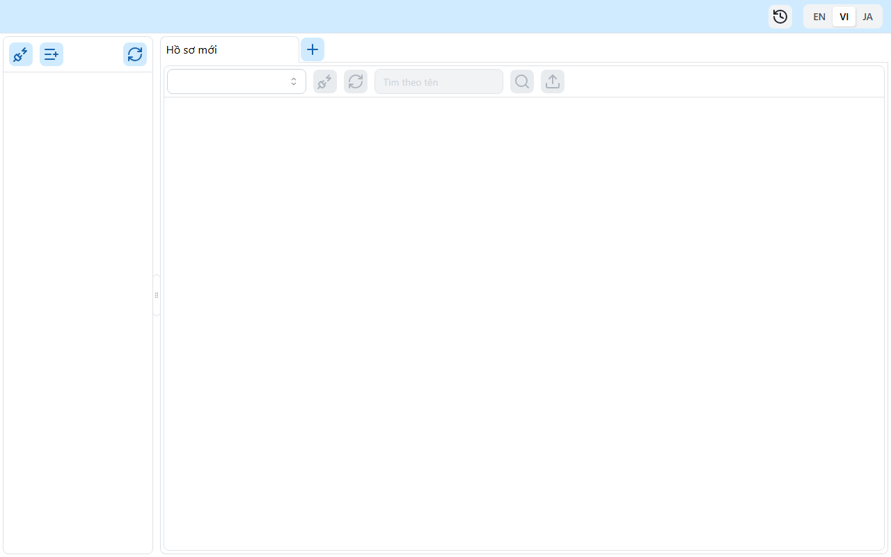
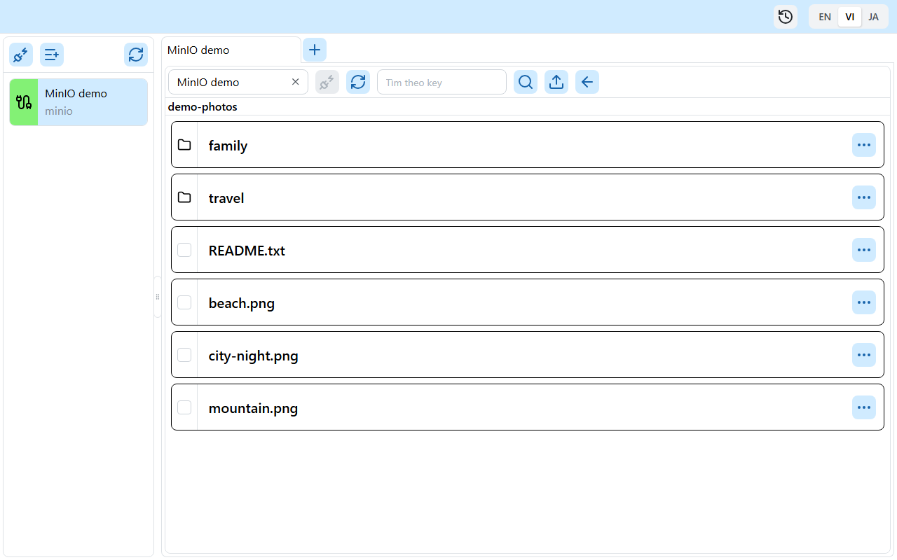
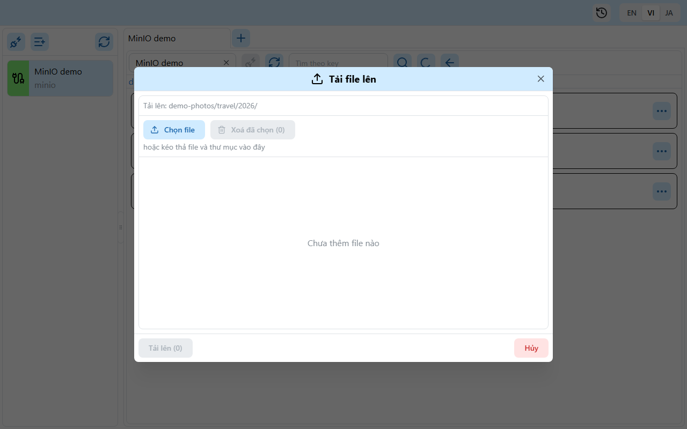

# S3Browser

[English](README.md) | **Tiếng Việt** | [日本語](README.ja.md)


S3Browser là ứng dụng desktop viết bằng **Wails v3** (backend Go, frontend React + TypeScript) để duyệt và thao tác với bucket/object trên **AWS S3** và các máy chủ tương thích S3 như **MinIO**.



## Tính năng

- Lưu hồ sơ kết nối (secret được mã hoá khi lưu) và kết nối nhiều tài khoản cùng lúc, mỗi kết nối một tab.
- Hỗ trợ AWS S3 và MinIO (endpoint tuỳ chỉnh, region, path style).
- Duyệt bucket, thư mục và object với danh sách phân trang.
- Tìm kiếm bucket và object, kết quả phân trang.
- Xem chi tiết object.
- Tải lên file và thư mục bằng hộp thoại hoặc kéo thả, có giới hạn và cửa sổ tiến độ theo thời gian thực.
- Tải xuống một hoặc nhiều object (tải song song theo từng đoạn), có cửa sổ tiến độ, huỷ và lịch sử tải xuống được lưu lại.
- Xoá object và thư mục (có xác nhận).
- Giao diện tiếng Anh, tiếng Việt và tiếng Nhật.
- Bản portable chạy không cần cài đặt.

| Object | Tải lên |
| --- | --- |
|  |  |

## Yêu cầu hệ thống

- Windows 10/11 (x64) có [WebView2 Runtime](https://developer.microsoft.com/microsoft-edge/webview2/). Bản portable đã kèm WebView2 riêng.
- macOS và Linux: build từ source. Các nền tảng này chưa được kiểm tra.

## Cài đặt

Tạo file như hướng dẫn ở mục [Build từ source](#build-từ-source).

- **Bản cài đặt (NSIS)**: `go tool wails3 task package` tạo ra `build/windows/nsis/S3Browser-installer.exe`. Chạy file này và làm theo các bước.
- **Bản portable**: `go tool wails3 task build:portable WEBVIEW2_DIR=<thư mục>` tạo thư mục `build/bin/S3Browser-portable` gồm `S3Browser.exe`, `data/` và `webview2/`. Sao chép thư mục đến nơi bất kỳ rồi chạy `S3Browser.exe`. Toàn bộ dữ liệu nằm trong `data/` cạnh file exe và ứng dụng dùng WebView2 Fixed Version trong `webview2/`. Đừng tách các thư mục này khỏi file exe.

## Build từ source

Yêu cầu:

- [Go](https://go.dev/dl/) 1.27 trở lên (xem `go.mod`). Wails, sqlc và golangci-lint được khai báo là Go tool trong `go.mod` nên không cần cài riêng.
- [bun](https://bun.sh/) cho frontend.
- [NSIS](https://nsis.sourceforge.io/) (`makensis`) để tạo bản cài đặt.
- WebView2 Fixed Version (file CAB đã giải nén từ Microsoft) để tạo bản portable.
- [Node.js](https://nodejs.org/) chỉ để sinh tài liệu.

Các lệnh, chạy ở thư mục gốc `App/S3Browser` trừ khi có ghi chú:

```bash
# Cài dependency frontend
bun install --cwd frontend

# Sinh bindings TypeScript (sau khi đổi handler hoặc model Go)
go tool wails3 generate bindings -clean=true -ts

# Chạy chế độ phát triển
go tool wails3 task dev

# Tạo bản cài đặt Windows
go tool wails3 task package

# Tạo bản portable (WEBVIEW2_DIR chứa msedgewebview2.exe)
go tool wails3 task build:portable WEBVIEW2_DIR=C:/path/to/webview2
```

Lint và test (chạy trong `frontend/`; trên Windows dùng `.exe`, ví dụ `node_modules/.bin/biome.exe`):

```bash
node_modules/.bin/biome check src
npx oxlint src
node_modules/.bin/tsc --noEmit
node_modules/.bin/vitest run
```

Backend (ở thư mục gốc):

```bash
go build ./...
go vet ./...
go tool golangci-lint run ./...
```

Sinh PDF hướng dẫn sử dụng (en, vi, ja):

```bash
bun install --cwd docs
(cd docs && bunx playwright install chromium)
bun run --cwd docs build:pdf
```

## Cấu trúc thư mục

```
main.go            Điểm vào của app Wails, đăng ký service
internal/          Backend Go: handlers, modules (bucket, profile, master, global), pkg (db, logger, portable...)
models/            Model input/output dùng chung với frontend
frontend/          Giao diện React 19 + TypeScript (src, bindings do Wails sinh)
build/             Tài nguyên build Wails và Taskfile theo nền tảng (windows, darwin)
docs/              Tài liệu kiến trúc, hướng dẫn sử dụng, công cụ tạo PDF
sprints/           Yêu cầu và plan theo từng sprint
```

- Kiến trúc: [docs/ARCHITECTURE.vi.md](docs/ARCHITECTURE.vi.md)
- Hướng dẫn sử dụng (PDF): [docs/user-guide/vi/S3Browser-user-guide.vi.pdf](docs/user-guide/vi/S3Browser-user-guide.vi.pdf), bản nguồn [user-guide.md](docs/user-guide/vi/user-guide.md)
- [Nhật ký thay đổi](CHANGELOG.vi.md)

## Đóng góp

Mở issue để trao đổi về lỗi hoặc ý tưởng, sau đó gửi pull request. Trước khi gửi, hãy chạy các lệnh lint và test ở trên và đảm bảo đều đạt. Viết commit message theo [Conventional Commits](https://www.conventionalcommits.org/) (ví dụ `feat(bucket): add object search`). Xem [CLAUDE.md](CLAUDE.md) để biết quy ước code.

## Giấy phép

[MIT](LICENSE) (c) 2026 minh-truyen
