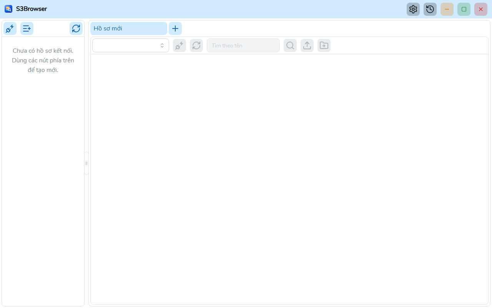
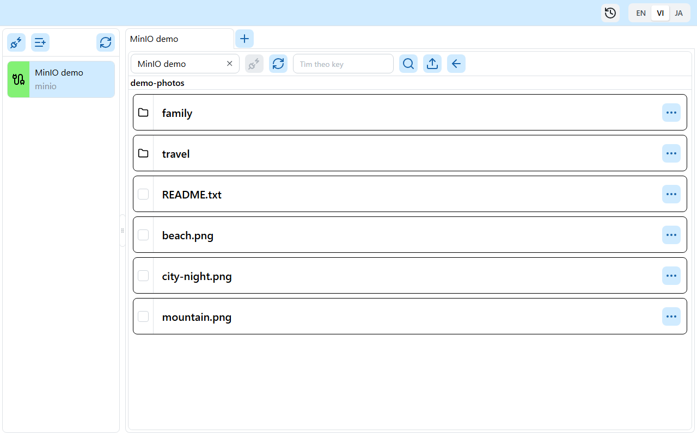
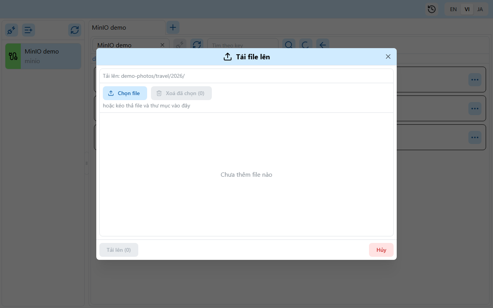
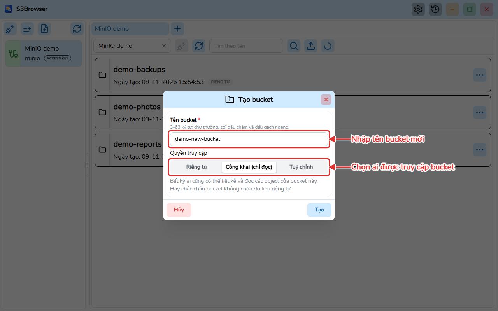
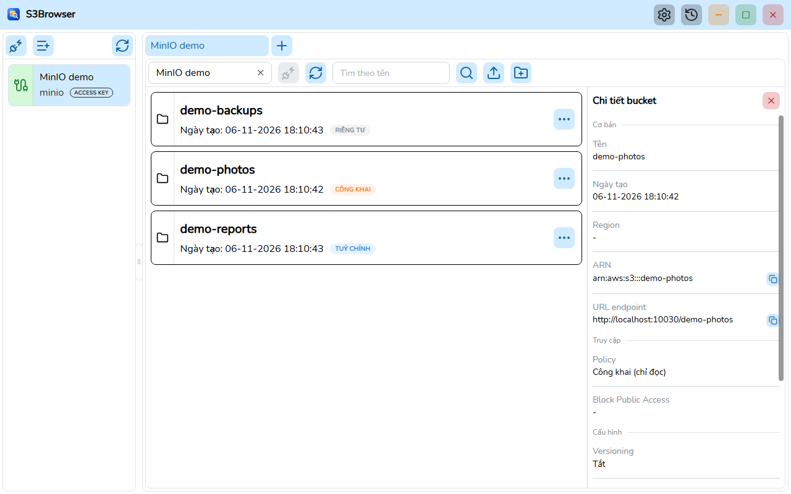

# S3Browser

[English](README.md) | **Tiếng Việt** | [日本語](README.ja.md) | [简体中文](README.zh-CN.md) | [繁體中文](README.zh-TW.md) | [Русский](README.ru.md) | [Deutsch](README.de.md)


S3Browser là ứng dụng desktop viết bằng **Wails v3** (backend Go, frontend React + TypeScript) để duyệt và thao tác với bucket/object trên **AWS S3** và các máy chủ tương thích S3 như **MinIO**.



## Tính năng

- Lưu hồ sơ kết nối (secret được mã hoá khi lưu) và kết nối nhiều tài khoản cùng lúc, mỗi kết nối một tab. Có thể kéo thả để đổi vị trí tab, và các tab được ghi nhớ giữa các lần mở app.
- Xuất hồ sơ kết nối ra tệp JSON và nhập lại trên máy tính khác. Secret là tuỳ chọn; nếu có kèm theo thì được mã hoá bằng mật khẩu bạn chọn.
- Hỗ trợ AWS S3 và MinIO (endpoint tuỳ chỉnh, region, path style) với nhiều phương thức xác thực: access key, AWS CLI profile, assume role (kèm MFA), AWS SSO, default credential chain, ẩn danh, MinIO STS, LDAP, OpenID Connect (OIDC) và chứng chỉ client TLS. Có thể đặt thêm file chứng chỉ CA cho máy chủ MinIO dùng chứng chỉ tự ký.
- Duyệt bucket, thư mục và object với danh sách phân trang và virtualize; tìm kiếm bucket và object.
- Xem chi tiết bucket (region, ARN, policy, Block Public Access, versioning, mã hoá, Object Lock, tag) và chi tiết object.
- Tạo bucket kèm quyền (riêng tư, công khai chỉ đọc hoặc policy JSON tuỳ chỉnh), sửa quyền sau đó, và xoá bucket (kể cả object và version bên trong). Badge trên mỗi bucket cho biết loại policy.
- Tải lên file và thư mục bằng hộp thoại hoặc kéo thả, có giới hạn và cửa sổ tiến độ theo thời gian thực.
- Tải xuống một hoặc nhiều object (tải song song theo từng đoạn), có cửa sổ tiến độ, huỷ và lịch sử tải xuống được lưu lại.
- Xoá object và thư mục (có xác nhận).
- **Chế độ SQL** (nút chuyển S3 / SQL trên thanh tiêu đề): mở file database SQLite, xem bảng, view, index và trigger trong cây đối tượng, chạy SQL ở nhiều tab (editor có Tìm và thay thế, huỷ câu lệnh đang chạy), xem kết quả lớn theo từng trang, xem cấu trúc và dữ liệu của bảng. Bộ xử lý database là thư viện Rust native để chạy nhanh. Các database khác (PostgreSQL, MySQL, MariaDB, SQL Server, MongoDB, Redis) đang được phát triển.
- Hộp thoại Cài đặt: giao diện (sáng / tối / theo hệ thống), phông chữ, cỡ giao diện (nhỏ / vừa / lớn), ngôn ngữ và khởi động cùng Windows; lưu trong `settings.json` và được nạp trước khi hiện giao diện.
- Giao diện tiếng Anh, tiếng Việt, tiếng Nhật, tiếng Trung giản thể, tiếng Trung phồn thể, tiếng Nga và tiếng Đức.
- Tự động cập nhật từ GitHub Releases (bản cài đặt trên Windows), có kênh beta tuỳ chọn.
- Bản portable chạy không cần cài đặt.

| Object | Tải lên |
| --- | --- |
|  |  |

| Tạo bucket kèm quyền | Chi tiết bucket |
| --- | --- |
|  |  |

## Yêu cầu hệ thống

- Windows 10/11 (x64) có [WebView2 Runtime](https://developer.microsoft.com/microsoft-edge/webview2/). Bản portable đã kèm WebView2 riêng.

## Cài đặt

Tải bản cài đặt từ trang [GitHub Releases](https://github.com/TranMinhTruyen/s3-browser/releases):

- Bản **Latest**: bản ổn định, build từ `master`.
- Bản **Pre-release**: bản beta, build từ `staging`.

Chạy `S3Browser-<phiên bản>-windows-amd64-installer.exe` và làm theo các bước. Mỗi bản phát hành còn có `checksums.txt` (SHA-256) để kiểm tra file đã tải. Ứng dụng đã cài tự kiểm tra cập nhật và có thể chuyển sang kênh beta trong Cài đặt.

Bản portable không được phát hành sẵn: hãy build từ source (xem [Build từ source](#build-từ-source)).

- **Bản cài đặt (NSIS)**: `go tool wails3 task package` tạo ra `build/bin/S3Browser-amd64-installer.exe`.
- **Bản portable**: `go tool wails3 task build:portable WEBVIEW2_DIR=<thư mục>` tạo thư mục `build/bin/S3Browser-portable` gồm `S3Browser.exe`, `data/` và `webview2/`. Sao chép thư mục đến nơi bất kỳ rồi chạy `S3Browser.exe`. Toàn bộ dữ liệu nằm trong `data/` cạnh file exe và ứng dụng dùng WebView2 Fixed Version trong `webview2/`. Đừng tách các thư mục này khỏi file exe. Bản portable không tự cập nhật.

## Build từ source

Yêu cầu:

- [Go](https://go.dev/dl/) 1.27 trở lên (xem `go.mod`). Wails, sqlc và golangci-lint được khai báo là Go tool trong `go.mod` nên không cần cài riêng.
- [bun](https://bun.sh/) cho frontend.
- [Rust](https://rustup.rs/) bản stable với target `x86_64-pc-windows-msvc`, và [Visual Studio Build Tools](https://visualstudio.microsoft.com/visual-cpp-build-tools/) (workload C++) để build thư viện database native `s3b_db.dll`. `setup/setup-project.sh` cài các thứ này, cùng với Go và bun; trên máy mới script còn cài Docker Desktop, Chromium cho Playwright và package của frontend, docs, build app và bản server cho E2E, rồi bật môi trường test (`test-env/docker-compose.yml`). Tắt từng bước bằng `SETUP_E2E=0`, `SETUP_TEST_ENV=0`, `SETUP_GRAPHIFY=0`.
- [NSIS](https://nsis.sourceforge.io/) (`makensis`) để tạo bản cài đặt.
- WebView2 Fixed Version (file CAB đã giải nén từ Microsoft) để tạo bản portable.
- [Node.js](https://nodejs.org/) chỉ để sinh tài liệu.

Các lệnh, chạy ở gốc repo trừ khi có ghi chú:

```bash
# Cài dependency frontend
bun install --cwd frontend

# Sinh bindings TypeScript (sau khi đổi handler hoặc model Go; bắt buộc có tag wailsgen)
go tool wails3 generate bindings -f "-tags=wailsgen" -clean=true -ts

# Chạy chế độ phát triển (đồng thời build s3b_db.dll từ rust/ và copy vào cạnh exe)
go tool wails3 task dev

# Tạo bản cài đặt Windows
go tool wails3 task package

# Tạo bản portable (WEBVIEW2_DIR chứa msedgewebview2.exe)
go tool wails3 task build:portable WEBVIEW2_DIR=C:/path/to/webview2
```

Lint và test (chạy trong `frontend/`; trên Windows dùng `.exe`, ví dụ `node_modules/.bin/biome.exe`):

```bash
node_modules/.bin/biome check src
npx oxlint src
node_modules/.bin/tsc --noEmit
node_modules/.bin/vitest run
```

Backend (ở thư mục gốc):

```bash
go build ./...
go vet ./...
go tool golangci-lint run ./...
```

Thư viện native (trong `rust/`):

```bash
cargo fmt --check
cargo clippy --target x86_64-pc-windows-msvc --all-targets -- -D warnings
cargo test
```

Test end-to-end (Playwright, trong `frontend/`, chỉ chạy local, không chạy trên CI): điều khiển app thật ở server mode (backend Go và `s3b_db.dll`) bằng Chromium. Mỗi lần chạy, app được chép vào `frontend/e2e/.run/` nên profile và cài đặt của bạn không bị đụng tới. Test SQL và Settings không cần gì thêm; test S3 cần một server S3/MinIO (ví dụ `test-env/docker-compose.yml`) và tự bỏ qua khi chưa đặt các biến `E2E_S3_*`. Console trình duyệt có warning hay error thì test fail. Báo cáo HTML và trace khi fail nằm trong `frontend/e2e/.run/`.

```bash
bun run e2e:build
E2E_S3_ENDPOINT=http://localhost:10010 E2E_S3_ACCESS_KEY=<access key> E2E_S3_SECRET_KEY=<secret key> bun run e2e
```

Sinh PDF hướng dẫn sử dụng (mỗi ngôn ngữ có `user-guide.md` được một PDF):

```bash
bun install --cwd docs
(cd docs && bunx playwright install chromium)
bun run --cwd docs build:pdf
```

## Cấu trúc thư mục

```
main.go            Điểm vào của app Wails, đăng ký service
internal/          Backend Go: handlers, modules (bucket, db, profile, master, global, setting, update), pkg (db, logger, portable...)
models/            Model input/output dùng chung với frontend
rust/              Thư viện database native s3b_db.dll (Rust), được internal/modules/db gọi không qua cgo
frontend/          Giao diện React 19 + TypeScript (src/pages/s3 chứa view S3 (bucket và object), src/pages/sql chứa view SQL, bindings do Wails sinh)
build/             Tài nguyên build Wails và Taskfile theo nền tảng (windows)
docs/              Tài liệu kiến trúc, hướng dẫn sử dụng, công cụ tạo PDF và chụp ảnh màn hình
test-env/          Server test bằng Docker (MinIO, Keycloak, LDAP, database) và script đo hiệu năng
sprints/           Yêu cầu và plan theo từng sprint
```

- Kiến trúc: [docs/ARCHITECTURE.vi.md](docs/ARCHITECTURE.vi.md) (mục 2.11 giải thích Go gọi thư viện Rust thế nào)
- Hướng dẫn sử dụng (PDF): [docs/user-guide/vi/S3Browser-user-guide.vi.pdf](docs/user-guide/vi/S3Browser-user-guide.vi.pdf), bản nguồn [user-guide.md](docs/user-guide/vi/user-guide.md)
- [Nhật ký thay đổi](CHANGELOG.vi.md)

## Đóng góp

Mở issue để trao đổi về lỗi hoặc ý tưởng, sau đó gửi pull request. Trước khi gửi, hãy chạy các lệnh lint và test ở trên và đảm bảo đều đạt. Viết commit message theo [Conventional Commits](https://www.conventionalcommits.org/) (ví dụ `feat(bucket): add object search`). Xem [CLAUDE.md](CLAUDE.md) để biết quy ước code.

## Giấy phép

[MIT](LICENSE) (c) 2026 minh-truyen
