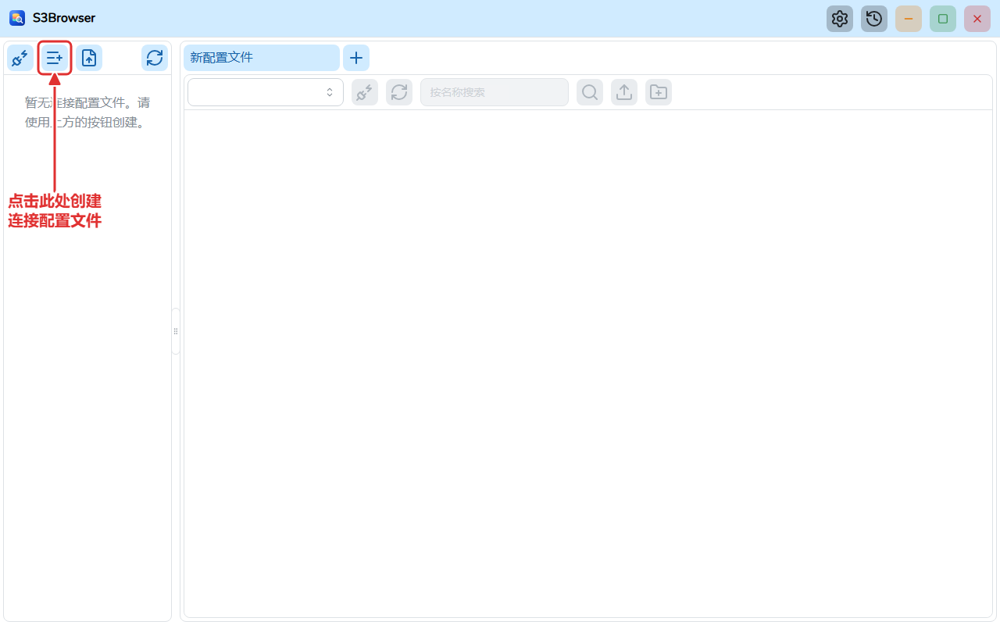
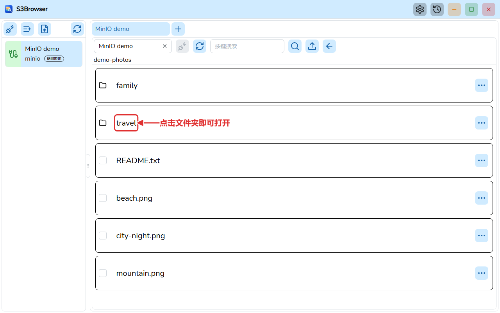
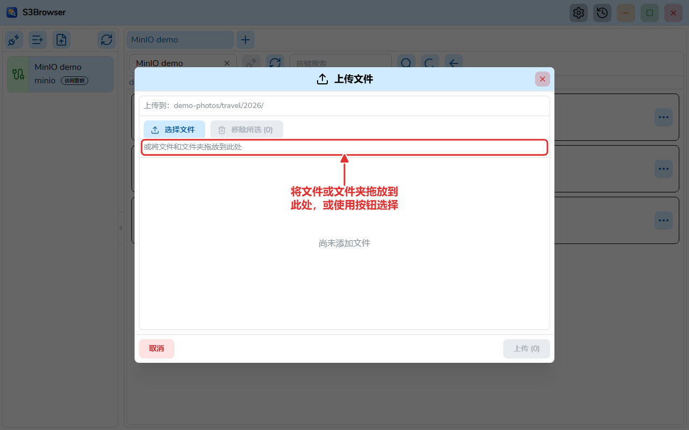
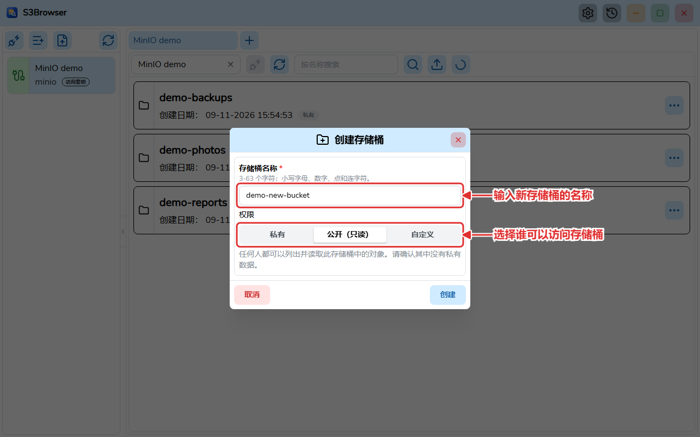
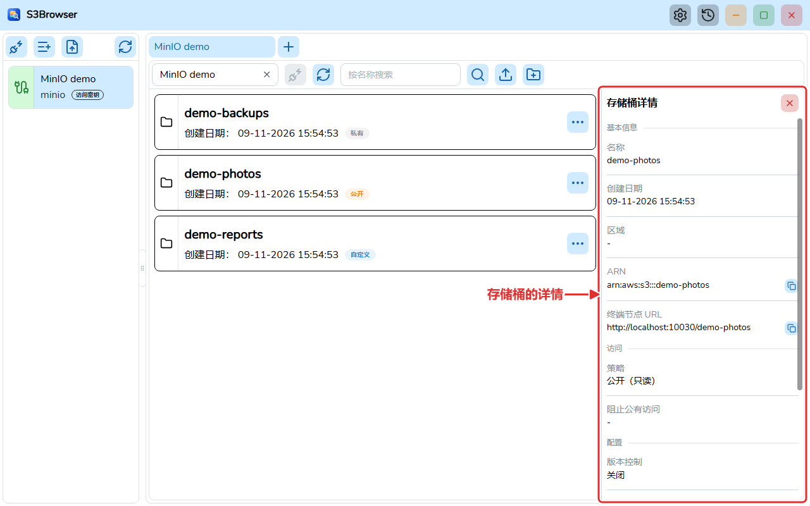

# S3Browser

[English](README.md) | [Tiếng Việt](README.vi.md) | [日本語](README.ja.md) | **简体中文** | [繁體中文](README.zh-TW.md) | [Русский](README.ru.md) | [Deutsch](README.de.md)


S3Browser 是一款使用 **Wails v3**（Go 后端，React + TypeScript 前端）构建的桌面应用程序，用于浏览和管理 **AWS S3** 以及 **MinIO** 等兼容 S3 的服务器上的存储桶和对象。

> 本译文尚未经过母语人士审校。



## 功能

- 保存连接配置文件（密钥加密存储），并可同时连接多个账户，每个连接一个标签页。标签页可通过拖放重新排序，并在下次启动时恢复。
- 可将连接配置文件导出为 JSON 文件，并在另一台计算机上导入。密钥为可选项；包含时会用你选择的密码加密。
- 支持 AWS S3 和 MinIO（自定义终端节点、区域、Path style），提供多种身份验证方式：访问密钥、AWS CLI 配置文件、担任角色（支持 MFA）、AWS SSO、默认凭证链、匿名、MinIO STS、LDAP、OpenID Connect (OIDC) 和 TLS 客户端证书。对于使用自签名证书的 MinIO 服务器，可额外指定 CA 证书文件。
- 通过分页、虚拟化的列表浏览存储桶、文件夹和对象；搜索存储桶和对象。
- 查看存储桶（区域、ARN、策略、阻止公有访问、版本控制、加密、对象锁定、标签）和对象的详情。
- 创建存储桶时指定权限（私有、公开只读或自定义 JSON 策略），之后可修改权限，并可删除存储桶（包括其中的对象和版本）。每个存储桶上的徽章显示其策略类型。
- 通过对话框或拖放上传文件和文件夹，有上限限制和实时进度窗口。
- 下载一个或多个对象，支持并行分段下载、进度窗口、取消和持久保存的下载历史。
- 删除对象和文件夹（需确认）。
- 设置对话框：主题（浅色 / 深色 / 跟随系统）、字体、语言和随 Windows 启动；保存在 `settings.json` 中，并在界面出现前加载。
- 界面支持英语、越南语、日语、简体中文、繁体中文、俄语和德语。
- 通过 GitHub Releases 自动更新（Windows 安装版），可选择接收测试版。
- 无需安装即可运行的便携版。

| 对象 | 上传 |
| --- | --- |
|  |  |

| 创建带权限的存储桶 | 存储桶详情 |
| --- | --- |
|  |  |

## 系统要求

- Windows 10/11 (x64)，并安装 [WebView2 Runtime](https://developer.microsoft.com/microsoft-edge/webview2/)。便携版自带 WebView2。

## 安装

从 [GitHub Releases](https://github.com/TranMinhTruyen/s3-browser/releases) 页面下载安装程序：

- **Latest** 版本：稳定版，从 `master` 构建。
- **Pre-release**：测试版，从 `staging` 构建。

运行 `S3Browser-<version>-windows-amd64-installer.exe` 并按步骤操作。每个发布版本还附带 `checksums.txt` (SHA-256)，用于校验下载。已安装的应用会自行检查更新，并可在设置中切换到测试版通道。

便携版不对外发布：请从源码构建（见[从源码构建](#从源码构建)）。

- **安装程序 (NSIS)**：`go tool wails3 task package` 会创建 `build/bin/S3Browser-amd64-installer.exe`。
- **便携版**：`go tool wails3 task build:portable WEBVIEW2_DIR=<folder>` 会创建文件夹 `build/bin/S3Browser-portable`，其中包含 `S3Browser.exe`、`data/` 和 `webview2/`。将该文件夹复制到任意位置并运行 `S3Browser.exe`。所有数据都保存在 exe 旁边的 `data/` 中，并使用 `webview2/` 中的 WebView2 Fixed Version 运行时。请勿将这些文件夹从 exe 旁移走。便携版不会自动更新。

## 从源码构建

前置条件：

- [Go](https://go.dev/dl/) 1.27 或更高版本（见 `go.mod`）。Wails、sqlc 和 golangci-lint 已在 `go.mod` 中声明为 Go 工具，因此无需另外安装。
- 前端使用 [bun](https://bun.sh/)。
- 构建安装程序需要 [NSIS](https://nsis.sourceforge.io/) (`makensis`)。
- 构建便携包需要 WebView2 Fixed Version（Microsoft 提供的 CAB 解压后的内容）。
- 仅生成文档时需要 [Node.js](https://nodejs.org/)。

命令（除非另有说明，均在仓库根目录运行）：

```bash
# Install frontend dependencies
bun install --cwd frontend

# Generate the TypeScript bindings (after changing Go handlers or models)
go tool wails3 generate bindings -clean=true -ts

# Run in development mode
go tool wails3 task dev

# Build the Windows installer
go tool wails3 task package

# Build the portable package (WEBVIEW2_DIR contains msedgewebview2.exe)
go tool wails3 task build:portable WEBVIEW2_DIR=C:/path/to/webview2
```

Lint 和测试（在 `frontend/` 中运行；在 Windows 上使用 `.exe`，例如 `node_modules/.bin/biome.exe`）：

```bash
node_modules/.bin/biome check src
npx oxlint src
node_modules/.bin/tsc --noEmit
node_modules/.bin/vitest run
```

后端（在项目根目录）：

```bash
go build ./...
go vet ./...
go tool golangci-lint run ./...
```

生成用户指南 PDF（每种有 `user-guide.md` 的语言一个）：

```bash
bun install --cwd docs
(cd docs && bunx playwright install chromium)
bun run --cwd docs build:pdf
```

## 项目结构

```
main.go            Wails app entry, registers services
internal/          Go backend: handlers, modules (bucket, profile, master, global, setting, update), pkg (db, logger, portable...)
models/            Input/output models shared with the frontend
frontend/          React 19 + TypeScript UI (src/pages/tab holds the tab page with the bucket and object views, bindings generated by Wails)
build/             Wails build assets and platform Taskfiles (windows)
docs/              Architecture notes, user guide, tools to build the PDFs and take the screenshots
sprints/           Requirements and plans per sprint
```

- 架构：[docs/ARCHITECTURE.md](docs/ARCHITECTURE.md)（英文）
- 用户指南 (PDF)：[docs/user-guide/zh-CN/S3Browser-user-guide.zh-CN.pdf](docs/user-guide/zh-CN/S3Browser-user-guide.zh-CN.pdf)，源文件 [user-guide.md](docs/user-guide/zh-CN/user-guide.md)
- [变更日志](CHANGELOG.md)（英文）

## 参与贡献

请先开一个 issue 讨论 bug 或想法，然后再提交 pull request。提交前请运行上面的 lint 和测试命令并确保通过。提交信息请使用 [Conventional Commits](https://www.conventionalcommits.org/)（例如 `feat(bucket): add object search`）。代码规范见 [CLAUDE.md](CLAUDE.md)。

## 许可证

[MIT](LICENSE) (c) 2026 minh-truyen
