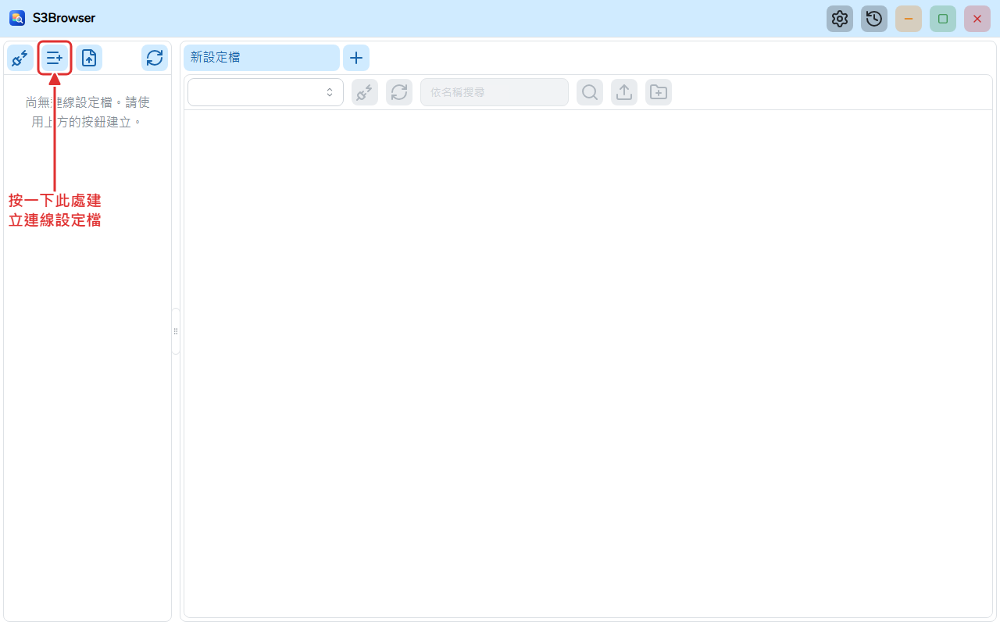
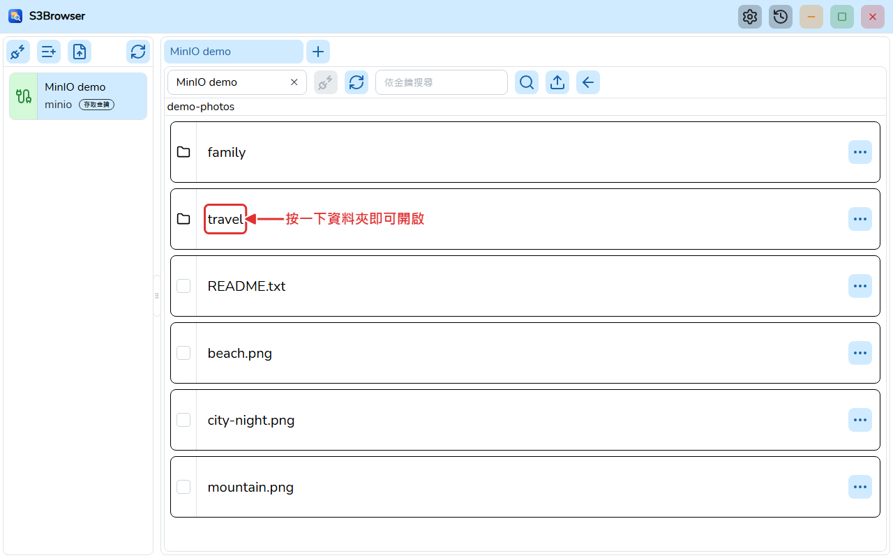
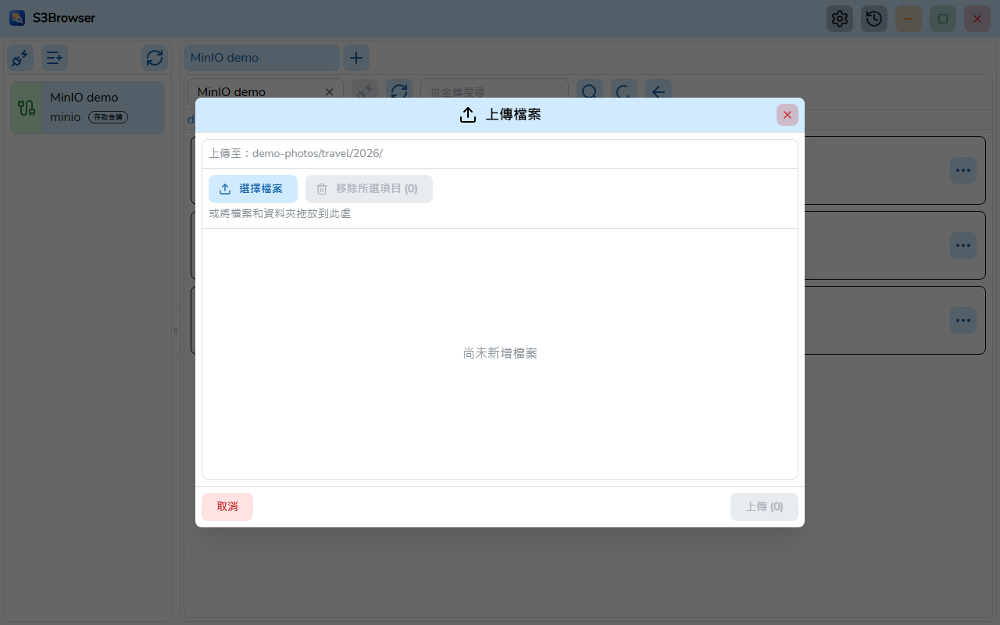
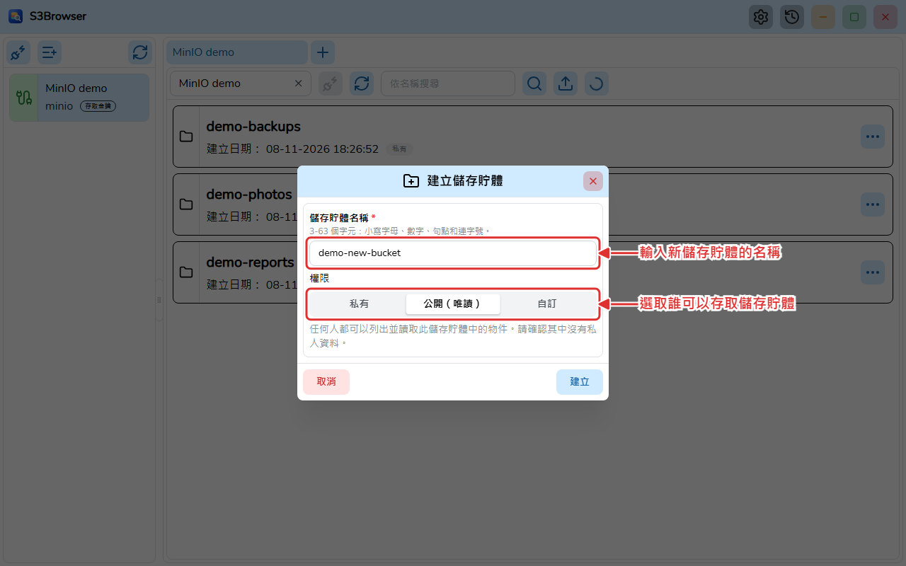
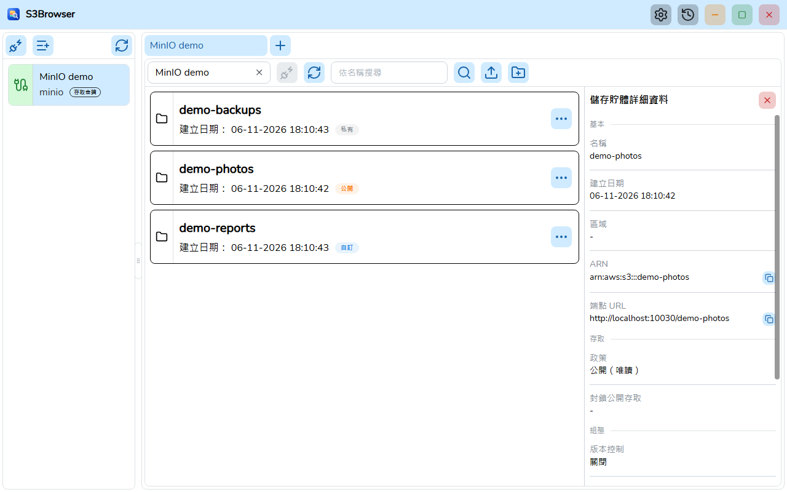

# S3Browser

[English](README.md) | [Tiếng Việt](README.vi.md) | [日本語](README.ja.md) | [简体中文](README.zh-CN.md) | **繁體中文** | [Русский](README.ru.md) | [Deutsch](README.de.md)


S3Browser 是一款使用 **Wails v3**（Go 後端，React + TypeScript 前端）建置的桌面應用程式，用於瀏覽和管理 **AWS S3** 以及 **MinIO** 等相容 S3 的伺服器上的儲存貯體和物件。

> 本譯文尚未經過母語人士審校。



## 功能

- 儲存連線設定檔（金鑰加密儲存），並可同時連線多個帳戶，每個連線一個索引標籤。索引標籤可透過拖放重新排序，並在下次啟動時還原。
- 可將連線設定檔匯出為 JSON 檔案，並在另一台電腦上匯入。金鑰為選用項目；包含時會以您選擇的密碼加密。
- 支援 AWS S3 和 MinIO（自訂端點、區域、Path style），提供多種驗證方式：存取金鑰、AWS CLI 設定檔、擔任角色（支援 MFA）、AWS SSO、預設憑證鏈、匿名、MinIO STS、LDAP、OpenID Connect (OIDC) 和 TLS 用戶端憑證。對於使用自簽憑證的 MinIO 伺服器，可額外指定 CA 憑證檔案。
- 透過分頁、虛擬化的清單瀏覽儲存貯體、資料夾和物件；搜尋儲存貯體和物件。
- 檢視儲存貯體（區域、ARN、政策、封鎖公開存取、版本控制、加密、物件鎖定、標籤）和物件的詳細資料。
- 建立儲存貯體時指定權限（私有、公開唯讀或自訂 JSON 政策），之後可修改權限，並可刪除儲存貯體（包括其中的物件和版本）。每個儲存貯體上的徽章顯示其政策類型。
- 透過對話方塊或拖放上傳檔案和資料夾，有上限限制和即時進度視窗。
- 下載一個或多個物件，支援平行分段下載、進度視窗、取消和持久保存的下載記錄。
- 刪除物件和資料夾（需確認）。
- **SQL 模式**（標題列中的 S3 / SQL 切換）：開啟 SQLite 資料庫檔案，在物件樹中瀏覽資料表、檢視、索引和觸發程序，在多個分頁中執行 SQL（編輯器支援尋找和取代，可取消執行中的查詢），分頁檢視大型結果，並檢視資料表的結構和資料。資料庫引擎是原生 Rust 程式庫，速度快。其他資料庫（PostgreSQL、MySQL、MariaDB、SQL Server、MongoDB、Redis）正在開發中。
- 設定對話方塊：佈景主題（淺色 / 深色 / 跟隨系統）、字型、介面大小（小 / 中 / 大）、語言和隨 Windows 啟動；儲存在 `settings.json` 中，並在介面出現前載入。
- 介面支援英文、越南文、日文、簡體中文、繁體中文、俄文和德文。
- 透過 GitHub Releases 自動更新（Windows 安裝版），可選擇接收測試版。
- 無需安裝即可執行的可攜版。

| 物件 | 上傳 |
| --- | --- |
|  |  |

| 建立帶權限的儲存貯體 | 儲存貯體詳細資料 |
| --- | --- |
|  |  |

## 系統需求

- Windows 10/11 (x64)，並安裝 [WebView2 Runtime](https://developer.microsoft.com/microsoft-edge/webview2/)。可攜版自帶 WebView2。

## 安裝

從 [GitHub Releases](https://github.com/TranMinhTruyen/s3-browser/releases) 頁面下載安裝程式：

- **Latest** 版本：穩定版，從 `master` 建置。
- **Pre-release**：測試版，從 `staging` 建置。

執行 `S3Browser-<version>-windows-amd64-installer.exe` 並依步驟操作。每個發行版本還附帶 `checksums.txt` (SHA-256)，用於驗證下載。已安裝的應用程式會自行檢查更新，並可在設定中切換到測試版通道。

可攜版不對外發布：請從原始碼建置（請參閱[從原始碼建置](#從原始碼建置)）。

- **安裝程式 (NSIS)**：`go tool wails3 task package` 會建立 `build/bin/S3Browser-amd64-installer.exe`。
- **可攜版**：`go tool wails3 task build:portable WEBVIEW2_DIR=<folder>` 會建立資料夾 `build/bin/S3Browser-portable`，其中包含 `S3Browser.exe`、`data/` 和 `webview2/`。將該資料夾複製到任何位置並執行 `S3Browser.exe`。所有資料都儲存在 exe 旁邊的 `data/` 中，並使用 `webview2/` 中的 WebView2 Fixed Version 執行階段。請勿將這些資料夾從 exe 旁移走。可攜版不會自動更新。

## 從原始碼建置

先決條件：

- [Go](https://go.dev/dl/) 1.27 或更新版本（請參閱 `go.mod`）。Wails、sqlc 和 golangci-lint 已在 `go.mod` 中宣告為 Go 工具，因此無需另外安裝。
- 前端使用 [bun](https://bun.sh/)。
- 含 `x86_64-pc-windows-msvc` 目標的 [Rust](https://rustup.rs/) stable，以及 [Visual Studio Build Tools](https://visualstudio.microsoft.com/visual-cpp-build-tools/)（C++ 工作負載），用於建置原生資料庫程式庫 `s3b_db.dll`。`setup/setup-project.sh` 會安裝它們，以及 Go 和 bun；在新電腦上它還會安裝 Docker Desktop、Playwright 用的 Chromium 以及 frontend 和 docs 的套件，建置應用程式和 E2E 用的伺服器版本，並啟動測試環境（`test-env/docker-compose.yml`）。可用 `SETUP_E2E=0`、`SETUP_TEST_ENV=0`、`SETUP_GRAPHIFY=0` 關閉對應步驟。
- 建置安裝程式需要 [NSIS](https://nsis.sourceforge.io/) (`makensis`)。
- 建置可攜套件需要 WebView2 Fixed Version（Microsoft 提供的 CAB 解壓縮後的內容）。
- 僅產生文件時需要 [Node.js](https://nodejs.org/)。

指令（除非另有說明，均在存放庫根目錄執行）：

```bash
# Install frontend dependencies
bun install --cwd frontend

# Generate the TypeScript bindings (after changing Go handlers or models; the wailsgen tag is required)
go tool wails3 generate bindings -f "-tags=wailsgen" -clean=true -ts

# Run in development mode (also builds s3b_db.dll from rust/ and copies it next to the exe)
go tool wails3 task dev

# Build the Windows installer
go tool wails3 task package

# Build the portable package (WEBVIEW2_DIR contains msedgewebview2.exe)
go tool wails3 task build:portable WEBVIEW2_DIR=C:/path/to/webview2
```

Lint 和測試（在 `frontend/` 中執行；在 Windows 上使用 `.exe`，例如 `node_modules/.bin/biome.exe`）：

```bash
node_modules/.bin/biome check src
npx oxlint src
node_modules/.bin/tsc --noEmit
node_modules/.bin/vitest run
```

後端（在專案根目錄）：

```bash
go build ./...
go vet ./...
go tool golangci-lint run ./...
```

原生程式庫（在 `rust/` 中執行）：

```bash
cargo fmt --check
cargo clippy --target x86_64-pc-windows-msvc --all-targets -- -D warnings
cargo test
```

端對端測試（Playwright，在 `frontend/` 中執行，僅限本機，不在 CI 中執行）：以 Chromium 操作伺服器模式下的實際應用程式（Go 後端和 `s3b_db.dll`）。每次執行都會把應用程式複製到 `frontend/e2e/.run/`，因此不會影響你自己的設定檔和設定。SQL 和設定測試不需額外準備；S3 測試需要一台 S3/MinIO 伺服器（例如 `test-env/docker-compose.yml`），未設定 `E2E_S3_*` 變數時會略過。瀏覽器主控台出現警告或錯誤時測試失敗。HTML 報告和失敗時的 trace 位於 `frontend/e2e/.run/`。

```bash
bun run e2e:build
E2E_S3_ENDPOINT=http://localhost:10010 E2E_S3_ACCESS_KEY=<access key> E2E_S3_SECRET_KEY=<secret key> bun run e2e
```

產生使用者指南 PDF（每種有 `user-guide.md` 的語言一個）：

```bash
bun install --cwd docs
(cd docs && bunx playwright install chromium)
bun run --cwd docs build:pdf
```

## 專案結構

```
main.go            Wails app entry, registers services
internal/          Go backend: handlers, modules (bucket, db, profile, master, global, setting, update), pkg (db, logger, portable...)
models/            Input/output models shared with the frontend
rust/              Native database library s3b_db.dll (Rust), called by internal/modules/db without cgo
frontend/          React 19 + TypeScript UI (src/pages/s3 holds the S3 views (bucket and object), src/pages/sql the SQL views, bindings generated by Wails)
build/             Wails build assets and platform Taskfiles (windows)
docs/              Architecture notes, user guide, tools to build the PDFs and take the screenshots
test-env/          Docker test servers (MinIO, Keycloak, LDAP, databases) and bench scripts
sprints/           Requirements and plans per sprint
```

- 架構：[docs/ARCHITECTURE.zh-TW.md](docs/ARCHITECTURE.zh-TW.md)（第 2.11 節說明 Go 如何呼叫 Rust 程式庫）
- 使用者指南 (PDF)：[docs/user-guide/zh-TW/S3Browser-user-guide.zh-TW.pdf](docs/user-guide/zh-TW/S3Browser-user-guide.zh-TW.pdf)，原始檔 [user-guide.md](docs/user-guide/zh-TW/user-guide.md)
- [變更記錄](CHANGELOG.md)（英文）

## 參與貢獻

請先開一個 issue 討論 bug 或想法，然後再提交 pull request。提交前請執行上面的 lint 和測試指令並確保通過。提交訊息請使用 [Conventional Commits](https://www.conventionalcommits.org/)（例如 `feat(bucket): add object search`）。程式碼規範請參閱 [CLAUDE.md](CLAUDE.md)。

## 授權

[MIT](LICENSE) (c) 2026 minh-truyen
