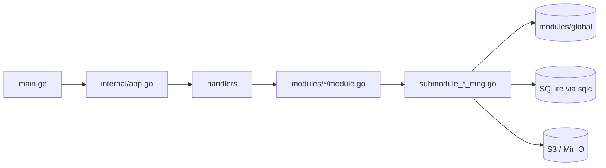

# S3Browser-Architektur

[English](ARCHITECTURE.md) | [Tiếng Việt](ARCHITECTURE.vi.md) | [日本語](ARCHITECTURE.ja.md) | [简体中文](ARCHITECTURE.zh-CN.md) | [繁體中文](ARCHITECTURE.zh-TW.md) | [Русский](ARCHITECTURE.ru.md) | [Deutsch](ARCHITECTURE.de.md)

Ein kurzer Rundgang durch den Code für neue Entwickler. Die Konventionen stehen in `CLAUDE.md`; diese Datei erklärt, wie die Teile zusammenspielen.

## 1. Stack

- Desktop-App auf Basis von **Wails v3**: Go-Backend + React-19-/TypeScript-Frontend in einer WebView.
- Backend: AWS SDK v2 (S3), `madmin-go` (MinIO-Administration), SQLite (modernc) + goose-Migrationen + sqlc, `slog`.
- Frontend: Mantine 9, zustand 5 + immer, NiceModal, i18next (7 Sprachen: en / vi / ja / zh-CN / zh-TW / ru / de), sonner (Toast), `@tanstack/react-virtual`, zod, dayjs. Paketmanager: **bun**.

```
s3-browser
├── main.go                 Einstieg: Logger, Wails-App, Services, Hauptfenster
├── internal/
│   ├── app.go              baut DB, Module und Handler auf; Shutdown
│   ├── handlers/           schlanke Wails-Services (ans Frontend gebunden)
│   ├── modules/
│   │   ├── global/         gemeinsamer Verbindungscontainer und Zugriffs-Cache
│   │   ├── profile/        Verbindungsprofile (verschlüsselte Geheimnisse)
│   │   ├── master/         Stammdaten (Regionen ...)
│   │   ├── bucket/         Verbindung, Buckets, Bucket-Richtlinie, Objekte, Upload, Download, Suche
│   │   ├── setting/        App-Einstellungen (settings.json), gemerkte Tabs (tabs.json), Autostart
│   │   └── update/         Selbstaktualisierung über GitHub Releases
│   └── pkg/                cnst, db (schemas, queries, sqlc), logger, portable, utils
├── models/                 Ein-/Ausgabemodelle + alias.go
├── frontend/
│   ├── bindings/           GENERIERTE Wails-Bindings (nicht bearbeiten)
│   └── src/                common, components, pages (pages/tab), locales, test
├── build/                  Paketierung je Plattform (Windows NSIS, portable, ...)
└── docs/                   diese Dokumentation + PDF-Werkzeuge
```

## 2. Backend

### 2.1 Schichten



- `main.go` erstellt den Logger und die Wails-App, registriert die fünf Handler (bucket, master, profile, setting, update) mit `application.NewService` und erstellt das Hauptfenster (`EnableFileDrop: true`).
- `internal/app.go` (`NewApp`) öffnet und migriert die Datenbank, erstellt den `KeyManager` (Verschlüsselung von Geheimnissen), baut die Module und darauf die Handler auf. `Shutdown` bricht Übertragungen ab, trennt alle Verbindungen und schließt die DB.
- **Handler** (`internal/handlers/*_handler.go`) sind schlank: Sie rufen nur das Modul auf. Ihre öffentlichen Methoden werden zu den TypeScript-Bindings.
- **Module** (`internal/modules/<name>/module.go`) stellen die dokumentierte öffentliche API bereit. Die Arbeit ist auf nicht exportierte Submodule (`submoduleXxxMng`, Konstruktor `newSubmoduleXxxMng`) in `submodule_<x>_mng.go` aufgeteilt.

### 2.2 Ausgabe und Meldungscodes

Jeder Handler gibt `models.Output[T]` (`Result`, `MessageList`, `Body`) zurück.

```go
output := models.NewOutput[T]()
output.AddMessage(msg)             // Result bleibt true
return output.ThrowError(msg)      // Result = false + Meldung
```

- Eine Meldung wird mit `models.NewMessage` / `models.NewParamsMessage(type, module, CODE, errorDetail, params)` erstellt. Typen: `S` Erfolg, `E` Fehler, `W` Warnung, `I` Info (`internal/pkg/cnst`).
- Codes sind `var`s am Anfang jeder `module.go`, Format `<PREFIX><S|E|W><NNN>` (`S3E006`, `PFE001`, `MTE001`, `UPE004`).
- Das Frontend übersetzt eine Meldung über den Schlüssel `ipcMessage:<moduleName>.<CODE>`, daher **braucht jeder neue Code einen Schlüssel in `frontend/src/locales/{en,vi,ja,zh-CN,zh-TW,ru,de}/messages/ipcMessage.json`**.
- Neue Modelle kommen nach `models/<domain>/` (`*_input.go`, `*_output.go`, JSON-Tags in camelCase) und müssen in `models/alias.go` erneut exportiert werden.

### 2.3 Verbindungscontainer und Zugriffs-Cache (`modules/global`)

`global.Module` hält `connContainer`, eine durch `sync.RWMutex` geschützte `map[id]*S3Conn`. `S3Conn` bündelt den S3-Client, den Presign-Client, einen optionalen MinIO-Admin-Client, den `http.Transport` und die Zugangsdaten (`Creds`, `CredInfo`). `profile` registriert Verbindungen, `bucket` liest sie (`GetConnContainer`). `RemoveConn` / `ReplaceConn` geben die alte Verbindung zurück und **schließen sie nie**: Der Aufrufer schließt sie nach dem Freigeben der Sperre, weil das Schließen Netzwerk-I/O auslöst.

Jede Verbindung besitzt außerdem einen `AccessCache` (`access_cache.go`): Pro Bucket-Name merkt er sich, ob Lese-, Schreib- und Löschzugriff verweigert wurden, sowie den als Badge angezeigten Richtlinienmodus des Buckets. Einträge laufen nach `accessTTL` (5 Minuten) ab. `Reset` erhöht eine Generation, sodass eine Prüfung, die vor dem Reset begann (mit alten Zugangsdaten), ihr Ergebnis nicht mehr schreiben kann. Die Bucket-Liste nutzt ihn, um nicht zugängliche / schreibgeschützte Buckets zu markieren, ohne jeden Bucket erneut zu prüfen.

### 2.4 Kontext und Abbruch

- Handler, die `ctx` annehmen, erhalten den Wails-Aufrufkontext. Er endet, wenn das Frontend den Aufruf abbricht, ist aber von der Lebensdauer der App entkoppelt.
- `withCallContext(ctx, appCtx, timeout)` (`modules/bucket/call_helper.go`) leitet den Kontext für einen Aufruf ab: Er endet bei Abbruch durch das Frontend, beim Beenden der App (`context.AfterFunc`) und bei Zeitüberschreitung. Das zurückgegebene cancel immer mit `defer` aufrufen.
- `isCallCanceled(ctx)`: Ein abgebrochener Aufruf gibt `Result=false` **stillschweigend** zurück (niemand wartet); eine Zeitüberschreitung wird weiterhin gemeldet.
- Nebenläufigkeit nutzt `errgroup` mit `SetLimit`. Code in `g.Go` darf nicht panicken: Wails fängt Panics zusätzlicher Goroutinen nicht ab.

### 2.5 Ereignisse

Ereignisse vom Backend zum Frontend sind Konstanten in `modules/<x>/events.go` mit Namen der Form `domain:kebab-name`, zum Beispiel `uploader:upload-progress-batch`, `downloader:download-progress-batch`, `uploader:files-dropped`, `bucket:credential-expiring` und `update:state-changed`. Sie werden in `init()` mit `application.RegisterEvent[PayloadType](name)` registriert; der Aufruf muss direkt aus `init` erfolgen, damit der Binding-Generator den Payload-Typ ausgibt. Fortschrittsereignisse werden gebündelt: Ein gemeinsamer 200-ms-Ticker (`utils.BatchReporter`) sendet ein einziges Ereignis mit dem Fortschritt aller laufenden Jobs (`{items: [...]}`). Abgelegte Dateien kommen aus `main.go` (`WindowFilesDropped` -> `BucketHandler.FilesDropped`) und werden als `uploader:files-dropped` / `uploader:picker-files-dropped` erneut ausgesendet.

### 2.6 Datenbank

Die SQLite-Datei `data.db` liegt im Datenverzeichnis der App (siehe `internal/pkg/portable`; WAL, Fremdschlüssel aktiv, Sicherung beim Start).

- Migrationen: goose, `internal/pkg/db/schemas/NNNNNN_name.sql`, ausgeführt von `db.RunMigrations`.
- Abfragen: `internal/pkg/db/queries/<domain>/<snake_name>.sql` mit `-- name: PascalName :one|many|exec`; SQL verwendet führende Kommas.
- Code: `go tool sqlc generate` schreibt `internal/pkg/db/sqlc` (generiert, nie bearbeiten).

### 2.7 App-Einstellungen und gemerkte Tabs (`modules/setting`)

Design, Schriftart, Sprache, Start mit dem System und die Update-Optionen (`autoUpdate`, `betaUpdate`) stehen in `settings.json` im selben Datenverzeichnis wie `data.db` (nicht in SQLite).

- `GetSettings`, `SaveSettings`, `ResetSettings` (`SettingHandler`). Werte werden gegen feste Listen geprüft (`languages` in `submodule_setting_mng.go` enthält die 7 Sprachcodes); eine fehlende oder beschädigte Datei fällt auf die Standardwerte zurück (`light`, `nunito`, `en`, automatisches Update an), ein unbekannter Wert setzt nur sein Feld zurück.
- Schreibvorgänge sind atomar (temporäre Datei + rename) unter einem Mutex. `ResetSettings` gibt nur die Standardwerte zurück; bis zu Save wird nichts geschrieben.
- Nach erfolgreichem `SaveSettings` übergibt der Handler `betaUpdate` und `autoUpdate` an `update.Module` (`SetBeta`, `SetAutoUpdate`).
- Der Start mit dem System schreibt `HKCU\Software\Microsoft\Windows\CurrentVersion\Run` (`autostart_windows.go`). In der portablen Version und auf anderen Betriebssystemen wird er nicht unterstützt (`autostartSupported=false`). Save schreibt zuerst die Datei, dann die Registrierung; schlägt die Registrierung fehl, behält die Datei den alten Wert und die Warnung `STE003` wird zurückgegeben.
- `main.go` liest das Design einmal, um die Hintergrundfarbe des Fensters zu setzen, bevor die Seite lädt.
- Gemerkte Tabs: `GetTabState` / `SaveTabState` (`SettingHandler`) lesen und schreiben `tabs.json` (`submodule_tab_mng.go`): Reihenfolge der Tabs, aktiver Tab und das Profil jedes Tabs. Eine fehlende, fehlerhafte oder ungültige Datei ergibt einen leeren Zustand.

### 2.8 Authentifizierung und Verbindungen (`modules/profile`, `modules/bucket`)

Ein Profil hat einen `provider` (`aws` oder `minio`) und einen `authType` (`internal/pkg/cnst/auth.go`). `cnst.IsAuthTypeValid` prüft das Paar; die Liste muss mit dem CHECK der Migration `000002_auth_methods.sql` und mit `authMethods.ts` im Frontend übereinstimmen.

| Provider | Authentifizierungstypen |
|---|---|
| `aws` | `static`, `sharedProfile`, `assumeRole`, `sso`, `defaultChain`, `anonymous` |
| `minio` | `static`, `minioAssumeRole`, `minioLdap`, `minioOidc`, `minioCert`, `anonymous` |

- Profile werden in SQLite gespeichert: Die nicht geheimen Optionen stehen in einer JSON-Spalte (`auth_config`), die Geheimnisse werden mit `KeyManager` verschlüsselt (`auth_secret`).
- `buildCredentials` (`submodule_cfg_credentials.go`) ermittelt die Zugangsdaten des Authentifizierungstyps und **ruft sie einmal ab**. Ein falsches Profil, eine abgelaufene SSO-Sitzung oder eine abgelehnte Rolle schlägt daher schon beim Verbinden mit einer eigenen Meldung fehl (`S3E030` - `S3E038`, `PFE009`) statt erst bei der ersten Anfrage.
  - Auf der AWS CLI basierende Typen (`sharedProfile`, `sso`, `assumeRole`, `defaultChain`) nutzen die Konfigurationsdateien des SDK. `assumeRole` mit MFA-Seriennummer verwendet den Einmalcode nur einmal und kann ohne neuen Code nicht erneuert werden.
  - `minioAssumeRole` (Zugriffsschlüssel + geheimer Schlüssel) und `minioLdap` (LDAP-Benutzer + Passwort) fragen den MinIO-STS-Endpunkt (den S3-Endpunkt) an. Die Zugangsdaten werden vor Ablauf **selbstständig erneuert**, weil die Geheimnisse im Speicher innerhalb des Providers bleiben (nie geloggt).
  - `minioCert` fragt MinIO STS mit einem TLS-Clientzertifikat an (mTLS, `AssumeRoleWithCertificate`, benötigt https). Der PEM-Schlüssel darf PKCS#8-verschlüsselt sein (`submodule_cert_loader.go`).
  - `minioOidc` tauscht die Tokens einer OpenID-Connect-Anmeldung gegen MinIO-Zugangsdaten (`AssumeRoleWithWebIdentity`).
  - `anonymous` sendet unsignierte Anfragen; die Buckets muss der Benutzer eingeben, weil ein anonymer Client keine Buckets auflisten kann.
- **OIDC** (`submodule_oidc_login.go`): Authorization-Code-Flow mit **PKCE**, nur öffentlicher Client. Der Systembrowser öffnet die IdP-Seite, ein lokaler Server auf `127.0.0.1` empfängt die Weiterleitung und wird sofort danach beendet. Die Anmeldung läuft nach 5 Minuten ab (`oidcLoginTimeout`). Die Sitzung (Tokens) existiert **nur im Speicher des Backends**, wird höchstens 10 Minuten wiederverwendet (`oidcSessionTTL`, zusätzlich durch den Ablauf des Tokens begrenzt) und pro Verbindung nur einmal verwendet; das Frontend hält nur eine `sessionId` und sieht nie ein Token. Wurde die Sitzung bereits verwendet, ist eine neue Anmeldung nötig (`S3E030`). OIDC-Profile verbinden sich nie automatisch (`cnst.IsAutoConnectAllowed`), ebenso `assumeRole`-Profile mit MFA-Seriennummer.
- **URL-Sicherheit**: Jede URL vom IdP (Issuer, Endpunkte des Discovery-Dokuments) muss `utils.IsSecureUrl` (`internal/pkg/utils/url.go`) bestehen: `https` oder `http` nur für einen Loopback-Host. Das Profilformular wird genauso geprüft (`profile/submodule_auth_mng.go`).
- **Eigene CA**: Jeder MinIO-Authentifizierungstyp kann eine CA-Datei hinzufügen (`AuthConfig.CaFile`). `newTransport` fügt sie dem System-Pool hinzu (`S3E049`, wenn sie nicht geladen werden kann) und sie gilt nur für den MinIO-Transport (S3 und STS); der IdP wird mit dem Vertrauensspeicher des Betriebssystems erreicht. `newTransport` setzt immer eine `TLSClientConfig`, weil minio-go bei mTLS hineinschreibt. `ChooseAuthFile` öffnet den nativen Dialog für Zertifikats-, Schlüssel- und CA-Dateien; das Abbrechen des Dialogs ist kein Fehler (`utils.IsDialogCancelled`).
- **Reauth**: `ReauthConnection` erneuert die Zugangsdaten einer bestehenden Verbindung, ohne sie zu trennen (der Provider hinter `SwapCreds` wird ersetzt, `madmin` liest über denselben Provider), sodass laufende Übertragungen weiterlaufen. Geheimnisse, die das Profil nicht speichert (`mfaCode`, `secretKey`, `ldapPassword`), liefert das Frontend nur für diesen Aufruf.
- **Ablaufwarnung**: Können Zugangsdaten nicht ohne den Benutzer erneuert werden (`CredInfo.Refreshable=false`), sendet das Backend vor dem Ablauf `bucket:credential-expiring` (`CredentialExpiringOutput`); das Frontend (`useCredentialExpiring`) zeigt einen Toast.

### 2.9 Bucket-Verwaltung und Bucket-Richtlinie (`modules/bucket`)

- `CreateBucket`, `GetBucketDetail`, `GetBucketDeleteInfo`, `DeleteBucket`, `GetBucketPolicy`, `PutBucketPolicy` und `CheckBucketAccess` stehen in `module.go`; die Arbeit erledigen `submodule_bucket_mng.go`, `submodule_bucket_detail.go`, `submodule_bucket_delete.go`, `submodule_bucket_edit_mng.go` und `submodule_bucket_policy.go`.
- **Zugriffsmodi** eines Buckets: `private` (keine Richtlinie), `public` schreibgeschützt (`GetObject`, `ListBucket`, `GetBucketLocation` für `*`) und `custom` (JSON). Es gibt keine ACL. Richtlinien werden inhaltlich verglichen (`samePolicy`), weil MinIO eine normalisierte Richtlinie zurückgibt. Bei echtem AWS gehen die Richtlinienanfragen an die Region des Buckets (`policyOptFns`); Block Public Access wird nur gelesen und als Warnung angezeigt (`S3E058`, wenn eine von ihm blockierte öffentliche Richtlinie gespeichert wird).
- Beim Erstellen eines Buckets kann der Zugriffsmodus im selben Aufruf gesetzt werden. Wurde der Bucket erstellt, die Richtlinie aber nicht gesetzt, bleibt der Bucket erhalten, `Result` bleibt true und eine Warnung wird zurückgegeben (`S3W011`, oder `S3W012` bei Block Public Access).
- **Badge**: Die Bucket-Liste zeigt den Richtlinienmodus jedes Buckets (`PolicyBadge`). `GetListBucket` füllt `PolicyMode` aus dem `AccessCache`, liest fehlende Werte parallel und cacht nur eindeutige Antworten (`isSurePolicyError`), sodass eine Zeitüberschreitung erneut versucht wird. Anonyme Verbindungen werden übersprungen.
- **Löschen**: Der Benutzer tippt den Bucket-Namen. Ein nicht leerer Bucket wird zuerst geleert (alle Versionen und Löschmarkierungen über den gemeinsamen `batchDeleter`), danach läuft `DeleteBucket` (Timeout 30 Minuten). Ein nicht leerer Bucket mit Object Lock wird abgelehnt, bevor ein Objekt gelöscht wird (`S3E063`). Es gibt kein Fortschrittsereignis und keine Abbrechen-Schaltfläche; das Schließen der App beendet den Vorgang stillschweigend. Der Menüeintrag „Löschen“ wird nur ausgeblendet, wenn sicher bekannt ist, dass dem Konto `s3:DeleteBucket` verweigert wird (`AccessDelete`).
- Anonyme Verbindungen können keine Buckets erstellen, ändern oder löschen (`S3E054`), aber die Detailleiste öffnen.

### 2.10 Automatisches Update (`modules/update`)

`update.Module` prüft die **GitHub Releases** von `TranMinhTruyen/s3-browser` auf eine neuere Version, lädt das NSIS-Installationsprogramm herunter und führt es aus. `UpdateHandler` stellt `GetUpdateState`, `CheckUpdate`, `DownloadUpdate` und `InstallUpdate` bereit.

- **Unterstützte Builds**: nur ein Windows-Build aus dem NSIS-Installationsprogramm (es schreibt `uninstall.exe` neben die exe; `installSupported`). Portable und entpackte Builds sowie andere Betriebssysteme werden nicht unterstützt, das Frontend blendet die Funktion aus (`supported=false`). Im Dev-Modus bleibt sie zum Testen eingeschaltet. Die Version stammt aus `build/config.yml` (in `main.go` eingebettet).
- **Kanäle**: Ein GitHub-Provider nur für stabile Releases und einer, der auch Vorabversionen einschließt; die Option `betaUpdate` wählt den Kanal (`SetBeta`). Bei aktivem Beta zählt nur eine neuere Vorabversion.
- **Prüfung**: `CheckUpdate` läuft auf Wunsch des Benutzers. Ist `autoUpdate` an, prüft eine Schleife 10 Sekunden nach dem Start und danach alle 6 Stunden (`checkInterval`), und ein neues Release wird selbstständig heruntergeladen; Fehler der Schleife werden nur geloggt.
- **Prüfsumme**: Das Release-Asset `checksums.txt` muss einen SHA-256 für das Installationsprogramm `S3Browser-<version>-windows-<arch>-installer.exe` liefern. Die Datei wird beim Herunterladen ins temporäre Verzeichnis gehasht und gelöscht, wenn der Hash nicht stimmt (`UPE004`). `InstallUpdate` prüft sie vor dem Start erneut, weil andere Programme ins temporäre Verzeichnis schreiben können. Downloads gehen nur an GitHub-Hosts.
- **Installation**: Das Installationsprogramm läuft still über `ShellExecute` (UAC-Abfrage, `/S /relaunch /D=<Installationsverzeichnis>`), danach beendet sich die App und das Installationsprogramm startet die neue Version. Lässt sich das Installationsprogramm nicht ausführen, läuft die App weiter (`UPE005`). Das heruntergeladene Installationsprogramm wird nach dem nächsten Start aufgeräumt.
- **Zustand**: `UpdateStateOutput` (`supported`, `state`, `currentVersion`, `version`, `releaseUrl`, `written`, `total`, `errorCode`, der `UPE...`-Code bei `state` = `error`). `state` ist `idle`, `checking`, `upToDate`, `available`, `downloading`, `ready` oder `error`. Jede Änderung und während des Downloads alle 200 ms wird mit dem Ereignis `update:state-changed` gesendet.
- **Meldungen**: `UPS001` (neueste Version), `UPE001` (Prüfung nicht möglich), `UPE002` (GitHub-Ratenbegrenzung), `UPE003` (Download nicht möglich), `UPE004` (Prüfsumme), `UPE005` (Installationsprogramm nicht ausführbar), `UPE006` (kein Installationsprogramm für diesen Rechner).

## 3. Frontend

### 3.1 Backend aufrufen: `callIPC`

Alle Backend-Aufrufe laufen über `callIPC` (`frontend/src/common/utils/ipcUtils.ts`), nie direkt über das Binding:

```ts
const body = await callIPC(GetListObject, [input], { scope: `${SCOPE}/load`, signal });
```

- Zeigt die Meldungen von `Output` als Toasts an (`showMessage`, standardmäßig an) über `ipcMessage:<module>.<CODE>`.
- Gibt bei Erfolg den `body` zurück, bei Fehler, Abbruch oder veraltetem Ergebnis `null`.
- `scope`: Ein neuerer Aufruf mit demselben Scope lässt das ältere Ergebnis verwerfen. `signal` (ein `AbortController`) bricht den Aufruf ab, was auch den Go-Kontext abbricht.
- Bindings werden aus `@wails/...` importiert (`frontend/bindings`, generiert).

### 3.2 Stores

Stores werden mit `createAppStore(creator, name)` erstellt (zustand + immer + devtools in Dev; in Dev sind sie auch unter `window.__stores` verfügbar).

- Jeder Store hat `State`, `Action` und eine Konstante `SCOPE`; jedes `set` ist benannt: ``set(update, undefined, `${SCOPE}/actionName`)``.
- `reset()` ruft `invalidateLoads(SCOPE)` auf, damit laufende Ergebnisse dieses Stores verworfen werden.
- Schmale Selektoren oder `useShallow` verwenden; nie ein ganzes Objekt auswählen.

### 3.3 Modale Fenster

Modale Fenster sind NiceModal-Komponenten, die mit `createMantineModal` (`common/utils/modalUtils.ts`) umhüllt sind; der z-index wird von `modalStackStore` verwaltet. Schwere Modale werden bei Bedarf in `components/modals/lazyModals.ts` geladen (`showConnectModal`, `showHistoryModal`, `showSettingModal`) und bleiben so außerhalb des Hauptbundles. Statt roher Mantine-Komponenten die Wrapper in `components/buttons|inputs|modals` verwenden. Fußzeile eines Modals: Abbrechen links, Aktionen rechts (`<Group justify="space-between" wrap="nowrap">`); der Hauptinhalt kommt in `<Paper withBorder>`.

### 3.4 i18n

`locales/i18n.ts` unterstützt **7 Sprachen**: `en`, `vi`, `ja`, `zh-CN`, `zh-TW`, `ru`, `de` (`LANGUAGES` und die Eigenbezeichnungen `LANGUAGE_LABELS` stehen in `common/cnst/settingConst.ts`). Nur `en` wird statisch importiert; die anderen werden mit einem dynamischen `import()` (`RESOURCE_LOADERS`) über `loadLanguage` vor `changeLanguage` geladen. Jede Sprache hat eine `resource.ts`, die pro Komponente/Seite einen Namespace registriert (`locales/<lang>/components|pages|messages`). Keine fest codierten UI-Texte: Schlüssel in **alle sieben** Sprachen eintragen (dieselben Schlüssel und `{{x}}`-Platzhalter wie in `en`) und neue Namespaces in allen sieben `resource.ts` registrieren. Die CJK-Sprachen erhalten in `getFontFamily` eigene Schriftart-Fallbacks.

### 3.5 Ereignisse

Backend-Ereignisse werden mit `Events.On(name, handler)` aus `@wailsio/runtime` innerhalb von `useEffect` empfangen, und die zurückgegebene Abmeldefunktion wird beim Aufräumen aufgerufen (siehe `UploaderWindow`, `DownloaderWindow`, `useFilesDroppedUpload`, `useAppUpdate`).

### 3.6 Listen und Performance

Große Listen (Objekte, Buckets, Uploader, Verlauf, Dateilisten) werden mit `@tanstack/react-virtual` virtualisiert. Objektlisten werden per Cursor seitenweise geladen (`useObjectPaging`, erste Seite `FIRST_PAGE_SIZE = 200`, weitere Seiten `NEXT_PAGE_SIZE = 1000`). Listeneinträge sind `memo`; jede Funktion in einer Komponente ist in `useCallback` verpackt; Handler heißen `on<Event><Target>` (`onClickConnect`).

### 3.7 Layout und Tabs

`App.tsx` -> `MainLayout` (Navigationsleiste, Uploader-/Downloader-Fenster) -> `RouterItem` -> `TabPage` (lazy, `pages/tab/TabPage.tsx`). `TabPage` enthält die Tab-Leiste (`SortableTab`, Drag-and-drop mit dnd-kit, Umsortieren per Tastatur mit Strg+Umschalt+Links/Rechts) und rendert `TabDetail`, das `pages/tab/bucket` (`BucketListView`, `BucketItem`) oder `pages/tab/object` (`ObjectListView`, `ObjectItem`) zeigt. Gemeinsame Teile liegen in `pages/tab/components` (`BucketDetailDrawer`, `ObjectDetailDrawer`, `TabActionBar`, `TabBreadcrumb`). Der Zustand liegt in `common/stores` (`profileStore`, `tabListStore`, `uploaderStore`, `downloaderStore`, `masterDataStore`, `settingStore`, `updateStore`).

**Gemerkte Tabs**: `useTabPersistence` (in `App.tsx` aufgerufen) speichert Reihenfolge, aktiven Tab und Profil jedes Tabs über `SaveTabState` in `tabs.json`, 500 ms nachdem sie sich nicht mehr ändern, sowie bei `pagehide`. Beim Start lädt `restoreTabsFromDisk` (`common/utils/tabPersistence.ts`) sie mit `GetTabState`. Schlägt das Laden fehl, ist das Speichern für die Sitzung deaktiviert, damit `tabs.json` nie überschrieben wird. Ein Tab, dessen Profil gelöscht wurde, behält seinen Platz, verliert aber das Profil (`normalizeTabProfiles`).

### 3.8 Einstellungen, Design und Updates

`main.tsx` wartet vor dem Rendern auf `loadStartupData()` (lädt Einstellungen und `restoreTabsFromDisk()` parallel), sodass Design, Schriftart, Sprache und gespeicherte Tabs zuerst bereitstehen (bei Fehlern Standardwerte). `settingStore` hält `saved` (Datei), `applied` (aktuelle Sitzung, durch Apply geändert) und `draft` (Formular, live als Vorschau); das Schließen des Modals setzt auf `applied` zurück. `applySettings` setzt das Mantine-Farbschema (`settingColorSchemeManager` im Speicher, kein localStorage), die Variable `--mantine-font-family` und die i18n-Sprache.

`AppUpdateToast` bindet `useAppUpdate` einmal ein: Es lädt den Zustand mit `GetUpdateState`, übernimmt `update:state-changed` in `updateStore` und hält einen einzigen Toast auf dem aktuellen Stand (neue Version mit Download-Schaltfläche bei ausgeschaltetem automatischem Update, Download-Fortschritt, bereit zur Installation). Ist `supported` false, wird nichts angezeigt.

Farben: `var(--mantine-color-*)` und `light-dark(<light>, <dark>)` verwenden, nie fest codierte Hex-/RGB-Werte (außer als Daten gespeicherte Farben, etwa die Profilfarbe).

## 4. Bindings und Befehle

Die Wails-Bindings werden aus den Go-Handlern generiert; nach jeder Änderung einer Handler-Signatur oder eines Modells neu erzeugen:

```
go tool wails3 generate bindings -clean=true -ts
```

| Aufgabe | Befehl (im Repo-Stammverzeichnis ausführen, sofern nicht anders angegeben) |
|---|---|
| Entwicklung | `go tool wails3 task dev` |
| Build | `go tool wails3 task build` |
| Paket (Installationsprogramm) | `go tool wails3 task package` |
| Portabel (Windows) | `go tool wails3 task build:portable WEBVIEW2_DIR=<WebView2-Fixed-Version-Ordner>` |
| Go-Prüfung | `go build ./...`, `go vet ./...`, `go tool golangci-lint run ./...` |
| sqlc | `go tool sqlc generate` |
| FE-Typprüfung (`frontend/`) | `node_modules/.bin/tsc --noEmit` (`tsc.exe` unter Windows) |
| FE lint / format | `npx oxlint <paths>`, `node_modules/.bin/biome check --write <paths>` |
| FE-Tests | `bun run test` (vitest); Tests liegen in `frontend/src/test/` und spiegeln `src/` |
| PDF des Benutzerhandbuchs | `bun run --cwd docs build:pdf` (oder `go tool wails3 task docs:pdf`) |

Die Go-Werkzeuge (wails3, sqlc, golangci-lint) sind im Block `tool (...)` der `go.mod` deklariert, eine separate Installation ist daher nicht nötig. Das Backend hat keine eingecheckten Unit-Tests; das Frontend verlangt pro geänderter Datei mindestens 95 % Branch- und Zeilenabdeckung.
