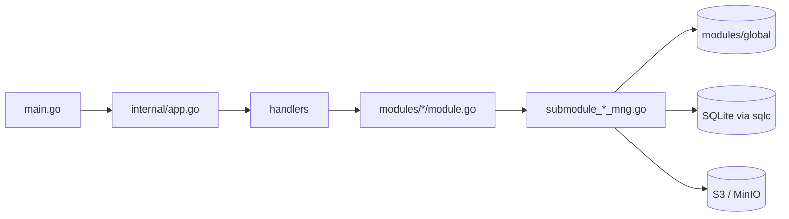

# S3Browser アーキテクチャ

[English](ARCHITECTURE.md) | [Tiếng Việt](ARCHITECTURE.vi.md) | [日本語](ARCHITECTURE.ja.md) | [简体中文](ARCHITECTURE.zh-CN.md) | [繁體中文](ARCHITECTURE.zh-TW.md) | [Русский](ARCHITECTURE.ru.md) | [Deutsch](ARCHITECTURE.de.md)

新しく参加する開発者向けに、コードの全体像を簡潔にまとめたものです。規約は `CLAUDE.md` にあり、本書では各部分がどのように組み合わさっているかを説明します。

## 1. スタック

- **Wails v3** によるデスクトップアプリ。Go のバックエンドと、WebView 上で動く React 19 / TypeScript のフロントエンドで構成されます。
- バックエンド: AWS SDK v2 (S3)、`madmin-go` (MinIO 管理)、SQLite (modernc) + goose マイグレーション + sqlc、`slog`。
- フロントエンド: Mantine 9、zustand 5 + immer、NiceModal、i18next (7 言語: en / vi / ja / zh-CN / zh-TW / ru / de)、sonner (トースト)、`@tanstack/react-virtual`、zod、dayjs。パッケージマネージャーは **bun**。

```
s3-browser
├── main.go                 エントリ: logger、Wails app、サービス、メインウィンドウ
├── internal/
│   ├── app.go              DB、モジュール、ハンドラーを構築。Shutdown
│   ├── handlers/           薄い Wails サービス (フロントエンドにバインド)
│   ├── modules/
│   │   ├── global/         共有の接続コンテナとアクセスキャッシュ
│   │   ├── profile/        接続プロファイル (シークレットは暗号化)
│   │   ├── master/         マスターデータ (リージョンなど)
│   │   ├── bucket/         接続、バケット、バケットポリシー、オブジェクト、アップロード、ダウンロード、検索
│   │   ├── setting/        アプリ設定 (settings.json)、記憶したタブ (tabs.json)、自動起動
│   │   └── update/         GitHub Releases からの自動更新
│   └── pkg/                cnst、db (schemas、queries、sqlc)、logger、portable、utils
├── models/                 入出力モデル + alias.go
├── frontend/
│   ├── bindings/           自動生成された Wails バインディング (編集禁止)
│   └── src/                common、components、pages (pages/s3, pages/sql)、locales、test
├── build/                  プラットフォーム別パッケージング (Windows NSIS、portable など)
└── docs/                   本ドキュメント + PDF 生成ツール
```

## 2. バックエンド

### 2.1 レイヤー



- `main.go` は logger と Wails app を作成し、`application.NewService` で 5 つのハンドラー (bucket、master、profile、setting、update) を登録して、メインウィンドウ (`EnableFileDrop: true`) を作成します。
- `internal/app.go` の `NewApp` は、データベースを開いてマイグレーションを実行し、`KeyManager` (シークレットの暗号化) を作成し、モジュール、その上にハンドラーを構築します。`Shutdown` は転送のキャンセル、全接続の切断、DB のクローズを行います。
- **ハンドラー** (`internal/handlers/*_handler.go`) は薄く、モジュールを呼ぶだけです。公開メソッドが TypeScript のバインディングになります。
- **モジュール** (`internal/modules/<name>/module.go`) は doc comment 付きの公開 API です。実処理は `submodule_<x>_mng.go` 内の非公開サブモジュール (`submoduleXxxMng`、コンストラクタ `newSubmoduleXxxMng`) に分割されています。

### 2.2 出力とメッセージコード

すべてのハンドラーは `models.Output[T]` (`Result`、`MessageList`、`Body`) を返します。

```go
output := models.NewOutput[T]()
output.AddMessage(msg)             // Result = true のまま
return output.ThrowError(msg)      // Result = false + メッセージ
```

- メッセージは `models.NewMessage` / `models.NewParamsMessage(type, module, CODE, errorDetail, params)` で作成します。種別は `S` 成功、`E` エラー、`W` 警告、`I` 情報 (`internal/pkg/cnst`)。
- コードは各 `module.go` の先頭にある `var` で、形式は `<PREFIX><S|E|W><NNN>` です (`S3E006`、`PFE001`、`MTE001`、`UPE004`)。
- フロントエンドはキー `ipcMessage:<moduleName>.<CODE>` でメッセージを翻訳するため、**新しいコードごとに `frontend/src/locales/{en,vi,ja,zh-CN,zh-TW,ru,de}/messages/ipcMessage.json` にキーが必要**です。
- 新しいモデルは `models/<domain>/` (`*_input.go`、`*_output.go`、camelCase の json タグ) に置き、`models/alias.go` で再エクスポートします。

### 2.3 接続コンテナとアクセスキャッシュ (`modules/global`)

`global.Module` は `connContainer`、すなわち `sync.RWMutex` で保護された `map[id]*S3Conn` を保持します。`S3Conn` は S3 クライアント、presign クライアント、任意の MinIO 管理クライアント、`http.Transport`、認証情報 (`Creds`、`CredInfo`) をまとめます。`profile` が接続を登録し、`bucket` が読み取ります (`GetConnContainer`)。`RemoveConn` / `ReplaceConn` は古い接続を返し、**自分では閉じません**。クローズはネットワーク I/O を伴うため、呼び出し側がロック解放後に閉じます。

各接続は `AccessCache` (`access_cache.go`) も持ちます。バケット名ごとに、読み取り・書き込み・削除のアクセスが拒否されたかどうかと、バッジとして表示するバケットポリシーのモードを記憶します。エントリは `accessTTL` (5 分) で期限切れになります。`Reset` は世代 (generation) を進めるため、リセット前に始まったプローブ (古い認証情報によるもの) は結果を書き込めません。バケット一覧はこれを使い、すべてのバケットを再度プローブせずにアクセス不可 / 読み取り専用のバケットを判定します。

### 2.4 コンテキストとキャンセル

- `ctx` を受け取るハンドラーは Wails の呼び出しコンテキストを受け取ります。これはフロントエンドが呼び出しをキャンセルすると終了しますが、アプリの寿命とは切り離されています。
- `withCallContext(ctx, appCtx, timeout)` (`modules/bucket/call_helper.go`) は 1 回の呼び出し用のコンテキストを作ります。フロントエンドのキャンセル、アプリの終了 (`context.AfterFunc`)、タイムアウトで停止します。返される cancel は必ず `defer` してください。
- `isCallCanceled(ctx)`: キャンセルされた呼び出しは `Result=false` を **何も表示せず** 返します (待っている人がいないため)。タイムアウトは引き続き報告されます。
- 並行処理は `errgroup` と `SetLimit` を使います。`g.Go` 内のコードは panic してはいけません。Wails は追加ゴルーチンの panic を recover しません。

### 2.5 イベント

バックエンドからフロントエンドへのイベントは `modules/<x>/events.go` の定数で、名前は `domain:kebab-name` 形式です。例: `uploader:upload-progress-batch`、`downloader:download-progress-batch`、`uploader:files-dropped`、`bucket:credential-expiring`、`update:state-changed`。`init()` 内で `application.RegisterEvent[PayloadType](name)` により登録します。バインディングジェネレーターがペイロード型を出力できるよう、`init` から直接呼び出す必要があります。進捗イベントはバッチ化されます。共有の 200 ms ティッカー (`utils.BatchReporter`) が、実行中の全ジョブの進捗を含む 1 つのイベント (`{items: [...]}`) を送ります。ドロップされたファイルは `main.go` (`WindowFilesDropped` -> `BucketHandler.FilesDropped`) から届き、`uploader:files-dropped` / `uploader:picker-files-dropped` として再送出されます。

### 2.6 データベース

SQLite ファイル `data.db` はアプリのデータディレクトリにあります (`internal/pkg/portable` 参照。WAL、外部キー有効、起動時にバックアップ)。

- マイグレーション: goose、`internal/pkg/db/schemas/NNNNNN_name.sql`、`db.RunMigrations` が実行します。
- クエリ: `internal/pkg/db/queries/<domain>/<snake_name>.sql` に `-- name: PascalName :one|many|exec` を付けます。SQL はカンマ先頭スタイルです。
- コード: `go tool sqlc generate` が `internal/pkg/db/sqlc` を出力します (自動生成。編集禁止)。

### 2.7 アプリ設定と記憶したタブ (`modules/setting`)

テーマ、フォント、言語、スタートアップ時の起動、更新オプション (`autoUpdate`、`betaUpdate`) は、`data.db` と同じデータディレクトリの `settings.json` に保存されます (SQLite ではありません)。

- `GetSettings`、`SaveSettings`、`ResetSettings` (`SettingHandler`)。値は固定リストで検証されます (`submodule_setting_mng.go` の `languages` に 7 つの言語コードがあります)。ファイルが無い、または壊れている場合は既定値 (`light`、`nunito`、`en`、自動更新オン) に戻り、不明な値はそのフィールドだけをリセットします。
- 書き込みはミューテックス下でアトミック (一時ファイル + rename) です。`ResetSettings` は既定値を返すだけで、Save するまで何も書き込みません。
- `SaveSettings` が成功すると、ハンドラーが `betaUpdate` と `autoUpdate` を `update.Module` に渡します (`SetBeta`、`SetAutoUpdate`)。
- スタートアップ時の起動は `HKCU\Software\Microsoft\Windows\CurrentVersion\Run` に書き込みます (`autostart_windows.go`)。ポータブル版や他の OS では未対応です (`autostartSupported=false`)。Save は先にファイル、次にレジストリへ書き込みます。レジストリが失敗した場合、ファイルは古い値のままで、警告 `STE003` を返します。
- `main.go` はテーマを一度だけ読み、ページ読み込み前にウィンドウの背景色を設定します。
- 記憶したタブ: `GetTabState` / `SaveTabState` (`SettingHandler`) が `tabs.json` (`submodule_tab_mng.go`) を読み書きします。タブの順序、アクティブなタブ、各タブのプロファイルを保存します。ファイルが無い、不正な形式、または無効な場合は空の状態になります。

### 2.8 認証と接続 (`modules/profile`、`modules/bucket`)

プロファイルは `provider` (`aws` または `minio`) と `authType` (`internal/pkg/cnst/auth.go`) を持ちます。`cnst.IsAuthTypeValid` が組み合わせを検証します。一覧はマイグレーション `000002_auth_methods.sql` の CHECK、およびフロントエンドの `authMethods.ts` と一致させる必要があります。

| プロバイダー | 認証タイプ |
|---|---|
| `aws` | `static`、`sharedProfile`、`assumeRole`、`sso`、`defaultChain`、`anonymous` |
| `minio` | `static`、`minioAssumeRole`、`minioLdap`、`minioOidc`、`minioCert`、`anonymous` |

- プロファイルは SQLite に保存されます。秘密でないオプションは JSON 列 (`auth_config`)、シークレットは `KeyManager` で暗号化されます (`auth_secret`)。
- `buildCredentials` (`submodule_cfg_credentials.go`) は認証タイプの認証情報を解決し、**一度取得します**。そのため、誤ったプロファイル、期限切れの SSO セッション、拒否されたロールは、最初のリクエストではなく接続時に専用メッセージ (`S3E030` - `S3E038`、`PFE009`) で失敗します。
  - AWS CLI ベースのタイプ (`sharedProfile`、`sso`、`assumeRole`、`defaultChain`) は SDK の設定ファイルを使います。MFA シリアルを持つ `assumeRole` はワンタイムコードを一度だけ使うため、新しいコードなしでは更新できません。
  - `minioAssumeRole` (アクセスキー + シークレット) と `minioLdap` (LDAP ユーザー + パスワード) は MinIO の STS エンドポイント (S3 エンドポイント) に問い合わせます。シークレットがプロバイダー内でメモリに保持される (ログには出ない) ため、認証情報は期限前に **自動で更新** されます。
  - `minioCert` は TLS クライアント証明書で MinIO STS に問い合わせます (mTLS、`AssumeRoleWithCertificate`、https が必要)。PEM 鍵は PKCS#8 で暗号化されていてもかまいません (`submodule_cert_loader.go`)。
  - `minioOidc` は OpenID Connect サインインのトークンを MinIO の認証情報に交換します (`AssumeRoleWithWebIdentity`)。
  - `anonymous` は署名なしでリクエストします。匿名クライアントはバケット一覧を取得できないため、ユーザーがバケットを入力する必要があります。
- **OIDC** (`submodule_oidc_login.go`): **PKCE** 付きの認可コードフローで、パブリッククライアントのみです。システムブラウザーが IdP のページを開き、`127.0.0.1` 上のローカルサーバーがリダイレクトを受け取って直後に停止します。サインインは 5 分でタイムアウトします (`oidcLoginTimeout`)。セッション (トークン) は **バックエンドのメモリ上にのみ** 存在し、最大 10 分間再利用され (`oidcSessionTTL`、トークンの有効期限でも制限)、接続ごとに 1 回だけ使われます。フロントエンドは `sessionId` を保持するだけで、トークンを見ることはありません。セッションが使用済みの場合は再サインインが必要です (`S3E030`)。OIDC プロファイルは自動接続されません (`cnst.IsAutoConnectAllowed`)。MFA シリアルを持つ `assumeRole` プロファイルも同様です。
- **URL の安全性**: IdP 由来の URL (issuer、discovery ドキュメントのエンドポイント) は必ず `utils.IsSecureUrl` (`internal/pkg/utils/url.go`) を通します。`https`、または `http` はループバックホストのみ許可されます。プロファイルフォームも同様に検証されます (`profile/submodule_auth_mng.go`)。
- **カスタム CA**: どの MinIO 認証タイプでも CA ファイル (`AuthConfig.CaFile`) を追加できます。`newTransport` がそれをシステムプールに追加し (読み込めない場合は `S3E049`)、MinIO のトランスポート (S3 と STS) にのみ適用されます。IdP へは OS の信頼ストアで接続します。minio-go が mTLS のために `TLSClientConfig` に書き込むため、`newTransport` は常に `TLSClientConfig` を設定します。`ChooseAuthFile` は証明書・鍵・CA ファイル用のネイティブダイアログを開きます。ダイアログのキャンセルはエラーではありません (`utils.IsDialogCancelled`)。
- **再認証**: `ReauthConnection` は、稼働中の接続を切らずに認証情報を更新します (`SwapCreds` の背後のプロバイダーを差し替え、`madmin` も同じプロバイダー経由で読み取ります)。そのため実行中の転送は継続します。プロファイルに保存されないシークレット (`mfaCode`、`secretKey`、`ldapPassword`) は、その呼び出しのためだけにフロントエンドから渡されます。
- **期限切れ警告**: ユーザー操作なしでは認証情報を更新できない場合 (`CredInfo.Refreshable=false`)、バックエンドは期限前に `bucket:credential-expiring` (`CredentialExpiringOutput`) を送出し、フロントエンド (`useCredentialExpiring`) がトーストを表示します。

### 2.9 バケット管理とバケットポリシー (`modules/bucket`)

- `CreateBucket`、`GetBucketDetail`、`GetBucketDeleteInfo`、`DeleteBucket`、`GetBucketPolicy`、`PutBucketPolicy`、`CheckBucketAccess` は `module.go` にあり、実処理は `submodule_bucket_mng.go`、`submodule_bucket_detail.go`、`submodule_bucket_delete.go`、`submodule_bucket_edit_mng.go`、`submodule_bucket_policy.go` にあります。
- バケットの**アクセスモード**: `private` (ポリシーなし)、`public` 読み取り専用 (`*` に対する `GetObject`、`ListBucket`、`GetBucketLocation`)、`custom` (JSON)。ACL はありません。MinIO は正規化されたポリシーを返すため、ポリシーは意味で比較します (`samePolicy`)。実際の AWS ではポリシーのリクエストはバケットのリージョンへ送られ (`policyOptFns`)、Block Public Access は読み取って警告として表示するだけです (それがブロックするパブリックポリシーを保存すると `S3E058`)。
- バケット作成時に、同じ呼び出しでアクセスモードを設定できます。バケットは作成されたがポリシーの設定に失敗した場合、バケットは残り、`Result` は true のまま警告を返します (`S3W011`。Block Public Access の場合は `S3W012`)。
- **バッジ**: バケット一覧は各バケットのポリシーモードを表示します (`PolicyBadge`)。`GetListBucket` は `AccessCache` から `PolicyMode` を埋め、不足分を並列に読み取り、確定した回答のみをキャッシュします (`isSurePolicyError`)。そのためタイムアウトは再試行されます。匿名接続はスキップされます。
- **削除**: ユーザーがバケット名を入力します。空でないバケットはまず空にされ (共有の `batchDeleter` ですべてのバージョンと削除マーカー)、その後 `DeleteBucket` が実行されます (タイムアウト 30 分)。Object Lock のある空でないバケットは、オブジェクトを 1 つも削除する前に拒否されます (`S3E063`)。進捗イベントもキャンセルボタンもなく、アプリを閉じると何も表示せず停止します。削除メニュー項目は、アカウントが `s3:DeleteBucket` を拒否されると確実に分かる場合にのみ非表示になります (`AccessDelete`)。
- 匿名接続ではバケットの作成・変更・削除はできませんが (`S3E054`)、詳細ドロワーは開けます。

### 2.10 自動更新 (`modules/update`)

`update.Module` は `TranMinhTruyen/s3-browser` の **GitHub Releases** で新しいバージョンを確認し、NSIS インストーラーをダウンロードして実行します。`UpdateHandler` は `GetUpdateState`、`CheckUpdate`、`DownloadUpdate`、`InstallUpdate` を公開します。

- **対応ビルド**: NSIS インストーラーでインストールした Windows ビルドのみです (インストーラーが exe の隣に `uninstall.exe` を書き込みます。`installSupported`)。ポータブル版、展開しただけのビルド、他の OS は非対応で、フロントエンドは機能を非表示にします (`supported=false`)。dev モードではテストのため常にオンです。バージョンは `build/config.yml` から取得します (`main.go` に埋め込み)。
- **チャンネル**: 安定版用の GitHub プロバイダーと、プレリリースも含むプロバイダーの 2 つがあり、`betaUpdate` オプションでチャンネルを選びます (`SetBeta`)。ベータがオンの場合、より新しいプレリリースのみが対象です。
- **確認**: `CheckUpdate` はユーザーが要求したときに実行されます。`autoUpdate` がオンの場合、ループが起動 10 秒後に確認し、以降 6 時間ごと (`checkInterval`) に確認します。新しいリリースは自動でダウンロードが始まります。ループの失敗はログに記録されるだけです。
- **チェックサム**: リリースアセット `checksums.txt` が、インストーラー `S3Browser-<version>-windows-<arch>-installer.exe` の SHA-256 を提供している必要があります。ファイルは一時ディレクトリへのダウンロード中にハッシュ計算され、一致しなければ削除されます (`UPE004`)。一時ディレクトリは他のプログラムも書き込めるため、`InstallUpdate` は実行前に再度検証します。ダウンロードは GitHub のホストにのみ接続します。
- **インストール**: インストーラーは `ShellExecute` 経由でサイレント実行され (UAC プロンプト、`/S /relaunch /D=<インストール先>`)、その後アプリが終了してインストーラーが新バージョンを起動します。インストーラーを実行できない場合、アプリは動作を続けます (`UPE005`)。ダウンロードしたインストーラーは次回起動後に削除されます。
- **状態**: `UpdateStateOutput` (`supported`、`state`、`currentVersion`、`version`、`releaseUrl`、`written`、`total`、`errorCode`、`state` が `error` のときの `UPE...` コード)。`state` は `idle`、`checking`、`upToDate`、`available`、`downloading`、`ready`、`error` のいずれかです。変更のたびに、またダウンロード中は 200 ms ごとに、イベント `update:state-changed` で送信されます。
- **メッセージ**: `UPS001` (最新バージョン)、`UPE001` (確認できない)、`UPE002` (GitHub のレート制限)、`UPE003` (ダウンロードできない)、`UPE004` (チェックサム)、`UPE005` (インストーラーを実行できない)、`UPE006` (このマシン用のインストーラーがない)。

## 3. フロントエンド

### 3.1 バックエンドの呼び出し: `callIPC`

バックエンドの呼び出しはすべて `callIPC` (`frontend/src/common/utils/ipcUtils.ts`) を通し、バインディングを直接呼び出しません。

```ts
const body = await callIPC(GetListObject, [input], { scope: `${SCOPE}/load`, signal });
```

- `Output` のメッセージを `ipcMessage:<module>.<CODE>` を使ってトースト表示します (`showMessage`、既定でオン)。
- 成功時は `body` を返し、失敗・キャンセル・古い結果の場合は `null` を返します。
- `scope`: 同じ scope の新しい呼び出しがあると、古い結果は破棄されます。`signal` (`AbortController`) は呼び出しをキャンセルし、Go のコンテキストもキャンセルします。
- バインディングは `@wails/...` (`frontend/bindings`、自動生成) からインポートします。

### 3.2 ストア

ストアは `createAppStore(creator, name)` で作成します (zustand + immer + 開発時は devtools。開発時は `window.__stores` にも公開されます)。

- 各ストアは `State`、`Action`、定数 `SCOPE` を持ち、すべての `set` に名前を付けます: ``set(update, undefined, `${SCOPE}/actionName`)``。
- `reset()` は `invalidateLoads(SCOPE)` を呼び、そのストアの実行中の結果を破棄します。
- 狭いセレクターか `useShallow` を使い、オブジェクト全体を選択してはいけません。

### 3.3 モーダル

モーダルは `createMantineModal` (`common/utils/modalUtils.ts`) でラップされた NiceModal コンポーネントで、z-index は `modalStackStore` が管理します。重いモーダルは `components/modals/lazyModals.ts` (`showConnectModal`、`showHistoryModal`、`showSettingModal`) でオンデマンドに読み込まれ、メインバンドルに含まれません。生の Mantine コンポーネントではなく `components/buttons|inputs|modals` のラッパーを使います。モーダルのフッター: キャンセルは左、アクションは右 (`<Group justify="space-between" wrap="nowrap">`)。主要コンテンツ領域は `<Paper withBorder>` に入れます。

### 3.4 i18n

`locales/i18n.ts` は **7 言語** `en`、`vi`、`ja`、`zh-CN`、`zh-TW`、`ru`、`de` に対応します (`LANGUAGES` と各言語の自称名 `LANGUAGE_LABELS` は `common/cnst/settingConst.ts` にあります)。静的にインポートされるのは `en` のみで、他の言語は `changeLanguage` の前に `loadLanguage` 経由で動的 `import()` (`RESOURCE_LOADERS`) により読み込まれます。各言語は `resource.ts` を持ち、コンポーネント/ページごとに 1 つの名前空間を登録します (`locales/<lang>/components|pages|messages`)。UI 文字列のハードコードは禁止です。キーは**7 言語すべて**に追加し (`en` と同じキーと `{{x}}` プレースホルダー)、新しい名前空間は 7 つの `resource.ts` すべてに登録します。CJK 言語には `getFontFamily` で専用のフォントフォールバックがあります。

### 3.5 イベント

バックエンドのイベントは `useEffect` 内で `@wailsio/runtime` の `Events.On(name, handler)` により受信し、返される購読解除関数をクリーンアップで呼び出します (`UploaderWindow`、`DownloaderWindow`、`useFilesDroppedUpload`、`useAppUpdate` を参照)。

### 3.6 リストとパフォーマンス

大きなリスト (オブジェクト、バケット、アップローダー、履歴、ファイル一覧) は `@tanstack/react-virtual` で仮想化します。オブジェクト一覧はカーソルでページングします (`useObjectPaging`、最初のページは `FIRST_PAGE_SIZE = 200`、以降のページは `NEXT_PAGE_SIZE = 1000`)。リスト項目は `memo` で、コンポーネント内のすべての関数は `useCallback` でラップし、ハンドラー名は `on<Event><Target>` (`onClickConnect`) とします。

### 3.7 レイアウトとタブ

`App.tsx` -> `MainLayout` (モード切り替え、アップローダー/ダウンローダーのウィンドウ) -> `S3Workspace` または `SqlWorkspace` (`MainLayout` 内で lazy、そのモードを最初に開いたときに読み込み。それぞれナビバーとタブページを持つ) -> `S3TabPage` (`S3Workspace` が静的に import、`pages/s3/S3TabPage.tsx`)。`S3TabPage` はタブバー (`components/tabs` の `TabStrip` と `SortableTab`、dnd-kit によるドラッグ&ドロップ、Ctrl+Shift+左/右 でキーボードによる並べ替え) を持ち、`TabDetail` を描画します。`TabDetail` は `pages/s3/bucket` (`BucketListView`、`BucketItem`) または `pages/s3/object` (`ObjectListView`、`ObjectItem`) を表示します。共通部品は `pages/s3/components` (`BucketDetailDrawer`、`ObjectDetailDrawer`、`TabActionBar`、`TabBreadcrumb`) にあります。各モードは専用フォルダ `pages/<mode>` (`s3`、`sql`) を持ち、`stores`、`hooks`、`utils`、`modals`、`navbar`、`components`、`transfer` などのサブフォルダがあります。S3 の状態は `pages/s3/stores` (`profileStore`、`tabListStore`、`uploaderStore`、`downloaderStore`、`masterDataStore`)、アプリ全体の状態は `common/stores` (`settingStore`、`updateStore`) にあります。

**タブの記憶**: `useTabPersistence` (`App.tsx` で呼び出し) は、タブの順序、アクティブなタブ、各タブのプロファイルを、変更が止まってから 500 ms 後と `pagehide` 時に `SaveTabState` 経由で `tabs.json` に保存します。起動時には `restoreTabsFromDisk` (`pages/s3/utils/tabPersistence.ts`) が `GetTabState` で読み込みます。読み込みに失敗した場合、`tabs.json` を上書きしないよう、そのセッションでは保存が無効になります。プロファイルが削除されたタブは位置を保ったままプロファイルだけを失います (`normalizeTabProfiles`)。

### 3.8 設定、テーマ、更新

`main.tsx` は描画前に `loadStartupData()` を待つため (設定と `restoreTabsFromDisk()` を並列で読み込みます)、テーマ、フォント、言語、保存済みタブが先に揃います (失敗時は既定値)。`settingStore` は `saved` (ファイル)、`applied` (現在のセッション、Apply で変更)、`draft` (フォーム、ライブでプレビュー) を保持し、モーダルを閉じると `applied` に戻ります。`applySettings` は Mantine のカラースキーム (メモリ上の `settingColorSchemeManager`、localStorage は使用しない)、`--mantine-font-family` 変数、i18n の言語を設定します。

`AppUpdateToast` は `useAppUpdate` を一度だけマウントします。`GetUpdateState` で状態を読み込み、`update:state-changed` を `updateStore` に反映し、1 つのトーストを状態に合わせて更新します (自動更新オフ時はダウンロードボタン付きの新バージョン、ダウンロード進捗、インストール可能)。`supported` が false の場合は何も表示しません。

色: `var(--mantine-color-*)` と `light-dark(<light>, <dark>)` を使い、16 進/rgb のハードコードは禁止です (プロファイルの色のようにデータとして保存される色を除く)。

## 4. バインディングとコマンド

Wails のバインディングは Go のハンドラーから生成されます。ハンドラーのシグネチャやモデルを変更したら再生成してください。

```
go tool wails3 generate bindings -clean=true -ts
```

| 作業 | コマンド (特記なき限りリポジトリのルートで実行) |
|---|---|
| 開発 | `go tool wails3 task dev` |
| ビルド | `go tool wails3 task build` |
| パッケージ (インストーラー) | `go tool wails3 task package` |
| ポータブル (Windows) | `go tool wails3 task build:portable WEBVIEW2_DIR=<WebView2 Fixed Version フォルダー>` |
| Go チェック | `go build ./...`、`go vet ./...`、`go tool golangci-lint run ./...` |
| sqlc | `go tool sqlc generate` |
| FE 型チェック (`frontend/`) | `node_modules/.bin/tsc --noEmit` (Windows は `tsc.exe`) |
| FE lint / format | `npx oxlint <paths>`、`node_modules/.bin/biome check --write <paths>` |
| FE テスト | `bun run test` (vitest)。テストは `src/` を模した `frontend/src/test/` に置きます |
| ユーザーガイド PDF | `bun run --cwd docs build:pdf` (または `go tool wails3 task docs:pdf`) |

Go ツール (wails3、sqlc、golangci-lint) は `go.mod` の `tool (...)` ブロックで宣言されているため、別途インストールは不要です。バックエンドにはコミットされた単体テストはありません。フロントエンドは変更したファイルごとにブランチ・行カバレッジ 95% 以上が必要です。
