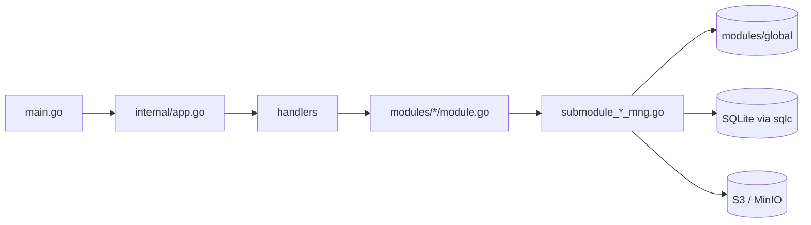

# S3Browser アーキテクチャ

[English](ARCHITECTURE.md) | [Tiếng Việt](ARCHITECTURE.vi.md) | [日本語](ARCHITECTURE.ja.md)

新しく参加する開発者向けに、コードの全体像を簡潔にまとめたものです。規約は `CLAUDE.md` にあり、本書では各部分がどのように組み合わさっているかを説明します。

## 1. スタック

- **Wails v3** によるデスクトップアプリ。Go のバックエンドと、WebView 上で動く React 19 / TypeScript のフロントエンドで構成されます。
- バックエンド: AWS SDK v2 (S3)、`madmin-go` (MinIO 管理)、SQLite (modernc) + goose マイグレーション + sqlc、`slog`。
- フロントエンド: Mantine 9、zustand 5 + immer、NiceModal、i18next (en / vi / ja)、sonner (トースト)、`@tanstack/react-virtual`、zod、dayjs。パッケージマネージャーは **bun**。

```
App/S3Browser
├── main.go                 エントリ: logger、Wails app、サービス、メインウィンドウ
├── internal/
│   ├── app.go              DB・モジュール・ハンドラーの構築、Shutdown
│   ├── handlers/           薄い Wails サービス (フロントエンドにバインド)
│   ├── modules/
│   │   ├── global/         共有の接続コンテナ
│   │   ├── profile/        接続プロファイル (シークレットは暗号化)
│   │   ├── master/         マスターデータ (リージョンなど)
│   │   └── bucket/         バケット、オブジェクト、アップロード、ダウンロード、検索
│   └── pkg/                cnst、db (schemas, queries, sqlc)、logger、portable、utils
├── models/                 入出力モデル + alias.go
├── frontend/
│   ├── bindings/           Wails バインディング (自動生成。手動で編集しない)
│   └── src/                common、components、pages、locales、test
├── build/                  プラットフォーム別パッケージング (Windows NSIS、portable など)
└── docs/                   本ドキュメント + PDF 生成ツール
```

## 2. バックエンド

### 2.1 レイヤー



- `main.go` は logger と Wails app を作成し、`application.NewService` で 3 つのハンドラーを登録して、メインウィンドウ (`EnableFileDrop: true`) を作成します。
- `internal/app.go` の `NewApp` は、データベースを開いてマイグレーションを実行し、`KeyManager` (シークレットの暗号化) を作成し、モジュール、その上にハンドラーを構築します。`Shutdown` は転送のキャンセル、全接続の切断、DB のクローズを行います。
- **ハンドラー** (`internal/handlers/*_handler.go`) は薄く、モジュールを呼ぶだけです。公開メソッドが TypeScript のバインディングになります。
- **モジュール** (`internal/modules/<name>/module.go`) は doc comment 付きの公開 API です。実処理は `submodule_<x>_mng.go` 内の非公開サブモジュール (`submoduleXxxMng`、コンストラクタ `newSubmoduleXxxMng`) に分割されています。

### 2.2 Output とメッセージコード

すべてのハンドラーは `models.Output[T]` (`Result`、`MessageList`、`Body`) を返します。

```go
output := models.NewOutput[T]()
output.AddMessage(msg)             // Result = true のまま
return output.ThrowError(msg)      // Result = false + メッセージ
```

- メッセージは `models.NewMessage` / `models.NewParamsMessage(type, module, CODE, errorDetail, params)` で作成します。種別は `S` 成功、`E` エラー、`W` 警告、`I` 情報です (`internal/pkg/cnst`)。
- コードは各 `module.go` の先頭にある `var` で、形式は `<PREFIX><S|E|W><NNN>` (`S3E006`、`PFE001`、`MTE001`) です。
- フロントエンドは `ipcMessage:<moduleName>.<CODE>` のキーでメッセージを翻訳するため、**新しいコードには必ず `frontend/src/locales/{en,vi,ja}/messages/ipcMessage.json` にキーが必要です**。
- 新しいモデルは `models/<domain>/` (`*_input.go`、`*_output.go`、camelCase の json タグ) に置き、`models/alias.go` で再エクスポートします。

### 2.3 接続コンテナ (`modules/global`)

`global.Module` は `sync.RWMutex` で保護された `map[id]*S3Conn` の `connContainer` を保持します。`S3Conn` は S3 クライアント、presign クライアント、任意の MinIO 管理クライアント、`http.Transport` をまとめたものです。`profile` が接続を登録し、`bucket` が読み取ります (`GetConnContainer`)。`RemoveConn` / `ReplaceConn` は古い接続を返すだけで、**自分では閉じません**。閉じる処理はネットワーク I/O を伴うため、呼び出し側がロック解放後に行います。

### 2.4 コンテキストとキャンセル

- `ctx` を受け取るハンドラーには Wails の呼び出しコンテキストが渡されます。これはフロントエンドが呼び出しをキャンセルすると終了しますが、アプリのライフサイクルからは切り離されています。
- `withCallContext(ctx, appCtx, timeout)` (`modules/bucket/call_helper.go`) が 1 回の呼び出し用コンテキストを作ります。フロントエンドのキャンセル、アプリ終了 (`context.AfterFunc`)、タイムアウトのいずれかで停止します。返された cancel は必ず `defer` してください。
- `isCallCanceled(ctx)`: キャンセルされた呼び出しは、待っている人がいないため **メッセージなしで** `Result=false` を返します。タイムアウトは通常どおり報告されます。
- 並行処理は `SetLimit` 付きの `errgroup` を使います。

### 2.5 イベント

バックエンドからフロントエンドへのイベントは `modules/<x>/events.go` の定数で、名前は `domain:kebab-name` 形式です (例: `uploader:upload-progress`、`downloader:download-progress`、`uploader:files-dropped`)。`init()` 内で `application.RegisterEvent[PayloadType](name)` により登録します。バインディング生成ツールがペイロード型を出力できるよう、`init` から直接呼ぶ必要があります。進捗イベントは `utils.ReportEvery` で 200 ms に間引かれます。ドロップされたファイルは `main.go` (`WindowFilesDropped` -> `BucketHandler.FilesDropped`) を経由し、`uploader:files-dropped` / `uploader:picker-files-dropped` として再送されます。

### 2.6 データベース

アプリのデータディレクトリに SQLite ファイル `data.db` を置きます (`internal/pkg/portable` を参照。WAL、外部キー有効、起動時にバックアップ)。

- マイグレーション: goose。`internal/pkg/db/schemas/NNNNNN_name.sql` を `db.RunMigrations` が実行します。
- クエリ: `internal/pkg/db/queries/<domain>/<snake_name>.sql` に `-- name: PascalName :one|many|exec` を付けて記述します。SQL はカンマを行頭に置くスタイルです。
- コード: `go tool sqlc generate` が `internal/pkg/db/sqlc` を生成します (自動生成のため編集禁止)。

## 3. フロントエンド

### 3.1 バックエンド呼び出し: `callIPC`

バックエンドの呼び出しはすべて `callIPC` (`frontend/src/common/utils/ipcUtils.ts`) を経由し、バインディングを直接呼びません。

```ts
const body = await callIPC(GetListObject, [input], { scope: `${SCOPE}/load`, signal });
```

- `Output` のメッセージを `ipcMessage:<module>.<CODE>` のキーでトースト表示します (`showMessage`、既定でオン)。
- 成功時は `body` を、失敗・キャンセル・古い結果の場合は `null` を返します。
- `scope`: 同じ scope の新しい呼び出しがあると、古い呼び出しの結果は破棄されます。`signal` (`AbortController`) は呼び出しをキャンセルし、Go 側のコンテキストもキャンセルされます。
- バインディングは `@wails/...` (`frontend/bindings`、自動生成) からインポートします。

### 3.2 ストア

ストアは `createAppStore(creator, name)` で作成します (zustand + immer、開発時は devtools も有効。開発時は `window.__stores` にも公開されます)。

- 各ストアは `State`、`Action`、定数 `SCOPE` を持ち、すべての `set` に名前を付けます: ``set(update, undefined, `${SCOPE}/actionName`)``。
- `reset()` は `invalidateLoads(SCOPE)` を呼び、そのストアの処理中の結果を破棄します。
- セレクターは絞り込むか `useShallow` を使い、オブジェクト全体は選択しません。

### 3.3 モーダル

モーダルは `createMantineModal` (`common/utils/modalUtils.ts`) でラップした NiceModal コンポーネントで、z-index は `modalStackStore` が管理します。重いモーダルは `components/modals/lazyModals.ts` (`showConnectModal`、`showHistoryModal`) で必要になったときに読み込むため、メインバンドルには含まれません。Mantine を直接使わず、`components/buttons|inputs|modals` のラッパーを使います。

### 3.4 i18n

`locales/i18n.ts` が en / vi / ja を読み込みます。各言語の `resource.ts` に、コンポーネント/ページごとに 1 つの名前空間を登録します (`locales/<lang>/components|pages|messages`)。UI 文字列のハードコードは禁止です。キーは **3 言語すべて** に追加し、新しい名前空間は 3 つの `resource.ts` すべてに登録します。

### 3.5 イベント

バックエンドのイベントは、`useEffect` 内で `@wailsio/runtime` の `Events.On(name, handler)` により受け取り、戻り値の購読解除関数をクリーンアップで呼びます (`UploaderWindow`、`DownloaderWindow`、`useFilesDroppedUpload` を参照)。

### 3.6 リストとパフォーマンス

大きなリスト (オブジェクト、バケット、アップローダー、履歴、ファイル一覧) は `@tanstack/react-virtual` で仮想化します。オブジェクト一覧はカーソルでページングします (`useObjectPaging`、`OBJECT_PAGE_SIZE = 20`)。リスト項目は `memo` 化し、コンポーネント内の関数はすべて `useCallback` でラップし、ハンドラー名は `on<イベント><対象>` (`onClickConnect`) とします。

### 3.7 レイアウト

`App.tsx` -> `MainLayout` (ナビバー、タブレイアウト、アップローダー/ダウンローダーウィンドウ) -> `TabLayout` (lazy) -> `TabDetail` -> `pages/bucket` と `pages/object`。状態は `common/stores` (`profileStore`、`tabListStore`、`uploaderStore`、`downloaderStore`、`masterDataStore`) にあります。

## 4. バインディングとコマンド

Wails のバインディングは Go のハンドラーから生成されます。ハンドラーのシグネチャやモデルを変更したら再生成してください。

```
go tool wails3 generate bindings -clean=true -ts
```

| 作業 | コマンド (特記なき限り `App/S3Browser` で実行) |
|---|---|
| 開発 | `go tool wails3 task dev` |
| ビルド | `go tool wails3 task build` |
| パッケージ (インストーラー) | `go tool wails3 task package` |
| ポータブル (Windows) | `go tool wails3 task build:portable WEBVIEW2_DIR=<WebView2 Fixed Version のフォルダー>` |
| Go の検査 | `go build ./...`、`go vet ./...`、`go tool golangci-lint run ./...` |
| sqlc | `go tool sqlc generate` |
| FE の型チェック (`frontend/`) | `node_modules/.bin/tsc --noEmit` (Windows は `tsc.exe`) |
| FE の lint / フォーマット | `npx oxlint <paths>`、`node_modules/.bin/biome check --write <paths>` |
| FE のテスト | `bun run test` (vitest)。テストは `src/` と同じ構成で `frontend/src/test/` に置く |
| ユーザーガイド PDF | `bun run --cwd docs build:pdf` (または `go tool wails3 task docs:pdf`) |

Go のツール (wails3、sqlc、golangci-lint) は `go.mod` の `tool (...)` ブロックで宣言されているため、別途インストールは不要です。バックエンドには単体テストを書きません。フロントエンドは、変更したファイルごとにブランチとラインのカバレッジ 95% 以上が必要です。
