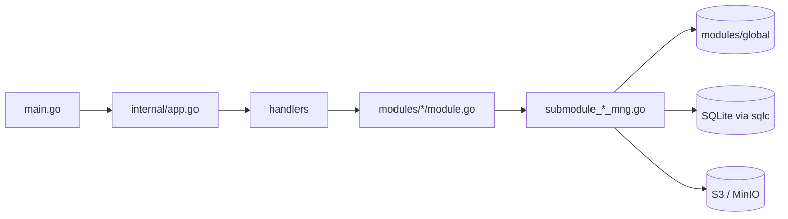

# S3Browser Architecture

[English](ARCHITECTURE.md) | [Tiếng Việt](ARCHITECTURE.vi.md) | [日本語](ARCHITECTURE.ja.md) | [简体中文](ARCHITECTURE.zh-CN.md) | [繁體中文](ARCHITECTURE.zh-TW.md) | [Русский](ARCHITECTURE.ru.md) | [Deutsch](ARCHITECTURE.de.md)

A short tour of the code for new developers. Conventions live in `CLAUDE.md`; this file explains how the pieces fit together.

## 1. Stack

- Desktop app on **Wails v3**: Go backend + React 19 / TypeScript frontend in a WebView.
- Backend: AWS SDK v2 (S3), `madmin-go` (MinIO admin), SQLite (modernc) + goose migrations + sqlc, `slog`.
- Frontend: Mantine 9, zustand 5 + immer, NiceModal, i18next (7 languages: en / vi / ja / zh-CN / zh-TW / ru / de), sonner (toast), `@tanstack/react-virtual`, zod, dayjs. Package manager: **bun**.

```
s3-browser
├── main.go                 entry: logger, Wails app, services, main window
├── internal/
│   ├── app.go              builds DB, modules and handlers; Shutdown
│   ├── handlers/           thin Wails services (bound to the frontend)
│   ├── modules/
│   │   ├── global/         shared connection container and access cache
│   │   ├── profile/        connection profiles (encrypted secrets)
│   │   ├── master/         master data (regions...)
│   │   ├── bucket/         connect, buckets, bucket policy, objects, upload, download, search
│   │   ├── setting/        app settings (settings.json), remembered tabs (tabs.json), autostart
│   │   └── update/         self-update from GitHub Releases
│   └── pkg/                cnst, db (schemas, queries, sqlc), logger, portable, utils
├── models/                 input/output models + alias.go
├── frontend/
│   ├── bindings/           GENERATED Wails bindings (do not edit)
│   └── src/                common, components, pages (pages/s3, pages/sql), locales, test
├── build/                  platform packaging (Windows NSIS, portable, ...)
└── docs/                   this documentation + PDF tooling
```

## 2. Backend

### 2.1 Layers



- `main.go` creates the logger and the Wails app, registers the five handlers (bucket, master, profile, setting, update) with `application.NewService`, and creates the main window (`EnableFileDrop: true`).
- `internal/app.go` (`NewApp`) opens and migrates the database, creates the `KeyManager` (secret encryption), builds the modules, then the handlers on top. `Shutdown` cancels transfers, disconnects everything and closes the DB.
- **Handlers** (`internal/handlers/*_handler.go`) are thin: they only call the module. Their public methods become the TypeScript bindings.
- **Modules** (`internal/modules/<name>/module.go`) expose the documented public API. Work is split into unexported submodules (`submoduleXxxMng`, constructor `newSubmoduleXxxMng`) in `submodule_<x>_mng.go`.

### 2.2 Output and message codes

Every handler returns `models.Output[T]` (`Result`, `MessageList`, `Body`).

```go
output := models.NewOutput[T]()
output.AddMessage(msg)             // keep Result = true
return output.ThrowError(msg)      // Result = false + message
```

- A message is built with `models.NewMessage` / `models.NewParamsMessage(type, module, CODE, errorDetail, params)`. Types: `S` success, `E` error, `W` warn, `I` info (`internal/pkg/cnst`).
- Codes are `var`s at the top of each `module.go`, format `<PREFIX><S|E|W><NNN>` (`S3E006`, `PFE001`, `MTE001`, `UPE004`).
- The frontend translates a message with the key `ipcMessage:<moduleName>.<CODE>`, so **every new code needs a key in `frontend/src/locales/{en,vi,ja,zh-CN,zh-TW,ru,de}/messages/ipcMessage.json`**.
- New models go under `models/<domain>/` (`*_input.go`, `*_output.go`, camelCase json tags) and must be re-exported in `models/alias.go`.

### 2.3 Connection container and access cache (`modules/global`)

`global.Module` holds `connContainer`, a `map[id]*S3Conn` guarded by `sync.RWMutex`. `S3Conn` bundles the S3 client, presign client, optional MinIO admin client, the `http.Transport` and the credentials (`Creds`, `CredInfo`). `profile` registers connections, `bucket` reads them (`GetConnContainer`). `RemoveConn` / `ReplaceConn` return the old connection and **never close it**: the caller closes it after the lock is released, because closing does network I/O.

Each connection also owns an `AccessCache` (`access_cache.go`): per bucket name it remembers whether read, write and delete access is denied, and the bucket policy mode shown as a badge. Entries expire after `accessTTL` (5 minutes). `Reset` bumps a generation, so a probe that started before a reset (with old credentials) cannot write its result. The bucket list uses it to flag inaccessible / read-only buckets without probing every bucket again.

### 2.4 Context and cancellation

- Handlers that take `ctx` get the Wails call context, which ends when the frontend cancels the call but is detached from the app lifetime.
- `withCallContext(ctx, appCtx, timeout)` (`modules/bucket/call_helper.go`) derives the context for one call: it stops on frontend cancel, on app shutdown (`context.AfterFunc`) and on timeout. Always `defer` the returned cancel.
- `isCallCanceled(ctx)`: a canceled call returns `Result=false` **silently** (nobody waits); a timeout is still reported.
- Concurrency uses `errgroup` with `SetLimit`. Code inside `g.Go` must not panic: Wails does not recover panics of extra goroutines.

### 2.5 Events

Backend-to-frontend events are constants in `modules/<x>/events.go`, named `domain:kebab-name`, for example `uploader:upload-progress-batch`, `downloader:download-progress-batch`, `uploader:files-dropped`, `bucket:credential-expiring` and `update:state-changed`. They are registered in `init()` with `application.RegisterEvent[PayloadType](name)`; it must be called directly from `init` so the binding generator emits the payload type. Progress events are batched: one shared 200 ms ticker (`utils.BatchReporter`) sends a single event holding the progress of every running job (`{items: [...]}`). Dropped files come from `main.go` (`WindowFilesDropped` -> `BucketHandler.FilesDropped`) and are re-emitted as `uploader:files-dropped` / `uploader:picker-files-dropped`.

### 2.6 Database

SQLite file `data.db` in the app data dir (see `internal/pkg/portable`; WAL, foreign keys on, backed up on start).

- Migrations: goose, `internal/pkg/db/schemas/NNNNNN_name.sql`, run by `db.RunMigrations`.
- Queries: `internal/pkg/db/queries/<domain>/<snake_name>.sql` with `-- name: PascalName :one|many|exec`; SQL uses leading commas.
- Code: `go tool sqlc generate` writes `internal/pkg/db/sqlc` (generated, never edit).

### 2.7 App settings and remembered tabs (`modules/setting`)

Theme, font, language, launch-on-startup and the update options (`autoUpdate`, `betaUpdate`) live in `settings.json` in the same data dir as `data.db` (not in SQLite).

- `GetSettings`, `SaveSettings`, `ResetSettings` (`SettingHandler`). Values are validated against fixed lists (`languages` in `submodule_setting_mng.go` holds the 7 language codes); a missing or corrupt file falls back to the defaults (`light`, `nunito`, `en`, auto update on), an unknown value resets only that field.
- Writes are atomic (temp file + rename) under a mutex. `ResetSettings` only returns the defaults; nothing is written until Save.
- After a successful `SaveSettings`, the handler passes `betaUpdate` and `autoUpdate` to `update.Module` (`SetBeta`, `SetAutoUpdate`).
- Launch on startup writes `HKCU\Software\Microsoft\Windows\CurrentVersion\Run` (`autostart_windows.go`). It is not supported on the portable build or other OSes (`autostartSupported=false`). Save writes the file first, then the registry; if the registry fails the file keeps the old value and warning `STE003` is returned.
- `main.go` reads the theme once to set the window background colour before the page loads.
- Remembered tabs: `GetTabState` / `SaveTabState` (`SettingHandler`) read and write `tabs.json` (`submodule_tab_mng.go`): tab order, active tab and the profile of each tab. A missing, malformed or invalid file yields an empty state.

### 2.8 Authentication and connections (`modules/profile`, `modules/bucket`)

A profile has a `provider` (`aws` or `minio`) and an `authType` (`internal/pkg/cnst/auth.go`). `cnst.IsAuthTypeValid` checks the pair; the list must match the CHECK of the `000002_auth_methods.sql` migration and `authMethods.ts` in the frontend.

| Provider | Auth types |
|---|---|
| `aws` | `static`, `sharedProfile`, `assumeRole`, `sso`, `defaultChain`, `anonymous` |
| `minio` | `static`, `minioAssumeRole`, `minioLdap`, `minioOidc`, `minioCert`, `anonymous` |

- Profiles are stored in SQLite: the non-secret options are a JSON column (`auth_config`), the secrets are encrypted with `KeyManager` (`auth_secret`).
- `buildCredentials` (`submodule_cfg_credentials.go`) resolves the credentials of the auth type and **retrieves them once**, so a wrong profile, an expired SSO session or a rejected role fails at connect time with its own message (`S3E030` - `S3E038`, `PFE009`) instead of at the first request.
  - AWS CLI based types (`sharedProfile`, `sso`, `assumeRole`, `defaultChain`) use the SDK config files. `assumeRole` with an MFA serial uses the one-time code once, so it cannot renew without a new code.
  - `minioAssumeRole` (access key + secret) and `minioLdap` (LDAP user + password) ask the MinIO STS endpoint (the S3 endpoint). The credentials renew **by themselves** before they expire, because the secrets stay in memory inside the provider (never logged).
  - `minioCert` asks MinIO STS with a TLS client certificate (mTLS, `AssumeRoleWithCertificate`, needs https). The PEM key may be PKCS#8 encrypted (`submodule_cert_loader.go`).
  - `minioOidc` exchanges the tokens of an OpenID Connect sign-in for MinIO credentials (`AssumeRoleWithWebIdentity`).
  - `anonymous` sends unsigned requests; the buckets must be entered by the user because an anonymous client cannot list buckets.
- **OIDC** (`submodule_oidc_login.go`): authorization code flow with **PKCE**, public client only. The system browser opens the IdP page, a local server on `127.0.0.1` receives the redirect and is shut down right after. The sign-in times out after 5 minutes (`oidcLoginTimeout`). The session (tokens) lives **only in backend memory**, is reused for at most 10 minutes (`oidcSessionTTL`, also capped by the token expiry) and is single use per connect; the frontend only holds a `sessionId` and never sees a token. When the session was already used, a new sign-in is needed (`S3E030`). OIDC profiles never auto-connect (`cnst.IsAutoConnectAllowed`), and neither do `assumeRole` profiles with an MFA serial.
- **URL safety**: every URL that comes from the IdP (issuer, endpoints of the discovery document) must pass `utils.IsSecureUrl` (`internal/pkg/utils/url.go`): `https`, or `http` only for a loopback host. The profile form is checked the same way (`profile/submodule_auth_mng.go`).
- **Custom CA**: any MinIO auth type can add a CA file (`AuthConfig.CaFile`). `newTransport` adds it to the system pool (`S3E049` if it cannot be loaded) and it applies only to the MinIO transport (S3 and STS); the IdP is reached with the OS trust store. `newTransport` always sets a `TLSClientConfig` because minio-go writes into it for mTLS. `ChooseAuthFile` opens the native dialog for the certificate, key and CA files; cancelling the dialog is not an error (`utils.IsDialogCancelled`).
- **Reauth**: `ReauthConnection` renews the credentials of a live connection without dropping it (the provider behind `SwapCreds` is replaced, `madmin` reads through the same provider), so running transfers continue. Secrets that the profile does not save (`mfaCode`, `secretKey`, `ldapPassword`) come from the frontend for that call only.
- **Expiry warning**: when credentials cannot renew without the user (`CredInfo.Refreshable=false`), the backend emits `bucket:credential-expiring` (`CredentialExpiringOutput`) before they expire; the frontend (`useCredentialExpiring`) shows a toast.

### 2.9 Bucket management and bucket policy (`modules/bucket`)

- `CreateBucket`, `GetBucketDetail`, `GetBucketDeleteInfo`, `DeleteBucket`, `GetBucketPolicy`, `PutBucketPolicy` and `CheckBucketAccess` are in `module.go`; the work is in `submodule_bucket_mng.go`, `submodule_bucket_detail.go`, `submodule_bucket_delete.go`, `submodule_bucket_edit_mng.go` and `submodule_bucket_policy.go`.
- **Access modes** of a bucket: `private` (no policy), `public` read-only (`GetObject`, `ListBucket`, `GetBucketLocation` for `*`) and `custom` (JSON). There is no ACL. Policies are compared by meaning (`samePolicy`), because MinIO returns a normalized policy. On real AWS the policy requests go to the region of the bucket (`policyOptFns`), and Block Public Access is only read and shown as a warning (`S3E058` when saving a public policy it blocks).
- Creating a bucket can set the access mode in the same call. If the bucket was created but the policy failed, the bucket is kept, `Result` stays true and a warning is returned (`S3W011`, or `S3W012` for Block Public Access).
- **Badge**: the bucket list shows the policy mode of each bucket (`PolicyBadge`). `GetListBucket` fills `PolicyMode` from the `AccessCache`, reads the missing ones in parallel, and caches only definite answers (`isSurePolicyError`) so a timeout is retried. Anonymous connections are skipped.
- **Delete**: the user types the bucket name. A non-empty bucket is emptied first (all versions and delete markers through the shared `batchDeleter`), then `DeleteBucket` runs (timeout 30 minutes). A non-empty bucket with Object Lock is refused before any object is deleted (`S3E063`). There is no progress event and no cancel button; closing the app stops it silently. The Delete menu item is hidden only when the account is known to be denied `s3:DeleteBucket` (`AccessDelete`).
- Anonymous connections cannot create, change or delete buckets (`S3E054`) but can open the detail drawer.

### 2.10 Auto update (`modules/update`)

`update.Module` checks **GitHub Releases** of `TranMinhTruyen/s3-browser` for a newer version, downloads the NSIS installer and runs it. `UpdateHandler` exposes `GetUpdateState`, `CheckUpdate`, `DownloadUpdate` and `InstallUpdate`.

- **Supported builds**: only a Windows build from the NSIS installer (it writes `uninstall.exe` next to the exe; `installSupported`). Portable and unpacked builds, and other OSes, are not supported and the frontend hides the feature (`supported=false`). Dev mode keeps it on for testing. The version comes from `build/config.yml` (embedded in `main.go`).
- **Channels**: one GitHub provider for stable releases and one that also includes pre-releases; the option `betaUpdate` picks the channel (`SetBeta`). With beta on, only a newer pre-release counts.
- **Check**: `CheckUpdate` runs when the user asks. When `autoUpdate` is on, a loop checks 10 seconds after start and then every 6 hours (`checkInterval`), and a new release starts downloading by itself; failures of the loop are only logged.
- **Checksum**: the release asset `checksums.txt` must give a SHA-256 for the installer `S3Browser-<version>-windows-<arch>-installer.exe`. The file is hashed while it is downloaded to the temp dir and deleted if the hash does not match (`UPE004`). `InstallUpdate` verifies it again before running, because the temp dir is writable by other programs. Downloads only go to GitHub hosts.
- **Install**: the installer runs silently through `ShellExecute` (UAC prompt, `/S /relaunch /D=<install dir>`), then the app quits and the installer starts the new version. If the installer cannot run, the app keeps running (`UPE005`). The downloaded installer is cleaned up after the next start.
- **State**: `UpdateStateOutput` (`supported`, `state`, `currentVersion`, `version`, `releaseUrl`, `written`, `total`, `errorCode`, the `UPE...` code when `state` is `error`). `state` is `idle`, `checking`, `upToDate`, `available`, `downloading`, `ready` or `error`. Every change, and every 200 ms while downloading, is sent with the event `update:state-changed`.
- **Messages**: `UPS001` (latest version), `UPE001` (cannot check), `UPE002` (GitHub rate limit), `UPE003` (cannot download), `UPE004` (checksum), `UPE005` (cannot run the installer), `UPE006` (no installer for this machine).

## 3. Frontend

### 3.1 Calling the backend: `callIPC`

All backend calls go through `callIPC` (`frontend/src/common/utils/ipcUtils.ts`), never the binding directly:

```ts
const body = await callIPC(GetListObject, [input], { scope: `${SCOPE}/load`, signal });
```

- Shows the messages of `Output` as toasts (`showMessage`, default on) using `ipcMessage:<module>.<CODE>`.
- Returns the `body` on success, `null` on failure, cancel or stale result.
- `scope`: a newer call with the same scope makes the older result be dropped. `signal` (an `AbortController`) cancels the call, which also cancels the Go context.
- Bindings are imported from `@wails/...` (`frontend/bindings`, generated).

### 3.2 Stores

Stores are created with `createAppStore(creator, name)` (zustand + immer + devtools in dev; in dev they are also on `window.__stores`).

- Each store has `State`, `Action` and a `SCOPE` constant; every `set` is named: ``set(update, undefined, `${SCOPE}/actionName`)``.
- `reset()` calls `invalidateLoads(SCOPE)` so in-flight results of that store are dropped.
- Use narrow selectors or `useShallow`; never select a whole object.

### 3.3 Modals

Modals are NiceModal components wrapped by `createMantineModal` (`common/utils/modalUtils.ts`), with z-index managed by `modalStackStore`. Heavy modals are loaded on demand in `components/modals/lazyModals.ts` (`showConnectModal`, `showHistoryModal`, `showSettingModal`), so they stay out of the main bundle. Use the wrappers in `components/buttons|inputs|modals` instead of raw Mantine components. Modal footer: Cancel on the left, actions on the right (`<Group justify="space-between" wrap="nowrap">`); a main content area goes in `<Paper withBorder>`.

### 3.4 i18n

`locales/i18n.ts` supports **7 languages**: `en`, `vi`, `ja`, `zh-CN`, `zh-TW`, `ru`, `de` (`LANGUAGES` and the native names `LANGUAGE_LABELS` are in `common/cnst/settingConst.ts`). Only `en` is imported statically; the others are loaded with a dynamic `import()` (`RESOURCE_LOADERS`) through `loadLanguage` before `changeLanguage`. Each language has a `resource.ts` registering one namespace per component/page (`locales/<lang>/components|pages|messages`). No hard-coded UI strings: add keys to **all seven** languages (same keys and `{{x}}` placeholders as `en`) and register new namespaces in all seven `resource.ts`. The CJK languages get their own font fallback in `getFontFamily`.

### 3.5 Events

Backend events are consumed with `Events.On(name, handler)` from `@wailsio/runtime` inside `useEffect`, and the returned unsubscribe function is called in the cleanup (see `UploaderWindow`, `DownloaderWindow`, `useFilesDroppedUpload`, `useAppUpdate`).

### 3.6 Lists and performance

Large lists (objects, buckets, uploader, history, file lists) are virtualized with `@tanstack/react-virtual`. Object lists page with a cursor (`useObjectPaging`, first page `FIRST_PAGE_SIZE = 200`, next pages `NEXT_PAGE_SIZE = 1000`). List items are `memo`; every function in a component is wrapped in `useCallback`; handlers are named `on<Event><Target>` (`onClickConnect`).

### 3.7 Layout and tabs

`App.tsx` -> `MainLayout` (mode switch, uploader/downloader windows) -> `S3Workspace` or `SqlWorkspace` (lazy in `MainLayout`, loaded on the first visit of the mode; each has its navbar and tab page) -> `S3TabPage` (imported statically by `S3Workspace`, `pages/s3/S3TabPage.tsx`). `S3TabPage` holds the tab bar (`TabStrip` and `SortableTab` in `components/tabs`, drag and drop with dnd-kit, keyboard reorder with Ctrl+Shift+Left/Right) and renders `TabDetail`, which shows `pages/s3/bucket` (`BucketListView`, `BucketItem`) or `pages/s3/object` (`ObjectListView`, `ObjectItem`). Shared pieces are in `pages/s3/components` (`BucketDetailDrawer`, `ObjectDetailDrawer`, `TabActionBar`, `TabBreadcrumb`). Each mode has its own folder `pages/<mode>` (`s3`, `sql`) with subfolders such as `stores`, `hooks`, `utils`, `modals`, `navbar`, `components` and `transfer`. S3 state lives in `pages/s3/stores` (`profileStore`, `tabListStore`, `uploaderStore`, `downloaderStore`, `masterDataStore`); app-wide state lives in `common/stores` (`settingStore`, `updateStore`).

**Remembered tabs**: `useTabPersistence` (called in `App.tsx`) saves the tab order, active tab and profile of each tab to `tabs.json` through `SaveTabState` 500 ms after they stop changing and on `pagehide`. At start `restoreTabsFromDisk` (`pages/s3/utils/tabPersistence.ts`) loads them with `GetTabState`. If the load fails, saving is disabled for the session so `tabs.json` is never overwritten. A tab whose profile was deleted keeps its place but loses the profile (`normalizeTabProfiles`).

### 3.8 Settings, theme and updates

`main.tsx` awaits `loadStartupData()` before rendering (loads the settings and `restoreTabsFromDisk()` in parallel), so theme, font, language and saved tabs are ready first (defaults on failure). `settingStore` keeps `saved` (file), `applied` (current session, changed by Apply) and `draft` (form, previewed live); closing the modal reverts to `applied`. `applySettings` sets the Mantine color scheme (in-memory `settingColorSchemeManager`, no localStorage), the `--mantine-font-family` variable and the i18n language.

`AppUpdateToast` mounts `useAppUpdate` once: it loads the state with `GetUpdateState`, follows `update:state-changed` into `updateStore`, and keeps one toast in step (new version with a Download button when auto update is off, download progress, ready to install). Nothing is shown when `supported` is false.

Colors: use `var(--mantine-color-*)` and `light-dark(<light>, <dark>)`, never hard-coded hex/rgb (except colors stored as data, such as the profile color).

## 4. Bindings and commands

Wails bindings are generated from the Go handlers; regenerate after any change to a handler signature or model:

```
go tool wails3 generate bindings -clean=true -ts
```

| Task | Command (run at the repo root unless noted) |
|---|---|
| Dev | `go tool wails3 task dev` |
| Build | `go tool wails3 task build` |
| Package (installer) | `go tool wails3 task package` |
| Portable (Windows) | `go tool wails3 task build:portable WEBVIEW2_DIR=<WebView2 Fixed Version folder>` |
| Go check | `go build ./...`, `go vet ./...`, `go tool golangci-lint run ./...` |
| sqlc | `go tool sqlc generate` |
| FE type-check (`frontend/`) | `node_modules/.bin/tsc --noEmit` (`tsc.exe` on Windows) |
| FE lint / format | `npx oxlint <paths>`, `node_modules/.bin/biome check --write <paths>` |
| FE test | `bun run test` (vitest); tests live in `frontend/src/test/` mirroring `src/` |
| User guide PDF | `bun run --cwd docs build:pdf` (or `go tool wails3 task docs:pdf`) |

Go tools (wails3, sqlc, golangci-lint) are declared in the `tool (...)` block of `go.mod`, so no separate install is needed. The backend has no committed unit tests; the frontend requires at least 95% branch and line coverage per changed file.
