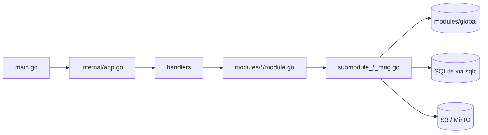

# S3Browser Architecture

[English](ARCHITECTURE.md) | [Tiếng Việt](ARCHITECTURE.vi.md) | [日本語](ARCHITECTURE.ja.md)

A short tour of the code for new developers. Conventions live in `CLAUDE.md`; this file explains how the pieces fit together.

## 1. Stack

- Desktop app on **Wails v3**: Go backend + React 19 / TypeScript frontend in a WebView.
- Backend: AWS SDK v2 (S3), `madmin-go` (MinIO admin), SQLite (modernc) + goose migrations + sqlc, `slog`.
- Frontend: Mantine 9, zustand 5 + immer, NiceModal, i18next (en / vi / ja), sonner (toast), `@tanstack/react-virtual`, zod, dayjs. Package manager: **bun**.

```
App/S3Browser
├── main.go                 entry: logger, Wails app, services, main window
├── internal/
│   ├── app.go              builds DB, modules and handlers; Shutdown
│   ├── handlers/           thin Wails services (bound to the frontend)
│   ├── modules/
│   │   ├── global/         shared connection container
│   │   ├── profile/        connection profiles (encrypted secrets)
│   │   ├── master/         master data (regions...)
│   │   └── bucket/         buckets, objects, upload, download, search
│   └── pkg/                cnst, db (schemas, queries, sqlc), logger, portable, utils
├── models/                 input/output models + alias.go
├── frontend/
│   ├── bindings/           GENERATED Wails bindings (do not edit)
│   └── src/                common, components, pages, locales, test
├── build/                  platform packaging (Windows NSIS, portable, ...)
└── docs/                   this documentation + PDF tooling
```

## 2. Backend

### 2.1 Layers



- `main.go` creates the logger and the Wails app, registers the three handlers with `application.NewService`, and creates the main window (`EnableFileDrop: true`).
- `internal/app.go` (`NewApp`) opens and migrates the database, creates the `KeyManager` (secret encryption), builds the modules, then the handlers on top. `Shutdown` cancels transfers, disconnects everything and closes the DB.
- **Handlers** (`internal/handlers/*_handler.go`) are thin: they only call the module. Their public methods become the TypeScript bindings.
- **Modules** (`internal/modules/<name>/module.go`) expose the documented public API. Work is split into unexported submodules (`submoduleXxxMng`, constructor `newSubmoduleXxxMng`) in `submodule_<x>_mng.go`.

### 2.2 Output and message codes

Every handler returns `models.Output[T]` (`Result`, `MessageList`, `Body`).

```go
output := models.NewOutput[T]()
output.AddMessage(msg)             // keep Result = true
return output.ThrowError(msg)      // Result = false + message
```

- A message is built with `models.NewMessage` / `models.NewParamsMessage(type, module, CODE, errorDetail, params)`. Types: `S` success, `E` error, `W` warn, `I` info (`internal/pkg/cnst`).
- Codes are `var`s at the top of each `module.go`, format `<PREFIX><S|E|W><NNN>` (`S3E006`, `PFE001`, `MTE001`).
- The frontend translates a message with the key `ipcMessage:<moduleName>.<CODE>`, so **every new code needs a key in `frontend/src/locales/{en,vi,ja}/messages/ipcMessage.json`**.
- New models go under `models/<domain>/` (`*_input.go`, `*_output.go`, camelCase json tags) and must be re-exported in `models/alias.go`.

### 2.3 Connection container (`modules/global`)

`global.Module` holds `connContainer`, a `map[id]*S3Conn` guarded by `sync.RWMutex`. `S3Conn` bundles the S3 client, presign client, optional MinIO admin client and the `http.Transport`. `profile` registers connections, `bucket` reads them (`GetConnContainer`). `RemoveConn` / `ReplaceConn` return the old connection and **never close it**: the caller closes it after the lock is released, because closing does network I/O.

### 2.4 Context and cancellation

- Handlers that take `ctx` get the Wails call context, which ends when the frontend cancels the call but is detached from the app lifetime.
- `withCallContext(ctx, appCtx, timeout)` (`modules/bucket/call_helper.go`) derives the context for one call: it stops on frontend cancel, on app shutdown (`context.AfterFunc`) and on timeout. Always `defer` the returned cancel.
- `isCallCanceled(ctx)`: a canceled call returns `Result=false` **silently** (nobody waits); a timeout is still reported.
- Concurrency uses `errgroup` with `SetLimit`.

### 2.5 Events

Backend-to-frontend events are constants in `modules/<x>/events.go`, named `domain:kebab-name`, for example `uploader:upload-progress`, `downloader:download-progress`, `uploader:files-dropped`. They are registered in `init()` with `application.RegisterEvent[PayloadType](name)`; it must be called directly from `init` so the binding generator emits the payload type. Progress events are throttled (200 ms) by `utils.ReportEvery`. Dropped files come from `main.go` (`WindowFilesDropped` -> `BucketHandler.FilesDropped`) and are re-emitted as `uploader:files-dropped` / `uploader:picker-files-dropped`.

### 2.6 Database

SQLite file `data.db` in the app data dir (see `internal/pkg/portable`; WAL, foreign keys on, backed up on start).

- Migrations: goose, `internal/pkg/db/schemas/NNNNNN_name.sql`, run by `db.RunMigrations`.
- Queries: `internal/pkg/db/queries/<domain>/<snake_name>.sql` with `-- name: PascalName :one|many|exec`; SQL uses leading commas.
- Code: `go tool sqlc generate` writes `internal/pkg/db/sqlc` (generated, never edit).

## 3. Frontend

### 3.1 Calling the backend: `callIPC`

All backend calls go through `callIPC` (`frontend/src/common/utils/ipcUtils.ts`), never the binding directly:

```ts
const body = await callIPC(GetListObject, [input], { scope: `${SCOPE}/load`, signal });
```

- Shows the messages of `Output` as toasts (`showMessage`, default on) using `ipcMessage:<module>.<CODE>`.
- Returns the `body` on success, `null` on failure, cancel or stale result.
- `scope`: a newer call with the same scope makes the older result be dropped. `signal` (an `AbortController`) cancels the call, which also cancels the Go context.
- Bindings are imported from `@wails/...` (`frontend/bindings`, generated).

### 3.2 Stores

Stores are created with `createAppStore(creator, name)` (zustand + immer + devtools in dev; in dev they are also on `window.__stores`).

- Each store has `State`, `Action` and a `SCOPE` constant; every `set` is named: ``set(update, undefined, `${SCOPE}/actionName`)``.
- `reset()` calls `invalidateLoads(SCOPE)` so in-flight results of that store are dropped.
- Use narrow selectors or `useShallow`; never select a whole object.

### 3.3 Modals

Modals are NiceModal components wrapped by `createMantineModal` (`common/utils/modalUtils.ts`), with z-index managed by `modalStackStore`. Heavy modals are loaded on demand in `components/modals/lazyModals.ts` (`showConnectModal`, `showHistoryModal`), so they stay out of the main bundle. Use the wrappers in `components/buttons|inputs|modals` instead of raw Mantine components.

### 3.4 i18n

`locales/i18n.ts` loads en / vi / ja. Each language has a `resource.ts` registering one namespace per component/page (`locales/<lang>/components|pages|messages`). No hard-coded UI strings: add keys to **all three** languages and register new namespaces in all three `resource.ts`.

### 3.5 Events

Backend events are consumed with `Events.On(name, handler)` from `@wailsio/runtime` inside `useEffect`, and the returned unsubscribe function is called in the cleanup (see `UploaderWindow`, `DownloaderWindow`, `useFilesDroppedUpload`).

### 3.6 Lists and performance

Large lists (objects, buckets, uploader, history, file lists) are virtualized with `@tanstack/react-virtual`. Object lists page with a cursor (`useObjectPaging`, `OBJECT_PAGE_SIZE = 20`). List items are `memo`; every function in a component is wrapped in `useCallback`; handlers are named `on<Event><Target>` (`onClickConnect`).

### 3.7 Layout

`App.tsx` -> `MainLayout` (navbar, tab layout, uploader/downloader windows) -> `TabLayout` (lazy) -> `TabDetail` -> `pages/bucket` and `pages/object`. State lives in `common/stores` (`profileStore`, `tabListStore`, `uploaderStore`, `downloaderStore`, `masterDataStore`).

## 4. Bindings and commands

Wails bindings are generated from the Go handlers; regenerate after any change to a handler signature or model:

```
go tool wails3 generate bindings -clean=true -ts
```

| Task | Command (run in `App/S3Browser` unless noted) |
|---|---|
| Dev | `go tool wails3 task dev` |
| Build | `go tool wails3 task build` |
| Package (installer) | `go tool wails3 task package` |
| Portable (Windows) | `go tool wails3 task build:portable WEBVIEW2_DIR=<WebView2 Fixed Version folder>` |
| Go check | `go build ./...`, `go vet ./...`, `go tool golangci-lint run ./...` |
| sqlc | `go tool sqlc generate` |
| FE type-check (`frontend/`) | `node_modules/.bin/tsc --noEmit` (`tsc.exe` on Windows) |
| FE lint / format | `npx oxlint <paths>`, `node_modules/.bin/biome check --write <paths>` |
| FE test | `bun run test` (vitest); tests live in `frontend/src/test/` mirroring `src/` |
| User guide PDF | `bun run --cwd docs build:pdf` (or `go tool wails3 task docs:pdf`) |

Go tools (wails3, sqlc, golangci-lint) are declared in the `tool (...)` block of `go.mod`, so no separate install is needed. The backend has no unit tests; the frontend requires at least 95% branch and line coverage per changed file.
