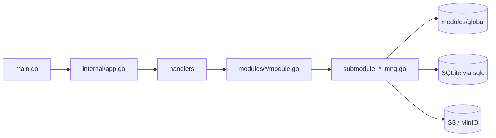

# Архитектура S3Browser

[English](ARCHITECTURE.md) | [Tiếng Việt](ARCHITECTURE.vi.md) | [日本語](ARCHITECTURE.ja.md) | [简体中文](ARCHITECTURE.zh-CN.md) | [繁體中文](ARCHITECTURE.zh-TW.md) | [Русский](ARCHITECTURE.ru.md) | [Deutsch](ARCHITECTURE.de.md)

Краткий обзор кода для новых разработчиков. Соглашения описаны в `CLAUDE.md`; этот файл объясняет, как части связаны между собой.

## 1. Стек

- Настольное приложение на **Wails v3**: бэкенд на Go + фронтенд на React 19 / TypeScript в WebView.
- Бэкенд: AWS SDK v2 (S3), `madmin-go` (администрирование MinIO), SQLite (modernc) + миграции goose + sqlc, `slog`.
- Фронтенд: Mantine 9, zustand 5 + immer, NiceModal, i18next (7 языков: en / vi / ja / zh-CN / zh-TW / ru / de), sonner (toast), `@tanstack/react-virtual`, zod, dayjs. Менеджер пакетов: **bun**.

```
s3-browser
├── main.go                 точка входа: logger, Wails app, сервисы, главное окно
├── internal/
│   ├── app.go              создаёт БД, модули и обработчики; Shutdown
│   ├── handlers/           тонкие сервисы Wails (привязаны к фронтенду)
│   ├── modules/
│   │   ├── global/         общий контейнер подключений и кэш доступа
│   │   ├── profile/        профили подключения (секреты зашифрованы)
│   │   ├── master/         справочные данные (регионы...)
│   │   ├── bucket/         подключение, бакеты, политика бакета, объекты, загрузка, скачивание, поиск
│   │   ├── setting/        настройки приложения (settings.json), запомненные вкладки (tabs.json), автозапуск
│   │   └── update/         самообновление из GitHub Releases
│   └── pkg/                cnst, db (schemas, queries, sqlc), logger, portable, utils
├── models/                 модели ввода/вывода + alias.go
├── frontend/
│   ├── bindings/           СГЕНЕРИРОВАННЫЕ привязки Wails (не редактировать)
│   └── src/                common, components, pages (pages/tab), locales, test
├── build/                  упаковка для платформ (Windows NSIS, portable, ...)
└── docs/                   эта документация + инструменты для PDF
```

## 2. Бэкенд

### 2.1 Слои



- `main.go` создаёт logger и приложение Wails, регистрирует пять обработчиков (bucket, master, profile, setting, update) через `application.NewService` и создаёт главное окно (`EnableFileDrop: true`).
- `internal/app.go` (`NewApp`) открывает базу данных и применяет миграции, создаёт `KeyManager` (шифрование секретов), собирает модули, а поверх них обработчики. `Shutdown` отменяет передачи, отключает все подключения и закрывает БД.
- **Обработчики** (`internal/handlers/*_handler.go`) тонкие: они только вызывают модуль. Их публичные методы становятся привязками TypeScript.
- **Модули** (`internal/modules/<name>/module.go`) предоставляют публичный API с doc-комментариями. Работа разделена на неэкспортируемые подмодули (`submoduleXxxMng`, конструктор `newSubmoduleXxxMng`) в `submodule_<x>_mng.go`.

### 2.2 Вывод и коды сообщений

Каждый обработчик возвращает `models.Output[T]` (`Result`, `MessageList`, `Body`).

```go
output := models.NewOutput[T]()
output.AddMessage(msg)             // Result остаётся true
return output.ThrowError(msg)      // Result = false + сообщение
```

- Сообщение создаётся через `models.NewMessage` / `models.NewParamsMessage(type, module, CODE, errorDetail, params)`. Типы: `S` успех, `E` ошибка, `W` предупреждение, `I` информация (`internal/pkg/cnst`).
- Коды — это `var` в начале каждого `module.go`, формат `<PREFIX><S|E|W><NNN>` (`S3E006`, `PFE001`, `MTE001`, `UPE004`).
- Фронтенд переводит сообщение по ключу `ipcMessage:<moduleName>.<CODE>`, поэтому **для каждого нового кода нужен ключ в `frontend/src/locales/{en,vi,ja,zh-CN,zh-TW,ru,de}/messages/ipcMessage.json`**.
- Новые модели размещаются в `models/<domain>/` (`*_input.go`, `*_output.go`, json-теги в camelCase) и должны быть реэкспортированы в `models/alias.go`.

### 2.3 Контейнер подключений и кэш доступа (`modules/global`)

`global.Module` хранит `connContainer` — `map[id]*S3Conn`, защищённый `sync.RWMutex`. `S3Conn` объединяет клиент S3, presign-клиент, необязательный административный клиент MinIO, `http.Transport` и учётные данные (`Creds`, `CredInfo`). `profile` регистрирует подключения, `bucket` читает их (`GetConnContainer`). `RemoveConn` / `ReplaceConn` возвращают старое подключение и **никогда его не закрывают**: закрытие выполняет вызывающий код после снятия блокировки, потому что закрытие требует сетевого ввода-вывода.

У каждого подключения также есть `AccessCache` (`access_cache.go`): по имени бакета он запоминает, отклонён ли доступ на чтение, запись и удаление, а также режим политики бакета, показываемый в виде бейджа. Записи истекают через `accessTTL` (5 минут). `Reset` увеличивает generation, поэтому проверка, начатая до сброса (со старыми учётными данными), не может записать результат. Список бакетов использует кэш, чтобы помечать недоступные / доступные только для чтения бакеты, не проверяя каждый бакет заново.

### 2.4 Контекст и отмена

- Обработчики, принимающие `ctx`, получают контекст вызова Wails: он завершается, когда фронтенд отменяет вызов, но не связан со временем жизни приложения.
- `withCallContext(ctx, appCtx, timeout)` (`modules/bucket/call_helper.go`) создаёт контекст для одного вызова: он останавливается при отмене фронтендом, при завершении приложения (`context.AfterFunc`) и по тайм-ауту. Всегда вызывайте `defer` для возвращаемой функции cancel.
- `isCallCanceled(ctx)`: отменённый вызов **молча** возвращает `Result=false` (никто не ждёт); тайм-аут по-прежнему сообщается.
- Параллелизм использует `errgroup` с `SetLimit`. Код внутри `g.Go` не должен паниковать: Wails не перехватывает паники дополнительных горутин.

### 2.5 События

События от бэкенда к фронтенду — это константы в `modules/<x>/events.go` с именами вида `domain:kebab-name`, например `uploader:upload-progress-batch`, `downloader:download-progress-batch`, `uploader:files-dropped`, `bucket:credential-expiring` и `update:state-changed`. Они регистрируются в `init()` через `application.RegisterEvent[PayloadType](name)`; вызов должен идти прямо из `init`, чтобы генератор привязок создал тип полезной нагрузки. События прогресса группируются: один общий тикер на 200 мс (`utils.BatchReporter`) отправляет одно событие с прогрессом всех выполняющихся задач (`{items: [...]}`). Перетащенные файлы приходят из `main.go` (`WindowFilesDropped` -> `BucketHandler.FilesDropped`) и повторно отправляются как `uploader:files-dropped` / `uploader:picker-files-dropped`.

### 2.6 База данных

Файл SQLite `data.db` находится в каталоге данных приложения (см. `internal/pkg/portable`; WAL, внешние ключи включены, резервная копия при запуске).

- Миграции: goose, `internal/pkg/db/schemas/NNNNNN_name.sql`, выполняются `db.RunMigrations`.
- Запросы: `internal/pkg/db/queries/<domain>/<snake_name>.sql` с `-- name: PascalName :one|many|exec`; в SQL запятые ставятся в начале строки.
- Код: `go tool sqlc generate` пишет в `internal/pkg/db/sqlc` (генерируется, не редактировать).

### 2.7 Настройки приложения и запомненные вкладки (`modules/setting`)

Тема, шрифт, язык, запуск при старте системы и параметры обновления (`autoUpdate`, `betaUpdate`) хранятся в `settings.json` в том же каталоге данных, что и `data.db` (не в SQLite).

- `GetSettings`, `SaveSettings`, `ResetSettings` (`SettingHandler`). Значения проверяются по фиксированным спискам (`languages` в `submodule_setting_mng.go` содержит 7 кодов языков); при отсутствии или повреждении файла используются значения по умолчанию (`light`, `nunito`, `en`, автообновление включено), неизвестное значение сбрасывает только своё поле.
- Запись атомарная (временный файл + rename) под мьютексом. `ResetSettings` лишь возвращает значения по умолчанию; ничего не записывается до Save.
- После успешного `SaveSettings` обработчик передаёт `betaUpdate` и `autoUpdate` в `update.Module` (`SetBeta`, `SetAutoUpdate`).
- Запуск при старте системы пишет в `HKCU\Software\Microsoft\Windows\CurrentVersion\Run` (`autostart_windows.go`). Он не поддерживается в портативной сборке и в других ОС (`autostartSupported=false`). Save сначала пишет файл, затем реестр; если запись в реестр не удалась, в файле остаётся старое значение и возвращается предупреждение `STE003`.
- `main.go` один раз читает тему, чтобы задать цвет фона окна до загрузки страницы.
- Запомненные вкладки: `GetTabState` / `SaveTabState` (`SettingHandler`) читают и пишут `tabs.json` (`submodule_tab_mng.go`): порядок вкладок, активную вкладку и профиль каждой вкладки. Отсутствующий, повреждённый или недопустимый файл даёт пустое состояние.

### 2.8 Аутентификация и подключения (`modules/profile`, `modules/bucket`)

У профиля есть `provider` (`aws` или `minio`) и `authType` (`internal/pkg/cnst/auth.go`). `cnst.IsAuthTypeValid` проверяет эту пару; список должен совпадать с CHECK миграции `000002_auth_methods.sql` и с `authMethods.ts` во фронтенде.

| Провайдер | Типы аутентификации |
|---|---|
| `aws` | `static`, `sharedProfile`, `assumeRole`, `sso`, `defaultChain`, `anonymous` |
| `minio` | `static`, `minioAssumeRole`, `minioLdap`, `minioOidc`, `minioCert`, `anonymous` |

- Профили хранятся в SQLite: несекретные параметры — в JSON-столбце (`auth_config`), секреты шифруются через `KeyManager` (`auth_secret`).
- `buildCredentials` (`submodule_cfg_credentials.go`) определяет учётные данные для типа аутентификации и **получает их один раз**, поэтому неверный профиль, истёкшая сессия SSO или отклонённая роль приводят к ошибке при подключении со своим сообщением (`S3E030` - `S3E038`, `PFE009`), а не при первом запросе.
  - Типы на основе AWS CLI (`sharedProfile`, `sso`, `assumeRole`, `defaultChain`) используют конфигурационные файлы SDK. `assumeRole` с серийным номером MFA использует одноразовый код только один раз, поэтому без нового кода обновление невозможно.
  - `minioAssumeRole` (ключ доступа + секретный ключ) и `minioLdap` (пользователь + пароль LDAP) обращаются к конечной точке STS MinIO (это конечная точка S3). Учётные данные **обновляются сами** до истечения срока, потому что секреты остаются в памяти внутри провайдера (никогда не логируются).
  - `minioCert` обращается к STS MinIO с клиентским TLS-сертификатом (mTLS, `AssumeRoleWithCertificate`, нужен https). Ключ PEM может быть зашифрован по PKCS#8 (`submodule_cert_loader.go`).
  - `minioOidc` обменивает токены входа через OpenID Connect на учётные данные MinIO (`AssumeRoleWithWebIdentity`).
  - `anonymous` отправляет неподписанные запросы; бакеты должен ввести пользователь, потому что анонимный клиент не может получить список бакетов.
- **OIDC** (`submodule_oidc_login.go`): поток authorization code с **PKCE**, только публичный клиент. Системный браузер открывает страницу IdP, локальный сервер на `127.0.0.1` принимает перенаправление и сразу останавливается. Вход ограничен 5 минутами (`oidcLoginTimeout`). Сессия (токены) хранится **только в памяти бэкенда**, переиспользуется не дольше 10 минут (`oidcSessionTTL`, а также не дольше срока действия токена) и применяется один раз за подключение; фронтенд хранит только `sessionId` и никогда не видит токен. Если сессия уже использована, нужен новый вход (`S3E030`). Профили OIDC никогда не подключаются автоматически (`cnst.IsAutoConnectAllowed`), как и профили `assumeRole` с серийным номером MFA.
- **Безопасность URL**: каждый URL, полученный от IdP (issuer, конечные точки документа discovery), должен пройти `utils.IsSecureUrl` (`internal/pkg/utils/url.go`): `https` или `http` только для loopback-хоста. Форма профиля проверяется так же (`profile/submodule_auth_mng.go`).
- **Собственный CA**: любой тип аутентификации MinIO может добавить файл CA (`AuthConfig.CaFile`). `newTransport` добавляет его в системный пул (`S3E049`, если загрузить не удалось), и он применяется только к транспорту MinIO (S3 и STS); к IdP обращение идёт с хранилищем доверия ОС. `newTransport` всегда задаёт `TLSClientConfig`, потому что minio-go пишет в него при mTLS. `ChooseAuthFile` открывает системный диалог для файлов сертификата, ключа и CA; отмена диалога не является ошибкой (`utils.IsDialogCancelled`).
- **Повторная аутентификация**: `ReauthConnection` обновляет учётные данные живого подключения, не разрывая его (провайдер за `SwapCreds` заменяется, `madmin` читает через тот же провайдер), поэтому текущие передачи продолжаются. Секреты, которые профиль не сохраняет (`mfaCode`, `secretKey`, `ldapPassword`), передаются фронтендом только для этого вызова.
- **Предупреждение об истечении**: когда учётные данные нельзя обновить без пользователя (`CredInfo.Refreshable=false`), бэкенд до истечения срока отправляет `bucket:credential-expiring` (`CredentialExpiringOutput`); фронтенд (`useCredentialExpiring`) показывает toast.

### 2.9 Управление бакетами и политика бакета (`modules/bucket`)

- `CreateBucket`, `GetBucketDetail`, `GetBucketDeleteInfo`, `DeleteBucket`, `GetBucketPolicy`, `PutBucketPolicy` и `CheckBucketAccess` находятся в `module.go`; работа выполняется в `submodule_bucket_mng.go`, `submodule_bucket_detail.go`, `submodule_bucket_delete.go`, `submodule_bucket_edit_mng.go` и `submodule_bucket_policy.go`.
- **Режимы доступа** бакета: `private` (без политики), `public` только чтение (`GetObject`, `ListBucket`, `GetBucketLocation` для `*`) и `custom` (JSON). ACL нет. Политики сравниваются по смыслу (`samePolicy`), потому что MinIO возвращает нормализованную политику. В настоящем AWS запросы политик идут в регион бакета (`policyOptFns`), а Block Public Access только читается и показывается как предупреждение (`S3E058` при сохранении публичной политики, которую он блокирует).
- При создании бакета режим доступа можно задать в том же вызове. Если бакет создан, а политику задать не удалось, бакет сохраняется, `Result` остаётся true и возвращается предупреждение (`S3W011` или `S3W012` для Block Public Access).
- **Бейдж**: список бакетов показывает режим политики каждого бакета (`PolicyBadge`). `GetListBucket` заполняет `PolicyMode` из `AccessCache`, параллельно читает недостающие и кэширует только однозначные ответы (`isSurePolicyError`), поэтому тайм-аут повторяется. Анонимные подключения пропускаются.
- **Удаление**: пользователь вводит имя бакета. Непустой бакет сначала очищается (все версии и маркеры удаления через общий `batchDeleter`), затем выполняется `DeleteBucket` (тайм-аут 30 минут). Непустой бакет с Object Lock отклоняется до удаления любого объекта (`S3E063`). Нет события прогресса и кнопки отмены; закрытие приложения молча останавливает удаление. Пункт меню «Удалить» скрывается только тогда, когда точно известно, что учётной записи отказано в `s3:DeleteBucket` (`AccessDelete`).
- Анонимные подключения не могут создавать, изменять или удалять бакеты (`S3E054`), но могут открыть панель сведений.

### 2.10 Автообновление (`modules/update`)

`update.Module` проверяет **GitHub Releases** репозитория `TranMinhTruyen/s3-browser` на наличие новой версии, скачивает установщик NSIS и запускает его. `UpdateHandler` предоставляет `GetUpdateState`, `CheckUpdate`, `DownloadUpdate` и `InstallUpdate`.

- **Поддерживаемые сборки**: только сборка Windows, установленная установщиком NSIS (он записывает `uninstall.exe` рядом с exe; `installSupported`). Портативные и распакованные сборки, а также другие ОС не поддерживаются, и фронтенд скрывает функцию (`supported=false`). В режиме dev она всегда включена для тестирования. Версия берётся из `build/config.yml` (встроен в `main.go`).
- **Каналы**: один провайдер GitHub только для стабильных релизов и один, включающий пре-релизы; параметр `betaUpdate` выбирает канал (`SetBeta`). При включённой бете учитывается только более новый пре-релиз.
- **Проверка**: `CheckUpdate` выполняется по запросу пользователя. Когда `autoUpdate` включено, цикл проверяет через 10 секунд после запуска, а затем каждые 6 часов (`checkInterval`), и новый релиз начинает скачиваться сам; сбои цикла только записываются в лог.
- **Контрольная сумма**: ресурс релиза `checksums.txt` должен содержать SHA-256 установщика `S3Browser-<version>-windows-<arch>-installer.exe`. Хэш считается во время скачивания во временный каталог, и файл удаляется, если хэш не совпал (`UPE004`). `InstallUpdate` проверяет его ещё раз перед запуском, потому что во временный каталог могут писать другие программы. Скачивание идёт только с хостов GitHub.
- **Установка**: установщик запускается тихо через `ShellExecute` (запрос UAC, `/S /relaunch /D=<каталог установки>`), затем приложение завершается, а установщик запускает новую версию. Если установщик запустить не удалось, приложение продолжает работать (`UPE005`). Скачанный установщик удаляется после следующего запуска.
- **Состояние**: `UpdateStateOutput` (`supported`, `state`, `currentVersion`, `version`, `releaseUrl`, `written`, `total`, `errorCode` — код `UPE...` при `state` = `error`). `state` — это `idle`, `checking`, `upToDate`, `available`, `downloading`, `ready` или `error`. Каждое изменение, а во время скачивания — каждые 200 мс, отправляется событием `update:state-changed`.
- **Сообщения**: `UPS001` (последняя версия), `UPE001` (не удалось проверить), `UPE002` (ограничение запросов GitHub), `UPE003` (не удалось скачать), `UPE004` (контрольная сумма), `UPE005` (не удалось запустить установщик), `UPE006` (нет установщика для этого компьютера).

## 3. Фронтенд

### 3.1 Вызов бэкенда: `callIPC`

Все вызовы бэкенда идут через `callIPC` (`frontend/src/common/utils/ipcUtils.ts`), а не напрямую через привязку:

```ts
const body = await callIPC(GetListObject, [input], { scope: `${SCOPE}/load`, signal });
```

- Показывает сообщения `Output` как toast (`showMessage`, по умолчанию включено) по ключу `ipcMessage:<module>.<CODE>`.
- Возвращает `body` при успехе и `null` при ошибке, отмене или устаревшем результате.
- `scope`: более новый вызов с тем же scope приводит к отбрасыванию более старого результата. `signal` (`AbortController`) отменяет вызов, что также отменяет контекст Go.
- Привязки импортируются из `@wails/...` (`frontend/bindings`, сгенерированы).

### 3.2 Хранилища

Хранилища создаются через `createAppStore(creator, name)` (zustand + immer + devtools в dev; в dev они также доступны в `window.__stores`).

- У каждого хранилища есть `State`, `Action` и константа `SCOPE`; каждый `set` именуется: ``set(update, undefined, `${SCOPE}/actionName`)``.
- `reset()` вызывает `invalidateLoads(SCOPE)`, чтобы выполняющиеся результаты этого хранилища отбрасывались.
- Используйте узкие селекторы или `useShallow`; никогда не выбирайте объект целиком.

### 3.3 Модальные окна

Модальные окна — это компоненты NiceModal, обёрнутые `createMantineModal` (`common/utils/modalUtils.ts`), z-index управляется `modalStackStore`. Тяжёлые модальные окна загружаются по требованию в `components/modals/lazyModals.ts` (`showConnectModal`, `showHistoryModal`, `showSettingModal`), поэтому не попадают в основной бандл. Используйте обёртки из `components/buttons|inputs|modals` вместо «сырых» компонентов Mantine. Футер модального окна: «Отмена» слева, действия справа (`<Group justify="space-between" wrap="nowrap">`); основная область содержимого — в `<Paper withBorder>`.

### 3.4 i18n

`locales/i18n.ts` поддерживает **7 языков**: `en`, `vi`, `ja`, `zh-CN`, `zh-TW`, `ru`, `de` (`LANGUAGES` и собственные названия языков `LANGUAGE_LABELS` находятся в `common/cnst/settingConst.ts`). Статически импортируется только `en`; остальные загружаются динамическим `import()` (`RESOURCE_LOADERS`) через `loadLanguage` перед `changeLanguage`. У каждого языка есть `resource.ts`, регистрирующий по одному пространству имён на компонент/страницу (`locales/<lang>/components|pages|messages`). Строки интерфейса не пишутся в коде: добавляйте ключи во **все семь** языков (те же ключи и плейсхолдеры `{{x}}`, что в `en`) и регистрируйте новые пространства имён во всех семи `resource.ts`. Для CJK-языков в `getFontFamily` предусмотрены собственные запасные шрифты.

### 3.5 События

События бэкенда принимаются через `Events.On(name, handler)` из `@wailsio/runtime` внутри `useEffect`, а возвращаемая функция отписки вызывается при очистке (см. `UploaderWindow`, `DownloaderWindow`, `useFilesDroppedUpload`, `useAppUpdate`).

### 3.6 Списки и производительность

Большие списки (объекты, бакеты, загрузчик, история, списки файлов) виртуализируются через `@tanstack/react-virtual`. Списки объектов подгружаются страницами по курсору (`useObjectPaging`, первая страница `FIRST_PAGE_SIZE = 200`, следующие `NEXT_PAGE_SIZE = 1000`). Элементы списка обёрнуты в `memo`; каждая функция в компоненте обёрнута в `useCallback`; обработчики называются `on<Event><Target>` (`onClickConnect`).

### 3.7 Макет и вкладки

`App.tsx` -> `MainLayout` (панель навигации, окна загрузчика/скачивания) -> `RouterItem` -> `TabPage` (lazy, `pages/tab/TabPage.tsx`). `TabPage` содержит панель вкладок (`SortableTab`, перетаскивание через dnd-kit, перестановка с клавиатуры Ctrl+Shift+Влево/Вправо) и отображает `TabDetail`, который показывает `pages/tab/bucket` (`BucketListView`, `BucketItem`) или `pages/tab/object` (`ObjectListView`, `ObjectItem`). Общие части находятся в `pages/tab/components` (`BucketDetailDrawer`, `ObjectDetailDrawer`, `TabActionBar`, `TabBreadcrumb`). Состояние находится в `common/stores` (`profileStore`, `tabListStore`, `uploaderStore`, `downloaderStore`, `masterDataStore`, `settingStore`, `updateStore`).

**Запоминание вкладок**: `useTabPersistence` (вызывается в `App.tsx`) сохраняет порядок вкладок, активную вкладку и профиль каждой вкладки в `tabs.json` через `SaveTabState` спустя 500 мс после прекращения изменений и при `pagehide`. При запуске `restoreTabsFromDisk` (`common/utils/tabPersistence.ts`) загружает их через `GetTabState`. Если загрузка не удалась, сохранение на этот сеанс отключается, чтобы `tabs.json` никогда не был перезаписан. Вкладка, профиль которой удалён, сохраняет своё место, но теряет профиль (`normalizeTabProfiles`).

### 3.8 Настройки, тема и обновления

`main.tsx` ждёт `loadStartupData()` перед отрисовкой (параллельно загружает настройки и `restoreTabsFromDisk()`), поэтому тема, шрифт, язык и сохранённые вкладки готовы первыми (при ошибке используются значения по умолчанию). `settingStore` хранит `saved` (файл), `applied` (текущий сеанс, меняется через Apply) и `draft` (форма, предпросмотр на лету); закрытие окна возвращает `applied`. `applySettings` задаёт цветовую схему Mantine (`settingColorSchemeManager` в памяти, без localStorage), переменную `--mantine-font-family` и язык i18n.

`AppUpdateToast` один раз монтирует `useAppUpdate`: он загружает состояние через `GetUpdateState`, передаёт `update:state-changed` в `updateStore` и поддерживает один toast в актуальном состоянии (новая версия с кнопкой «Скачать» при выключенном автообновлении, прогресс скачивания, готово к установке). Если `supported` равно false, ничего не показывается.

Цвета: используйте `var(--mantine-color-*)` и `light-dark(<light>, <dark>)`, не задавайте hex/rgb в коде (кроме цветов, хранимых как данные, например цвета профиля).

## 4. Привязки и команды

Привязки Wails генерируются из обработчиков Go; генерируйте заново после любого изменения сигнатуры обработчика или модели:

```
go tool wails3 generate bindings -clean=true -ts
```

| Задача | Команда (из корня репозитория, если не указано иное) |
|---|---|
| Разработка | `go tool wails3 task dev` |
| Сборка | `go tool wails3 task build` |
| Пакет (установщик) | `go tool wails3 task package` |
| Портативная (Windows) | `go tool wails3 task build:portable WEBVIEW2_DIR=<папка WebView2 Fixed Version>` |
| Проверка Go | `go build ./...`, `go vet ./...`, `go tool golangci-lint run ./...` |
| sqlc | `go tool sqlc generate` |
| Проверка типов FE (`frontend/`) | `node_modules/.bin/tsc --noEmit` (`tsc.exe` в Windows) |
| Lint / формат FE | `npx oxlint <paths>`, `node_modules/.bin/biome check --write <paths>` |
| Тесты FE | `bun run test` (vitest); тесты лежат в `frontend/src/test/` по структуре `src/` |
| PDF руководства пользователя | `bun run --cwd docs build:pdf` (или `go tool wails3 task docs:pdf`) |

Инструменты Go (wails3, sqlc, golangci-lint) объявлены в блоке `tool (...)` файла `go.mod`, поэтому отдельная установка не нужна. В бэкенде нет закоммиченных модульных тестов; для фронтенда требуется покрытие веток и строк не менее 95% на каждый изменённый файл.
