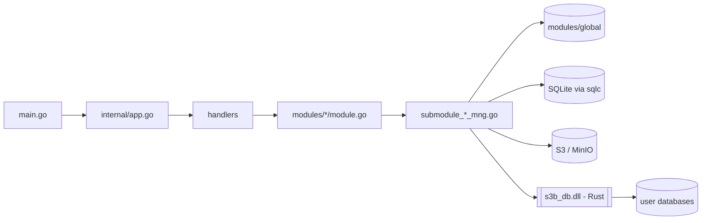
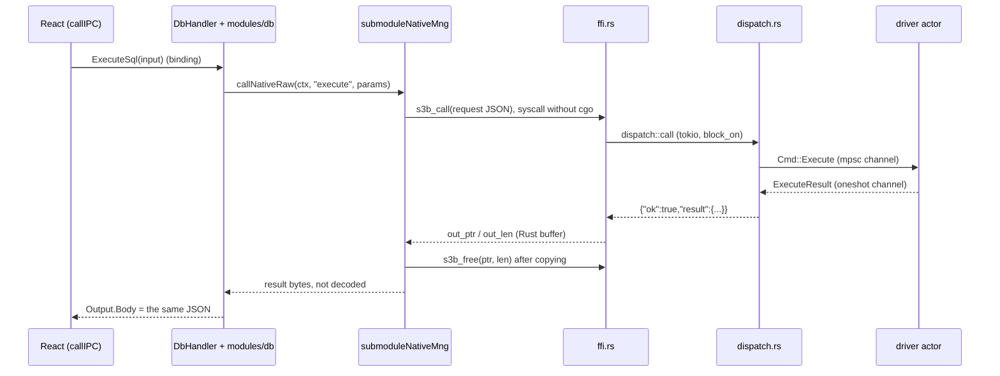

# Kiến trúc S3Browser

[English](ARCHITECTURE.md) | [Tiếng Việt](ARCHITECTURE.vi.md) | [日本語](ARCHITECTURE.ja.md) | [简体中文](ARCHITECTURE.zh-CN.md) | [繁體中文](ARCHITECTURE.zh-TW.md) | [Русский](ARCHITECTURE.ru.md) | [Deutsch](ARCHITECTURE.de.md)

Tổng quan ngắn gọn về mã nguồn dành cho lập trình viên mới. Các quy ước nằm trong `CLAUDE.md`; tài liệu này giải thích các phần ghép với nhau như thế nào.

## 1. Stack

- Ứng dụng desktop trên **Wails v3**: backend Go + frontend React 19 / TypeScript chạy trong WebView. Chỉ chạy trên Windows.
- Backend: AWS SDK v2 (S3), `madmin-go` (MinIO admin), SQLite (modernc) + goose migration + sqlc, `slog`.
- Thư viện DB native: **Rust** `s3b_db.dll` (tokio + mỗi database một driver mức thấp), được Go nạp **không qua cgo**. Thư viện này làm toàn bộ việc của chế độ SQL trên database của người dùng (mục 2.11).
- Frontend: Mantine 9, zustand 5 + immer, NiceModal, i18next (7 ngôn ngữ: en / vi / ja / zh-CN / zh-TW / ru / de), sonner (toast), `@tanstack/react-virtual`, zod, dayjs. Package manager: **bun**.

```
s3-browser
├── main.go                 điểm vào: logger, Wails app, service, cửa sổ chính
├── internal/
│   ├── app.go              dựng DB, module và handler; Shutdown
│   ├── handlers/           Wails service mỏng (bind sang frontend)
│   ├── modules/
│   │   ├── global/         container kết nối dùng chung và access cache
│   │   ├── profile/        profile kết nối (secret được mã hoá)
│   │   ├── master/         dữ liệu master (region...)
│   │   ├── bucket/         kết nối, bucket, bucket policy, object, upload, download, tìm kiếm
│   │   ├── db/             chế độ SQL: profile DB, kết nối, truy vấn -> gọi s3b_db.dll
│   │   ├── setting/        cài đặt app (settings.json), tab được ghi nhớ (tabs.json), autostart
│   │   └── update/         tự cập nhật từ GitHub Releases
│   └── pkg/                cnst, db (schemas, queries, sqlc), logger, memprobe, portable, utils
├── models/                 model input/output + alias.go
├── rust/                   Cargo workspace của s3b_db.dll: src/{ffi,dispatch,registry,runtime}.rs, protocol/, drivers/, tests/
├── frontend/
│   ├── bindings/           binding Wails ĐƯỢC SINH TỰ ĐỘNG (không sửa tay)
│   └── src/                common, components, pages (pages/s3, pages/sql), locales, test
├── build/                  đóng gói theo nền tảng (Windows NSIS, portable, ...) và Taskfile (build:dll, copy:dll)
├── test-env/               server test bằng Docker (MinIO, Keycloak, LDAP, 6 database), script đo hiệu năng
└── docs/                   tài liệu này + công cụ tạo PDF
```

## 2. Backend

### 2.1 Các lớp



- `main.go` tạo logger và Wails app, đăng ký sáu handler (bucket, db, master, profile, setting, update) bằng `application.NewService`, rồi tạo cửa sổ chính (`EnableFileDrop: true`).
- `internal/app.go` (`NewApp`) mở và migrate database, tạo `KeyManager` (mã hoá secret), dựng các module, sau đó dựng handler phía trên. `Shutdown` huỷ các tiến trình truyền tải, ngắt mọi kết nối và đóng DB.
- **Handler** (`internal/handlers/*_handler.go`) mỏng: chỉ gọi xuống module. Các method public của handler trở thành binding TypeScript.
- **Module** (`internal/modules/<name>/module.go`) là API public có doc comment. Công việc được chia cho các submodule không export (`submoduleXxxMng`, constructor `newSubmoduleXxxMng`) trong `submodule_<x>_mng.go`.

### 2.2 Output và mã message

Mọi handler trả về `models.Output[T]` (`Result`, `MessageList`, `Body`).

```go
output := models.NewOutput[T]()
output.AddMessage(msg)             // giữ Result = true
return output.ThrowError(msg)      // Result = false + message
```

- Message được tạo bằng `models.NewMessage` / `models.NewParamsMessage(type, module, CODE, errorDetail, params)`. Các loại: `S` thành công, `E` lỗi, `W` cảnh báo, `I` thông tin (`internal/pkg/cnst`).
- Mã là các `var` ở đầu mỗi `module.go`, định dạng `<PREFIX><S|E|W><NNN>` (`S3E006`, `PFE001`, `MTE001`, `UPE004`).
- Frontend dịch message bằng key `ipcMessage:<moduleName>.<CODE>`, nên **mỗi mã mới cần một key trong `frontend/src/locales/{en,vi,ja,zh-CN,zh-TW,ru,de}/messages/ipcMessage.json`**.
- Model mới đặt trong `models/<domain>/` (`*_input.go`, `*_output.go`, json tag camelCase) và phải được re-export trong `models/alias.go`.

### 2.3 Container kết nối và access cache (`modules/global`)

`global.Module` giữ `connContainer`, một `map[id]*S3Conn` được bảo vệ bằng `sync.RWMutex`. `S3Conn` gói S3 client, presign client, MinIO admin client (tuỳ chọn), `http.Transport` và credential (`Creds`, `CredInfo`). `profile` đăng ký kết nối, `bucket` đọc chúng (`GetConnContainer`). `RemoveConn` / `ReplaceConn` trả về kết nối cũ và **không bao giờ đóng nó**: bên gọi đóng sau khi đã nhả lock, vì đóng kết nối có I/O mạng.

Mỗi kết nối còn có một `AccessCache` (`access_cache.go`): theo tên bucket, nó nhớ quyền đọc, ghi và xoá có bị từ chối hay không, cùng chế độ policy của bucket hiển thị dưới dạng badge. Mục cache hết hạn sau `accessTTL` (5 phút). `Reset` tăng một generation, nên lần dò đã bắt đầu trước khi reset (với credential cũ) không thể ghi kết quả. Danh sách bucket dùng cache này để đánh dấu bucket không truy cập được / chỉ đọc mà không phải dò lại mọi bucket.

### 2.4 Context và huỷ

- Handler nhận `ctx` sẽ có context của lời gọi Wails, kết thúc khi frontend huỷ lời gọi nhưng tách khỏi vòng đời của app.
- `withCallContext(ctx, appCtx, timeout)` (`modules/bucket/call_helper.go`) tạo context cho một lời gọi: nó dừng khi frontend huỷ, khi app tắt (`context.AfterFunc`) và khi hết timeout. Luôn `defer` hàm cancel trả về.
- `isCallCanceled(ctx)`: lời gọi bị huỷ trả `Result=false` **một cách im lặng** (không ai chờ); timeout vẫn được báo.
- Đồng thời dùng `errgroup` với `SetLimit`. Code trong `g.Go` không được panic: Wails không recover panic của goroutine phụ.

### 2.5 Event

Event từ backend sang frontend là các hằng trong `modules/<x>/events.go`, đặt tên `domain:kebab-name`, ví dụ `uploader:upload-progress-batch`, `downloader:download-progress-batch`, `uploader:files-dropped`, `bucket:credential-expiring` và `update:state-changed`. Chúng được đăng ký trong `init()` bằng `application.RegisterEvent[PayloadType](name)`; phải gọi trực tiếp từ `init` để bộ sinh binding sinh ra kiểu payload. Event tiến trình được gom lô: một ticker 200 ms dùng chung (`utils.BatchReporter`) gửi một event duy nhất chứa tiến trình của mọi job đang chạy (`{items: [...]}`). File được kéo thả đến từ `main.go` (`WindowFilesDropped` -> `BucketHandler.FilesDropped`) và được phát lại thành `uploader:files-dropped` / `uploader:picker-files-dropped`.

### 2.6 Database

File SQLite `data.db` trong thư mục dữ liệu của app (xem `internal/pkg/portable`; WAL, bật foreign key, sao lưu khi khởi động).

- Migration: goose, `internal/pkg/db/schemas/NNNNNN_name.sql`, chạy bởi `db.RunMigrations`.
- Query: `internal/pkg/db/queries/<domain>/<snake_name>.sql` với `-- name: PascalName :one|many|exec`; SQL viết dấu phẩy đứng đầu dòng.
- Code: `go tool sqlc generate` ghi ra `internal/pkg/db/sqlc` (sinh tự động, không sửa tay).

### 2.7 Cài đặt app và tab được ghi nhớ (`modules/setting`)

Theme, font, ngôn ngữ, khởi động cùng Windows và các tuỳ chọn cập nhật (`autoUpdate`, `betaUpdate`) nằm trong `settings.json` ở cùng thư mục dữ liệu với `data.db` (không nằm trong SQLite).

- `GetSettings`, `SaveSettings`, `ResetSettings` (`SettingHandler`). Giá trị được kiểm tra theo danh sách cố định (`languages` trong `submodule_setting_mng.go` chứa 7 mã ngôn ngữ); file thiếu hoặc hỏng thì dùng mặc định (`light`, `nunito`, `en`, bật tự cập nhật), giá trị lạ chỉ reset đúng trường đó.
- Ghi file là atomic (file tạm + rename) dưới một mutex. `ResetSettings` chỉ trả về mặc định; chưa ghi gì cho tới khi Save.
- Sau khi `SaveSettings` thành công, handler chuyển `betaUpdate` và `autoUpdate` cho `update.Module` (`SetBeta`, `SetAutoUpdate`).
- Khởi động cùng Windows ghi vào `HKCU\Software\Microsoft\Windows\CurrentVersion\Run` (`autostart_windows.go`). Không hỗ trợ trên bản portable hay hệ điều hành khác (`autostartSupported=false`). Save ghi file trước rồi mới ghi registry; nếu registry lỗi thì file giữ giá trị cũ và trả về cảnh báo `STE003`.
- `main.go` đọc theme một lần để đặt màu nền cửa sổ trước khi trang tải xong.
- Tab được ghi nhớ: `GetTabState` / `SaveTabState` (`SettingHandler`) đọc và ghi `tabs.json` (`submodule_tab_mng.go`): thứ tự tab, tab đang chọn và profile của từng tab. File thiếu, sai định dạng hoặc không hợp lệ cho ra trạng thái rỗng.

### 2.8 Xác thực và kết nối (`modules/profile`, `modules/bucket`)

Một profile có `provider` (`aws` hoặc `minio`) và `authType` (`internal/pkg/cnst/auth.go`). `cnst.IsAuthTypeValid` kiểm tra cặp này; danh sách phải khớp với CHECK của migration `000002_auth_methods.sql` và `authMethods.ts` ở frontend.

| Provider | Kiểu xác thực |
|---|---|
| `aws` | `static`, `sharedProfile`, `assumeRole`, `sso`, `defaultChain`, `anonymous` |
| `minio` | `static`, `minioAssumeRole`, `minioLdap`, `minioOidc`, `minioCert`, `anonymous` |

- Profile lưu trong SQLite: các tuỳ chọn không bí mật nằm ở cột JSON (`auth_config`), secret được mã hoá bằng `KeyManager` (`auth_secret`).
- `buildCredentials` (`submodule_cfg_credentials.go`) xác định credential của kiểu xác thực và **lấy chúng một lần**, nên profile sai, phiên SSO hết hạn hay role bị từ chối sẽ lỗi ngay lúc kết nối với message riêng (`S3E030` - `S3E038`, `PFE009`) thay vì ở request đầu tiên.
  - Các kiểu dựa trên AWS CLI (`sharedProfile`, `sso`, `assumeRole`, `defaultChain`) dùng file cấu hình của SDK. `assumeRole` có MFA serial dùng mã một lần đúng một lần, nên không thể gia hạn nếu không có mã mới.
  - `minioAssumeRole` (access key + secret) và `minioLdap` (user + mật khẩu LDAP) hỏi endpoint STS của MinIO (chính là endpoint S3). Credential **tự gia hạn** trước khi hết hạn vì secret nằm trong bộ nhớ bên trong provider (không bao giờ ghi log).
  - `minioCert` hỏi MinIO STS bằng chứng chỉ TLS của client (mTLS, `AssumeRoleWithCertificate`, cần https). Khoá PEM có thể được mã hoá PKCS#8 (`submodule_cert_loader.go`).
  - `minioOidc` đổi token của phiên đăng nhập OpenID Connect lấy credential MinIO (`AssumeRoleWithWebIdentity`).
  - `anonymous` gửi request không ký; người dùng phải nhập các bucket vì client ẩn danh không liệt kê được bucket.
- **OIDC** (`submodule_oidc_login.go`): luồng authorization code với **PKCE**, chỉ public client. Trình duyệt hệ thống mở trang của IdP, một server cục bộ trên `127.0.0.1` nhận redirect rồi tắt ngay. Đăng nhập hết hạn sau 5 phút (`oidcLoginTimeout`). Phiên (token) **chỉ nằm trong bộ nhớ backend**, được dùng lại tối đa 10 phút (`oidcSessionTTL`, đồng thời bị giới hạn bởi hạn của token) và chỉ dùng một lần cho mỗi lần kết nối; frontend chỉ giữ `sessionId` và không bao giờ thấy token. Khi phiên đã được dùng thì cần đăng nhập lại (`S3E030`). Profile OIDC không bao giờ tự kết nối (`cnst.IsAutoConnectAllowed`), profile `assumeRole` có MFA serial cũng vậy.
- **An toàn URL**: mọi URL đến từ IdP (issuer, các endpoint trong discovery document) phải qua `utils.IsSecureUrl` (`internal/pkg/utils/url.go`): `https`, hoặc `http` chỉ với host loopback. Form profile cũng được kiểm tra như vậy (`profile/submodule_auth_mng.go`).
- **CA tuỳ chỉnh**: mọi kiểu xác thực MinIO đều có thể thêm file CA (`AuthConfig.CaFile`). `newTransport` thêm nó vào pool hệ thống (`S3E049` nếu không tải được) và nó chỉ áp dụng cho transport của MinIO (S3 và STS); IdP được truy cập bằng kho tin cậy của hệ điều hành. `newTransport` luôn đặt `TLSClientConfig` vì minio-go ghi vào đó khi dùng mTLS. `ChooseAuthFile` mở hộp thoại native để chọn file chứng chỉ, khoá và CA; huỷ hộp thoại không phải là lỗi (`utils.IsDialogCancelled`).
- **Reauth**: `ReauthConnection` gia hạn credential của kết nối đang sống mà không ngắt nó (provider phía sau `SwapCreds` được thay, `madmin` đọc qua cùng provider), nên các tiến trình truyền tải đang chạy vẫn tiếp tục. Các secret mà profile không lưu (`mfaCode`, `secretKey`, `ldapPassword`) do frontend gửi cho đúng lời gọi đó.
- **Cảnh báo hết hạn**: khi credential không thể gia hạn mà không có người dùng (`CredInfo.Refreshable=false`), backend phát `bucket:credential-expiring` (`CredentialExpiringOutput`) trước khi hết hạn; frontend (`useCredentialExpiring`) hiện một toast.

### 2.9 Quản lý bucket và bucket policy (`modules/bucket`)

- `CreateBucket`, `GetBucketDetail`, `GetBucketDeleteInfo`, `DeleteBucket`, `GetBucketPolicy`, `PutBucketPolicy` và `CheckBucketAccess` nằm trong `module.go`; phần xử lý nằm ở `submodule_bucket_mng.go`, `submodule_bucket_detail.go`, `submodule_bucket_delete.go`, `submodule_bucket_edit_mng.go` và `submodule_bucket_policy.go`.
- **Chế độ truy cập** của bucket: `private` (không có policy), `public` chỉ đọc (`GetObject`, `ListBucket`, `GetBucketLocation` cho `*`) và `custom` (JSON). Không có ACL. Policy được so sánh theo ngữ nghĩa (`samePolicy`), vì MinIO trả về policy đã chuẩn hoá. Trên AWS thật, request policy đi tới region của bucket (`policyOptFns`), còn Block Public Access chỉ được đọc và hiển thị dưới dạng cảnh báo (`S3E058` khi lưu một policy public bị nó chặn).
- Tạo bucket có thể đặt chế độ truy cập ngay trong cùng lời gọi. Nếu bucket đã tạo nhưng đặt policy lỗi thì bucket được giữ lại, `Result` vẫn là true và trả về một cảnh báo (`S3W011`, hoặc `S3W012` với Block Public Access).
- **Badge**: danh sách bucket hiển thị chế độ policy của từng bucket (`PolicyBadge`). `GetListBucket` điền `PolicyMode` từ `AccessCache`, đọc song song những bucket còn thiếu, và chỉ cache các câu trả lời chắc chắn (`isSurePolicyError`) để timeout được thử lại. Kết nối ẩn danh bị bỏ qua.
- **Xoá**: người dùng gõ tên bucket. Bucket không rỗng được làm rỗng trước (mọi version và delete marker qua `batchDeleter` dùng chung), rồi `DeleteBucket` chạy (timeout 30 phút). Bucket không rỗng có Object Lock bị từ chối trước khi xoá bất kỳ object nào (`S3E063`). Không có event tiến trình và không có nút huỷ; đóng app sẽ dừng việc xoá một cách im lặng. Mục Xoá trong menu chỉ bị ẩn khi biết chắc tài khoản bị từ chối `s3:DeleteBucket` (`AccessDelete`).
- Kết nối ẩn danh không thể tạo, sửa hay xoá bucket (`S3E054`) nhưng vẫn mở được drawer chi tiết.

### 2.10 Tự cập nhật (`modules/update`)

`update.Module` kiểm tra **GitHub Releases** của `TranMinhTruyen/s3-browser` để tìm phiên bản mới, tải bộ cài NSIS và chạy nó. `UpdateHandler` cung cấp `GetUpdateState`, `CheckUpdate`, `DownloadUpdate` và `InstallUpdate`.

- **Bản build được hỗ trợ**: chỉ bản Windows cài bằng NSIS (bộ cài ghi `uninstall.exe` cạnh file exe; `installSupported`). Bản portable, bản giải nén và hệ điều hành khác không được hỗ trợ và frontend ẩn tính năng này (`supported=false`). Chế độ dev luôn bật để thử nghiệm. Phiên bản lấy từ `build/config.yml` (được embed trong `main.go`).
- **Kênh**: một GitHub provider cho bản stable và một provider bao gồm cả pre-release; tuỳ chọn `betaUpdate` chọn kênh (`SetBeta`). Khi bật beta, chỉ pre-release mới hơn mới được tính.
- **Kiểm tra**: `CheckUpdate` chạy khi người dùng yêu cầu. Khi `autoUpdate` bật, một vòng lặp kiểm tra sau khi khởi động 10 giây rồi cứ mỗi 6 giờ (`checkInterval`), và bản mới tự bắt đầu tải; lỗi của vòng lặp chỉ được ghi log.
- **Checksum**: asset `checksums.txt` của release phải cung cấp SHA-256 cho bộ cài `S3Browser-<version>-windows-<arch>-installer.exe`. File được băm trong lúc tải về thư mục tạm và bị xoá nếu hash không khớp (`UPE004`). `InstallUpdate` kiểm tra lại trước khi chạy, vì thư mục tạm có thể bị chương trình khác ghi. Việc tải chỉ đi tới các host của GitHub.
- **Cài đặt**: bộ cài chạy im lặng qua `ShellExecute` (hộp thoại UAC, `/S /relaunch /D=<thư mục cài>`), sau đó app thoát và bộ cài khởi động phiên bản mới. Nếu không chạy được bộ cài, app vẫn tiếp tục chạy (`UPE005`). Bộ cài đã tải được dọn sau lần khởi động kế tiếp.
- **Trạng thái**: `UpdateStateOutput` (`supported`, `state`, `currentVersion`, `version`, `releaseUrl`, `written`, `total`, `errorCode`, mã `UPE...` khi `state` là `error`). `state` là `idle`, `checking`, `upToDate`, `available`, `downloading`, `ready` hoặc `error`. Mỗi thay đổi, và mỗi 200 ms trong lúc tải, được gửi bằng event `update:state-changed`.
- **Message**: `UPS001` (đã là bản mới nhất), `UPE001` (không kiểm tra được), `UPE002` (GitHub giới hạn request), `UPE003` (không tải được), `UPE004` (checksum), `UPE005` (không chạy được bộ cài), `UPE006` (không có bộ cài cho máy này).

### 2.11 Chế độ SQL: Go gọi Rust như thế nào (`modules/db` -> `s3b_db.dll`)

**Mọi việc với database người dùng kết nối đều do Rust làm**: mở kết nối, chạy SQL, tách câu lệnh, cây đối tượng, phân trang, chuyển kiểu giá trị và huỷ. Go chỉ là cầu nối: kiểm input, gửi request, đổi lỗi thành message rồi chuyển kết quả đi tiếp. Frontend không biết Rust tồn tại; nó gọi `DbHandler` như mọi binding khác. SQLite riêng của app (profile, setting) vẫn do Go xử lý.



**Nạp DLL** (`internal/modules/db/native_windows.go`)

- App được build với `CGO_ENABLED=0`. Go nạp DLL bằng `golang.org/x/sys/windows`: `LoadLibraryEx(<thư mục exe>\s3b_db.dll, LOAD_LIBRARY_SEARCH_APPLICATION_DIR | LOAD_LIBRARY_SEARCH_SYSTEM32)`. Đường dẫn là tuyệt đối nên không thư mục nào trên search path thay được DLL.
- `GetProcAddress` lấy bốn hàm export, rồi `s3b_init` chạy một lần. Mọi lời gọi đi qua `syscall.SyscallN`.
- DLL được nạp ở lời gọi đầu tiên (thường là Connect), không nạp lúc mở app. Nạp lỗi thì lời gọi sau thử lại, và báo `DBE009`. Trên hệ điều hành khác, `native_other.go` chỉ trả lỗi.
- DLL link với `+crt-static` (`rust/.cargo/config.toml`) nên không cần `VCRUNTIME140.dll`.

**Hợp đồng FFI** (`rust/src/ffi.rs`)

| Export | Chữ ký | Vai trò |
|---|---|---|
| `s3b_init` | `() -> i32` | Tạo tokio runtime duy nhất và TLS provider. |
| `s3b_call` | `(req_ptr, req_len, *out_ptr, *out_len) -> i32` | Một request JSON; chặn tới khi response JSON sẵn sàng và trả về buffer do Rust sở hữu. |
| `s3b_cancel` | `(id: u64)` | Yêu cầu ngắt request `id`. |
| `s3b_free` | `(ptr, len)` | Giải phóng buffer do `s3b_call` trả về. |

- Giá trị trả về chỉ báo lời gọi bị lỗi: `0` ok, `1` sai tham số, `2` init lỗi, `-1` panic. Lỗi của chính công việc (SQL sai, kết nối đã đóng...) nằm trong JSON.
- Mọi hàm export được bọc `catch_unwind` và profile release giữ `panic = "unwind"`, nên panic của Rust không bao giờ tràn sang Go. Ngoài test không dùng `unwrap`/`expect`.
- Bộ nhớ: Rust copy request và không giữ con trỏ nào tới bộ nhớ của Go sau khi trả về. Go copy response rồi luôn gọi `s3b_free`: buffer do Rust cấp chỉ được Rust giải phóng.

**Giao thức** (`rust/src/protocol/mod.rs`, JSON camelCase)

```jsonc
// request: id là duy nhất cho mỗi lời gọi (bộ đếm atomic ở Go) và cũng là khoá của s3b_cancel
{"id": 7, "method": "execute", "params": {"connId": 1, "sql": "select 1", "pageSize": 10000, "maxPageBytes": 16777216}}
// thành công
{"ok": true, "result": {...}}
// thất bại
{"ok": false, "error": {"code": "sqlError", "message": "no such table: t"}}
```

- Các method: `open`, `close`, `execute`, `fetch`, `schemaTree`, `tableInfo`, `tableRows`.
- Mã lỗi ổn định, được `errorCodeMessage` (`submodule_native_mng.go`) đổi sang message: `invalidRequest` `DBE001`, `openFailed` `DBE002`, `notADatabase` `DBE003`, `connNotFound` `DBE004`, `cursorNotFound` `DBE005`, `sqlError` `DBE006` (hiện cùng câu lệnh, không hiện toast), `tableNotFound` `DBE007`, mã khác `DBE008`. `cancelled` trả `Result=false` im lặng. Nạp lỗi là `DBE009`, Go hết thời gian chờ là `DBE015`. Mã mới cần key trong 7 file `ipcMessage.json`.

**Bên trong Rust**: `ffi.rs` -> `dispatch.rs` -> `drivers/<db>/`

- `dispatch::call` chạy mỗi request thành một task trên tokio runtime đa luồng duy nhất (`runtime.rs`) và chờ bằng `block_on`, vì với Go thì `s3b_call` là hàm đồng bộ. Panic trong task thành lỗi `internal`.
- `dispatch` parse request và chọn nhánh theo `method`. Lỗi parse không bao giờ lặp lại giá trị sai, nên mật khẩu không thể lọt vào message.
- Mỗi kết nối là một **actor**: một tokio task duy nhất giữ kết nối. Nó nhận lệnh (`Cmd::Execute`, `Fetch`, `TableRows`, `SchemaTree`, `TableInfo`, `Close`) qua kênh `mpsc` và trả lời qua kênh `oneshot`, nên không cần khoá quanh kết nối (giống goroutine + channel trong Go).
- `registry.rs` ánh xạ `connId` tới kênh của actor, và `id` của request tới kết nối cùng `CancelSignal` của nó.
- Mỗi database dùng driver mức thấp nhất, ghi thẳng các dòng thành chuỗi JSON với capacity cấp sẵn:

| Database | Driver Rust |
|---|---|
| SQLite | `libsqlite3-sys` (C API, bundled); `sqlx` chỉ để mở kết nối |
| PostgreSQL | `tokio-postgres` |
| MySQL / MariaDB | `mysql_async` |
| SQL Server | `tiberius` |
| MongoDB | `mongodb` (đọc BSON thô) |
| Redis | `redis` |

**Go không decode kết quả**

`callNativeRaw` kiểm response bắt đầu bằng `{"ok":true,"result":` rồi cắt lấy phần byte kết quả mà không parse. `StatementResult`, `ExecuteSqlOutput` và `FetchRowsOutput` (`models/db`) giữ các byte này, và `MarshalJSON` của chúng (`query_output_json.go`, build tag `!wailsgen`) ghi nguyên vào response của Wails, nên một trang 10.000 dòng không bao giờ bị decode rồi encode lại. Bộ sinh binding biến type có `MarshalJSON` thành `any`, vì vậy binding được sinh với `-tags=wailsgen` (mục 4). Kết quả nhỏ (`open`, `schemaTree`, `tableInfo`) được decode bình thường bằng `callNative[T]`.

**Huỷ và thời gian chờ**

- Context Go của một lời gọi kết thúc khi frontend huỷ (`AbortController`), khi app tắt, hoặc khi hết thời gian chờ: 5 phút cho `ExecuteSql`, `OpenTableRows` và `FetchRows` (`queryTimeout`), 30 giây cho kết nối và đọc metadata (`metaTimeout`). `FetchRows` với `All` không giới hạn trang và không có thời gian chờ.
- Khi context kết thúc, một goroutine trong `callNativeRaw` gọi `s3b_cancel(id)` mỗi 100 ms cho tới khi `s3b_call` trả về, vì lần huỷ đầu có thể tới trước khi Rust kịp đăng ký request.
- Rust bật `CancelSignal`, ngắt câu lệnh đang chạy và trả `cancelled`. Go trả `Result=false` im lặng khi frontend huỷ, và `DBE015` khi hết thời gian chờ.

**Kết nối và phân trang**

- Mỗi profile có một **kết nối chính** (`ConnectDb`), dùng cho cây đối tượng và thông tin bảng, và **mỗi tab SQL một kết nối riêng**, mở ở lần chạy đầu tiên trong tab đó. `CloseDbTab` đóng kết nối của một tab, `DisconnectDb` đóng mọi kết nối của profile, `Close` (khi tắt app) đóng tất cả.
- Kết quả được phân trang: trang đầu và mỗi trang sau tối đa 10.000 dòng hoặc 16 MiB (`pageSize`, `maxPageBytes`). Phần còn lại nằm trong cursor phía Rust (`cursorId`); không bao giờ đọc cả kết quả vào bộ nhớ.

**Hiện trạng**

- Rust đã có driver cho SQLite, PostgreSQL, MySQL, MariaDB, SQL Server, MongoDB và Redis, đã test với server thật.
- Hiện Go chỉ mở **SQLite** (`openParams{"sqlite", path, readOnly}` trong `submodule_conn_mng.go`).
- Profile PostgreSQL lưu được (`db_profiles`), nhưng kết nối, cây đối tượng và dữ liệu của nó ở frontend vẫn là mock (`frontend/src/pages/sql/mock`). Các database mạng khác chưa có trên giao diện.

**Thêm một khả năng mới**

1. Rust: kiểu params và kết quả trong `protocol`, một nhánh trong `dispatch::route`, một biến thể `Cmd`, phần xử lý trong từng driver, test bằng `cargo test`.
2. Go: struct params và lời gọi `callNative[T]` (kết quả nhỏ) hoặc `callNativeRaw` (dữ liệu dòng), mã lỗi mới đổi sang `DBE...` có key ở 7 ngôn ngữ, rồi method của module, handler và sinh lại binding.
3. Không bao giờ làm tạm công việc đó ở Go: Go chỉ là cầu nối.

## 3. Frontend

### 3.1 Gọi backend: `callIPC`

Mọi lời gọi backend đều đi qua `callIPC` (`frontend/src/common/utils/ipcUtils.ts`), không bao giờ gọi thẳng binding:

```ts
const body = await callIPC(GetListObject, [input], { scope: `${SCOPE}/load`, signal });
```

- Hiển thị các message của `Output` dưới dạng toast (`showMessage`, mặc định bật) dùng `ipcMessage:<module>.<CODE>`.
- Trả về `body` khi thành công, `null` khi lỗi, bị huỷ hoặc kết quả đã cũ.
- `scope`: lời gọi mới hơn với cùng scope khiến kết quả cũ bị bỏ. `signal` (một `AbortController`) huỷ lời gọi, đồng thời huỷ cả context Go.
- Binding được import từ `@wails/...` (`frontend/bindings`, sinh tự động).

### 3.2 Store

Store được tạo bằng `createAppStore(creator, name)` (zustand + immer + devtools ở chế độ dev; ở dev chúng còn nằm trên `window.__stores`).

- Mỗi store có `State`, `Action` và hằng `SCOPE`; mọi `set` đều có tên: ``set(update, undefined, `${SCOPE}/actionName`)``.
- `reset()` gọi `invalidateLoads(SCOPE)` để các kết quả đang bay của store đó bị bỏ.
- Dùng selector hẹp hoặc `useShallow`; không bao giờ select nguyên object.

### 3.3 Modal

Modal là các component NiceModal được bọc bởi `createMantineModal` (`common/utils/modalUtils.ts`), z-index do `modalStackStore` quản lý. Các modal nặng được tải khi cần trong `components/modals/lazyModals.ts` (`showConnectModal`, `showHistoryModal`, `showSettingModal`), nên không nằm trong bundle chính. Dùng các wrapper trong `components/buttons|inputs|modals` thay vì component Mantine thô. Footer modal: Huỷ ở bên trái, các nút hành động ở bên phải (`<Group justify="space-between" wrap="nowrap">`); vùng nội dung chính nằm trong `<Paper withBorder>`.

### 3.4 i18n

`locales/i18n.ts` hỗ trợ **7 ngôn ngữ**: `en`, `vi`, `ja`, `zh-CN`, `zh-TW`, `ru`, `de` (`LANGUAGES` và tên bản ngữ `LANGUAGE_LABELS` nằm trong `common/cnst/settingConst.ts`). Chỉ `en` được import tĩnh; các ngôn ngữ khác được nạp bằng `import()` động (`RESOURCE_LOADERS`) qua `loadLanguage` trước khi `changeLanguage`. Mỗi ngôn ngữ có một `resource.ts` đăng ký một namespace cho mỗi component/page (`locales/<lang>/components|pages|messages`). Không hard-code chuỗi UI: thêm key vào **cả bảy** ngôn ngữ (cùng key và placeholder `{{x}}` như `en`) và đăng ký namespace mới trong cả bảy `resource.ts`. Các ngôn ngữ CJK có fallback font riêng trong `getFontFamily`.

### 3.5 Event

Event từ backend được nhận bằng `Events.On(name, handler)` của `@wailsio/runtime` bên trong `useEffect`, và hàm huỷ đăng ký trả về được gọi trong cleanup (xem `UploaderWindow`, `DownloaderWindow`, `useFilesDroppedUpload`, `useAppUpdate`).

### 3.6 Danh sách và hiệu năng

Các danh sách lớn (object, bucket, uploader, lịch sử, danh sách file) được virtualize bằng `@tanstack/react-virtual`. Danh sách object phân trang bằng cursor (`useObjectPaging`, trang đầu `FIRST_PAGE_SIZE = 200`, các trang sau `NEXT_PAGE_SIZE = 1000`). Item của danh sách là `memo`; mọi hàm trong component đều bọc `useCallback`; handler đặt tên `on<Event><Target>` (`onClickConnect`).

### 3.7 Layout và tab

`App.tsx` -> `MainLayout` (chuyển chế độ, cửa sổ uploader/downloader) -> `S3Workspace` hoặc `SqlWorkspace` (lazy trong `MainLayout`, nạp ở lần đầu vào chế độ đó; mỗi cái có navbar và trang tab riêng) -> `S3TabPage` (`S3Workspace` import tĩnh, `pages/s3/S3TabPage.tsx`). `S3TabPage` chứa thanh tab (`TabStrip` và `SortableTab` trong `components/tabs`, kéo thả bằng dnd-kit, đổi thứ tự bằng bàn phím Ctrl+Shift+Left/Right) và render `TabDetail`, nơi hiển thị `pages/s3/bucket` (`BucketListView`, `BucketItem`) hoặc `pages/s3/object` (`ObjectListView`, `ObjectItem`). Các phần dùng chung nằm trong `pages/s3/components` (`BucketDetailDrawer`, `ObjectDetailDrawer`, `TabActionBar`, `TabBreadcrumb`). Mỗi chế độ có thư mục riêng `pages/<mode>` (`s3`, `sql`) với các thư mục con như `stores`, `hooks`, `utils`, `modals`, `navbar`, `components` và `transfer`. State của S3 nằm trong `pages/s3/stores` (`profileStore`, `tabListStore`, `uploaderStore`, `downloaderStore`, `masterDataStore`); state dùng chung toàn app nằm trong `common/stores` (`settingStore`, `updateStore`).

**Ghi nhớ tab**: `useTabPersistence` (gọi trong `App.tsx`) lưu thứ tự tab, tab đang chọn và profile của từng tab vào `tabs.json` qua `SaveTabState` sau 500 ms kể từ lúc chúng ngừng thay đổi và khi `pagehide`. Lúc khởi động, `restoreTabsFromDisk` (`pages/s3/utils/tabPersistence.ts`) nạp chúng bằng `GetTabState`. Nếu nạp lỗi, việc lưu bị tắt trong phiên đó để `tabs.json` không bao giờ bị ghi đè. Tab có profile đã bị xoá giữ nguyên vị trí nhưng mất profile (`normalizeTabProfiles`).

### 3.8 Chế độ SQL

`SqlWorkspace` (`pages/sql`) gồm navbar profile với cây đối tượng (`dbTreeStore`) và `SqlTabPage` với các tab SQL (`sqlTabStore`): editor CodeMirror, Run (Ctrl+E) và Cancel, Find/Replace, và khung kết quả (mỗi câu SELECT một tab cùng tab Messages, dữ liệu hiện trong `DataGrid` có virtualize). `useSqlRunner` gọi `ExecuteSql`, tải các trang sau bằng `FetchRows` khi cuộn, và gọi `CloseDbTab` khi đóng tab hoặc đổi profile của tab. Mở một bảng sẽ hiện cấu trúc và dữ liệu của nó (`useTableRows`, `OpenTableRows`). Profile nằm trong `dbProfileStore` (`sqlite` hoặc `postgres`).

### 3.9 Cài đặt, theme và cập nhật

`main.tsx` chờ `loadStartupData()` xong rồi mới render (tải song song settings và `restoreTabsFromDisk()`), nên theme, font, ngôn ngữ và các tab đã lưu sẵn sàng trước (dùng mặc định nếu lỗi). `settingStore` giữ `saved` (file), `applied` (phiên hiện tại, đổi bởi Apply) và `draft` (form, xem trước trực tiếp); đóng modal sẽ quay về `applied`. `applySettings` đặt color scheme của Mantine (`settingColorSchemeManager` trong bộ nhớ, không dùng localStorage), biến `--mantine-font-family` và ngôn ngữ i18n.

`AppUpdateToast` mount `useAppUpdate` một lần: nó nạp trạng thái bằng `GetUpdateState`, theo dõi `update:state-changed` vào `updateStore`, và giữ một toast duy nhất đồng bộ (phiên bản mới kèm nút Download khi tắt tự cập nhật, tiến trình tải, sẵn sàng cài). Không hiển thị gì khi `supported` là false.

Màu: dùng `var(--mantine-color-*)` và `light-dark(<light>, <dark>)`, không hard-code hex/rgb (trừ màu lưu như dữ liệu, ví dụ màu của profile).

## 4. Binding và lệnh

Binding Wails được sinh từ các handler Go; sinh lại sau mọi thay đổi chữ ký handler hoặc model:

```
go tool wails3 generate bindings -f "-tags=wailsgen" -clean=true -ts
```

Tag `wailsgen` là bắt buộc (mục 2.11). Các task build Windows build thư viện Rust trước (`common:build:dll`: `cargo build --release --target x86_64-pc-windows-msvc` trong `rust/`), rồi copy `s3b_db.dll` vào cạnh exe (`common:copy:dll`). `dev`, `build`, `package` và `build:portable` tự làm việc này, và bộ cài NSIS cũng như thư mục portable đều có DLL. Tắt app đang chạy trước khi build, nếu không DLL không thay được.

| Việc | Lệnh (chạy ở gốc repo trừ khi ghi khác) |
|---|---|
| Dev | `go tool wails3 task dev` |
| Build | `go tool wails3 task build` |
| Đóng gói (installer) | `go tool wails3 task package` |
| Portable (Windows) | `go tool wails3 task build:portable WEBVIEW2_DIR=<thư mục WebView2 Fixed Version>` |
| Kiểm tra Go | `go build ./...`, `go vet ./...`, `go tool golangci-lint run ./...` |
| sqlc | `go tool sqlc generate` |
| Kiểm tra Rust (`rust/`) | `cargo fmt --check`, `cargo clippy --target x86_64-pc-windows-msvc --all-targets -- -D warnings` |
| Test Rust (`rust/`) | `cargo test`; test cần server database dùng `test-env/docker-compose.yml` và bị bỏ qua khi không có server (`S3B_REQUIRE_DB=1` biến bỏ qua thành lỗi) |
| FE type-check (`frontend/`) | `node_modules/.bin/tsc --noEmit` (`tsc.exe` trên Windows) |
| FE lint / format | `npx oxlint <paths>`, `node_modules/.bin/biome check --write <paths>` |
| FE test | `bun run test` (vitest); test nằm trong `frontend/src/test/` theo cây của `src/` |
| Test E2E (`frontend/`) | `bun run e2e:build` rồi `bun run e2e` (Playwright, chỉ chạy local): app thật ở server mode kèm DLL, được chép vào `frontend/e2e/.run/`; spec ở `frontend/e2e/`; spec S3 cần `E2E_S3_ENDPOINT`, `E2E_S3_ACCESS_KEY`, `E2E_S3_SECRET_KEY`, thiếu thì bỏ qua; console có warning hay error là test fail |
| PDF hướng dẫn sử dụng | `bun run --cwd docs build:pdf` (hoặc `go tool wails3 task docs:pdf`) |

Các tool Go (wails3, sqlc, golangci-lint) được khai báo trong khối `tool (...)` của `go.mod`, nên không cần cài riêng. Rust cần toolchain stable với target `x86_64-pc-windows-msvc` và Visual Studio Build Tools (workload C++); `setup/setup-project.sh` cài sẵn các thứ này. Go không có unit test được commit, test Rust được commit (`rust/tests/`), còn frontend yêu cầu coverage branch và line tối thiểu 95% cho mỗi file đã đổi.
