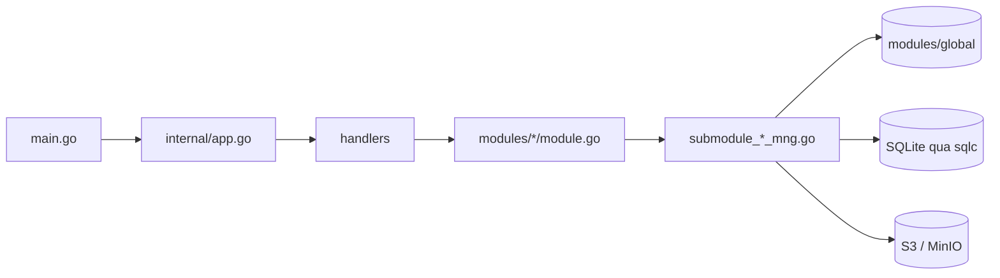

# Kiến trúc S3Browser

[English](ARCHITECTURE.md) | [Tiếng Việt](ARCHITECTURE.vi.md) | [日本語](ARCHITECTURE.ja.md)

Tổng quan ngắn gọn về mã nguồn dành cho lập trình viên mới. Các quy ước nằm trong `CLAUDE.md`; tài liệu này giải thích các phần ghép với nhau như thế nào.

## 1. Stack

- Ứng dụng desktop trên **Wails v3**: backend Go + frontend React 19 / TypeScript chạy trong WebView.
- Backend: AWS SDK v2 (S3), `madmin-go` (MinIO admin), SQLite (modernc) + goose migration + sqlc, `slog`.
- Frontend: Mantine 9, zustand 5 + immer, NiceModal, i18next (en / vi / ja), sonner (toast), `@tanstack/react-virtual`, zod, dayjs. Package manager: **bun**.

```
App/S3Browser
├── main.go                 điểm vào: logger, Wails app, service, cửa sổ chính
├── internal/
│   ├── app.go              khởi tạo DB, module, handler; Shutdown
│   ├── handlers/           Wails service mỏng (được bind sang frontend)
│   ├── modules/
│   │   ├── global/         container kết nối dùng chung
│   │   ├── profile/        profile kết nối (secret được mã hoá)
│   │   ├── master/         master data (region...)
│   │   ├── bucket/         bucket, object, upload, download, tìm kiếm
│   │   └── setting/        cài đặt app (settings.json, autostart)
│   └── pkg/                cnst, db (schemas, queries, sqlc), logger, portable, utils
├── models/                 model input/output + alias.go
├── frontend/
│   ├── bindings/           binding Wails SINH TỰ ĐỘNG (không sửa tay)
│   └── src/                common, components, pages, locales, test
├── build/                  đóng gói theo nền tảng (Windows NSIS, portable, ...)
└── docs/                   tài liệu này + công cụ sinh PDF
```

## 2. Backend

### 2.1 Các lớp



- `main.go` tạo logger và Wails app, đăng ký ba handler bằng `application.NewService`, rồi tạo cửa sổ chính (`EnableFileDrop: true`).
- `internal/app.go` (`NewApp`) mở và migrate database, tạo `KeyManager` (mã hoá secret), dựng các module, sau đó dựng handler phía trên. `Shutdown` huỷ các tiến trình truyền tải, ngắt mọi kết nối và đóng DB.
- **Handler** (`internal/handlers/*_handler.go`) mỏng: chỉ gọi xuống module. Các method public của handler trở thành binding TypeScript.
- **Module** (`internal/modules/<name>/module.go`) là API public có doc comment. Công việc được chia cho các submodule không export (`submoduleXxxMng`, constructor `newSubmoduleXxxMng`) trong `submodule_<x>_mng.go`.

### 2.2 Output và mã message

Mọi handler trả về `models.Output[T]` (`Result`, `MessageList`, `Body`).

```go
output := models.NewOutput[T]()
output.AddMessage(msg)             // giữ Result = true
return output.ThrowError(msg)      // Result = false + message
```

- Message được tạo bằng `models.NewMessage` / `models.NewParamsMessage(type, module, CODE, errorDetail, params)`. Loại: `S` thành công, `E` lỗi, `W` cảnh báo, `I` thông tin (`internal/pkg/cnst`).
- Mã message là các `var` ở đầu mỗi `module.go`, định dạng `<PREFIX><S|E|W><NNN>` (`S3E006`, `PFE001`, `MTE001`).
- Frontend dịch message bằng key `ipcMessage:<moduleName>.<CODE>`, vì vậy **mỗi mã mới phải có key trong `frontend/src/locales/{en,vi,ja}/messages/ipcMessage.json`**.
- Model mới đặt trong `models/<domain>/` (`*_input.go`, `*_output.go`, json tag camelCase) và phải được re-export trong `models/alias.go`.

### 2.3 Container kết nối (`modules/global`)

`global.Module` giữ `connContainer`, một `map[id]*S3Conn` được bảo vệ bằng `sync.RWMutex`. `S3Conn` gộp S3 client, presign client, MinIO admin client (tuỳ chọn) và `http.Transport`. `profile` đăng ký kết nối, `bucket` đọc kết nối (`GetConnContainer`). `RemoveConn` / `ReplaceConn` trả về connection cũ và **không bao giờ tự đóng**: bên gọi đóng sau khi đã nhả lock, vì việc đóng có thực hiện I/O mạng.

### 2.4 Context và huỷ

- Handler nhận `ctx` sẽ có context của lời gọi Wails: context này kết thúc khi frontend huỷ lời gọi nhưng bị tách khỏi vòng đời của app.
- `withCallContext(ctx, appCtx, timeout)` (`modules/bucket/call_helper.go`) tạo context cho một lời gọi: dừng khi frontend huỷ, khi app tắt (`context.AfterFunc`) và khi hết thời gian. Luôn `defer` hàm cancel trả về.
- `isCallCanceled(ctx)`: lời gọi bị huỷ trả `Result=false` **một cách im lặng** (không ai chờ kết quả); timeout vẫn được báo.
- Xử lý đồng thời dùng `errgroup` với `SetLimit`.

### 2.5 Event

Event từ backend sang frontend là hằng số trong `modules/<x>/events.go`, tên dạng `domain:kebab-name`, ví dụ `uploader:upload-progress`, `downloader:download-progress`, `uploader:files-dropped`. Event được đăng ký trong `init()` bằng `application.RegisterEvent[PayloadType](name)`; phải gọi trực tiếp trong `init` để công cụ sinh binding tạo được kiểu payload. Event tiến độ được giới hạn tần suất (200 ms) bởi `utils.ReportEvery`. File thả vào cửa sổ đi qua `main.go` (`WindowFilesDropped` -> `BucketHandler.FilesDropped`) rồi được phát lại thành `uploader:files-dropped` / `uploader:picker-files-dropped`.

### 2.6 Database

File SQLite `data.db` nằm trong thư mục dữ liệu của app (xem `internal/pkg/portable`; WAL, bật foreign keys, sao lưu khi khởi động).

- Migration: goose, `internal/pkg/db/schemas/NNNNNN_name.sql`, chạy bởi `db.RunMigrations`.
- Query: `internal/pkg/db/queries/<domain>/<snake_name>.sql` với chú thích `-- name: PascalName :one|many|exec`; SQL viết kiểu dấu phẩy đứng đầu dòng.
- Code: `go tool sqlc generate` sinh vào `internal/pkg/db/sqlc` (code sinh tự động, không sửa tay).

### 2.7 Cài đặt app (`modules/setting`)

Giao diện, phông chữ, ngôn ngữ và khởi động cùng Windows nằm trong `settings.json`, cùng thư mục data với `data.db` (không lưu trong SQLite).

- `GetSettings`, `SaveSettings`, `ResetSettings` (`SettingHandler`). Giá trị được kiểm tra theo danh sách cố định; file thiếu hoặc hỏng thì dùng mặc định (`light`, `nunito`, `en`, tắt), giá trị lạ chỉ đưa field đó về mặc định.
- Ghi atomic (file tạm + rename) trong mutex. `ResetSettings` chỉ trả về mặc định; chưa ghi gì cho đến khi Lưu.
- Khởi động cùng Windows ghi vào `HKCU\Software\Microsoft\Windows\CurrentVersion\Run` (`autostart_windows.go`). Không hỗ trợ ở bản portable và hệ điều hành khác (`autostartSupported=false`). Lưu sẽ ghi file trước rồi mới ghi registry; nếu registry lỗi thì file giữ giá trị cũ và trả cảnh báo `STE003`.
- `main.go` đọc theme một lần để đặt màu nền cửa sổ trước khi trang được tải.

## 3. Frontend

### 3.1 Gọi backend: `callIPC`

Mọi lời gọi backend đều đi qua `callIPC` (`frontend/src/common/utils/ipcUtils.ts`), không gọi trực tiếp binding:

```ts
const body = await callIPC(GetListObject, [input], { scope: `${SCOPE}/load`, signal });
```

- Hiển thị các message của `Output` dưới dạng toast (`showMessage`, mặc định bật) theo key `ipcMessage:<module>.<CODE>`.
- Trả về `body` khi thành công, `null` khi thất bại, bị huỷ hoặc kết quả đã cũ.
- `scope`: lời gọi mới hơn cùng scope sẽ làm kết quả của lời gọi cũ bị bỏ. `signal` (`AbortController`) huỷ lời gọi, đồng thời huỷ cả context phía Go.
- Binding được import từ `@wails/...` (`frontend/bindings`, sinh tự động).

### 3.2 Store

Store được tạo bằng `createAppStore(creator, name)` (zustand + immer + devtools khi dev; khi dev còn có trên `window.__stores`).

- Mỗi store có `State`, `Action` và hằng `SCOPE`; mọi `set` đều có tên: ``set(update, undefined, `${SCOPE}/actionName`)``.
- `reset()` gọi `invalidateLoads(SCOPE)` để bỏ các kết quả đang chờ của store đó.
- Dùng selector hẹp hoặc `useShallow`; không select nguyên object.

### 3.3 Modal

Modal là component NiceModal được bọc bởi `createMantineModal` (`common/utils/modalUtils.ts`), z-index do `modalStackStore` quản lý. Các modal nặng được tải khi cần trong `components/modals/lazyModals.ts` (`showConnectModal`, `showHistoryModal`, `showSettingModal`) nên không nằm trong bundle chính. Dùng các wrapper trong `components/buttons|inputs|modals` thay vì component Mantine gốc. Footer modal: nút Hủy bên trái, các nút thao tác bên phải (`<Group justify="space-between" wrap="nowrap">`); vùng nội dung chính bọc trong `<Paper withBorder>`.

### 3.4 i18n

`locales/i18n.ts` nạp en / vi / ja. Mỗi ngôn ngữ có `resource.ts` đăng ký mỗi component/page một namespace (`locales/<lang>/components|pages|messages`). Không hard-code chuỗi giao diện: thêm key cho **cả ba** ngôn ngữ và đăng ký namespace mới trong cả ba `resource.ts`.

### 3.5 Event

Event từ backend được nhận bằng `Events.On(name, handler)` của `@wailsio/runtime` trong `useEffect`, và hàm huỷ đăng ký trả về được gọi trong cleanup (xem `UploaderWindow`, `DownloaderWindow`, `useFilesDroppedUpload`).

### 3.6 Danh sách và hiệu năng

Các danh sách lớn (object, bucket, uploader, lịch sử, danh sách file) được virtualize bằng `@tanstack/react-virtual`. Danh sách object phân trang theo cursor (`useObjectPaging`, `OBJECT_PAGE_SIZE = 20`). Item của danh sách dùng `memo`; mọi hàm trong component bọc `useCallback`; handler đặt tên `on<Sự kiện><Đối tượng>` (`onClickConnect`).

### 3.7 Bố cục

`App.tsx` -> `MainLayout` (navbar, tab layout, cửa sổ uploader/downloader) -> `TabLayout` (lazy) -> `TabDetail` -> `pages/bucket` và `pages/object`. State nằm trong `common/stores` (`profileStore`, `tabListStore`, `uploaderStore`, `downloaderStore`, `masterDataStore`, `settingStore`).

### 3.8 Cài đặt và theme

`main.tsx` chờ `useSettingStore.getState().load()` trước khi render, nên theme, phông chữ và ngôn ngữ được áp dụng trước (lỗi thì dùng mặc định). `settingStore` giữ `saved` (trong file), `applied` (phiên hiện tại, đổi bằng Áp dụng) và `draft` (form, xem trước ngay); đóng modal thì quay về `applied`. `applySettings` đặt color scheme của Mantine (`settingColorSchemeManager` trong bộ nhớ, không dùng localStorage), biến `--mantine-font-family` và ngôn ngữ i18n.

Màu: dùng `var(--mantine-color-*)` và `light-dark(<light>, <dark>)`, không hard-code hex/rgb (trừ màu lưu như dữ liệu, ví dụ màu hồ sơ).

## 4. Binding và lệnh

Binding Wails được sinh từ các handler Go; hãy sinh lại sau mỗi thay đổi chữ ký handler hoặc model:

```
go tool wails3 generate bindings -clean=true -ts
```

| Việc | Lệnh (chạy trong `App/S3Browser` trừ khi ghi khác) |
|---|---|
| Dev | `go tool wails3 task dev` |
| Build | `go tool wails3 task build` |
| Đóng gói (installer) | `go tool wails3 task package` |
| Portable (Windows) | `go tool wails3 task build:portable WEBVIEW2_DIR=<thư mục WebView2 Fixed Version>` |
| Kiểm tra Go | `go build ./...`, `go vet ./...`, `go tool golangci-lint run ./...` |
| sqlc | `go tool sqlc generate` |
| Type-check FE (`frontend/`) | `node_modules/.bin/tsc --noEmit` (`tsc.exe` trên Windows) |
| Lint / format FE | `npx oxlint <paths>`, `node_modules/.bin/biome check --write <paths>` |
| Test FE | `bun run test` (vitest); test đặt trong `frontend/src/test/` theo cây thư mục của `src/` |
| PDF hướng dẫn sử dụng | `bun run --cwd docs build:pdf` (hoặc `go tool wails3 task docs:pdf`) |

Các tool Go (wails3, sqlc, golangci-lint) được khai báo trong khối `tool (...)` của `go.mod` nên không cần cài riêng. Backend không viết unit test; frontend yêu cầu coverage nhánh và dòng tối thiểu 95% cho mỗi file đã đổi.
