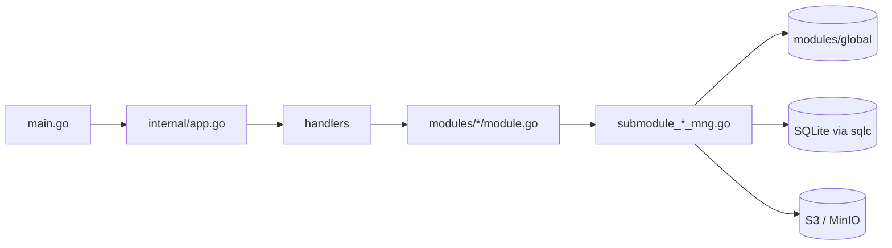

# S3Browser 架构

[English](ARCHITECTURE.md) | [Tiếng Việt](ARCHITECTURE.vi.md) | [日本語](ARCHITECTURE.ja.md) | [简体中文](ARCHITECTURE.zh-CN.md) | [繁體中文](ARCHITECTURE.zh-TW.md) | [Русский](ARCHITECTURE.ru.md) | [Deutsch](ARCHITECTURE.de.md)

面向新开发者的代码导览。约定写在 `CLAUDE.md` 中；本文说明各部分如何组合在一起。

## 1. 技术栈

- 基于 **Wails v3** 的桌面应用：Go 后端 + 运行在 WebView 中的 React 19 / TypeScript 前端。
- 后端：AWS SDK v2 (S3)、`madmin-go` (MinIO 管理)、SQLite (modernc) + goose 迁移 + sqlc、`slog`。
- 前端：Mantine 9、zustand 5 + immer、NiceModal、i18next (7 种语言：en / vi / ja / zh-CN / zh-TW / ru / de)、sonner (toast)、`@tanstack/react-virtual`、zod、dayjs。包管理器：**bun**。

```
s3-browser
├── main.go                 入口：logger、Wails app、服务、主窗口
├── internal/
│   ├── app.go              构建 DB、模块和 handler；Shutdown
│   ├── handlers/           轻量的 Wails 服务 (绑定到前端)
│   ├── modules/
│   │   ├── global/         共享的连接容器和访问缓存
│   │   ├── profile/        连接配置文件 (密钥加密存储)
│   │   ├── master/         主数据 (区域等)
│   │   ├── bucket/         连接、存储桶、存储桶策略、对象、上传、下载、搜索
│   │   ├── setting/        应用设置 (settings.json)、记住的标签页 (tabs.json)、开机自启
│   │   └── update/         从 GitHub Releases 自动更新
│   └── pkg/                cnst、db (schemas、queries、sqlc)、logger、portable、utils
├── models/                 输入/输出模型 + alias.go
├── frontend/
│   ├── bindings/           自动生成的 Wails 绑定 (请勿编辑)
│   └── src/                common、components、pages (pages/s3, pages/sql)、locales、test
├── build/                  各平台打包 (Windows NSIS、portable 等)
└── docs/                   本文档 + PDF 工具
```

## 2. 后端

### 2.1 分层



- `main.go` 创建 logger 和 Wails app，用 `application.NewService` 注册五个 handler (bucket、master、profile、setting、update)，并创建主窗口 (`EnableFileDrop: true`)。
- `internal/app.go` 的 `NewApp` 打开数据库并执行迁移，创建 `KeyManager` (密钥加密)，构建各模块，再在其上构建 handler。`Shutdown` 会取消传输、断开所有连接并关闭数据库。
- **Handler** (`internal/handlers/*_handler.go`) 很轻：只调用模块。其公开方法会成为 TypeScript 绑定。
- **模块** (`internal/modules/<name>/module.go`) 暴露带文档注释的公开 API。具体工作拆分到 `submodule_<x>_mng.go` 中未导出的子模块 (`submoduleXxxMng`，构造函数 `newSubmoduleXxxMng`)。

### 2.2 输出与消息代码

每个 handler 都返回 `models.Output[T]` (`Result`、`MessageList`、`Body`)。

```go
output := models.NewOutput[T]()
output.AddMessage(msg)             // 保持 Result = true
return output.ThrowError(msg)      // Result = false + 消息
```

- 消息通过 `models.NewMessage` / `models.NewParamsMessage(type, module, CODE, errorDetail, params)` 构建。类型：`S` 成功、`E` 错误、`W` 警告、`I` 信息 (`internal/pkg/cnst`)。
- 代码是每个 `module.go` 顶部的 `var`，格式为 `<PREFIX><S|E|W><NNN>` (`S3E006`、`PFE001`、`MTE001`、`UPE004`)。
- 前端用键 `ipcMessage:<moduleName>.<CODE>` 翻译消息，因此**每个新代码都需要在 `frontend/src/locales/{en,vi,ja,zh-CN,zh-TW,ru,de}/messages/ipcMessage.json` 中添加键**。
- 新模型放在 `models/<domain>/` 下 (`*_input.go`、`*_output.go`，json 标签使用 camelCase)，并且必须在 `models/alias.go` 中重新导出。

### 2.3 连接容器与访问缓存 (`modules/global`)

`global.Module` 持有 `connContainer`，即由 `sync.RWMutex` 保护的 `map[id]*S3Conn`。`S3Conn` 打包了 S3 客户端、presign 客户端、可选的 MinIO 管理客户端、`http.Transport` 以及凭证 (`Creds`、`CredInfo`)。`profile` 负责注册连接，`bucket` 负责读取 (`GetConnContainer`)。`RemoveConn` / `ReplaceConn` 返回旧连接并且**从不自行关闭**：关闭会产生网络 I/O，因此由调用方在释放锁之后关闭。

每个连接还拥有一个 `AccessCache` (`access_cache.go`)：按存储桶名称记录读、写、删除访问是否被拒绝，以及以徽章形式显示的存储桶策略模式。条目在 `accessTTL` (5 分钟) 后过期。`Reset` 会递增一个 generation，因此在重置之前开始的探测 (使用旧凭证) 无法写入结果。存储桶列表借助它标记不可访问 / 只读的存储桶，而无需再次探测每个存储桶。

### 2.4 上下文与取消

- 接收 `ctx` 的 handler 得到的是 Wails 调用上下文，它会在前端取消调用时结束，但与应用生命周期无关。
- `withCallContext(ctx, appCtx, timeout)` (`modules/bucket/call_helper.go`) 为一次调用派生上下文：前端取消、应用关闭 (`context.AfterFunc`) 和超时都会使其停止。务必 `defer` 返回的 cancel。
- `isCallCanceled(ctx)`：被取消的调用**静默**返回 `Result=false` (没有人在等待)；超时仍会被报告。
- 并发使用带 `SetLimit` 的 `errgroup`。`g.Go` 内的代码不得 panic：Wails 不会恢复额外 goroutine 的 panic。

### 2.5 事件

后端到前端的事件是 `modules/<x>/events.go` 中的常量，命名为 `domain:kebab-name`，例如 `uploader:upload-progress-batch`、`downloader:download-progress-batch`、`uploader:files-dropped`、`bucket:credential-expiring` 和 `update:state-changed`。它们在 `init()` 中通过 `application.RegisterEvent[PayloadType](name)` 注册；必须直接在 `init` 中调用，绑定生成器才会输出载荷类型。进度事件会批量发送：一个共享的 200 ms 定时器 (`utils.BatchReporter`) 发送单个事件，包含所有运行中任务的进度 (`{items: [...]}`)。拖放的文件来自 `main.go` (`WindowFilesDropped` -> `BucketHandler.FilesDropped`)，并重新发出为 `uploader:files-dropped` / `uploader:picker-files-dropped`。

### 2.6 数据库

SQLite 文件 `data.db` 位于应用数据目录 (见 `internal/pkg/portable`；WAL、启用外键、启动时备份)。

- 迁移：goose，`internal/pkg/db/schemas/NNNNNN_name.sql`，由 `db.RunMigrations` 执行。
- 查询：`internal/pkg/db/queries/<domain>/<snake_name>.sql`，带 `-- name: PascalName :one|many|exec`；SQL 使用前置逗号风格。
- 代码：`go tool sqlc generate` 写入 `internal/pkg/db/sqlc` (自动生成，请勿编辑)。

### 2.7 应用设置与记住的标签页 (`modules/setting`)

主题、字体、语言、开机自启以及更新选项 (`autoUpdate`、`betaUpdate`) 保存在与 `data.db` 相同数据目录下的 `settings.json` 中 (不在 SQLite 中)。

- `GetSettings`、`SaveSettings`、`ResetSettings` (`SettingHandler`)。值会按固定列表校验 (`submodule_setting_mng.go` 中的 `languages` 包含 7 个语言代码)；文件缺失或损坏时回退到默认值 (`light`、`nunito`、`en`、自动更新开启)，未知值只重置该字段。
- 写入在互斥锁下以原子方式进行 (临时文件 + rename)。`ResetSettings` 只返回默认值；在 Save 之前不会写入任何内容。
- `SaveSettings` 成功后，handler 会把 `betaUpdate` 和 `autoUpdate` 传给 `update.Module` (`SetBeta`、`SetAutoUpdate`)。
- 开机自启会写入 `HKCU\Software\Microsoft\Windows\CurrentVersion\Run` (`autostart_windows.go`)。便携版和其他操作系统不支持 (`autostartSupported=false`)。Save 先写文件，再写注册表；如果注册表失败，文件保留旧值，并返回警告 `STE003`。
- `main.go` 只读取一次主题，用于在页面加载前设置窗口背景色。
- 记住的标签页：`GetTabState` / `SaveTabState` (`SettingHandler`) 读写 `tabs.json` (`submodule_tab_mng.go`)：标签页顺序、活动标签页以及每个标签页的配置文件。文件缺失、格式错误或无效时得到空状态。

### 2.8 认证与连接 (`modules/profile`、`modules/bucket`)

配置文件有 `provider` (`aws` 或 `minio`) 和 `authType` (`internal/pkg/cnst/auth.go`)。`cnst.IsAuthTypeValid` 校验这一组合；该列表必须与迁移 `000002_auth_methods.sql` 的 CHECK 以及前端的 `authMethods.ts` 保持一致。

| Provider | 认证类型 |
|---|---|
| `aws` | `static`、`sharedProfile`、`assumeRole`、`sso`、`defaultChain`、`anonymous` |
| `minio` | `static`、`minioAssumeRole`、`minioLdap`、`minioOidc`、`minioCert`、`anonymous` |

- 配置文件存储在 SQLite 中：非机密选项放在 JSON 列 (`auth_config`)，机密用 `KeyManager` 加密 (`auth_secret`)。
- `buildCredentials` (`submodule_cfg_credentials.go`) 解析该认证类型的凭证并**只获取一次**，因此错误的配置文件、过期的 SSO 会话或被拒绝的角色会在连接时就以专属消息 (`S3E030` - `S3E038`、`PFE009`) 失败，而不是在第一次请求时才失败。
  - 基于 AWS CLI 的类型 (`sharedProfile`、`sso`、`assumeRole`、`defaultChain`) 使用 SDK 配置文件。带 MFA 序列号的 `assumeRole` 只会使用一次一次性验证码，因此没有新验证码就无法续期。
  - `minioAssumeRole` (访问密钥 + 秘密密钥) 和 `minioLdap` (LDAP 用户 + 密码) 向 MinIO STS 端点 (即 S3 端点) 请求凭证。凭证会在到期前**自动续期**，因为密钥保存在 provider 内部的内存中 (从不写入日志)。
  - `minioCert` 使用 TLS 客户端证书向 MinIO STS 请求凭证 (mTLS，`AssumeRoleWithCertificate`，需要 https)。PEM 私钥可以是 PKCS#8 加密的 (`submodule_cert_loader.go`)。
  - `minioOidc` 用 OpenID Connect 登录得到的令牌换取 MinIO 凭证 (`AssumeRoleWithWebIdentity`)。
  - `anonymous` 发送未签名的请求；由于匿名客户端无法列出存储桶，存储桶必须由用户输入。
- **OIDC** (`submodule_oidc_login.go`)：带 **PKCE** 的授权码流程，仅支持公共客户端。系统浏览器打开 IdP 页面，`127.0.0.1` 上的本地服务器接收重定向后立即关闭。登录在 5 分钟后超时 (`oidcLoginTimeout`)。会话 (令牌) **只存在于后端内存中**，最多复用 10 分钟 (`oidcSessionTTL`，同时受令牌有效期限制)，每次连接只能使用一次；前端只持有 `sessionId`，永远看不到令牌。会话已被使用时需要重新登录 (`S3E030`)。OIDC 配置文件不会自动连接 (`cnst.IsAutoConnectAllowed`)，带 MFA 序列号的 `assumeRole` 配置文件也一样。
- **URL 安全**：来自 IdP 的每个 URL (issuer、discovery 文档中的端点) 都必须通过 `utils.IsSecureUrl` (`internal/pkg/utils/url.go`)：`https`，或仅对回环主机允许 `http`。配置文件表单也以同样方式校验 (`profile/submodule_auth_mng.go`)。
- **自定义 CA**：任何 MinIO 认证类型都可以添加 CA 文件 (`AuthConfig.CaFile`)。`newTransport` 将其加入系统证书池 (无法加载时返回 `S3E049`)，并且只作用于 MinIO 的 transport (S3 和 STS)；访问 IdP 时使用操作系统的信任库。`newTransport` 始终设置 `TLSClientConfig`，因为 minio-go 在 mTLS 时会写入其中。`ChooseAuthFile` 打开原生对话框来选择证书、私钥和 CA 文件；取消对话框不算错误 (`utils.IsDialogCancelled`)。
- **重新认证**：`ReauthConnection` 在不断开连接的情况下更新其凭证 (替换 `SwapCreds` 背后的 provider，`madmin` 通过同一个 provider 读取)，因此正在进行的传输会继续。配置文件不保存的机密 (`mfaCode`、`secretKey`、`ldapPassword`) 仅在该次调用中由前端提供。
- **到期警告**：当凭证在没有用户操作时无法续期 (`CredInfo.Refreshable=false`)，后端会在到期前发出 `bucket:credential-expiring` (`CredentialExpiringOutput`)；前端 (`useCredentialExpiring`) 显示 toast。

### 2.9 存储桶管理与存储桶策略 (`modules/bucket`)

- `CreateBucket`、`GetBucketDetail`、`GetBucketDeleteInfo`、`DeleteBucket`、`GetBucketPolicy`、`PutBucketPolicy` 和 `CheckBucketAccess` 位于 `module.go`；具体工作在 `submodule_bucket_mng.go`、`submodule_bucket_detail.go`、`submodule_bucket_delete.go`、`submodule_bucket_edit_mng.go` 和 `submodule_bucket_policy.go` 中。
- 存储桶的**访问模式**：`private` (无策略)、`public` 只读 (对 `*` 开放 `GetObject`、`ListBucket`、`GetBucketLocation`) 和 `custom` (JSON)。没有 ACL。由于 MinIO 返回规范化后的策略，策略按语义比较 (`samePolicy`)。在真实 AWS 上，策略请求会发往存储桶所在区域 (`policyOptFns`)，Block Public Access 只读取并作为警告显示 (保存被它阻止的公开策略时返回 `S3E058`)。
- 创建存储桶时可以在同一次调用中设置访问模式。如果存储桶已创建但策略设置失败，存储桶会保留，`Result` 仍为 true 并返回一条警告 (`S3W011`，Block Public Access 的情况为 `S3W012`)。
- **徽章**：存储桶列表显示每个存储桶的策略模式 (`PolicyBadge`)。`GetListBucket` 从 `AccessCache` 填充 `PolicyMode`，并行读取缺失的部分，且只缓存确定的答案 (`isSurePolicyError`)，因此超时会被重试。匿名连接会被跳过。
- **删除**：用户输入存储桶名称。非空存储桶先被清空 (通过共享的 `batchDeleter` 删除所有版本和删除标记)，然后执行 `DeleteBucket` (超时 30 分钟)。带有 Object Lock 的非空存储桶会在删除任何对象之前被拒绝 (`S3E063`)。没有进度事件，也没有取消按钮；关闭应用会静默停止删除。只有在已知账户被拒绝 `s3:DeleteBucket` 时才会隐藏“删除”菜单项 (`AccessDelete`)。
- 匿名连接不能创建、修改或删除存储桶 (`S3E054`)，但可以打开详情抽屉。

### 2.10 自动更新 (`modules/update`)

`update.Module` 在 `TranMinhTruyen/s3-browser` 的 **GitHub Releases** 中检查新版本，下载 NSIS 安装程序并运行。`UpdateHandler` 提供 `GetUpdateState`、`CheckUpdate`、`DownloadUpdate` 和 `InstallUpdate`。

- **支持的构建**：仅限通过 NSIS 安装程序安装的 Windows 构建 (安装程序会在 exe 旁写入 `uninstall.exe`；`installSupported`)。便携版、解压版构建以及其他操作系统不受支持，前端会隐藏该功能 (`supported=false`)。dev 模式下为便于测试始终开启。版本号来自 `build/config.yml` (嵌入到 `main.go`)。
- **渠道**：一个 GitHub provider 仅用于稳定版，另一个同时包含预发布版；选项 `betaUpdate` 选择渠道 (`SetBeta`)。开启 beta 时，只有更新的预发布版才算数。
- **检查**：`CheckUpdate` 在用户请求时运行。`autoUpdate` 开启时，循环会在启动 10 秒后检查，之后每 6 小时 (`checkInterval`) 检查一次，发现新版本会自动开始下载；循环中的失败只会记录日志。
- **校验和**：发布资源 `checksums.txt` 必须提供安装程序 `S3Browser-<version>-windows-<arch>-installer.exe` 的 SHA-256。文件在下载到临时目录的同时计算哈希，不匹配则删除 (`UPE004`)。由于其他程序可以写入临时目录，`InstallUpdate` 会在运行前再次校验。下载只会访问 GitHub 的主机。
- **安装**：安装程序通过 `ShellExecute` 静默运行 (UAC 提示，`/S /relaunch /D=<安装目录>`)，然后应用退出，由安装程序启动新版本。如果无法运行安装程序，应用继续运行 (`UPE005`)。下载的安装程序会在下次启动后清理。
- **状态**：`UpdateStateOutput` (`supported`、`state`、`currentVersion`、`version`、`releaseUrl`、`written`、`total`、`errorCode`，`state` 为 `error` 时的 `UPE...` 代码)。`state` 为 `idle`、`checking`、`upToDate`、`available`、`downloading`、`ready` 或 `error`。每次变化，以及下载期间每 200 ms，都会通过事件 `update:state-changed` 发送。
- **消息**：`UPS001` (已是最新版本)、`UPE001` (无法检查)、`UPE002` (GitHub 限流)、`UPE003` (无法下载)、`UPE004` (校验和)、`UPE005` (无法运行安装程序)、`UPE006` (没有适用于本机的安装程序)。

## 3. 前端

### 3.1 调用后端：`callIPC`

所有后端调用都通过 `callIPC` (`frontend/src/common/utils/ipcUtils.ts`)，不要直接调用绑定：

```ts
const body = await callIPC(GetListObject, [input], { scope: `${SCOPE}/load`, signal });
```

- 使用 `ipcMessage:<module>.<CODE>` 将 `Output` 的消息显示为 toast (`showMessage`，默认开启)。
- 成功时返回 `body`，失败、取消或结果已过期时返回 `null`。
- `scope`：相同 scope 的较新调用会使较旧的结果被丢弃。`signal` (`AbortController`) 取消调用，同时也会取消 Go 上下文。
- 绑定从 `@wails/...` 导入 (`frontend/bindings`，自动生成)。

### 3.2 Store

Store 通过 `createAppStore(creator, name)` 创建 (zustand + immer，开发环境带 devtools；开发环境下也挂在 `window.__stores` 上)。

- 每个 store 都有 `State`、`Action` 和常量 `SCOPE`；每次 `set` 都要命名：``set(update, undefined, `${SCOPE}/actionName`)``。
- `reset()` 调用 `invalidateLoads(SCOPE)`，丢弃该 store 进行中的结果。
- 使用窄选择器或 `useShallow`；不要选择整个对象。

### 3.3 模态框

模态框是由 `createMantineModal` (`common/utils/modalUtils.ts`) 包装的 NiceModal 组件，z-index 由 `modalStackStore` 管理。较重的模态框在 `components/modals/lazyModals.ts` 中按需加载 (`showConnectModal`、`showHistoryModal`、`showSettingModal`)，因此不在主 bundle 中。使用 `components/buttons|inputs|modals` 中的封装，而不是原始的 Mantine 组件。模态框页脚：取消在左，操作在右 (`<Group justify="space-between" wrap="nowrap">`)；主要内容区域放在 `<Paper withBorder>` 中。

### 3.4 i18n

`locales/i18n.ts` 支持 **7 种语言**：`en`、`vi`、`ja`、`zh-CN`、`zh-TW`、`ru`、`de` (`LANGUAGES` 和各语言的本地名称 `LANGUAGE_LABELS` 位于 `common/cnst/settingConst.ts`)。只有 `en` 是静态导入的；其他语言在 `changeLanguage` 之前通过 `loadLanguage` 使用动态 `import()` (`RESOURCE_LOADERS`) 加载。每种语言都有一个 `resource.ts`，为每个组件/页面注册一个命名空间 (`locales/<lang>/components|pages|messages`)。不得硬编码界面字符串：在**全部七种**语言中添加键 (键和 `{{x}}` 占位符与 `en` 相同)，并在全部七个 `resource.ts` 中注册新命名空间。CJK 语言在 `getFontFamily` 中有各自的字体回退。

### 3.5 事件

后端事件通过 `useEffect` 中 `@wailsio/runtime` 的 `Events.On(name, handler)` 消费，并在清理函数中调用返回的取消订阅函数 (参见 `UploaderWindow`、`DownloaderWindow`、`useFilesDroppedUpload`、`useAppUpdate`)。

### 3.6 列表与性能

大型列表 (对象、存储桶、上传器、历史记录、文件列表) 使用 `@tanstack/react-virtual` 虚拟化。对象列表通过游标分页 (`useObjectPaging`，首页 `FIRST_PAGE_SIZE = 200`，后续页 `NEXT_PAGE_SIZE = 1000`)。列表项使用 `memo`；组件中的每个函数都用 `useCallback` 包装；处理函数命名为 `on<Event><Target>` (`onClickConnect`)。

### 3.7 布局与标签页

`App.tsx` -> `MainLayout` (模式切换、上传器/下载器窗口) -> `S3Workspace` 或 `SqlWorkspace` (在 `MainLayout` 中 lazy，首次进入该模式时加载；各自带有导航栏和标签页) -> `S3TabPage` (由 `S3Workspace` 静态 import，`pages/s3/S3TabPage.tsx`)。`S3TabPage` 包含标签栏 (`components/tabs` 中的 `TabStrip` 和 `SortableTab`，使用 dnd-kit 拖放，Ctrl+Shift+左/右 进行键盘排序) 并渲染 `TabDetail`，后者显示 `pages/s3/bucket` (`BucketListView`、`BucketItem`) 或 `pages/s3/object` (`ObjectListView`、`ObjectItem`)。共用部分位于 `pages/s3/components` (`BucketDetailDrawer`、`ObjectDetailDrawer`、`TabActionBar`、`TabBreadcrumb`)。每种模式有自己的文件夹 `pages/<mode>` (`s3`、`sql`)，含 `stores`、`hooks`、`utils`、`modals`、`navbar`、`components`、`transfer` 等子文件夹。S3 状态位于 `pages/s3/stores` (`profileStore`、`tabListStore`、`uploaderStore`、`downloaderStore`、`masterDataStore`)；全应用共用状态位于 `common/stores` (`settingStore`、`updateStore`)。

**记住标签页**：`useTabPersistence` (在 `App.tsx` 中调用) 在标签页顺序、活动标签页和各标签页的配置文件停止变化 500 ms 后以及 `pagehide` 时，通过 `SaveTabState` 将其保存到 `tabs.json`。启动时 `restoreTabsFromDisk` (`pages/s3/utils/tabPersistence.ts`) 用 `GetTabState` 加载它们。如果加载失败，本次会话会禁用保存，因此 `tabs.json` 永远不会被覆盖。配置文件已被删除的标签页保留位置但失去配置文件 (`normalizeTabProfiles`)。

### 3.8 设置、主题与更新

`main.tsx` 在渲染之前等待 `loadStartupData()` (并行加载设置和 `restoreTabsFromDisk()`)，因此主题、字体、语言和已保存的标签页会最先就绪 (失败时使用默认值)。`settingStore` 保存 `saved` (文件)、`applied` (当前会话，由 Apply 修改) 和 `draft` (表单，实时预览)；关闭模态框会恢复到 `applied`。`applySettings` 设置 Mantine 的颜色方案 (内存中的 `settingColorSchemeManager`，不使用 localStorage)、`--mantine-font-family` 变量和 i18n 语言。

`AppUpdateToast` 只挂载一次 `useAppUpdate`：它用 `GetUpdateState` 加载状态，将 `update:state-changed` 同步到 `updateStore`，并让同一个 toast 与状态保持一致 (自动更新关闭时显示带“下载”按钮的新版本、下载进度、可以安装)。`supported` 为 false 时不显示任何内容。

颜色：使用 `var(--mantine-color-*)` 和 `light-dark(<light>, <dark>)`，不要硬编码 hex/rgb (作为数据保存的颜色除外，例如配置文件的颜色)。

## 4. 绑定与命令

Wails 绑定由 Go handler 生成；修改 handler 签名或模型后需要重新生成：

```
go tool wails3 generate bindings -clean=true -ts
```

| 任务 | 命令 (除特别说明外在仓库根目录运行) |
|---|---|
| 开发 | `go tool wails3 task dev` |
| 构建 | `go tool wails3 task build` |
| 打包 (安装程序) | `go tool wails3 task package` |
| 便携版 (Windows) | `go tool wails3 task build:portable WEBVIEW2_DIR=<WebView2 Fixed Version 文件夹>` |
| Go 检查 | `go build ./...`、`go vet ./...`、`go tool golangci-lint run ./...` |
| sqlc | `go tool sqlc generate` |
| FE 类型检查 (`frontend/`) | `node_modules/.bin/tsc --noEmit` (Windows 上为 `tsc.exe`) |
| FE lint / format | `npx oxlint <paths>`、`node_modules/.bin/biome check --write <paths>` |
| FE 测试 | `bun run test` (vitest)；测试位于 `frontend/src/test/`，目录结构与 `src/` 一致 |
| 用户指南 PDF | `bun run --cwd docs build:pdf` (或 `go tool wails3 task docs:pdf`) |

Go 工具 (wails3、sqlc、golangci-lint) 在 `go.mod` 的 `tool (...)` 块中声明，因此无需单独安装。后端没有提交的单元测试；前端要求每个修改过的文件分支和行覆盖率至少达到 95%。
