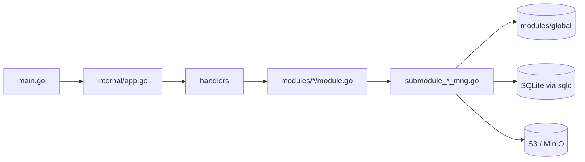

# S3Browser 架構

[English](ARCHITECTURE.md) | [Tiếng Việt](ARCHITECTURE.vi.md) | [日本語](ARCHITECTURE.ja.md) | [简体中文](ARCHITECTURE.zh-CN.md) | [繁體中文](ARCHITECTURE.zh-TW.md) | [Русский](ARCHITECTURE.ru.md) | [Deutsch](ARCHITECTURE.de.md)

這是給新進開發人員的程式碼導覽。慣例寫在 `CLAUDE.md` 中；本文說明各個部分如何組合在一起。

## 1. 技術堆疊

- 以 **Wails v3** 建構的桌面應用程式：Go 後端 + 在 WebView 中執行的 React 19 / TypeScript 前端。
- 後端：AWS SDK v2 (S3)、`madmin-go` (MinIO 管理)、SQLite (modernc) + goose 遷移 + sqlc、`slog`。
- 前端：Mantine 9、zustand 5 + immer、NiceModal、i18next (7 種語言：en / vi / ja / zh-CN / zh-TW / ru / de)、sonner (toast)、`@tanstack/react-virtual`、zod、dayjs。套件管理工具：**bun**。

```
s3-browser
├── main.go                 進入點：logger、Wails app、服務、主視窗
├── internal/
│   ├── app.go              建立 DB、模組與 handler；Shutdown
│   ├── handlers/           精簡的 Wails 服務 (繫結到前端)
│   ├── modules/
│   │   ├── global/         共用的連線容器與存取快取
│   │   ├── profile/        連線設定檔 (機密資料加密)
│   │   ├── master/         主資料 (區域等)
│   │   ├── bucket/         連線、儲存貯體、儲存貯體政策、物件、上傳、下載、搜尋
│   │   ├── setting/        應用程式設定 (settings.json)、記住的索引標籤 (tabs.json)、開機自動啟動
│   │   └── update/         從 GitHub Releases 自動更新
│   └── pkg/                cnst、db (schemas、queries、sqlc)、logger、portable、utils
├── models/                 輸入/輸出模型 + alias.go
├── frontend/
│   ├── bindings/           自動產生的 Wails 繫結 (請勿編輯)
│   └── src/                common、components、pages (pages/s3, pages/sql)、locales、test
├── build/                  各平台封裝 (Windows NSIS、portable 等)
└── docs/                   本文件 + PDF 工具
```

## 2. 後端

### 2.1 分層



- `main.go` 建立 logger 與 Wails app，使用 `application.NewService` 註冊五個 handler (bucket、master、profile、setting、update)，並建立主視窗 (`EnableFileDrop: true`)。
- `internal/app.go` 的 `NewApp` 會開啟資料庫並執行遷移，建立 `KeyManager` (機密資料加密)，建構各模組，再於其上建構 handler。`Shutdown` 會取消傳輸、中斷所有連線並關閉資料庫。
- **Handler** (`internal/handlers/*_handler.go`) 很精簡：只呼叫模組。其公開方法會成為 TypeScript 繫結。
- **模組** (`internal/modules/<name>/module.go`) 提供附有文件註解的公開 API。實際工作拆分到 `submodule_<x>_mng.go` 中未匯出的子模組 (`submoduleXxxMng`，建構函式 `newSubmoduleXxxMng`)。

### 2.2 輸出與訊息代碼

每個 handler 都傳回 `models.Output[T]` (`Result`、`MessageList`、`Body`)。

```go
output := models.NewOutput[T]()
output.AddMessage(msg)             // 維持 Result = true
return output.ThrowError(msg)      // Result = false + 訊息
```

- 訊息以 `models.NewMessage` / `models.NewParamsMessage(type, module, CODE, errorDetail, params)` 建立。類型：`S` 成功、`E` 錯誤、`W` 警告、`I` 資訊 (`internal/pkg/cnst`)。
- 代碼是每個 `module.go` 開頭的 `var`，格式為 `<PREFIX><S|E|W><NNN>` (`S3E006`、`PFE001`、`MTE001`、`UPE004`)。
- 前端以鍵 `ipcMessage:<moduleName>.<CODE>` 翻譯訊息，因此**每個新代碼都需要在 `frontend/src/locales/{en,vi,ja,zh-CN,zh-TW,ru,de}/messages/ipcMessage.json` 中新增鍵**。
- 新模型放在 `models/<domain>/` 下 (`*_input.go`、`*_output.go`，json 標籤使用 camelCase)，且必須在 `models/alias.go` 中重新匯出。

### 2.3 連線容器與存取快取 (`modules/global`)

`global.Module` 持有 `connContainer`，也就是由 `sync.RWMutex` 保護的 `map[id]*S3Conn`。`S3Conn` 包含 S3 用戶端、presign 用戶端、選用的 MinIO 管理用戶端、`http.Transport` 以及憑證 (`Creds`、`CredInfo`)。`profile` 負責登錄連線，`bucket` 負責讀取 (`GetConnContainer`)。`RemoveConn` / `ReplaceConn` 會傳回舊連線，並且**絕不自行關閉**：關閉會產生網路 I/O，因此由呼叫端在釋放鎖之後關閉。

每個連線還擁有一個 `AccessCache` (`access_cache.go`)：依儲存貯體名稱記錄讀取、寫入、刪除存取是否被拒絕，以及以徽章顯示的儲存貯體政策模式。項目在 `accessTTL` (5 分鐘) 後過期。`Reset` 會遞增 generation，因此在重設之前開始的探測 (使用舊憑證) 無法寫入結果。儲存貯體清單利用它標示無法存取 / 唯讀的儲存貯體，而不必重新探測每個儲存貯體。

### 2.4 Context 與取消

- 接收 `ctx` 的 handler 取得的是 Wails 呼叫 context，它會在前端取消呼叫時結束，但與應用程式生命週期無關。
- `withCallContext(ctx, appCtx, timeout)` (`modules/bucket/call_helper.go`) 為單次呼叫衍生 context：前端取消、應用程式關閉 (`context.AfterFunc`) 與逾時都會使其停止。務必 `defer` 傳回的 cancel。
- `isCallCanceled(ctx)`：被取消的呼叫會**靜默**傳回 `Result=false` (沒有人在等待)；逾時仍會回報。
- 並行處理使用帶 `SetLimit` 的 `errgroup`。`g.Go` 內的程式碼不得 panic：Wails 不會復原額外 goroutine 的 panic。

### 2.5 事件

後端到前端的事件是 `modules/<x>/events.go` 中的常數，命名為 `domain:kebab-name`，例如 `uploader:upload-progress-batch`、`downloader:download-progress-batch`、`uploader:files-dropped`、`bucket:credential-expiring` 與 `update:state-changed`。它們在 `init()` 中以 `application.RegisterEvent[PayloadType](name)` 註冊；必須直接從 `init` 呼叫，繫結產生器才會輸出酬載型別。進度事件採批次傳送：一個共用的 200 ms 計時器 (`utils.BatchReporter`) 傳送單一事件，包含所有執行中工作的進度 (`{items: [...]}`)。拖放的檔案來自 `main.go` (`WindowFilesDropped` -> `BucketHandler.FilesDropped`)，並重新發出為 `uploader:files-dropped` / `uploader:picker-files-dropped`。

### 2.6 資料庫

SQLite 檔案 `data.db` 位於應用程式資料目錄 (見 `internal/pkg/portable`；WAL、啟用外部索引鍵、啟動時備份)。

- 遷移：goose，`internal/pkg/db/schemas/NNNNNN_name.sql`，由 `db.RunMigrations` 執行。
- 查詢：`internal/pkg/db/queries/<domain>/<snake_name>.sql`，附 `-- name: PascalName :one|many|exec`；SQL 使用逗號置於行首的寫法。
- 程式碼：`go tool sqlc generate` 寫入 `internal/pkg/db/sqlc` (自動產生，請勿編輯)。

### 2.7 應用程式設定與記住的索引標籤 (`modules/setting`)

佈景主題、字型、語言、開機自動啟動與更新選項 (`autoUpdate`、`betaUpdate`) 儲存在與 `data.db` 相同資料目錄下的 `settings.json` (不在 SQLite 中)。

- `GetSettings`、`SaveSettings`、`ResetSettings` (`SettingHandler`)。值會依固定清單驗證 (`submodule_setting_mng.go` 中的 `languages` 包含 7 個語言代碼)；檔案遺失或損毀時會回復為預設值 (`light`、`nunito`、`en`、自動更新開啟)，未知的值只會重設該欄位。
- 寫入在互斥鎖下以不可部分完成的方式進行 (暫存檔 + rename)。`ResetSettings` 只傳回預設值；在 Save 之前不會寫入任何內容。
- `SaveSettings` 成功後，handler 會把 `betaUpdate` 與 `autoUpdate` 傳給 `update.Module` (`SetBeta`、`SetAutoUpdate`)。
- 開機自動啟動會寫入 `HKCU\Software\Microsoft\Windows\CurrentVersion\Run` (`autostart_windows.go`)。可攜版與其他作業系統不支援 (`autostartSupported=false`)。Save 先寫檔案，再寫登錄；若登錄失敗，檔案維持舊值，並傳回警告 `STE003`。
- `main.go` 只讀取一次佈景主題，用來在頁面載入前設定視窗背景色。
- 記住的索引標籤：`GetTabState` / `SaveTabState` (`SettingHandler`) 讀寫 `tabs.json` (`submodule_tab_mng.go`)：索引標籤順序、使用中的索引標籤，以及每個索引標籤的設定檔。檔案遺失、格式錯誤或無效時會得到空狀態。

### 2.8 驗證與連線 (`modules/profile`、`modules/bucket`)

設定檔具有 `provider` (`aws` 或 `minio`) 與 `authType` (`internal/pkg/cnst/auth.go`)。`cnst.IsAuthTypeValid` 驗證這組組合；清單必須與遷移 `000002_auth_methods.sql` 的 CHECK 以及前端的 `authMethods.ts` 一致。

| Provider | 驗證類型 |
|---|---|
| `aws` | `static`、`sharedProfile`、`assumeRole`、`sso`、`defaultChain`、`anonymous` |
| `minio` | `static`、`minioAssumeRole`、`minioLdap`、`minioOidc`、`minioCert`、`anonymous` |

- 設定檔儲存在 SQLite 中：非機密選項放在 JSON 欄位 (`auth_config`)，機密資料以 `KeyManager` 加密 (`auth_secret`)。
- `buildCredentials` (`submodule_cfg_credentials.go`) 解析該驗證類型的憑證並**只擷取一次**，因此錯誤的設定檔、過期的 SSO 工作階段或被拒絕的角色，會在連線時就以專屬訊息 (`S3E030` - `S3E038`、`PFE009`) 失敗，而不是等到第一次請求。
  - 以 AWS CLI 為基礎的類型 (`sharedProfile`、`sso`、`assumeRole`、`defaultChain`) 使用 SDK 組態檔。帶有 MFA 序號的 `assumeRole` 只會使用一次一次性驗證碼，因此沒有新驗證碼就無法更新。
  - `minioAssumeRole` (存取金鑰 + 私密金鑰) 與 `minioLdap` (LDAP 使用者 + 密碼) 向 MinIO STS 端點 (即 S3 端點) 要求憑證。憑證會在到期前**自動更新**，因為機密資料保留在 provider 內部的記憶體中 (絕不寫入記錄檔)。
  - `minioCert` 以 TLS 用戶端憑證向 MinIO STS 要求憑證 (mTLS，`AssumeRoleWithCertificate`，需要 https)。PEM 金鑰可以是 PKCS#8 加密的 (`submodule_cert_loader.go`)。
  - `minioOidc` 以 OpenID Connect 登入取得的權杖換取 MinIO 憑證 (`AssumeRoleWithWebIdentity`)。
  - `anonymous` 傳送未簽署的請求；由於匿名用戶端無法列出儲存貯體，儲存貯體必須由使用者輸入。
- **OIDC** (`submodule_oidc_login.go`)：搭配 **PKCE** 的授權碼流程，僅支援公開用戶端。系統瀏覽器開啟 IdP 頁面，`127.0.0.1` 上的本機伺服器接收重新導向後隨即關閉。登入在 5 分鐘後逾時 (`oidcLoginTimeout`)。工作階段 (權杖) **只存在於後端記憶體中**，最多重複使用 10 分鐘 (`oidcSessionTTL`，同時受權杖到期時間限制)，每次連線只能使用一次；前端只持有 `sessionId`，永遠看不到權杖。工作階段已被使用時需要重新登入 (`S3E030`)。OIDC 設定檔不會自動連線 (`cnst.IsAutoConnectAllowed`)，帶有 MFA 序號的 `assumeRole` 設定檔也一樣。
- **URL 安全性**：來自 IdP 的每個 URL (issuer、探索文件中的端點) 都必須通過 `utils.IsSecureUrl` (`internal/pkg/utils/url.go`)：`https`，或僅對回送主機允許 `http`。設定檔表單也以相同方式驗證 (`profile/submodule_auth_mng.go`)。
- **自訂 CA**：任何 MinIO 驗證類型都可以加入 CA 檔案 (`AuthConfig.CaFile`)。`newTransport` 將其加入系統憑證集區 (無法載入時傳回 `S3E049`)，且只套用於 MinIO 的 transport (S3 與 STS)；連線到 IdP 時使用作業系統的信任存放區。`newTransport` 一律設定 `TLSClientConfig`，因為 minio-go 在 mTLS 時會寫入其中。`ChooseAuthFile` 開啟原生對話方塊來選擇憑證、金鑰與 CA 檔案；取消對話方塊不算錯誤 (`utils.IsDialogCancelled`)。
- **重新驗證**：`ReauthConnection` 在不中斷連線的情況下更新其憑證 (替換 `SwapCreds` 背後的 provider，`madmin` 透過同一個 provider 讀取)，因此進行中的傳輸會繼續。設定檔未儲存的機密 (`mfaCode`、`secretKey`、`ldapPassword`) 僅在該次呼叫時由前端提供。
- **到期警告**：當憑證在沒有使用者操作的情況下無法更新 (`CredInfo.Refreshable=false`)，後端會在到期前發出 `bucket:credential-expiring` (`CredentialExpiringOutput`)；前端 (`useCredentialExpiring`) 顯示 toast。

### 2.9 儲存貯體管理與儲存貯體政策 (`modules/bucket`)

- `CreateBucket`、`GetBucketDetail`、`GetBucketDeleteInfo`、`DeleteBucket`、`GetBucketPolicy`、`PutBucketPolicy` 與 `CheckBucketAccess` 位於 `module.go`；實際工作在 `submodule_bucket_mng.go`、`submodule_bucket_detail.go`、`submodule_bucket_delete.go`、`submodule_bucket_edit_mng.go` 與 `submodule_bucket_policy.go` 中。
- 儲存貯體的**存取模式**：`private` (無政策)、`public` 唯讀 (對 `*` 開放 `GetObject`、`ListBucket`、`GetBucketLocation`) 與 `custom` (JSON)。沒有 ACL。由於 MinIO 傳回正規化後的政策，政策依語意比較 (`samePolicy`)。在真實的 AWS 上，政策請求會送往儲存貯體所在區域 (`policyOptFns`)，Block Public Access 只會讀取並以警告顯示 (儲存被它封鎖的公開政策時傳回 `S3E058`)。
- 建立儲存貯體時可在同一次呼叫中設定存取模式。若儲存貯體已建立但政策設定失敗，儲存貯體會保留，`Result` 仍為 true 並傳回一則警告 (`S3W011`，Block Public Access 的情況為 `S3W012`)。
- **徽章**：儲存貯體清單顯示每個儲存貯體的政策模式 (`PolicyBadge`)。`GetListBucket` 從 `AccessCache` 填入 `PolicyMode`，平行讀取缺少的部分，且只快取確定的答案 (`isSurePolicyError`)，因此逾時會被重試。匿名連線會被略過。
- **刪除**：使用者輸入儲存貯體名稱。非空的儲存貯體會先被清空 (透過共用的 `batchDeleter` 刪除所有版本與刪除標記)，然後執行 `DeleteBucket` (逾時 30 分鐘)。具有 Object Lock 的非空儲存貯體會在刪除任何物件之前遭到拒絕 (`S3E063`)。沒有進度事件，也沒有取消按鈕；關閉應用程式會靜默停止刪除。只有在確定帳戶被拒絕 `s3:DeleteBucket` 時才會隱藏「刪除」選單項目 (`AccessDelete`)。
- 匿名連線不能建立、修改或刪除儲存貯體 (`S3E054`)，但可以開啟詳細資料抽屜。

### 2.10 自動更新 (`modules/update`)

`update.Module` 在 `TranMinhTruyen/s3-browser` 的 **GitHub Releases** 中檢查新版本，下載 NSIS 安裝程式並執行。`UpdateHandler` 提供 `GetUpdateState`、`CheckUpdate`、`DownloadUpdate` 與 `InstallUpdate`。

- **支援的組建**：僅限透過 NSIS 安裝程式安裝的 Windows 組建 (安裝程式會在 exe 旁寫入 `uninstall.exe`；`installSupported`)。可攜版、解壓縮版組建與其他作業系統不受支援，前端會隱藏此功能 (`supported=false`)。dev 模式為方便測試一律開啟。版本號來自 `build/config.yml` (內嵌於 `main.go`)。
- **管道**：一個 GitHub provider 僅用於穩定版，另一個同時包含預先發行版；選項 `betaUpdate` 選擇管道 (`SetBeta`)。開啟 beta 時，只有更新的預先發行版才算數。
- **檢查**：`CheckUpdate` 在使用者要求時執行。`autoUpdate` 開啟時，迴圈會在啟動 10 秒後檢查，之後每 6 小時 (`checkInterval`) 檢查一次，發現新版本會自動開始下載；迴圈中的失敗只會寫入記錄。
- **總和檢查碼**：發行資產 `checksums.txt` 必須提供安裝程式 `S3Browser-<version>-windows-<arch>-installer.exe` 的 SHA-256。檔案在下載到暫存目錄的同時計算雜湊，不相符就刪除 (`UPE004`)。由於其他程式可以寫入暫存目錄，`InstallUpdate` 會在執行前再次驗證。下載只會連到 GitHub 的主機。
- **安裝**：安裝程式透過 `ShellExecute` 靜默執行 (UAC 提示，`/S /relaunch /D=<安裝目錄>`)，接著應用程式結束，由安裝程式啟動新版本。若無法執行安裝程式，應用程式會繼續執行 (`UPE005`)。下載的安裝程式會在下次啟動後清除。
- **狀態**：`UpdateStateOutput` (`supported`、`state`、`currentVersion`、`version`、`releaseUrl`、`written`、`total`、`errorCode`，`state` 為 `error` 時的 `UPE...` 代碼)。`state` 為 `idle`、`checking`、`upToDate`、`available`、`downloading`、`ready` 或 `error`。每次變化，以及下載期間每 200 ms，都會透過事件 `update:state-changed` 傳送。
- **訊息**：`UPS001` (已是最新版本)、`UPE001` (無法檢查)、`UPE002` (GitHub 限流)、`UPE003` (無法下載)、`UPE004` (總和檢查碼)、`UPE005` (無法執行安裝程式)、`UPE006` (沒有適用於這台電腦的安裝程式)。

## 3. 前端

### 3.1 呼叫後端：`callIPC`

所有後端呼叫都經由 `callIPC` (`frontend/src/common/utils/ipcUtils.ts`)，不要直接呼叫繫結：

```ts
const body = await callIPC(GetListObject, [input], { scope: `${SCOPE}/load`, signal });
```

- 使用 `ipcMessage:<module>.<CODE>` 將 `Output` 的訊息顯示為 toast (`showMessage`，預設開啟)。
- 成功時傳回 `body`，失敗、取消或結果已過期時傳回 `null`。
- `scope`：相同 scope 的較新呼叫會使較舊的結果被捨棄。`signal` (`AbortController`) 取消呼叫，同時也會取消 Go context。
- 繫結從 `@wails/...` 匯入 (`frontend/bindings`，自動產生)。

### 3.2 Store

Store 以 `createAppStore(creator, name)` 建立 (zustand + immer，開發環境帶 devtools；開發環境下也掛在 `window.__stores` 上)。

- 每個 store 都有 `State`、`Action` 與常數 `SCOPE`；每次 `set` 都要命名：``set(update, undefined, `${SCOPE}/actionName`)``。
- `reset()` 呼叫 `invalidateLoads(SCOPE)`，捨棄該 store 進行中的結果。
- 使用窄範圍的 selector 或 `useShallow`；不要選取整個物件。

### 3.3 強制回應視窗

強制回應視窗 (modal) 是由 `createMantineModal` (`common/utils/modalUtils.ts`) 包裝的 NiceModal 元件，z-index 由 `modalStackStore` 管理。較重的 modal 在 `components/modals/lazyModals.ts` 中依需求載入 (`showConnectModal`、`showHistoryModal`、`showSettingModal`)，因此不在主 bundle 中。請使用 `components/buttons|inputs|modals` 中的封裝，而不是原始的 Mantine 元件。Modal 頁尾：取消在左，動作在右 (`<Group justify="space-between" wrap="nowrap">`)；主要內容區域放在 `<Paper withBorder>` 中。

### 3.4 i18n

`locales/i18n.ts` 支援 **7 種語言**：`en`、`vi`、`ja`、`zh-CN`、`zh-TW`、`ru`、`de` (`LANGUAGES` 與各語言的自稱名稱 `LANGUAGE_LABELS` 位於 `common/cnst/settingConst.ts`)。只有 `en` 是靜態匯入的；其他語言在 `changeLanguage` 之前透過 `loadLanguage` 以動態 `import()` (`RESOURCE_LOADERS`) 載入。每種語言都有一個 `resource.ts`，為每個元件/頁面註冊一個命名空間 (`locales/<lang>/components|pages|messages`)。不得寫死介面字串：在**全部七種**語言中新增鍵 (鍵與 `{{x}}` 預留位置與 `en` 相同)，並在全部七個 `resource.ts` 中註冊新命名空間。CJK 語言在 `getFontFamily` 中有各自的字型後備。

### 3.5 事件

後端事件透過 `useEffect` 中 `@wailsio/runtime` 的 `Events.On(name, handler)` 取用，並在清除函式中呼叫傳回的取消訂閱函式 (參見 `UploaderWindow`、`DownloaderWindow`、`useFilesDroppedUpload`、`useAppUpdate`)。

### 3.6 清單與效能

大型清單 (物件、儲存貯體、上傳器、歷程記錄、檔案清單) 使用 `@tanstack/react-virtual` 虛擬化。物件清單以游標分頁 (`useObjectPaging`，第一頁 `FIRST_PAGE_SIZE = 200`，後續頁 `NEXT_PAGE_SIZE = 1000`)。清單項目使用 `memo`；元件中的每個函式都以 `useCallback` 包裝；處理函式命名為 `on<Event><Target>` (`onClickConnect`)。

### 3.7 版面配置與索引標籤

`App.tsx` -> `MainLayout` (模式切換、上傳器/下載器視窗) -> `S3Workspace` 或 `SqlWorkspace` (在 `MainLayout` 中 lazy，首次進入該模式時載入；各自帶有導覽列與索引標籤頁) -> `S3TabPage` (由 `S3Workspace` 靜態 import，`pages/s3/S3TabPage.tsx`)。`S3TabPage` 包含索引標籤列 (`components/tabs` 中的 `TabStrip` 與 `SortableTab`，以 dnd-kit 拖放，Ctrl+Shift+左/右 進行鍵盤排序) 並繪製 `TabDetail`，後者顯示 `pages/s3/bucket` (`BucketListView`、`BucketItem`) 或 `pages/s3/object` (`ObjectListView`、`ObjectItem`)。共用部分位於 `pages/s3/components` (`BucketDetailDrawer`、`ObjectDetailDrawer`、`TabActionBar`、`TabBreadcrumb`)。每種模式有自己的資料夾 `pages/<mode>` (`s3`、`sql`)，含 `stores`、`hooks`、`utils`、`modals`、`navbar`、`components`、`transfer` 等子資料夾。S3 狀態位於 `pages/s3/stores` (`profileStore`、`tabListStore`、`uploaderStore`、`downloaderStore`、`masterDataStore`)；全應用共用狀態位於 `common/stores` (`settingStore`、`updateStore`)。

**記住索引標籤**：`useTabPersistence` (在 `App.tsx` 中呼叫) 在索引標籤順序、使用中的索引標籤與各索引標籤的設定檔停止變化 500 ms 後以及 `pagehide` 時，透過 `SaveTabState` 將其儲存到 `tabs.json`。啟動時 `restoreTabsFromDisk` (`pages/s3/utils/tabPersistence.ts`) 以 `GetTabState` 載入。若載入失敗，本次工作階段會停用儲存，因此 `tabs.json` 絕不會被覆寫。設定檔已被刪除的索引標籤保留位置但失去設定檔 (`normalizeTabProfiles`)。

### 3.8 設定、佈景主題與更新

`main.tsx` 在繪製之前等待 `loadStartupData()` (平行載入設定與 `restoreTabsFromDisk()`)，因此佈景主題、字型、語言與已儲存的索引標籤會最先就緒 (失敗時使用預設值)。`settingStore` 保存 `saved` (檔案)、`applied` (目前工作階段，由 Apply 修改) 與 `draft` (表單，即時預覽)；關閉 modal 會還原為 `applied`。`applySettings` 設定 Mantine 的色彩配置 (記憶體中的 `settingColorSchemeManager`，不使用 localStorage)、`--mantine-font-family` 變數與 i18n 語言。

`AppUpdateToast` 只掛載一次 `useAppUpdate`：它以 `GetUpdateState` 載入狀態，將 `update:state-changed` 同步到 `updateStore`，並讓同一個 toast 與狀態保持一致 (自動更新關閉時顯示附「下載」按鈕的新版本、下載進度、可以安裝)。`supported` 為 false 時不顯示任何內容。

顏色：使用 `var(--mantine-color-*)` 與 `light-dark(<light>, <dark>)`，不要寫死 hex/rgb (作為資料儲存的顏色除外，例如設定檔的顏色)。

## 4. 繫結與命令

Wails 繫結由 Go handler 產生；修改 handler 簽章或模型後需要重新產生：

```
go tool wails3 generate bindings -clean=true -ts
```

| 工作 | 命令 (除特別說明外在儲存庫根目錄執行) |
|---|---|
| 開發 | `go tool wails3 task dev` |
| 建置 | `go tool wails3 task build` |
| 封裝 (安裝程式) | `go tool wails3 task package` |
| 可攜版 (Windows) | `go tool wails3 task build:portable WEBVIEW2_DIR=<WebView2 Fixed Version 資料夾>` |
| Go 檢查 | `go build ./...`、`go vet ./...`、`go tool golangci-lint run ./...` |
| sqlc | `go tool sqlc generate` |
| FE 型別檢查 (`frontend/`) | `node_modules/.bin/tsc --noEmit` (Windows 上為 `tsc.exe`) |
| FE lint / format | `npx oxlint <paths>`、`node_modules/.bin/biome check --write <paths>` |
| FE 測試 | `bun run test` (vitest)；測試位於 `frontend/src/test/`，目錄結構與 `src/` 一致 |
| 使用指南 PDF | `bun run --cwd docs build:pdf` (或 `go tool wails3 task docs:pdf`) |

Go 工具 (wails3、sqlc、golangci-lint) 宣告於 `go.mod` 的 `tool (...)` 區塊，因此不需要另外安裝。後端沒有已提交的單元測試；前端要求每個修改過的檔案分支與行覆蓋率至少達到 95%。
