# S3 Browser Benutzerhandbuch

Version 0.0.1-beta.1

> Diese Übersetzung wurde noch nicht von einem Muttersprachler geprüft.

## 1. Einführung

S3 Browser ist eine Desktop-Anwendung zum Durchsuchen und Verwalten von Buckets und Objekten auf **AWS S3** und auf S3-kompatiblen Servern wie **MinIO**. Damit können Sie:

- Verbindungsprofile speichern und sich gleichzeitig mit mehreren Konten verbinden (ein Tab pro Verbindung);
- sich mit einem Zugriffsschlüssel, einer übernommenen Rolle, AWS SSO, MinIO STS, LDAP, OpenID Connect (OIDC) oder einem Clientzertifikat anmelden;
- Buckets, Ordner und Objekte durchsuchen und nach ihnen suchen;
- Buckets erstellen, ansehen, deren Berechtigung ändern und sie löschen;
- die Details eines Objekts ansehen;
- Dateien und Ordner hochladen (per Drag-and-drop oder über einen Dialog) und den Fortschritt in einem Live-Fenster verfolgen;
- Objekte herunterladen und den Download-Verlauf einsehen;
- Objekte und ganze Ordner löschen;
- die Anwendung über GitHub Releases aktuell halten.

Die Oberfläche ist auf Englisch, Vietnamesisch, Japanisch, Vereinfachtem Chinesisch, Traditionellem Chinesisch, Russisch und Deutsch verfügbar.

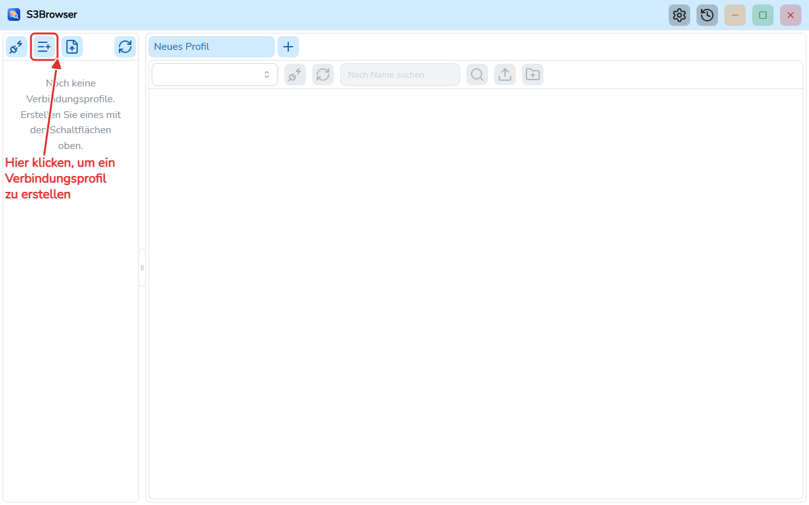

Das Fenster hat drei Bereiche: die **Profilliste** links, die **Tabs** rechts (jeder Tab zeigt die Buckets und Objekte einer Verbindung) und die **Kopfzeile** oben mit der Schaltfläche **Einstellungen** und der Schaltfläche für den Download-Verlauf.

> Dies ist eine Beta-Version (0.0.1-beta.1). Bitte sichern Sie wichtige Daten, bevor Sie Objekte löschen: Ein Löschen kann nicht rückgängig gemacht werden.

## 2. Installation

Unter Windows gibt es zwei Möglichkeiten, die Anwendung zu erhalten.

- **Installationsprogramm**: Laden Sie `S3Browser-<version>-windows-amd64-installer.exe` von der Seite [GitHub Releases](https://github.com/TranMinhTruyen/s3-browser/releases) herunter, führen Sie die Datei aus und folgen Sie den Schritten. Das **Latest**-Release ist die stabile Version; als **Pre-release** gekennzeichnete Versionen sind Betas. Danach ist die Anwendung über das Startmenü verfügbar. Profile und der Download-Verlauf werden in Ihrem Benutzerprofil gespeichert. Nur die installierte Version kann sich selbst aktualisieren (siehe [Updates](#102-updates)).
- **Portable Version**: Kopieren Sie den portablen Ordner an einen beliebigen Ort (zum Beispiel auf einen USB-Stick) und führen Sie `S3Browser.exe` aus. Sie verwendet die im Ordner `webview2` mitgelieferte WebView2-Laufzeit und speichert ihre Daten im Ordner `data` neben dem Programm, sodass nirgendwo sonst etwas geschrieben wird. Verschieben Sie die Ordner `webview2` und `data` nicht vom Programm weg.

## 3. Mit AWS S3 oder MinIO verbinden

Klicken Sie auf die Schaltfläche **Verbindungsprofil erstellen** (die zweite Schaltfläche über der Profilliste). Das Fenster **Verbindungsprofil** wird geöffnet.

### 3.1 Profilformular

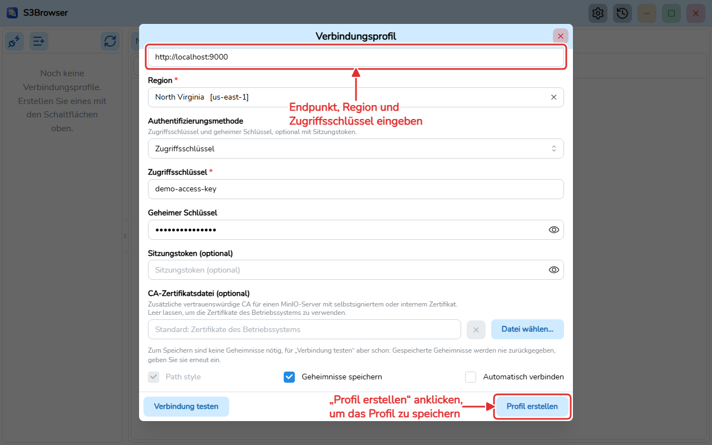

| Feld | Beschreibung |
| --- | --- |
| AWS / MinIO | Wählen Sie den Servertyp. Bei MinIO wird **Path style** automatisch aktiviert. Die angebotenen Authentifizierungsmethoden hängen davon ab. |
| Profilname | Der Name, der in der Profilliste und im Tab angezeigt wird. |
| Profilfarbe | Die Farbe des Profils in der Liste. |
| Endpunkt | Die Adresse des Servers, zum Beispiel `https://s3.amazonaws.com` oder `http://localhost:9000`. |
| Region | Die Region Ihres Kontos, zum Beispiel `North Virginia [us-east-1]`. Pflichtfeld, außer bei einigen Methoden, die sie aus der AWS-Konfiguration lesen. |
| Authentifizierungsmethode | Wie sich die Anwendung anmeldet (siehe [Authentifizierungsmethoden](#32-authentifizierungsmethoden)). Die Felder darunter ändern sich je nach Methode. |
| Zugriffsschlüssel | Der Zugriffsschlüssel Ihres Kontos. |
| Geheimer Schlüssel | Der geheime Schlüssel Ihres Kontos. Klicken Sie auf das Augensymbol, um ihn anzuzeigen. |
| Sitzungstoken (optional) | Das Sitzungstoken temporärer Anmeldedaten. |
| CA-Zertifikatsdatei (optional) | Siehe [CA-Zertifikat für MinIO](#33-ca-zertifikat-für-minio). |
| Path style | Spricht Buckets als `endpoint/bucket` statt als `bucket.endpoint` an. Wird von MinIO und den meisten selbst betriebenen Servern benötigt. |
| Geheimnisse speichern | Speichert die Geheimnisse (verschlüsselt) im Profil. Ohne diese Option müssen Sie sie bei jeder Verbindung eingeben. |
| Automatisch verbinden | Verbindet das Profil beim Start der Anwendung. Nur verfügbar, wenn **Geheimnisse speichern** aktiviert ist, und nicht für Methoden, die bei jeder Verbindung eine Eingabe erfordern (zum Beispiel OIDC oder ein MFA-Code). |

Unten stehen zwei Schaltflächen zur Verfügung:

- **Verbindung testen** prüft die Werte, ohne etwas zu speichern. Gespeicherte Geheimnisse werden nie wieder angezeigt, geben Sie sie daher für den Test erneut ein. Eine grüne Meldung zeigt, dass der Test erfolgreich war; eine rote Meldung erklärt das Problem (siehe [Fehlerbehebung](#11-fehlerbehebung)).
- **Profil erstellen** speichert das Profil (wenn Sie das Fenster von einem vorhandenen Profil aus öffnen, heißt die Schaltfläche **Profil aktualisieren**).

> Teilen Sie niemals einen Screenshot, auf dem Ihr geheimer Schlüssel zu sehen ist. Die Schlüsselfelder in diesem Handbuch enthalten nur Platzhalterwerte.

### 3.2 Authentifizierungsmethoden

Wählen Sie die Methode unter **Authentifizierungsmethode**. Die Liste hängt vom Servertyp ab.

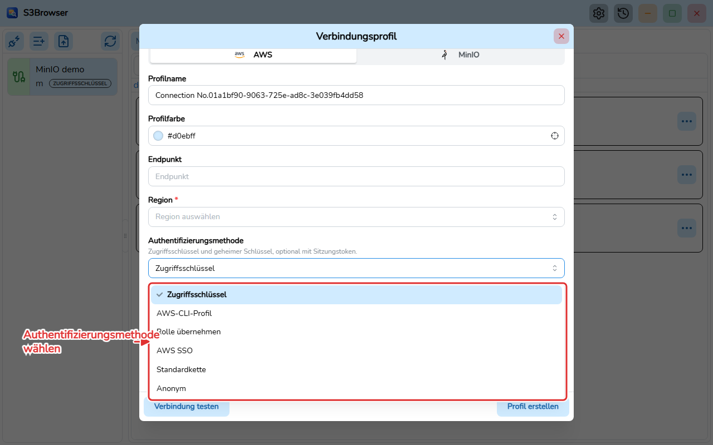

| Methode | Server | Was einzugeben ist |
| --- | --- | --- |
| Zugriffsschlüssel | AWS, MinIO | Zugriffsschlüssel, geheimer Schlüssel und ein optionales Sitzungstoken. |
| AWS-CLI-Profil | AWS | Ein Profil aus den AWS-CLI-Dateien (`~/.aws`), mit optionalen Pfaden für **AWS-Konfigurationsdatei (optional)** und **AWS-Anmeldedatendatei (optional)** (Standard: `~/.aws/config`, `~/.aws/credentials`). |
| Rolle übernehmen | AWS | **Rollen-ARN**, die Anmeldedaten zum Übernehmen der Rolle (**Zugriffsschlüssel** oder **AWS-CLI-Profil**) und optional **Externe ID (optional)**, **Sitzungsname (optional)**, **Dauer (Sekunden)** und **Seriennummer des MFA-Geräts (optional)**. Der **MFA-Code** wird beim Verbinden abgefragt und nie gespeichert. |
| AWS SSO | AWS | Ein AWS-CLI-Profil, bei dem bereits eine Anmeldung besteht. Führen Sie zuerst `aws sso login --profile <profile>` aus. |
| Standardkette | AWS | Nichts: Es werden die in der Umgebung gefundenen Anmeldedaten verwendet (Umgebungsvariablen, gemeinsame Dateien oder die Instanzrolle). |
| Anonym | AWS, MinIO | Nur die Namen der zu öffnenden öffentlichen Buckets (ein anonymer Benutzer kann keine Buckets auflisten). |
| MinIO STS | MinIO | Zugriffsschlüssel, geheimer Schlüssel und optional **Rollen-ARN (optional)**, **Dauer (Sekunden, optional)** und **Inline-Richtlinie (JSON, optional)**. |
| LDAP | MinIO | **LDAP-Benutzername** und **LDAP-Passwort** und optional **Dauer (Sekunden, optional)** und **Inline-Richtlinie (JSON, optional)**. |
| OIDC | MinIO | **Client-ID**, **Aussteller-URL**, ein optionaler **Scope (optional)** und der **Callback-Port**. |
| Clientzertifikat | MinIO | **Client-Zertifikatsdatei** und **Datei des privaten Schlüssels**; aktivieren Sie bei Bedarf **Der private Schlüssel ist passwortgeschützt**. Der Endpunkt muss `https://` verwenden. |

Die Methoden mit weiteren Feldern sind unten dargestellt (die Werte sind Platzhalter).

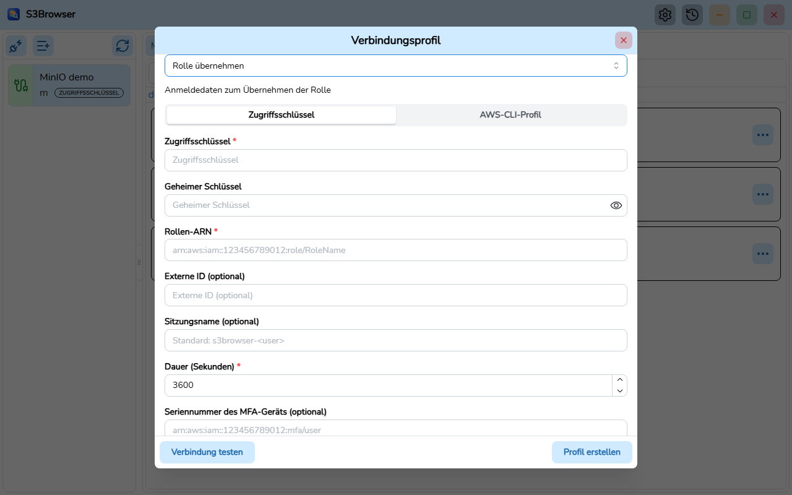

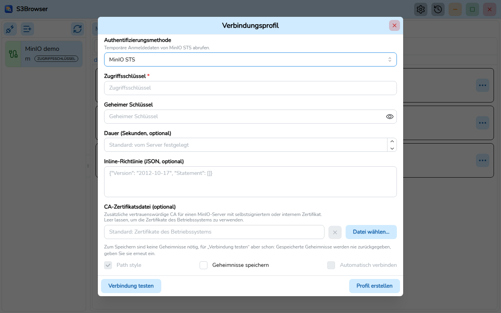

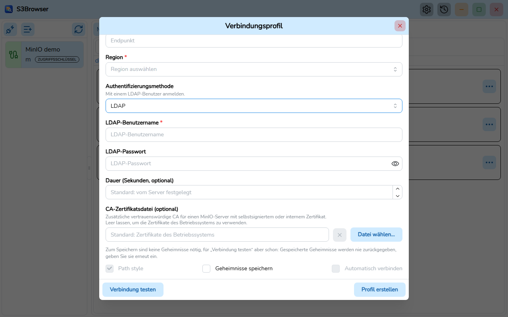

**OIDC.** Kopieren Sie den im Formular angezeigten **Weiterleitungs-URI** (Schaltfläche **Kopieren**) und registrieren Sie ihn bei Ihrem Identitätsanbieter als Weiterleitungs-URI des Clients. Klicken Sie auf **Anmelden**: Ihr Webbrowser öffnet sich und Sie melden sich dort an. Das Formular zeigt **Warten auf die Anmeldung im Browser...** und danach **Angemeldet, gültig bis ...**; **Anmeldung abbrechen** beendet das Warten. Die Anmeldung wird einmal verwendet und nie gespeichert. Wenn sie abläuft, zeigt das Formular **Die Anmeldung ist abgelaufen, bitte erneut anmelden**. Das Browserfenster kann nicht in einem Screenshot gezeigt werden.

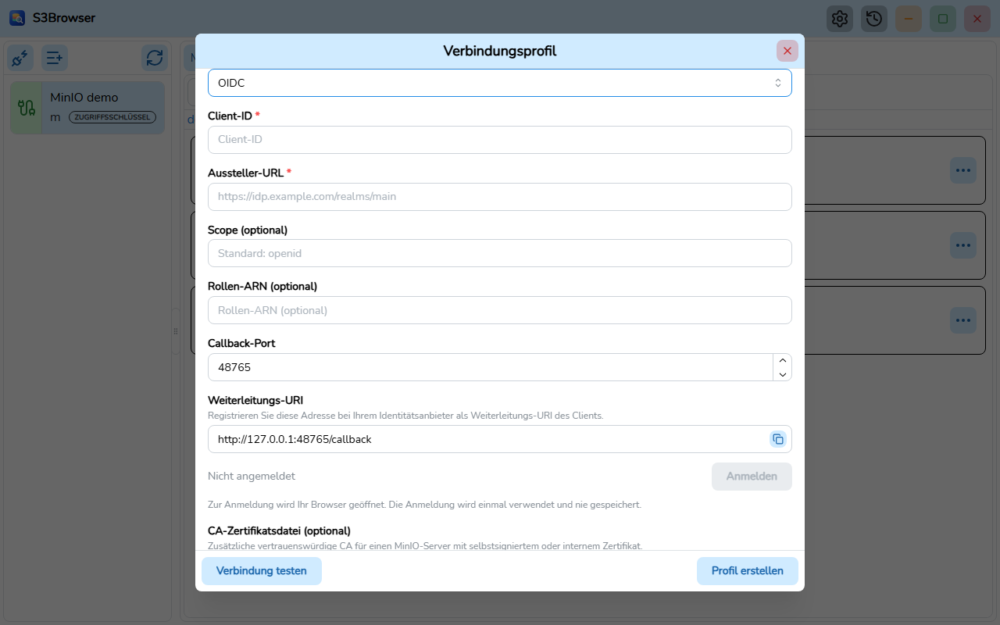

**Clientzertifikat.** Klicken Sie neben einem Dateifeld auf **Datei wählen...** und wählen Sie die Datei im Dialog Ihres Systems (der Dialog kann nicht in einem Screenshot gezeigt werden); **Datei entfernen** leert das Feld. Die Dateien werden beim Verbinden gelesen, ihr Inhalt wird nicht gespeichert.

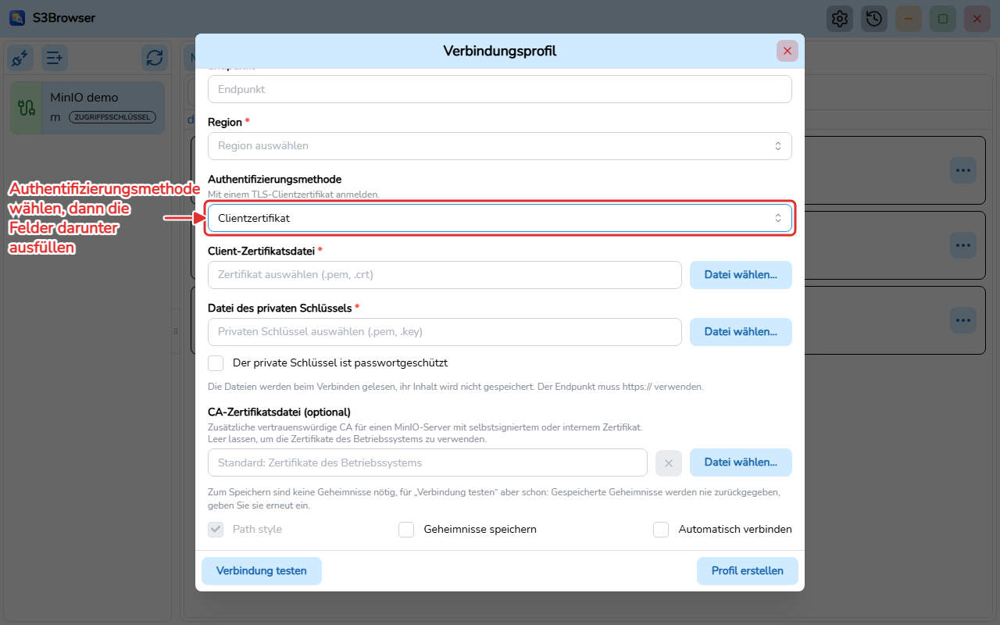

Manche Anmeldedaten laufen ab. Kurz davor fordert Sie die Anwendung zur Erneuerung auf: mit einem MFA-Code (Rolle übernehmen), durch erneutes Anmelden (OIDC, SSO) oder indem Sie die Verbindung trennen und erneut herstellen.

### 3.3 CA-Zertifikat für MinIO

Ein MinIO-Server mit einem selbstsignierten oder internen Zertifikat benötigt eine zusätzliche vertrauenswürdige CA. Klicken Sie unter **CA-Zertifikatsdatei (optional)** auf **Datei wählen...** und wählen Sie das CA-Zertifikat (`.pem` oder `.crt`). Lassen Sie das Feld leer, um die Zertifikate Ihres Betriebssystems zu verwenden. Die Datei gilt nur für die Verbindung zu MinIO, nicht für den OIDC-Identitätsanbieter.

## 4. Profile verwalten

Nachdem Sie ein Profil erstellt haben, erscheint es in der Profilliste.

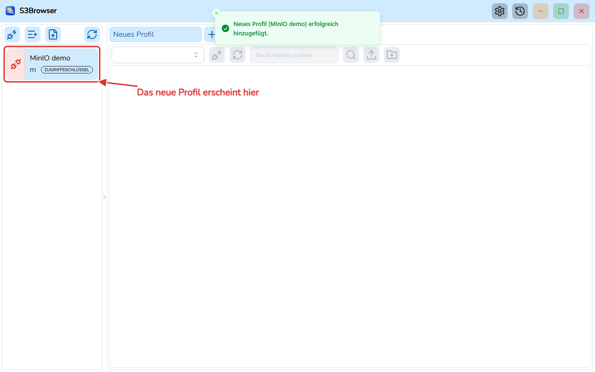

Klicken Sie mit der rechten Maustaste auf ein Profil, um sein Menü zu öffnen.

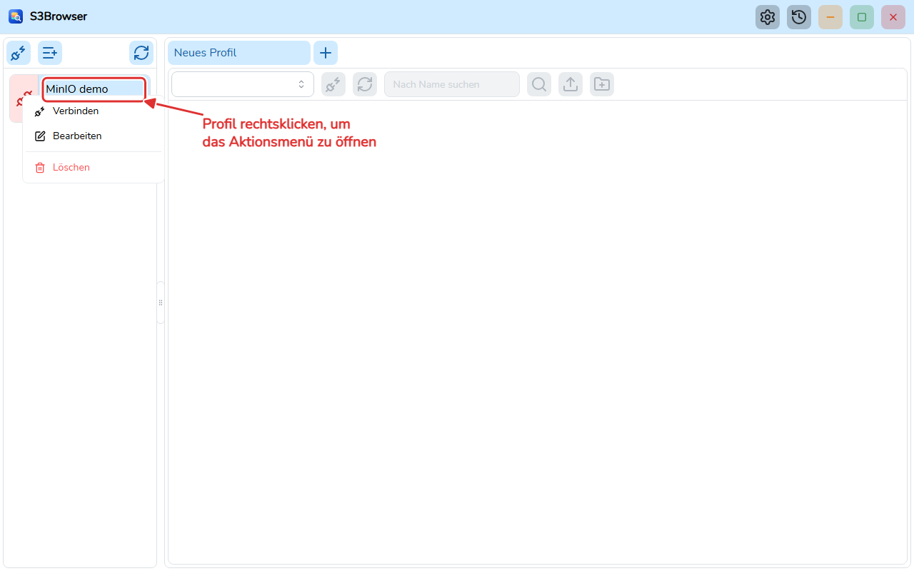

- **Verbinden**: öffnet die Verbindung. Ein verbundenes Profil zeigt ein grünes Symbol.
- **Trennen**: schließt die Verbindung. Trennen Sie die Verbindung zuerst, bevor Sie ein Profil bearbeiten oder löschen.
- **Bearbeiten**: ändert das Profil (der Fenstertitel lautet wieder **Verbindungsprofil**, die Schaltfläche **Profil aktualisieren**). Sie werden gebeten, die Aktualisierung zu bestätigen.
- **Exportieren**: speichert das Profil in einer JSON-Datei; siehe [4.1 Ein Profil exportieren](#41-ein-profil-exportieren).
- **Löschen**: entfernt das Profil nach Ihrer Bestätigung.

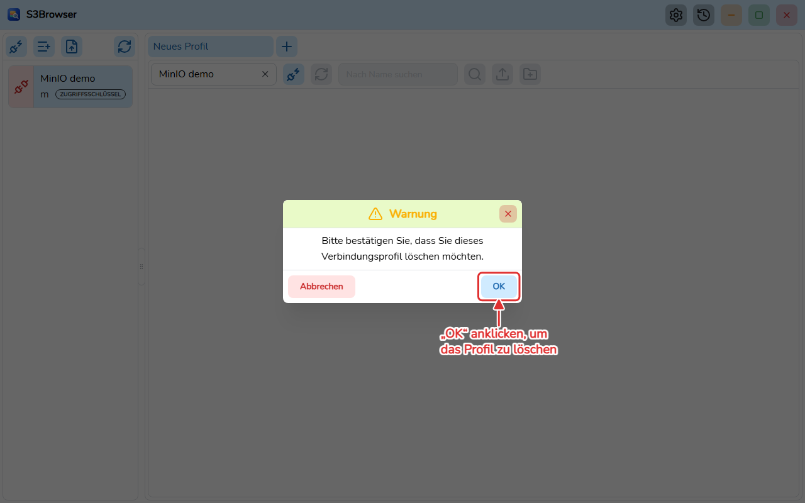

Ein Profil, bei dem noch ein Upload oder Download läuft, kann nicht gelöscht werden. Warten Sie, bis die Übertragungen beendet sind, oder brechen Sie sie zuerst ab.

Die erste Schaltfläche über der Liste (**Verbinden**) öffnet dasselbe Fenster mit einer Schaltfläche **Verbinden**, um sich einmalig zu verbinden, ohne ein Profil zu speichern; die Schaltfläche **Liste der Verbindungsprofile neu laden** lädt die Liste neu.

### 4.1 Ein Profil exportieren

Der Export kopiert ein Profil in eine Datei, zum Beispiel um es auf einem anderen Computer zu verwenden. Klicken Sie mit der rechten Maustaste auf das Profil und wählen Sie **Exportieren**.

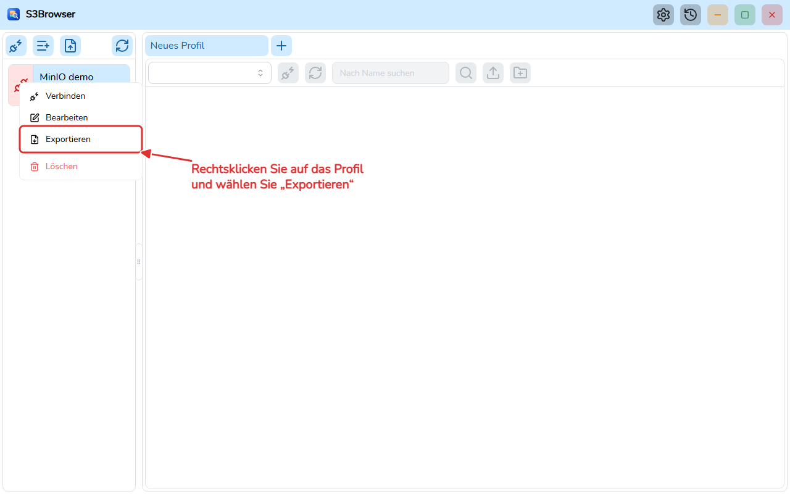

Das Fenster **Profil exportieren** öffnet sich.

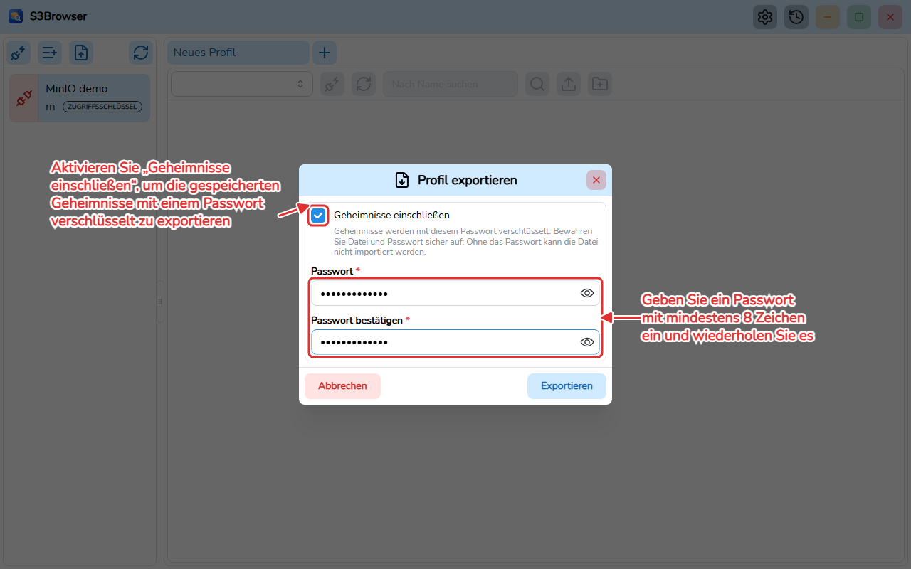

- Lassen Sie **Geheimnisse einschließen** ausgeschaltet, um das Profil ohne seine Geheimnisse zu exportieren (Secret Key, Sitzungstoken, LDAP-Passwort, Schlüssel-Passphrase). Bevor es weitergeht, warnt die Anwendung Sie, wenn das Profil gespeicherte Geheimnisse hat: „Das Profil [Name] enthält gespeicherte Geheimnisse, die NICHT exportiert werden. Nach dem Import müssen Sie sie erneut eingeben. Ohne Geheimnisse exportieren?“ Bestätigen Sie, um zu exportieren, oder brechen Sie ab, um zurückzukehren. Bearbeiten Sie das Profil nach dem Import und geben Sie die Geheimnisse erneut ein.
- Aktivieren Sie **Geheimnisse einschließen**, um auch die gespeicherten Geheimnisse zu exportieren. Geben Sie ein **Passwort** mit mindestens 8 Zeichen ein und wiederholen Sie es unter **Passwort bestätigen**. Die Geheimnisse werden mit diesem Passwort verschlüsselt (PBKDF2 und AES-GCM): Sie werden nie im Klartext in die Datei geschrieben. Die Option ist deaktiviert („Dieses Profil hat keine gespeicherten Geheimnisse.“), wenn das Profil keine gespeicherten Geheimnisse hat.

Klicken Sie auf **Exportieren**. Ein Windows-Speichern-Dialog öffnet sich mit einem vorgeschlagenen Dateinamen, der aus dem Profilnamen gebildet wird: nur Kleinbuchstaben, Ziffern und Unterstriche, zum Beispiel `minio_demo.json`. Wählen Sie den Speicherort. Sobald die Datei geschrieben ist, erscheint eine Meldung. Wenn Sie den Speichern-Dialog schließen, wird nichts geschrieben und das Fenster **Profil exportieren** bleibt geöffnet.

Die Datei enthält die Verbindungseinstellungen des Profils (Name, Farbe, Anbieter, Endpunkt, Region, Zugriffsschlüssel, Path Style, automatisches Verbinden, Authentifizierungsmethode und ihre Optionen), aber keine internen Daten wie die Profil-ID oder Datumsangaben. Von Zertifikats- und Schlüsseldateien werden nur die Pfade exportiert, nicht die Dateien selbst.

Bewahren Sie Datei und Passwort sicher auf. Das Passwort wird nirgends gespeichert: Wenn Sie es vergessen, kann die Datei nicht importiert werden. Bearbeiten Sie eine Datei mit Geheimnissen nicht von Hand. Wenn darin Anbieter, Endpunkt oder Authentifizierungsmethode geändert werden, schlägt der Import mit „Falsches Passwort oder die Datei ist beschädigt.“ fehl.

### 4.2 Ein Profil importieren

Klicken Sie auf die Schaltfläche **Verbindungsprofil importieren** (über der Profilliste, neben **Verbindungsprofil erstellen**).

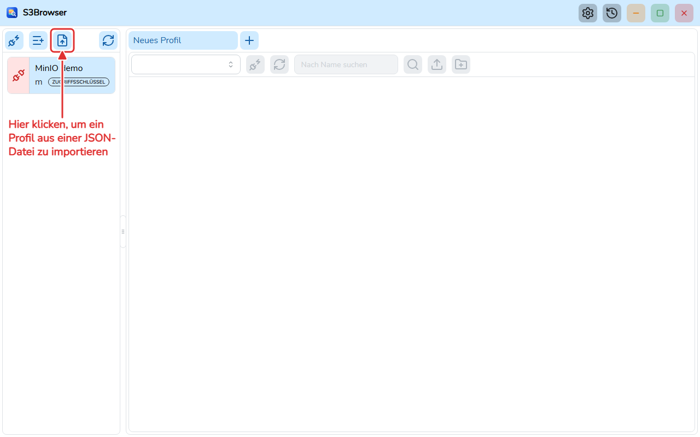

Ein Windows-Öffnen-Dialog erscheint: Wählen Sie eine von S3Browser exportierte `.json`-Datei (höchstens 1 MiB). Die Anwendung prüft die Datei, bevor sie etwas speichert. Zum Beispiel bedeutet „Die Datei ist keine gültige S3Browser-Profildatei.“, dass die Datei kein von S3Browser exportiertes Profil ist; eine Meldung erscheint auch, wenn die Version der Datei nicht unterstützt wird oder die Datei zu groß ist.

- Eine ohne Geheimnisse exportierte Datei wird sofort importiert.
- Bei einer mit Geheimnissen exportierten Datei öffnet sich das Fenster **Profil importieren**: Geben Sie das beim Export verwendete Passwort ein und klicken Sie auf **Importieren**.

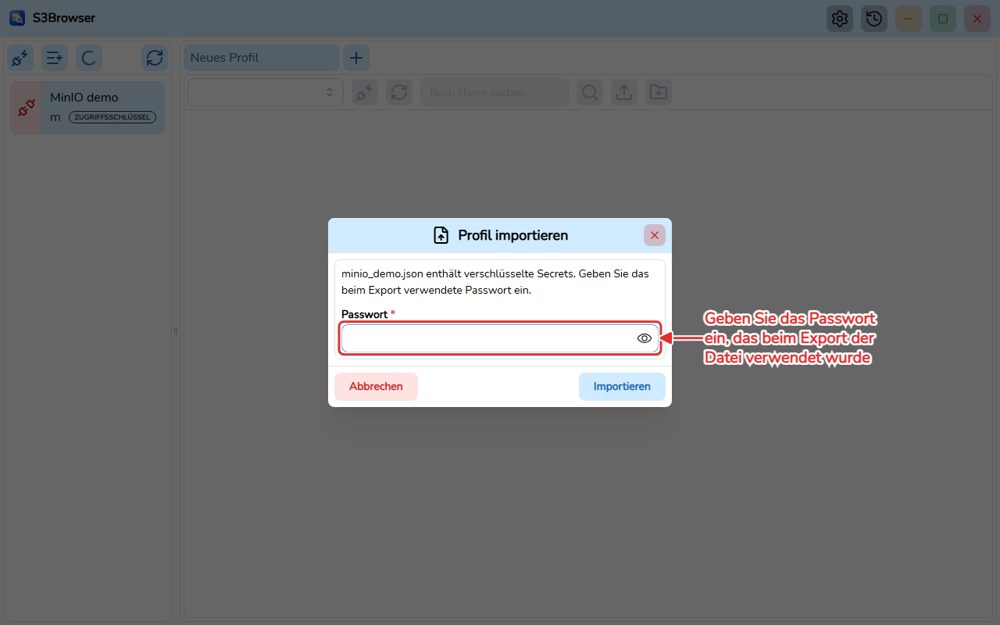

Ist das Passwort falsch, erscheint die Meldung „Falsches Passwort oder die Datei ist beschädigt.“ und das Fenster bleibt geöffnet, sodass Sie das Passwort erneut eingeben oder auf **Abbrechen** klicken können. Es wird nichts gespeichert, solange das Passwort nicht stimmt.

Das importierte Profil wird als neues Profil zur Liste hinzugefügt:

- Gibt es bereits ein Profil mit demselben Namen, erhält das neue eine Nummer: **Name (2)**, **Name (3)** und so weiter.
- Ein Pfad wird geleert, wenn die Datei auf diesem Computer nicht existiert oder wenn es ein Netzwerk- oder Gerätepfad ist (etwa `\\host\share`, `\\?\` oder `\\.\`), auch wenn dieser Pfad existiert. Das gilt für das CA-Zertifikat, das Zertifikat und den privaten Schlüssel der Methode **Clientzertifikat** sowie die AWS-config- und -credentials-Dateien. Eine Warnung listet diese Felder auf: „Profil [Name] importiert. Diese Dateipfade existieren auf diesem Computer nicht und wurden geleert: {fields}.“ Bearbeiten Sie das Profil und wählen Sie die Dateien erneut aus, bevor Sie sich verbinden.
- Der Import verbindet das Profil nicht, auch wenn in der Datei **Automatisch verbinden** aktiviert ist; das automatische Verbinden gilt ab dem nächsten Start der Anwendung.
- Ein ohne Geheimnisse exportiertes Profil hat keine Geheimnisse: Bearbeiten Sie es und geben Sie sie ein.

Die Windows-Dialoge zum Speichern und Öffnen lassen sich nicht in einem Screenshot zeigen. Das Bild des Fensters **Profil importieren** zeigt das Fenster, geöffnet mit einer Beispieldatei.

## 5. Buckets und Objekte durchsuchen

Jeder Tab arbeitet mit einem Profil. Um ein Profil in einem Tab zu verwenden, wählen Sie es in der Dropdown-Liste oben links im Tab und klicken dann daneben auf **Verbinden** (wenn das Profil noch nicht verbunden ist). Mit der Schaltfläche **+** (**Tab hinzufügen**) öffnen Sie einen weiteren Tab, zum Beispiel für ein zweites Konto. Ziehen Sie einen Tab, um die Reihenfolge zu ändern (oder drücken Sie Strg+Umschalt+Links/Rechts); die geöffneten Tabs werden beim nächsten Start der Anwendung wiederhergestellt.

Die Liste der Buckets wird angezeigt:

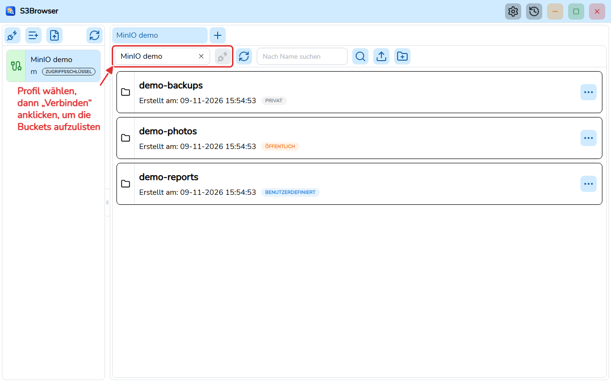

Klicken Sie auf einen Bucket, um seine Objekte zu sehen. Ordner werden zuerst angezeigt; klicken Sie auf einen Ordner, um ihn zu öffnen. Der Pfad über der Liste (zum Beispiel `demo-photos / travel / 2026`) ist anklickbar, und die Pfeilschaltfläche geht eine Ebene zurück (zum übergeordneten Ordner oder von der obersten Ebene eines Buckets zur Bucket-Liste).

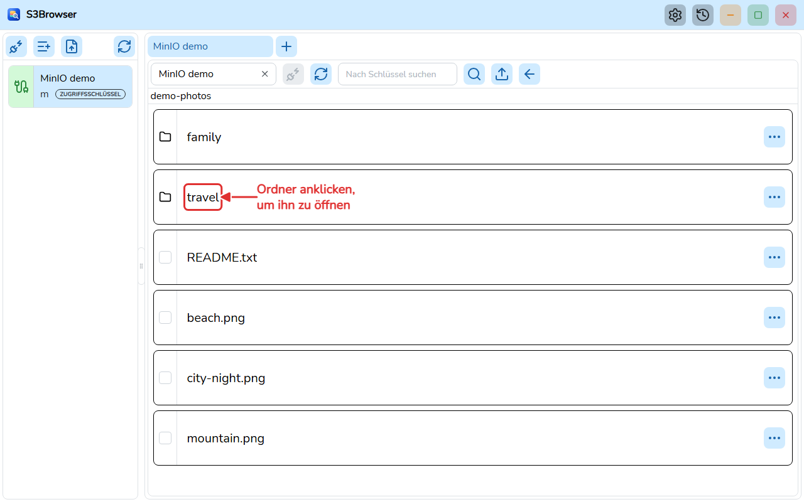

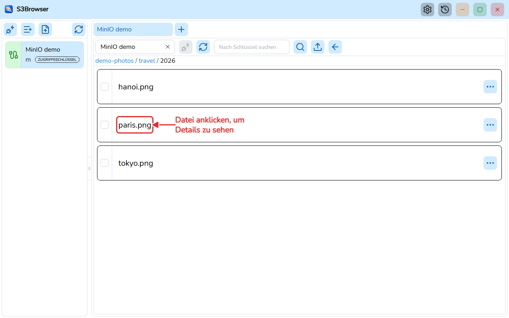

Große Buckets werden seitenweise geladen; beim Herunterscrollen werden automatisch weitere Objekte geladen. Mit der Schaltfläche **Aktualisieren** (**Objektliste neu laden** oder **Bucket-Liste neu laden**) laden Sie die aktuelle Ansicht neu.

## 6. Suche

Geben Sie im Suchfeld über der Liste einen Text ein und drücken Sie die Eingabetaste (oder klicken Sie auf die Lupe).

- In der Bucket-Liste suchen Sie nach dem **Namen**.
- In einem Bucket suchen Sie nach dem **Schlüssel** (dem Namen der Objekte und Ordner im aktuellen Ordner, die den Text enthalten; die Suche unterscheidet nicht zwischen Groß- und Kleinschreibung und geht nicht in Unterordner).

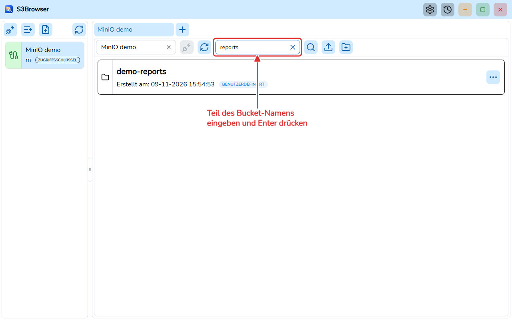

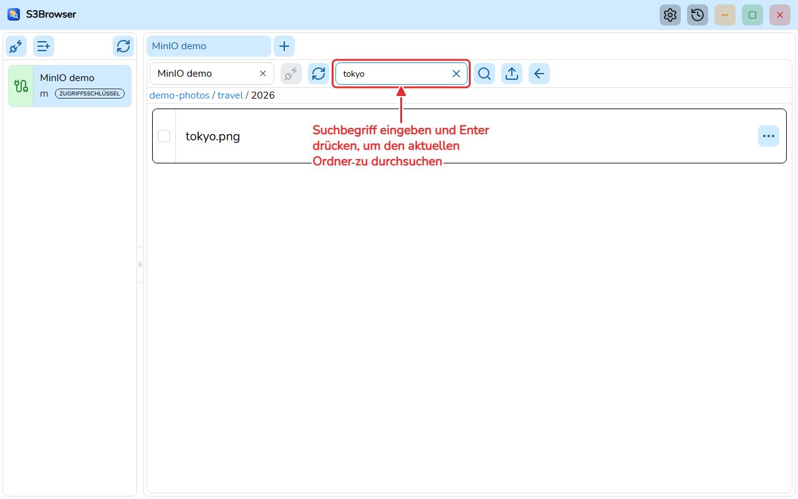

Wenn die Ergebnisliste mit **Weiter suchen** endet, klicken Sie darauf, um die Suche fortzusetzen. Das **x** im Suchfeld löscht die Suche.

## 7. Objektdetails

Klicken Sie auf eine Datei, um rechts das Fenster **Objektdetails** zu öffnen. Es zeigt Name, Schlüssel, Größe, Datum der letzten Änderung, ETag, Inhaltstyp, Speicherklasse und die Metadaten des Objekts. Die Kopierschaltflächen neben Schlüssel und ETag kopieren den Wert in die Zwischenablage. Wenn die Details nicht geladen werden können, klicken Sie auf **Erneut versuchen**. Schließen Sie das Fenster mit der Schaltfläche **Schließen**.

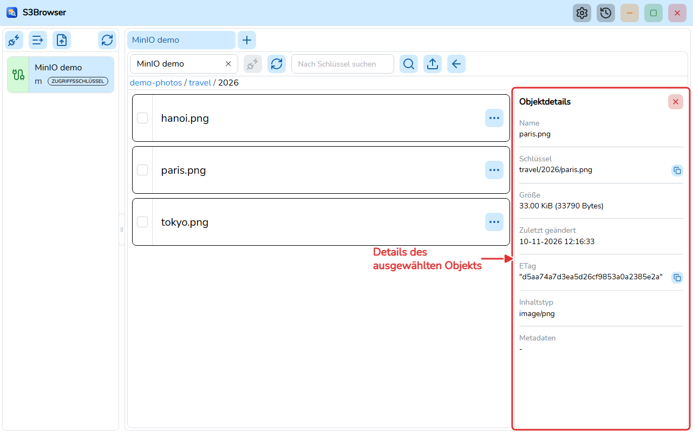

## 8. Buckets verwalten

### 8.1 Richtlinien-Badge und Bucket-Menü

Jeder Bucket in der Liste zeigt ein Badge mit seinem Richtlinientyp: **Privat** (keine Bucket-Richtlinie), **Öffentlich** (jeder kann Objekte lesen und auflisten) oder **Benutzerdefiniert** (eine benutzerdefinierte Richtlinie). Zeigen Sie mit der Maus auf das Badge, um die Bedeutung zu lesen. Ein Bucket, auf den Sie nicht zugreifen können, wird entsprechend markiert.

Öffnen Sie das Menü **Weitere Aktionen** (drei Punkte) am Ende einer Bucket-Zeile:

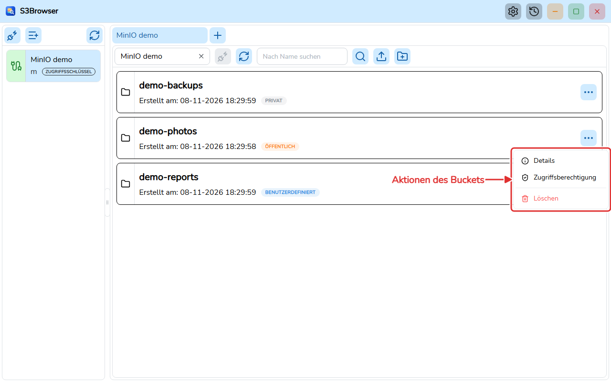

- **Details**: öffnet die Bucket-Details.
- **Zugriffsberechtigung**: ändert, wer auf den Bucket zugreifen kann.
- **Löschen**: löscht den Bucket.

**Zugriffsberechtigung** und **Löschen** werden ausgeblendet, wenn das Konto sie nicht verwenden darf; bei der Methode **Anonym** wird nur **Details** angeboten.

### 8.2 Bucket-Details

Wählen Sie **Details**, um rechts das Fenster **Bucket-Details** zu öffnen.

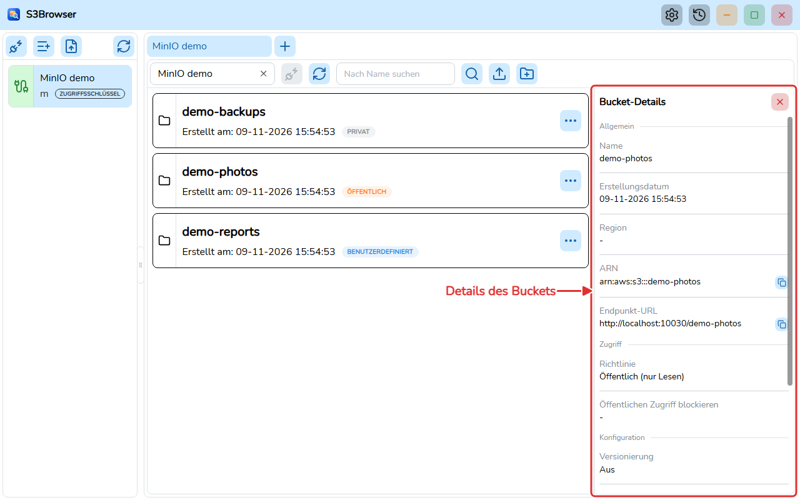

- **Allgemein**: **Name**, **Erstellungsdatum**, **Region**, **ARN** und **Endpunkt-URL**.
- **Zugriff**: **Richtlinie** (**Privat**, **Öffentlich (nur Lesen)** oder **Benutzerdefiniert**) und **Öffentlichen Zugriff blockieren** (**Ein** oder **Aus**).
- **Konfiguration**: **Versionierung**, **Standardverschlüsselung**, **Objektsperre**, **Tags** und **Objekte im Stammverzeichnis**. Die Zählung der Objekte im Stammverzeichnis endet bei 10.000 und zeigt dann `10,000+`.

Wenn die Details nicht geladen werden können, klicken Sie auf **Erneut versuchen**. Schließen Sie das Fenster mit der Schaltfläche **Schließen**.

### 8.3 Einen Bucket erstellen

Klicken Sie über der Bucket-Liste auf die Schaltfläche **Bucket erstellen**.

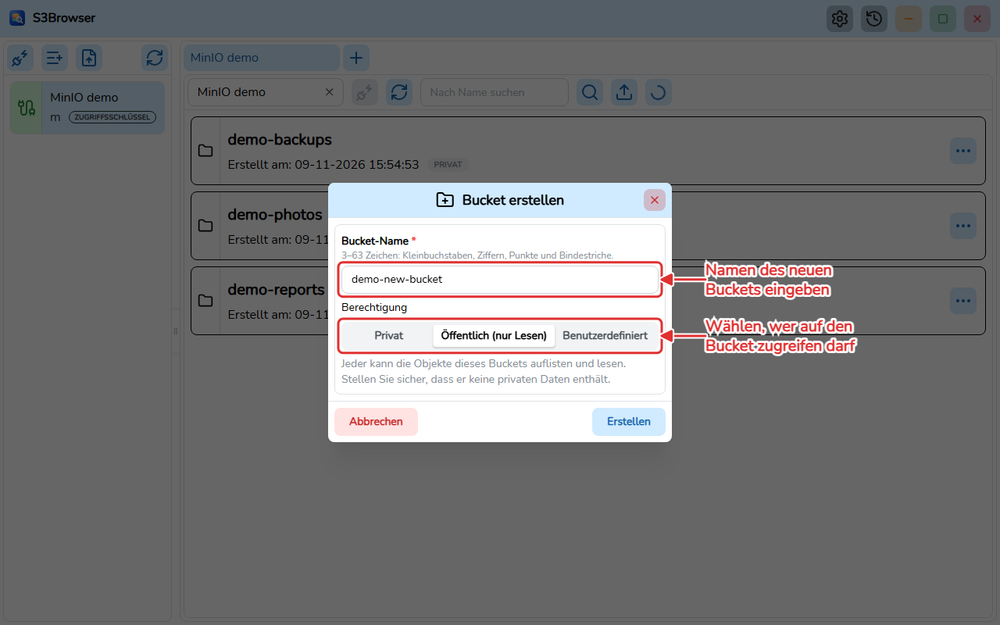

- **Bucket-Name**: 3–63 Zeichen: Kleinbuchstaben, Ziffern, Punkte und Bindestriche.
- **Berechtigung**: **Privat**, **Öffentlich (nur Lesen)** oder **Benutzerdefiniert** (geben Sie dann die Richtlinie als JSON ein).
- Auf AWS blockieren neue Buckets den öffentlichen Zugriff standardmäßig, daher kann eine öffentliche Richtlinie abgelehnt werden, solange „Öffentlichen Zugriff blockieren“ aktiv ist. Der Bucket wird trotzdem erstellt, und eine Warnung teilt Ihnen mit, dass die Berechtigung nicht angewendet wurde.
- Auf AWS gibt es zusätzlich das Feld **Region**, um die Region des neuen Buckets zu wählen (standardmäßig die Region des Profils); das kann nicht in einem Screenshot gezeigt werden, da dafür ein echtes AWS-Konto nötig ist.

Klicken Sie auf **Erstellen**. Die Bucket-Liste wird aktualisiert.

### 8.4 Die Berechtigung ändern

Wählen Sie im Bucket-Menü **Zugriffsberechtigung**.

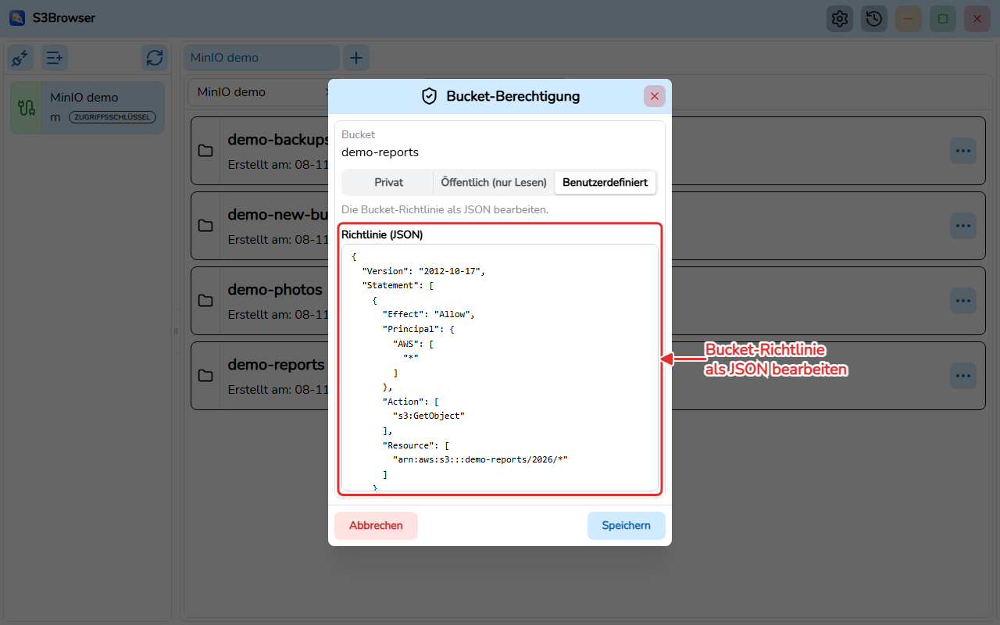

| Modus | Bedeutung |
| --- | --- |
| Privat | Keine Bucket-Richtlinie. Nur autorisierte Benutzer können auf diesen Bucket zugreifen. |
| Öffentlich (nur Lesen) | Jeder kann die Objekte dieses Buckets auflisten und lesen. Stellen Sie sicher, dass er keine privaten Daten enthält. |
| Benutzerdefiniert | Die Bucket-Richtlinie als JSON bearbeiten. |

Das Fenster warnt Sie, wenn für den Bucket „Öffentlichen Zugriff blockieren“ aktiv ist (eine öffentliche Richtlinie wird abgelehnt) oder wenn Ihr Konto die Berechtigung nicht ändern darf. Klicken Sie auf **Speichern**.

### 8.5 Einen Bucket löschen

Wählen Sie im Bucket-Menü **Löschen**.

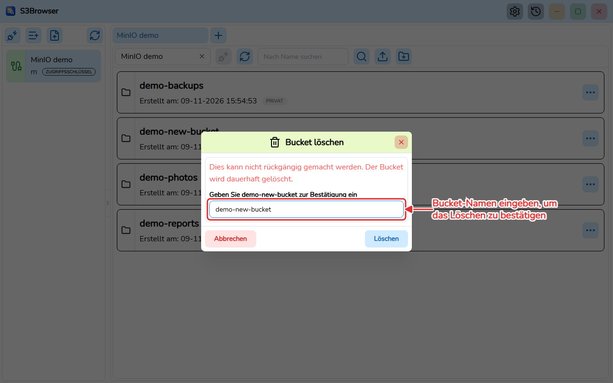

- Geben Sie zur Bestätigung den Namen des Buckets ein und klicken Sie dann auf **Löschen**.
- Ein Bucket, der nicht leer ist, wird zuerst geleert: **Alle seine Objekte werden gelöscht** (bei Versionierung auch jede Version und jede Löschmarkierung). Das kann nicht rückgängig gemacht werden.
- Ein Bucket mit Objektsperre, der nicht leer ist, kann nicht gelöscht werden.
- Das Löschen kann nicht abgebrochen werden, und das Fenster lässt sich erst schließen, wenn es beendet ist; bei einem großen Bucket kann das lange dauern. Danach wird nur der aktuelle Tab aktualisiert.

## 9. Objekte übertragen und löschen

### 9.1 Upload

Es gibt zwei Möglichkeiten, in den Ordner (oder Bucket) hochzuladen, den Sie gerade ansehen.

**Drag-and-drop.** Ziehen Sie Dateien und Ordner aus Ihrem Dateimanager auf die Objektliste. Wird ein Ordner abgelegt, werden alle darin enthaltenen Dateien hochgeladen und die Ordnerstruktur bleibt erhalten. Das Ziehen kann nicht in einem Screenshot gezeigt werden.

**Upload-Dialog.** Klicken Sie auf die Schaltfläche **Dateien hochladen** (der Pfeil nach oben über der Liste). Das Fenster **Dateien hochladen** wird geöffnet und zeigt das Ziel (**Hochladen nach: ...**).

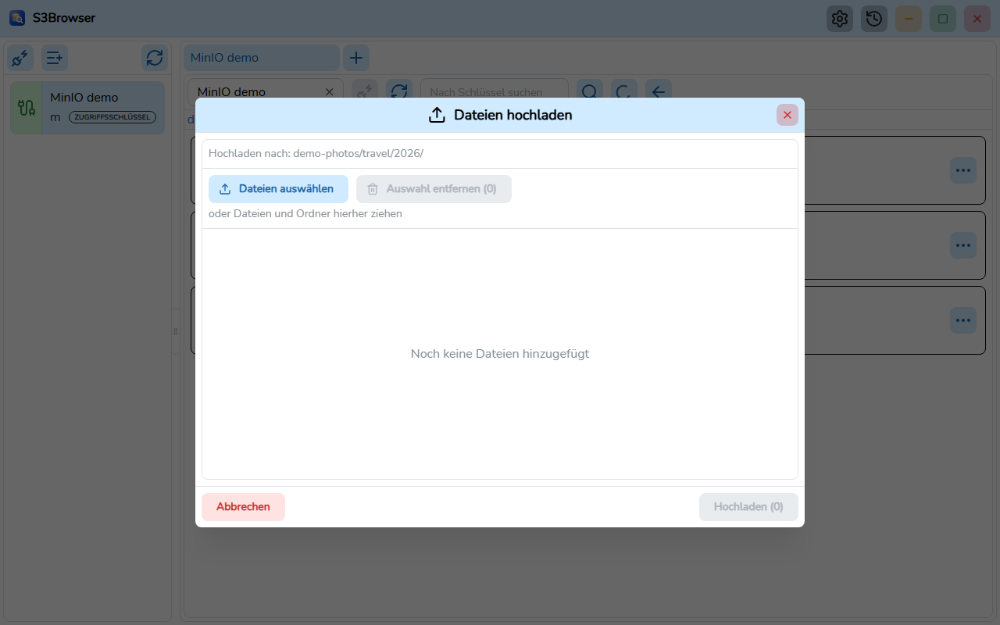

- Klicken Sie auf **Dateien auswählen** und wählen Sie Dateien im Dialog Ihres Systems, oder ziehen Sie Dateien und Ordner in das Fenster.
- Die Liste zeigt jede Datei mit ihrer Größe. Deaktivieren Sie eine Datei, um sie auszulassen, klicken Sie auf das Papierkorb-Symbol, um sie aus der Liste zu entfernen, oder verwenden Sie **Auswahl entfernen**.
- Wenn Sie den Dialog von der Bucket-Liste aus geöffnet haben, wählen Sie zuerst den Ziel-Bucket.
- Klicken Sie auf **Hochladen**, um zu starten.

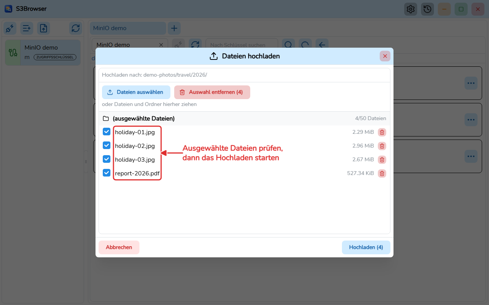

Damit eine Übertragung überschaubar bleibt, gelten die folgenden Grenzen:

| Grenze | Wert |
| --- | --- |
| Dateien aus einem Ordner pro Upload | 50 |
| Große Dateien (über 10 GiB) aus einem Ordner | 4 |
| Dateien pro Upload | 1000 |
| Gleichzeitige Uploads | 1 (warten Sie, bis der laufende Upload beendet ist) |

Überschreitet ein abgelegter Ordner eine Grenze, können Sie im Fenster **Dateien zum Hochladen auswählen** die hochzuladenden Dateien ankreuzen; Ordner innerhalb der Grenzen werden vollständig hochgeladen. Elemente, die nicht hochgeladen werden können (nicht lesbare Dateien, symbolische Links), werden übersprungen, und Sie erfahren, wie viele es waren.

Das Fenster **Upload läuft** erscheint unten rechts mit dem Fortschritt jeder Datei (Prozentring, **Hochgeladen** und **Verbleibend**). Klicken Sie bei einer Datei auf **Abbrechen** oder oben auf **Alle abbrechen**, um zu stoppen. Das Fenster kann geschlossen und über seine Schaltfläche wieder geöffnet werden.

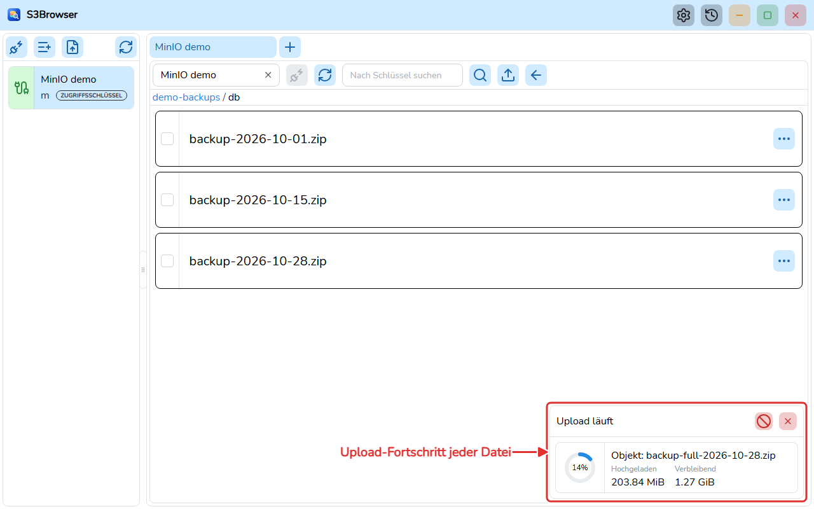

Wenn der Upload abgeschlossen ist, klicken Sie auf **Aktualisieren**, um die neuen Objekte zu sehen.

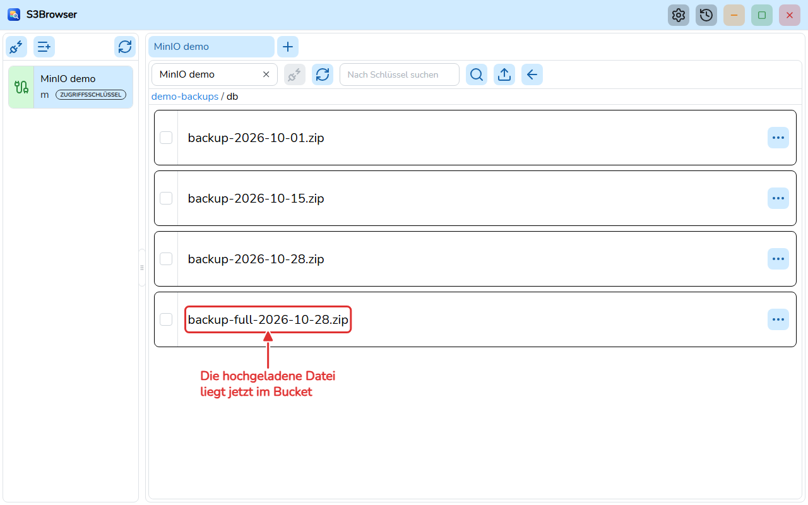

### 9.2 Download

- Für ein einzelnes Objekt öffnen Sie das Menü **Weitere Aktionen** (drei Punkte) am Ende seiner Zeile und wählen **Herunterladen**. Ein Dialog fragt, wo die Datei gespeichert werden soll.
- Für mehrere Objekte kreuzen Sie diese an (bis zu 5) und klicken dann in der Symbolleiste auf **Auswahl herunterladen**. Ein Dialog fragt nach dem Zielordner.

Ordner können nicht heruntergeladen werden; sie werden aus der Auswahl ausgelassen.

Das Fenster **Download läuft** zeigt den Fortschritt jeder Datei (**Heruntergeladen** und **Verbleibend**) und hat die Schaltflächen **Abbrechen** und **Alle abbrechen**. Das Bild unten zeigt das Fenster.

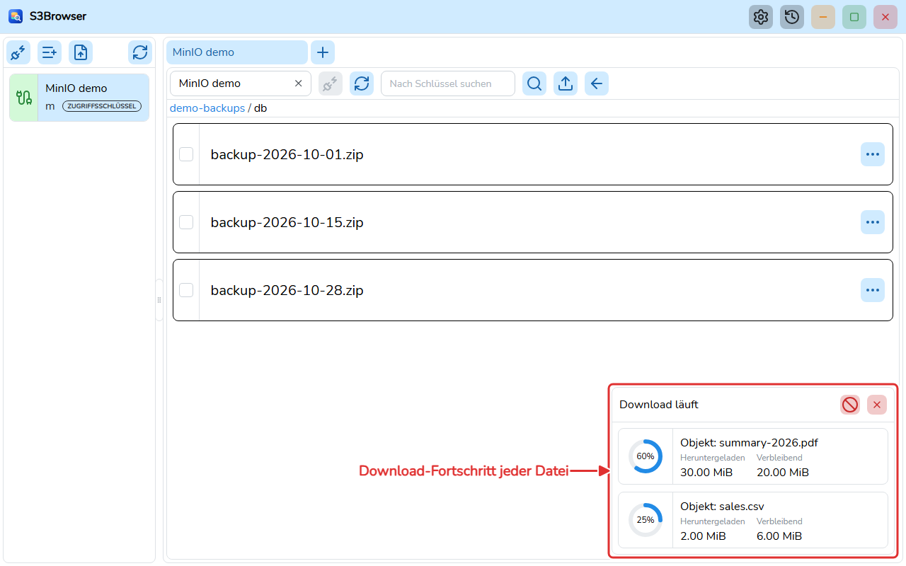

Klicken Sie oben rechts auf die Uhr-Schaltfläche, um den **Download-Verlauf** zu öffnen: jeder Download mit Größe, Zeit, Status und Zielpfad.

### 9.3 Mehrere Objekte auswählen

Aktivieren Sie die Kontrollkästchen am Zeilenanfang. Die Symbolleiste zeigt dann **Auswahl aufheben**, **Auswahl herunterladen** und **Auswahl löschen**. Zum Herunterladen oder Löschen können Sie höchstens 5 Objekte gleichzeitig auswählen.

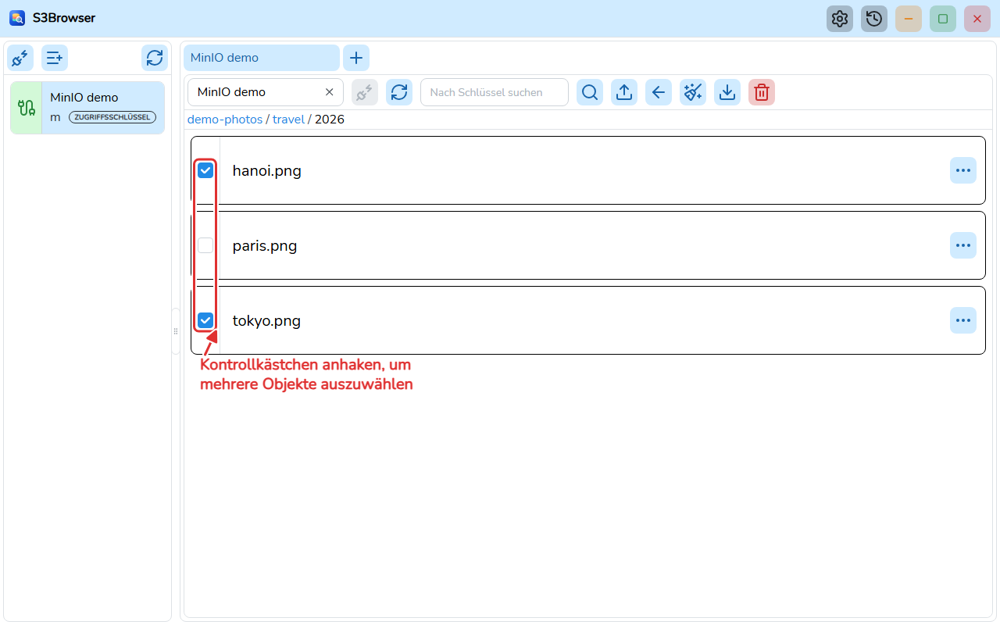

### 9.4 Löschen

Öffnen Sie das Menü **Weitere Aktionen** des Objekts und wählen Sie **Löschen**, oder wählen Sie Objekte aus und klicken Sie auf **Auswahl löschen**. Ein Bestätigungsfenster zeigt, was gelöscht wird; klicken Sie zur Bestätigung auf **Löschen (n)**, wobei n die Anzahl der ausgewählten Elemente ist.

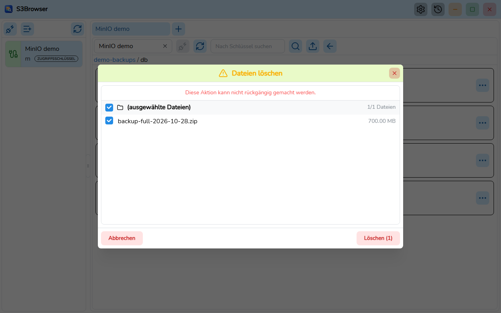

Das Löschen eines **Ordners** entfernt den Ordner **und alles darin**. Die Bestätigung weist darauf hin, und die Aktion kann nicht rückgängig gemacht werden. Wenn einige Objekte nicht gelöscht werden können, nennt die Meldung, wie viele fehlgeschlagen sind und wie viele gelöscht wurden.

## 10. Einstellungen und Updates

### 10.1 Einstellungen

Klicken Sie oben rechts, links von der Schaltfläche für den Download-Verlauf, auf die Schaltfläche **Einstellungen** (Zahnrad-Symbol).

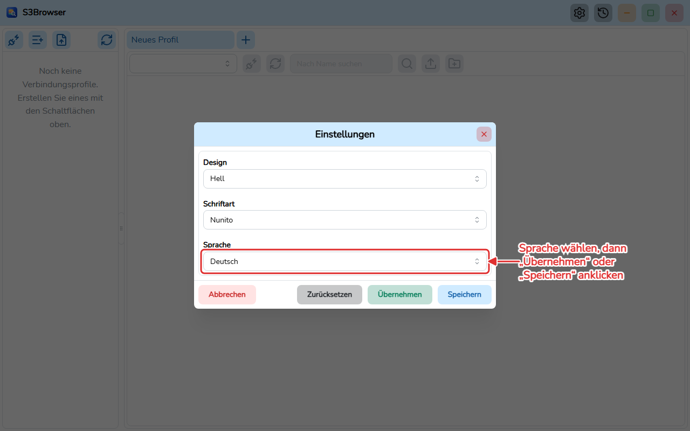

- **Design**: Hell, Dunkel oder Systemvorgabe.
- **Schriftart**: Nunito, System-UI, Segoe UI, Arial, Roboto, Be Vietnam Pro, Verdana, Meiryo UI, Monospace oder JetBrains Mono.
- **Sprache**: English, Tiếng Việt, 日本語, 简体中文, 繁體中文, Русский oder Deutsch. Die gesamte Oberfläche ändert sich, einschließlich der Meldungen.
- **Beim Windows-Start starten**: startet S3Browser, wenn Sie sich bei Windows anmelden. Wird nur in der installierten Windows-Version angezeigt (nicht in der portablen).
- **Updates automatisch suchen und herunterladen** und **Beta-Versionen (Vorabversionen) erhalten**: siehe [Updates](#102-updates). Diese beiden Schalter wirken sofort beim Umschalten, ohne **Übernehmen** oder **Speichern**; nur mit **Speichern** bleiben sie nach einem Neustart der App erhalten.

Jede Änderung wird sofort als Vorschau angezeigt. Wählen Sie dann:

- **Speichern**: behält die Einstellungen, auch nach einem Neustart der App.
- **Übernehmen**: behält die Einstellungen, bis Sie die App schließen, einschließlich der beiden Update-Schalter; der Dialog bleibt geöffnet. „Beim Windows-Start starten“ wird durch Übernehmen sofort in Windows geschrieben; Abbrechen macht das nicht rückgängig.
- **Abbrechen**: macht die Änderungen seit dem letzten Übernehmen oder Speichern rückgängig, einschließlich der beiden Update-Schalter. Der Dialog wird geschlossen.
- **Zurücksetzen**: setzt das Formular auf die Standardwerte zurück (Hell, Nunito, English, **Beim Windows-Start starten** aus). Die beiden Update-Schalter werden ebenfalls sofort zurückgesetzt, wie bei manuellem Umschalten: **Updates automatisch suchen und herunterladen** an und **Beta-Versionen (Vorabversionen) erhalten** aus. Klicken Sie auf **Speichern**, um die Standardwerte zu behalten; **Abbrechen** macht das Zurücksetzen rückgängig.

Wenn Sie das Fenster mit **X**, der Esc-Taste oder einem Klick außerhalb schließen, während es Änderungen gibt, die weder gespeichert noch übernommen wurden, erscheint die Warnung **Nicht gespeicherte Einstellungen** („Es gibt Einstellungen, die weder gespeichert noch angewendet wurden. Was möchten Sie tun?“): **Zurück** lässt das Fenster mit Ihren Änderungen geöffnet, **Änderungen verwerfen** macht sie rückgängig und schließt das Fenster, **Speichern** speichert sie (schlägt das Speichern fehl, bleibt das Fenster geöffnet). Ohne Änderungen wird das Fenster einfach geschlossen.

Die Einstellungen werden beim Start der App geladen, bevor der Fensterinhalt erscheint.

### 10.2 Updates

Die installierte Version kann sich über GitHub Releases selbst aktualisieren. Dort wird der Abschnitt **Update** des Einstellungsfensters angezeigt; die portable Version aktualisiert sich nicht selbst.

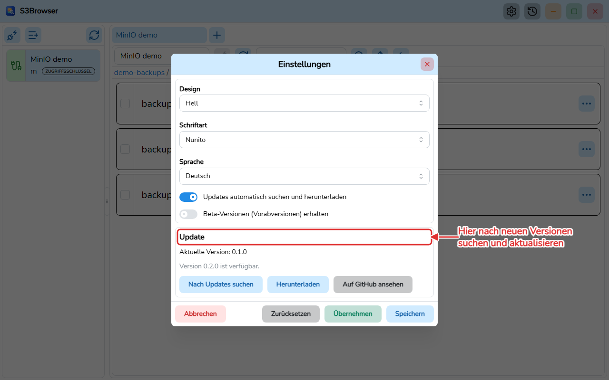

- **Updates automatisch suchen und herunterladen**: Wenn aktiviert, sucht die Anwendung nach einer neuen Version und lädt sie im Hintergrund herunter.
- **Beta-Versionen (Vorabversionen) erhalten**: bietet zusätzlich die als Pre-release gekennzeichneten Versionen an.
- **Nach Updates suchen** sucht sofort. Die Zeile unter **Aktuelle Version** nennt das Ergebnis (zum Beispiel **Version ... ist verfügbar.** oder **Sie verwenden die neueste Version.**).
- **Herunterladen** lädt die neue Version herunter, **Jetzt aktualisieren** installiert sie nach dem Download, und **Auf GitHub ansehen** öffnet die Release-Seite.

Wenn eine neue Version verfügbar ist, bietet ein Hinweis oben im Fenster **Herunterladen** an; während des Downloads zeigt er den Fortschritt, und nach Abschluss des Downloads bietet er **Aktualisieren** an. Die heruntergeladene Datei wird vor der Installation geprüft.

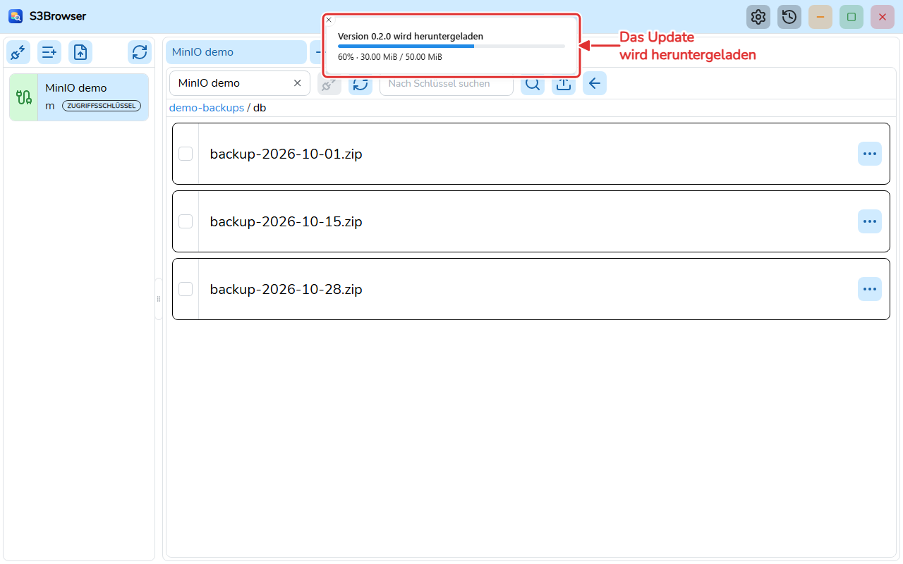

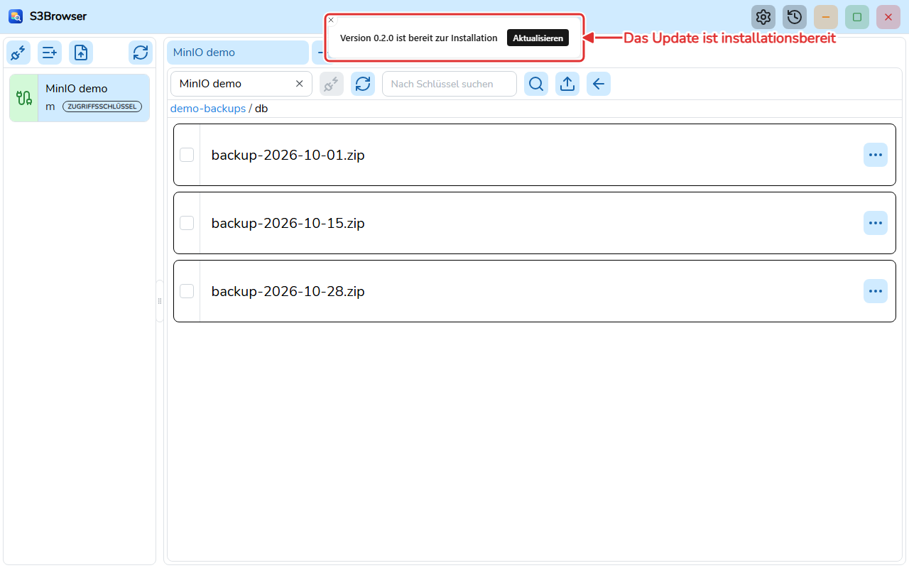

Ein echtes Update kann nicht in einem Screenshot gezeigt werden: Die Bilder oben zeigen den Hinweis mit Beispielwerten.

## 11. Fehlerbehebung

Meldungen erscheinen oben im Fenster. Dies sind die, denen Sie am häufigsten begegnen können.

| Meldung | Ursache und was zu tun ist |
| --- | --- |
| Zugriffsschlüssel oder geheimer Schlüssel ist für diesen Endpunkt ungültig. | Die Schlüssel sind falsch oder gehören zu einem anderen Server. Prüfen Sie sie im Profil und verwenden Sie **Verbindung testen**. |
| Zeitüberschreitung beim Erreichen des Endpunkts. Prüfen Sie die Adresse und ob der Server läuft. | Der Endpunkt ist falsch, der Server ist gestoppt, oder eine Firewall oder das Netzwerk blockiert ihn. Prüfen Sie die Adresse (mit `http://` oder `https://`) und den Port. |
| Der Endpunkt hat die Anfrage abgelehnt. / Fehler beim Verbinden mit dem S3-Bucket. | Der Server hat geantwortet, aber die Verbindung abgelehnt. Prüfen Sie Endpunkt, Region und **Path style** (für MinIO erforderlich). |
| Profil {name} ist nicht verbunden. | Die Verbindung wurde geschlossen. Verbinden Sie das Profil erneut. |
| Fehler beim Abrufen der Bucket-Liste / Fehler beim Abrufen der Objektliste | Das Konto darf möglicherweise keine Buckets oder diesen Bucket auflisten, oder die Verbindung wurde unterbrochen. Prüfen Sie die Berechtigungen der Schlüssel und verbinden Sie sich erneut. |
| Der Zugriff auf den Bucket ist eingeschränkt. | Ihr Konto kann nicht alle Buckets auflisten. Fordern Sie die fehlende Berechtigung an oder öffnen Sie einen Bucket, den Sie verwenden dürfen. |
| Ein anderer Upload läuft, bitte warten Sie, bis er abgeschlossen ist. | Es läuft immer nur ein Upload. Warten Sie darauf oder brechen Sie ihn im Fenster **Upload läuft** ab. |
| Ordner ... enthält mehr als 50 hochzuladende Dateien. / Es können höchstens 1000 Dateien gleichzeitig hochgeladen werden. | Siehe die Grenzen in Abschnitt 9.1. Teilen Sie den Upload auf oder wählen Sie weniger Dateien. |
| Profil [{name}] hat laufende Uploads oder Downloads und kann nicht gelöscht werden. | Warten Sie, bis die Übertragungen beendet sind, oder brechen Sie sie ab, und löschen Sie dann das Profil. |
| Bitte trennen Sie zuerst die Verbindung! | Trennen Sie das Profil (Rechtsklick, **Trennen**), bevor Sie es bearbeiten oder löschen. |
| Es können höchstens 5 Elemente ausgewählt werden! | Wählen Sie höchstens 5 Objekte zum Herunterladen oder Löschen aus. |
| Ziel ... existiert nicht. | Der für einen Download gewählte Ordner ist nicht verfügbar. Wählen Sie einen anderen Speicherort. |

Wenn eine Meldung hier nicht aufgeführt ist, enthält sie den Namen des Vorgangs und den vom Server gemeldeten Grund. Dieser Grund (zum Beispiel `AccessDenied` oder `NoSuchBucket`) ist die Meldung von S3 selbst und sagt Ihnen, was auf der Serverseite zu beheben ist.

Die Screenshots der beiden Verbindungsfehler unten wurden mit **Verbindung testen** erstellt.

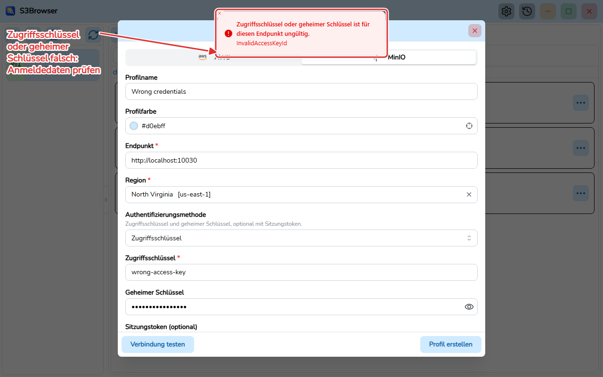

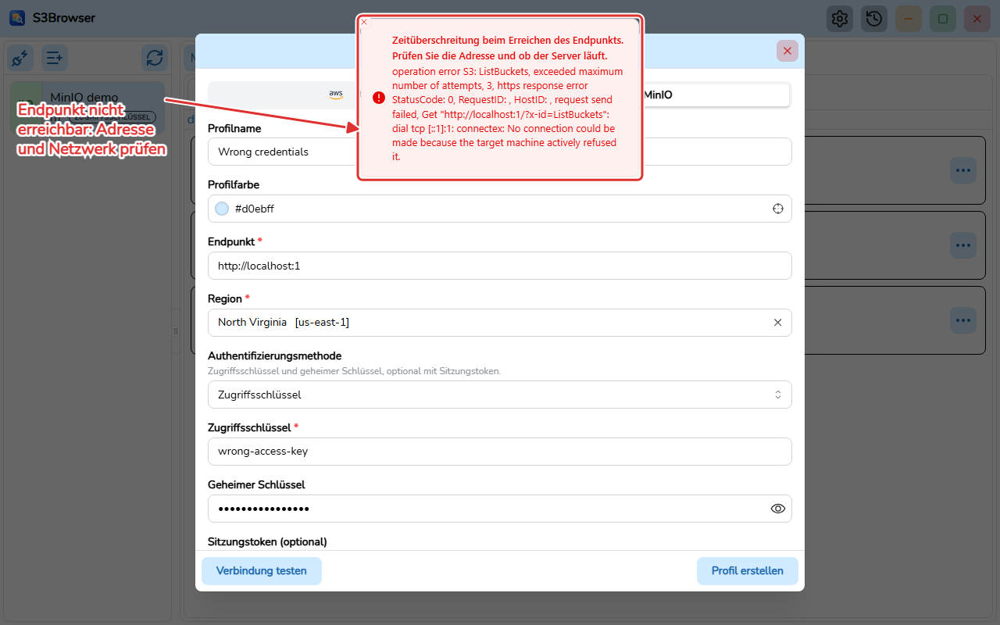
