# S3 Browser User Guide

Version 0.0.1-beta.1

## 1. Introduction

S3 Browser is a desktop application for browsing and managing buckets and objects on **AWS S3** and on S3-compatible servers such as **MinIO**. With it you can:

- save connection profiles and connect to several accounts at the same time (one tab per connection);
- sign in with an access key, an assumed role, AWS SSO, MinIO STS, LDAP, OpenID Connect (OIDC) or a client certificate;
- browse buckets, folders and objects, and search them;
- create, inspect, change the permission of and delete buckets;
- see the details of an object;
- upload files and folders (drag and drop or a dialog), with a live progress window;
- download objects and review the download history;
- delete objects and whole folders;
- keep the application up to date from GitHub Releases.

The interface is available in English, Vietnamese, Japanese, Simplified Chinese, Traditional Chinese, Russian and German.

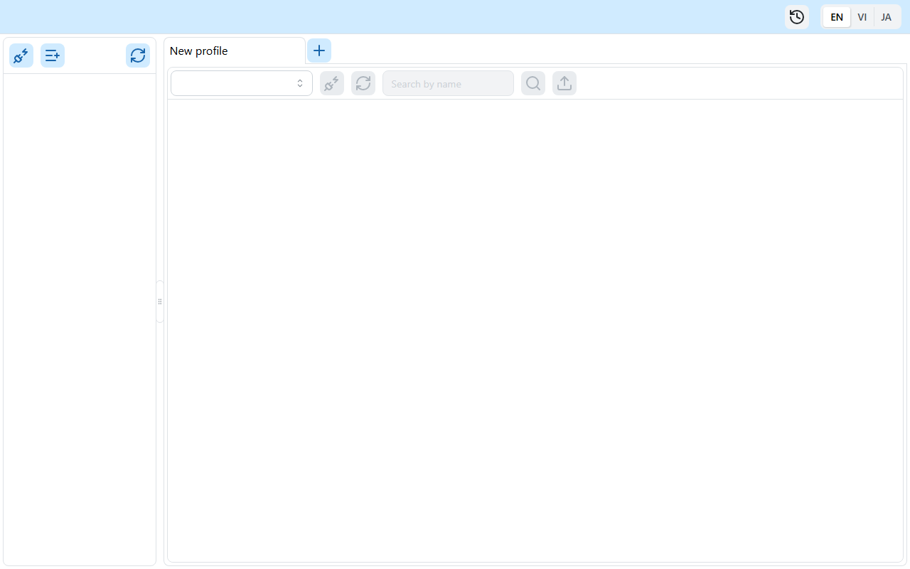

The window has three areas: the **profile list** on the left, the **tabs** on the right (each tab shows the buckets and objects of one connection) and the **header** at the top with the **Settings** button and the download history button.

> This is a beta version (0.0.1-beta.1). Please keep a copy of important data before deleting objects: a deletion cannot be undone.

## 2. Installation

There are two ways to get the application on Windows.

- **Installer**: download `S3Browser-<version>-windows-amd64-installer.exe` from the [GitHub Releases](https://github.com/TranMinhTruyen/s3-browser/releases) page and run it, then follow the steps. The **Latest** release is the stable version; versions marked **Pre-release** are betas. The application is then available from the Start menu. Profiles and the download history are stored in your user profile. Only the installed version can update itself (see [Updates](#102-updates)).
- **Portable**: copy the portable folder anywhere (for example a USB drive) and run `S3Browser.exe`. It uses the WebView2 runtime shipped in the `webview2` folder and keeps its data in the `data` folder next to the program, so nothing is written elsewhere. Do not move the `webview2` and `data` folders away from the program.

## 3. Connect to AWS S3 or MinIO

Click the **Create connection profile** button (the second button above the profile list). The **Connection Profile** window opens.

### 3.1 Profile form

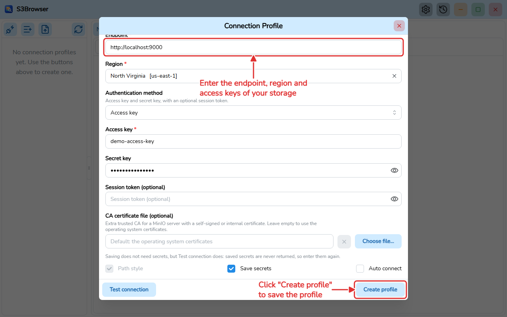

| Field | Description |
| --- | --- |
| AWS / MinIO | Choose the type of server. MinIO switches **Path style** on automatically. The authentication methods offered depend on it. |
| Profile name | The name shown in the profile list and in the tab. |
| Profile color | The color of the profile in the list. |
| Endpoint | The address of the server, for example `https://s3.amazonaws.com` or `http://localhost:9000`. |
| Region | The region of your account, for example `North Virginia [us-east-1]`. Required, except for some methods that read it from the AWS configuration. |
| Authentication method | How the application signs in (see [Authentication methods](#32-authentication-methods)). The fields below it change with the method. |
| Access key | The access key of your account. |
| Secret key | The secret key of your account. Click the eye icon to show it. |
| Session token (optional) | The session token of temporary credentials. |
| CA certificate file (optional) | See [CA certificate for MinIO](#33-ca-certificate-for-minio). |
| Path style | Addresses buckets as `endpoint/bucket` instead of `bucket.endpoint`. Needed by MinIO and most self-hosted servers. |
| Save secrets | Stores the secrets (encrypted) in the profile. Without it you must type them every time you connect. |
| Auto connect | Connects the profile when the application starts. Available only when **Save secrets** is ticked, and not for methods that need input on every connect (for example OIDC or an MFA code). |

Two buttons are available at the bottom:

- **Test connection** checks the values without saving anything. Saved secrets are never shown again, so type them again for the test. A green message tells you the test succeeded; a red message explains the problem (see [Troubleshooting](#11-troubleshooting)).
- **Create profile** saves the profile (when you open the window from an existing profile, the button reads **Update profile**).

> Never share a screenshot that shows your secret key. The key fields in this guide contain placeholder values only.

### 3.2 Authentication methods

Choose the method in **Authentication method**. The list depends on the server type.

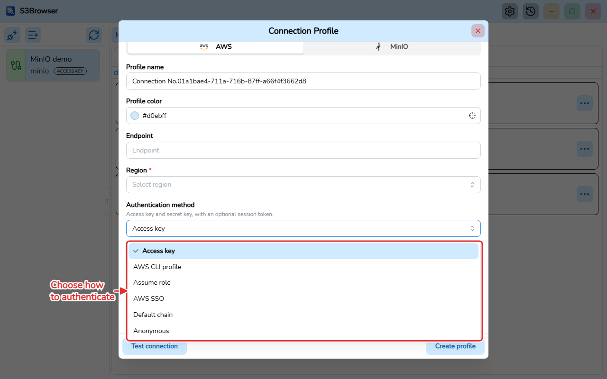

| Method | Server | What to enter |
| --- | --- | --- |
| Access key | AWS, MinIO | Access key, secret key and an optional session token. |
| AWS CLI profile | AWS | A profile of the AWS CLI files (`~/.aws`), with optional paths of the **AWS config file** and **AWS credentials file** (defaults: `~/.aws/config`, `~/.aws/credentials`). |
| Assume role | AWS | **Role ARN**, the credentials used to assume it (**Access key** or **AWS CLI profile**) and, optionally, **External ID**, **Session name**, **Duration (seconds)** and **MFA device serial (optional)**. The **MFA code** is asked at connect time and is never saved. |
| AWS SSO | AWS | An AWS CLI profile that is already signed in. Run `aws sso login --profile <profile>` first. |
| Default chain | AWS | Nothing: uses the credentials found in the environment (environment variables, shared files or the instance role). |
| Anonymous | AWS, MinIO | Only the names of the public buckets to open (an anonymous user cannot list buckets). |
| MinIO STS | MinIO | Access key, secret key and, optionally, **Role ARN (optional)**, **Duration (seconds, optional)** and **Inline policy (JSON, optional)**. |
| LDAP | MinIO | **LDAP username** and **LDAP password** and, optionally, **Duration (seconds, optional)** and **Inline policy (JSON, optional)**. |
| OIDC | MinIO | **Client ID**, **Issuer URL**, an optional **Scope** and the **Callback port**. |
| Client certificate | MinIO | **Client certificate file** and **Private key file**; tick **The private key has a password** if needed. The endpoint must use `https://`. |

The methods that need more fields are shown below (the values are placeholders).

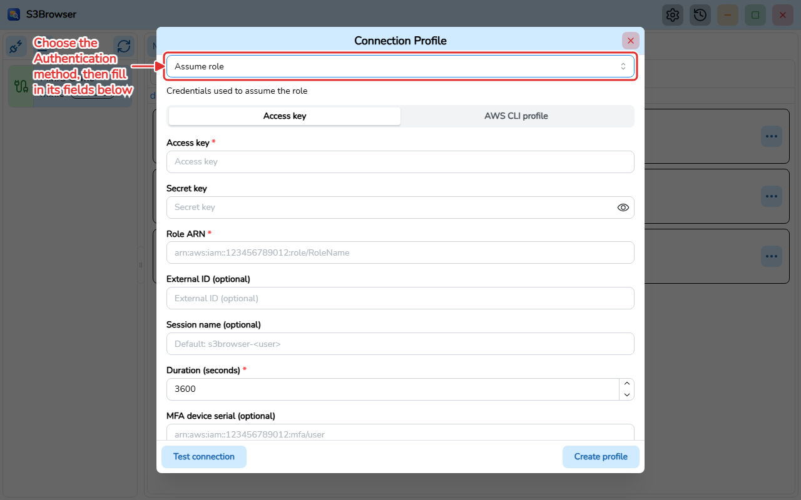

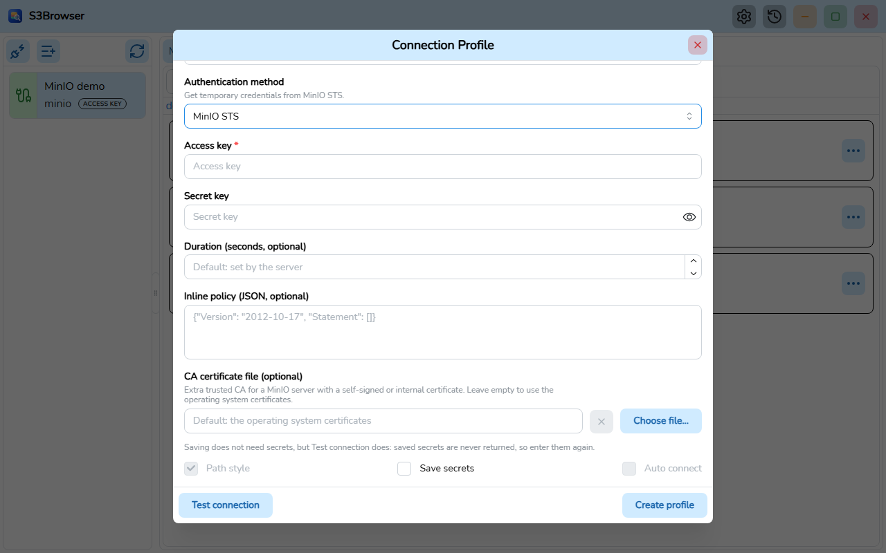

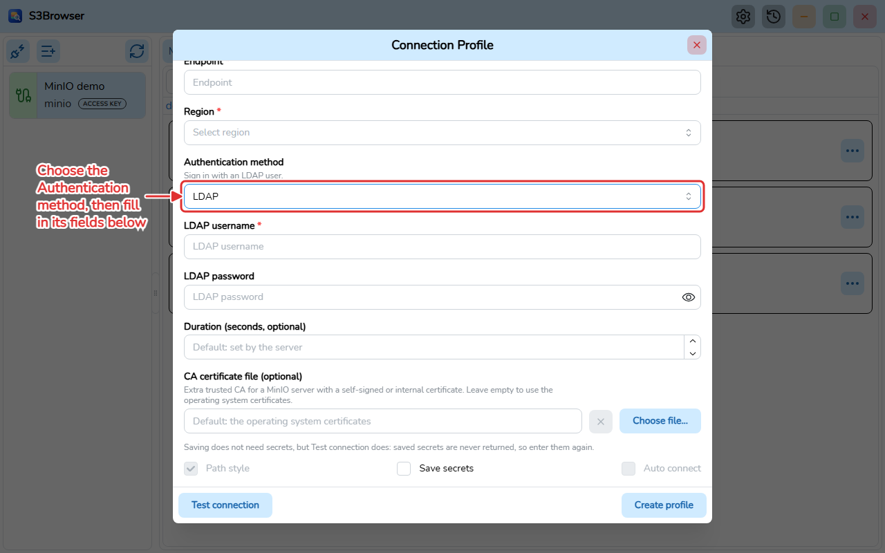

**OIDC.** Copy the **Redirect URI** shown in the form (**Copy** button) and register it as a redirect URI of the client in your identity provider. Click **Sign in**: your web browser opens and you sign in there. The form shows **Waiting for the sign-in in your browser...** and then **Signed in, valid until ...**; **Cancel sign-in** stops waiting. The sign-in is used once and is never saved. When it expires the form says **The sign-in has expired, sign in again**. The browser window cannot be shown in a screenshot.

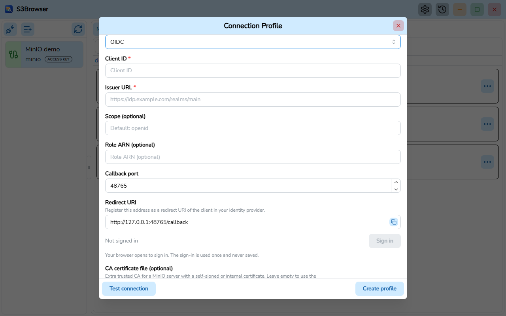

**Client certificate.** Click **Choose file...** next to a file field and pick the file in the dialog of your system (the dialog cannot be shown in a screenshot); **Clear file** empties the field. The files are read when you connect and their content is not saved.

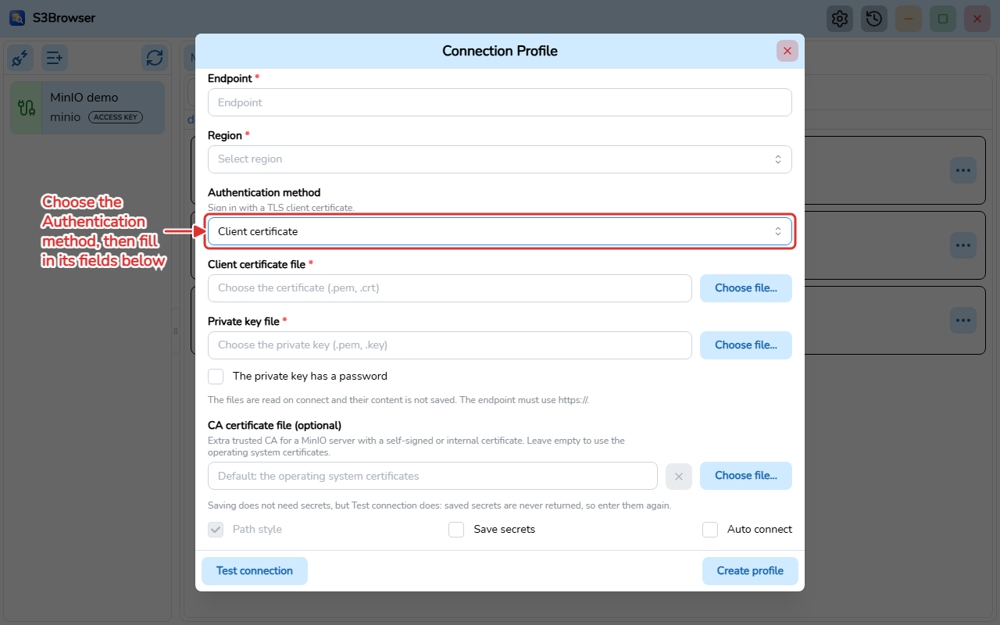

Some credentials expire. Shortly before that, the application asks you to renew them: with an MFA code (assume role), by signing in again (OIDC, SSO), or by disconnecting and connecting again.

### 3.3 CA certificate for MinIO

A MinIO server with a self-signed or internal certificate needs an extra trusted CA. In **CA certificate file (optional)**, click **Choose file...** and pick the CA certificate (`.pem` or `.crt`). Leave the field empty to use the certificates of your operating system. The file applies to the connection to MinIO only, not to the OIDC identity provider.

## 4. Manage profiles

After you create a profile, it appears in the profile list.

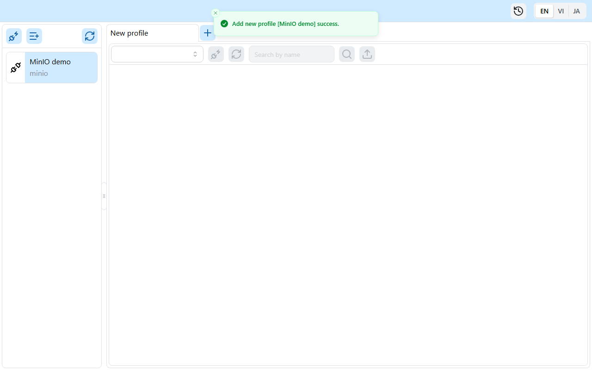

Right-click a profile to open its menu.

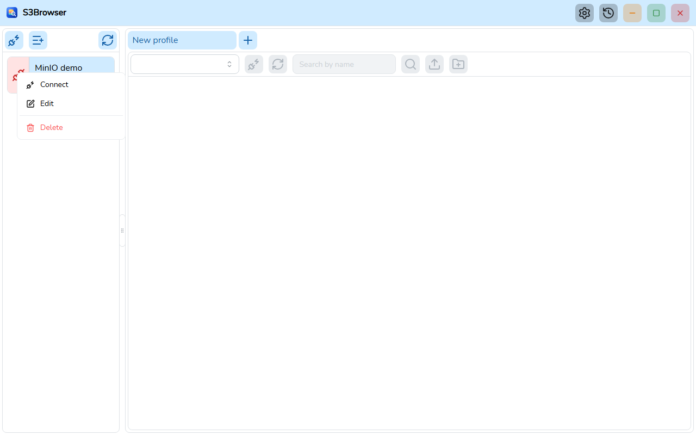

- **Connect**: opens the connection. A connected profile shows a green icon.
- **Disconnect**: closes the connection. Disconnect first before you edit or delete a profile.
- **Edit**: changes the profile (the window title is again **Connection Profile**, and the button is **Update profile**). You are asked to confirm the update.
- **Export**: saves the profile to a JSON file; see [4.1 Export a profile](#41-export-a-profile).
- **Delete**: removes the profile after you confirm.

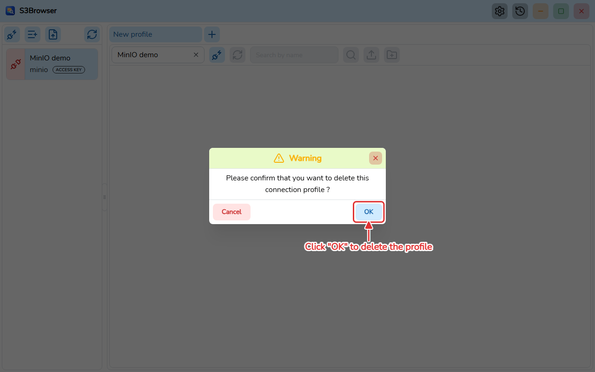

A profile that still has an upload or a download running cannot be deleted. Wait for the transfers to finish or cancel them first.

The first button above the list (**Connect**) opens the same window with a **Connect** button, to connect once without saving a profile, and the **Refresh connection profile list** button reloads the list.

### 4.1 Export a profile

Export copies a profile to a file, for example to use it on another computer. Right-click the profile and choose **Export**.

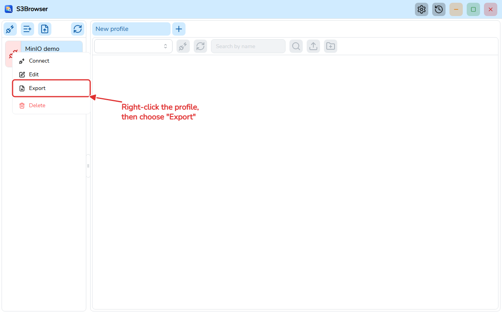

The **Export profile** window opens.

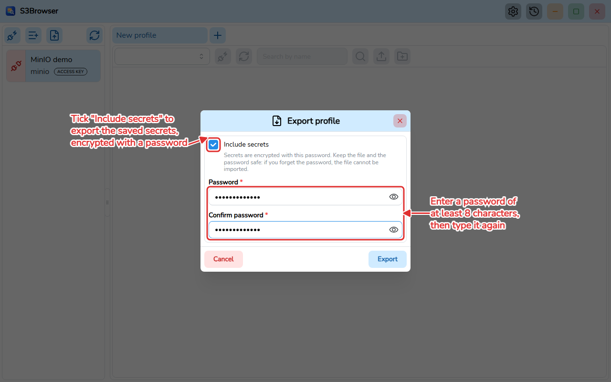

- Leave **Include secrets** off to export the profile without its secrets (secret key, session token, LDAP password, key passphrase). Before it continues, the application warns you if the profile has saved secrets: "Profile [name] has saved secrets that will NOT be exported. After importing you will need to enter them again. Export without secrets?" Confirm to export, or cancel to go back. After importing, edit the profile and enter the secrets again.
- Tick **Include secrets** to export the saved secrets as well. Enter a **Password** of at least 8 characters and type it again in **Confirm password**. The secrets are encrypted with this password (PBKDF2 and AES-GCM): they are never written to the file in plain text. The option is disabled ("This profile has no saved secrets.") when the profile has no saved secrets.

Click **Export**. A Windows save dialog opens with a suggested file name made from the profile name: lowercase letters, digits and underscores only, for example `minio_demo.json`. Choose where to save the file. When the file is written, a message tells you so. If you close the save dialog, nothing is written and the **Export profile** window stays open.

The file contains the connection settings of the profile (name, color, provider, endpoint, region, access key, path style, auto connect, authentication method and its options), not internal data such as the profile ID or dates. Only the paths of the certificate and key files are exported, not the files themselves.

Keep the file and the password safe. The password is not stored anywhere: if you forget it, the file cannot be imported. Do not edit a file that contains secrets by hand. If its provider, endpoint or authentication method is changed, importing it fails with "Wrong password, or the file is damaged."

### 4.2 Import a profile

Click the **Import connection profile** button (next to **Create connection profile**, above the profile list).

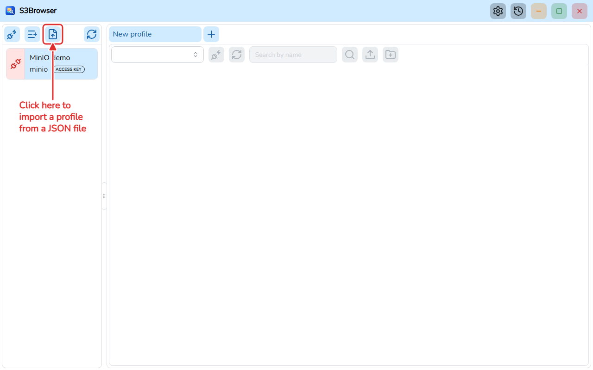

A Windows open dialog appears: choose a `.json` file exported by S3Browser (at most 1 MB). The application checks the file before it saves anything. For example, "The file is not a valid S3Browser profile file." means that the file is not a profile exported by S3Browser, and a message also tells you when the version of the file is not supported or the file is too large.

- A file exported without secrets is imported at once.
- A file exported with secrets opens the **Import profile** window: enter the password that was used when the file was exported, then click **Import**.

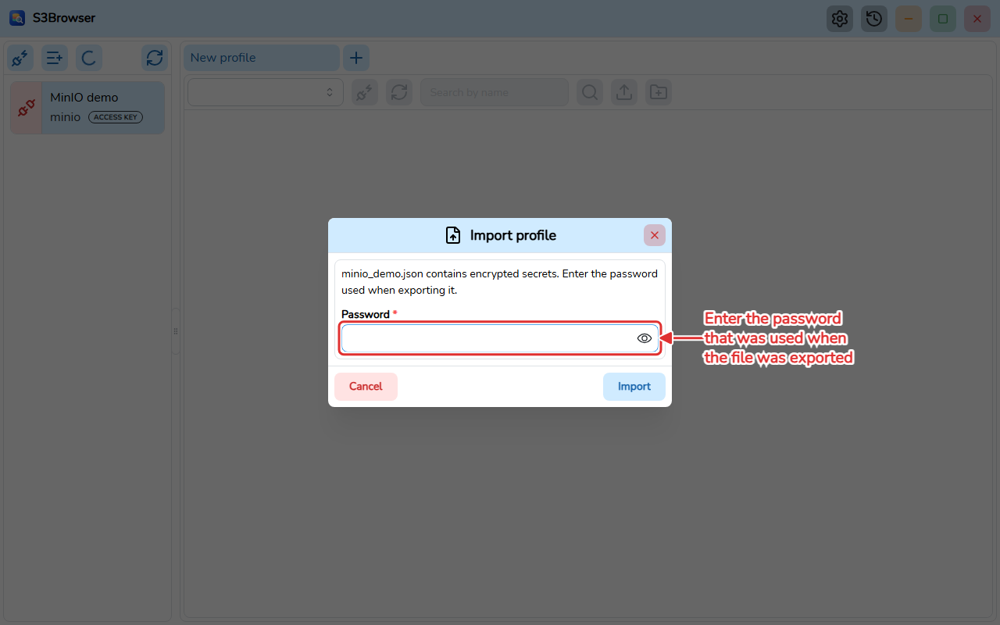

If the password is wrong, the message "Wrong password, or the file is damaged." appears and the window stays open, so you can type the password again or click **Cancel**. Nothing is saved until the password is correct.

The imported profile is added to the list as a new profile:

- If a profile with the same name already exists, the new one is named with a number: **name (2)**, **name (3)**, and so on.
- A path is emptied when the file does not exist on this computer, or when it is a network or device path (such as `\\host\share`, `\\?\` or `\\.\`), even if that path exists. This applies to the CA certificate, the certificate and private key of the **Client certificate** method, and the AWS config and credentials files. One warning lists these fields: "Profile [name] imported. These file paths do not exist on this computer and were cleared: {fields}." Edit the profile and choose the files again before you connect.
- The profile is not connected by the import, even when **auto connect** is on in the file; auto connect applies the next time the application starts.
- A profile exported without secrets has no secrets: edit it and enter them.

The Windows save and open dialogs cannot be shown in a screenshot. The image of the **Import profile** window shows the window opened with a sample file.

## 5. Browse buckets and objects

Each tab works with one profile. To use a profile in a tab, choose it in the drop-down at the top left of the tab, then click the **Connect** button next to it (if the profile is not connected yet). Use the **+** button (**Add tab**) to open another tab, for example for a second account. Drag a tab to reorder it (or press Ctrl+Shift+Left/Right); the open tabs are remembered the next time you start the application.

The list of buckets is shown:

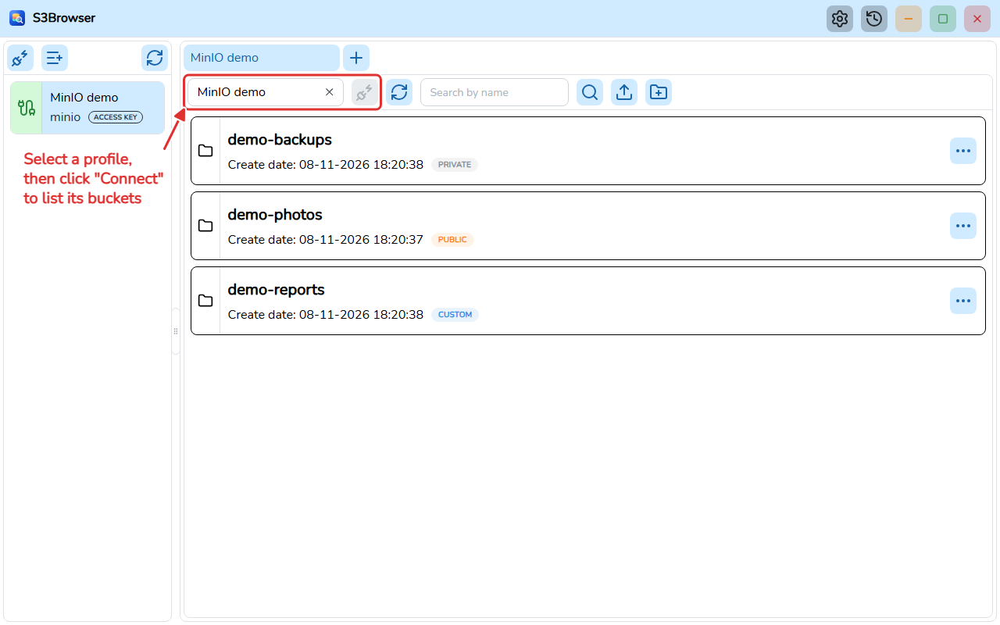

Click a bucket to see its objects. Folders are shown first; click a folder to open it. The path above the list (for example `demo-photos / travel / 2026`) is clickable, and the arrow button goes back one level (to the parent folder, or to the bucket list from the top of a bucket).

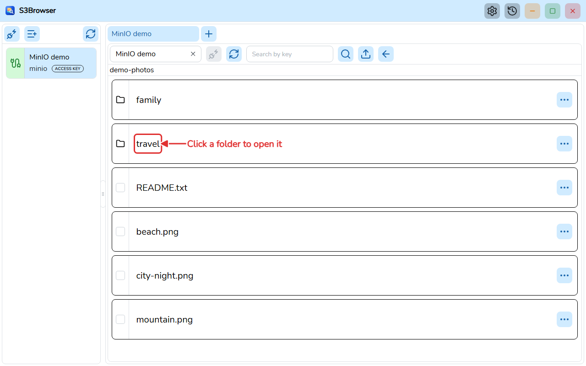

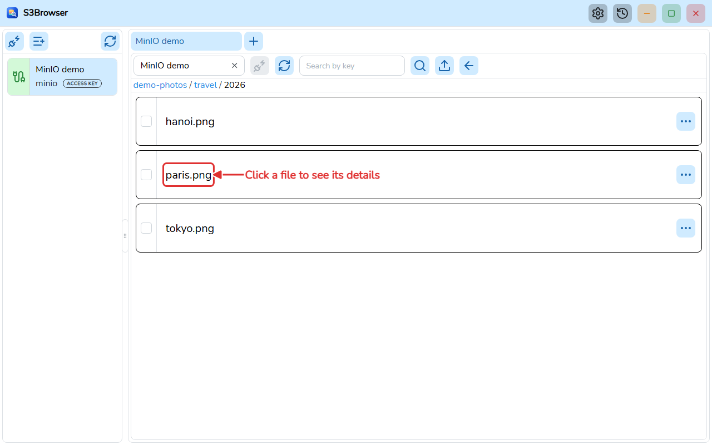

Large buckets are loaded page by page; more objects are loaded automatically as you scroll down. Use the **Refresh** button (**Refresh object list** or **Refresh bucket list**) to reload the current view.

## 6. Search

Type in the search box above the list and press Enter (or click the magnifier).

- In the bucket list you search by **name**.
- Inside a bucket you search by **key** (the name of the objects and folders in the current folder that contain the text; the search is not case-sensitive and does not go into sub-folders).

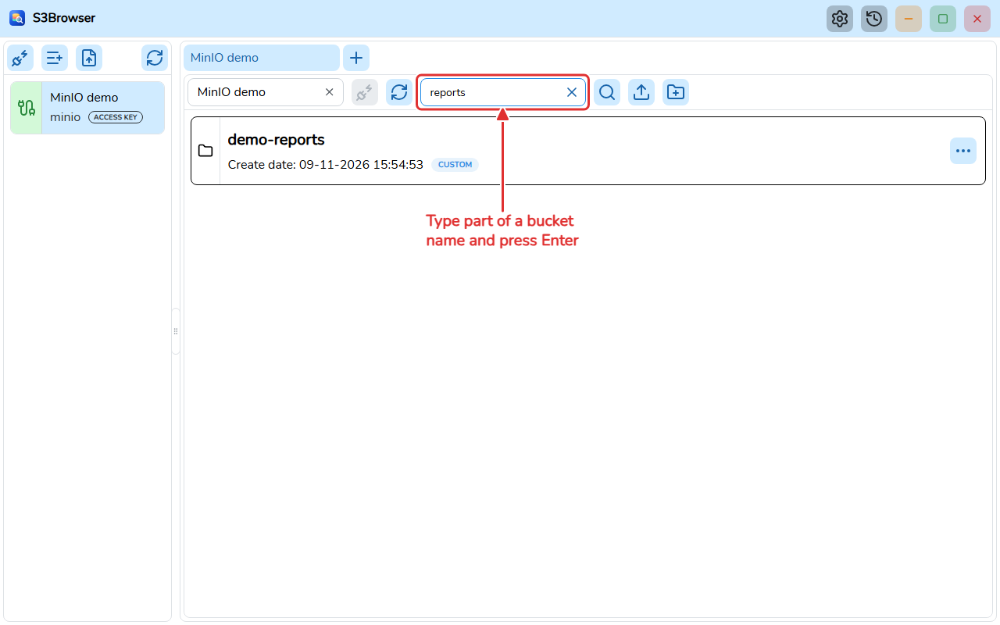

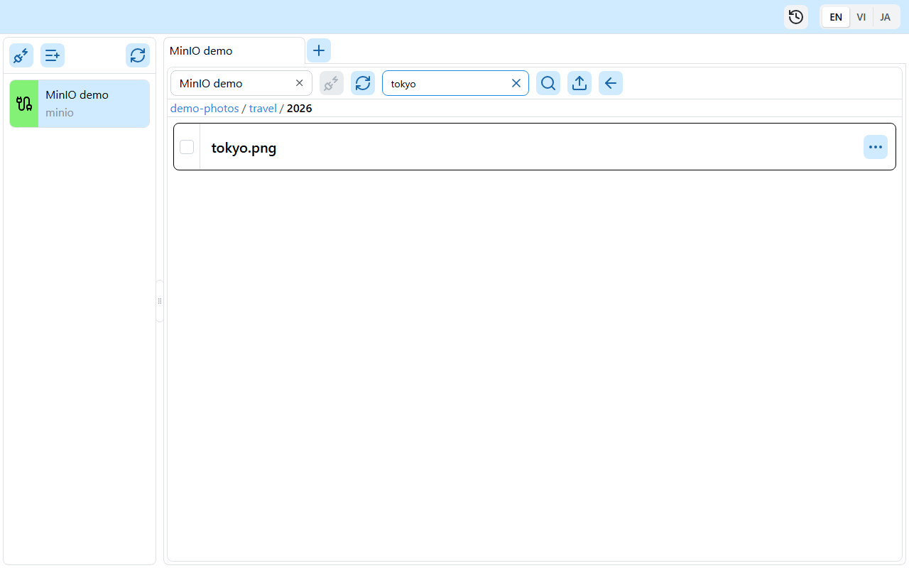

When the result list ends with **Search more**, click it to continue searching. The **x** in the search box clears the search.

## 7. Object details

Click a file to open the **Object details** panel on the right. It shows the name, key, size, last modified date, ETag, content type, storage class and the metadata of the object. The copy buttons next to the key and the ETag copy the value to the clipboard. If the details cannot be loaded, click **Retry**. Close the panel with the **Close** button.

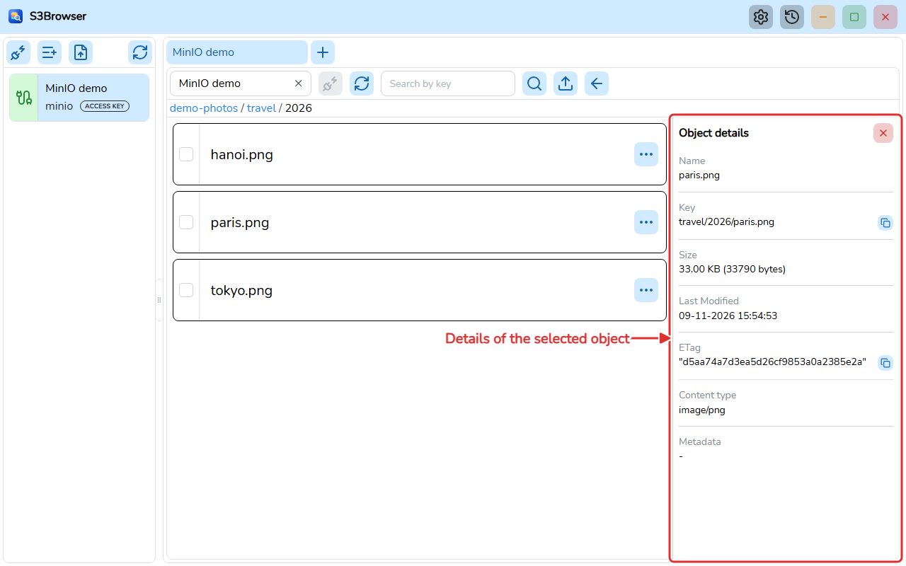

## 8. Manage buckets

### 8.1 Policy badge and bucket menu

Each bucket in the list shows a badge with its policy type: **Private** (no bucket policy), **Public** (anyone can read and list objects) or **Custom** (a custom policy). Point at the badge to read what it means. A bucket you cannot access is marked as such.

Open the **More actions** menu (three dots) at the end of a bucket row:

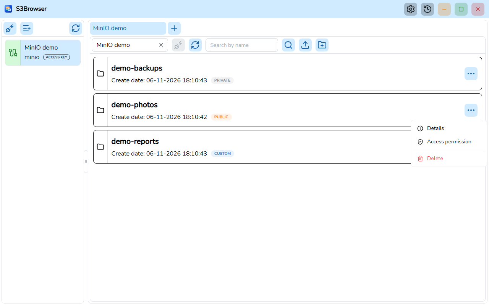

- **Details**: opens the bucket details.
- **Access permission**: changes who can access the bucket.
- **Delete**: deletes the bucket.

**Access permission** and **Delete** are hidden when the account is not allowed to use them; with the **Anonymous** method only **Details** is offered.

### 8.2 Bucket details

Choose **Details** to open the **Bucket details** panel on the right.

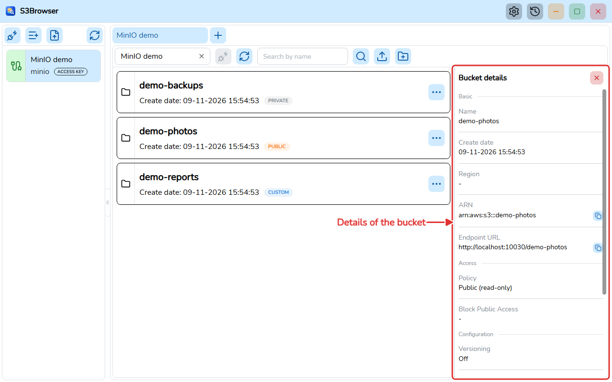

- **Basic**: **Name**, **Create date**, **Region**, **ARN** and **Endpoint URL**.
- **Access**: **Policy** (**Private**, **Public (read-only)** or **Custom**) and **Block Public Access** (**On** or **Off**).
- **Configuration**: **Versioning**, **Default encryption**, **Object lock**, **Tags** and **Objects at root**. The count of objects at the root stops at 10,000 and then shows `10,000+`.

If the details cannot be loaded, click **Retry**. Close the panel with the **Close** button.

### 8.3 Create a bucket

Click the **Create bucket** button above the bucket list.

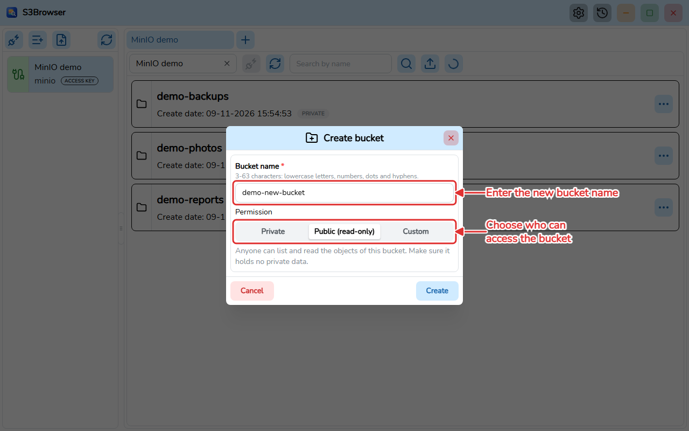

- **Bucket name**: 3-63 characters: lowercase letters, numbers, dots and hyphens.
- **Permission**: **Private**, **Public (read-only)** or **Custom** (then type the policy as JSON).
- On AWS, new buckets block public access by default, so a public policy may be rejected until Block Public Access is turned off. The bucket is still created and a warning tells you the permission was not applied.
- On AWS there is also a **Region** field to choose the region of the new bucket (the profile region by default); this cannot be shown in a screenshot because it needs a real AWS account.

Click **Create**. The bucket list refreshes.

### 8.4 Change the permission

Choose **Access permission** in the bucket menu.

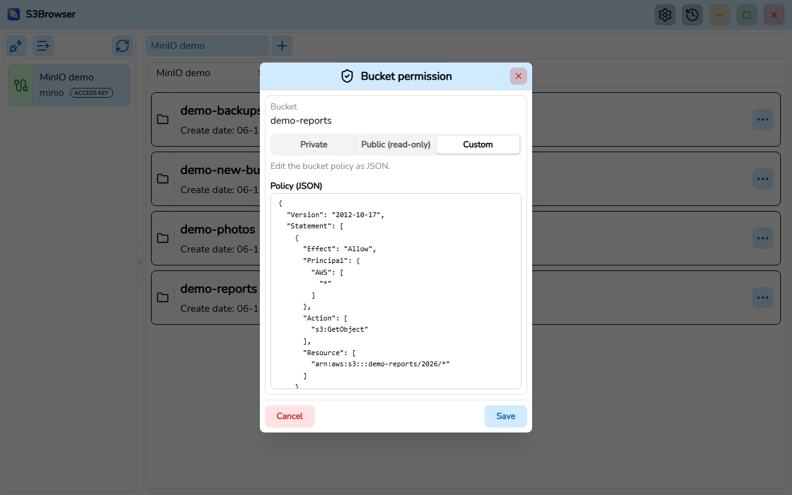

| Mode | Meaning |
| --- | --- |
| Private | No bucket policy. Only authorized users can access this bucket. |
| Public (read-only) | Anyone can list and read the objects of this bucket. Make sure it holds no private data. |
| Custom | Edit the bucket policy as JSON. |

The window warns you when Block Public Access is on for the bucket (a public policy will be rejected) or when your account is not allowed to change the permission. Click **Save**.

### 8.5 Delete a bucket

Choose **Delete** in the bucket menu.

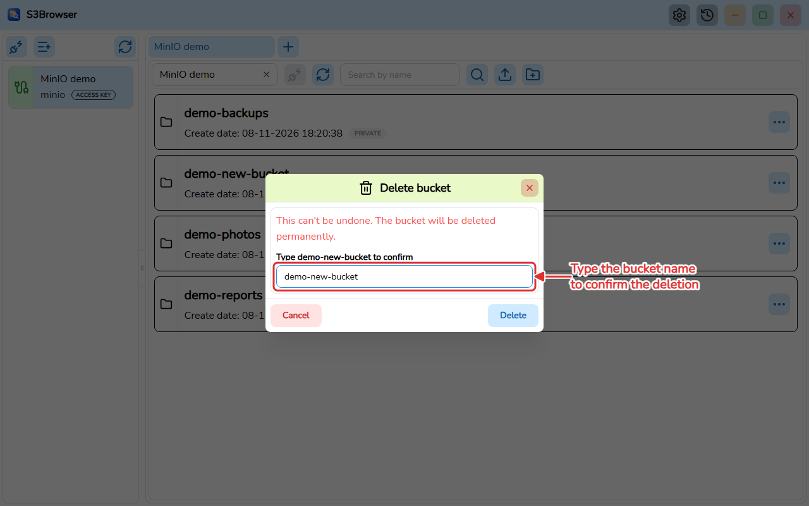

- Type the name of the bucket to confirm, then click **Delete**.
- A bucket that is not empty is emptied first: **all its objects are deleted** (with versioning, every version and delete marker too). This cannot be undone.
- A bucket that has Object Lock and is not empty cannot be deleted.
- The deletion cannot be cancelled, and the window cannot be closed until it ends; this can take a long time for a large bucket. Only the current tab is refreshed afterwards.

## 9. Transfer and delete objects

### 9.1 Upload

There are two ways to upload to the folder (or bucket) you are looking at.

**Drag and drop.** Drag files and folders from your file manager onto the object list. Dropping a folder uploads all the files inside it, keeping the folder structure. Dragging cannot be shown in a screenshot.

**Upload dialog.** Click the **Upload files** button (the arrow pointing up above the list). The **Upload files** window opens and shows the target (**Upload to: ...**).

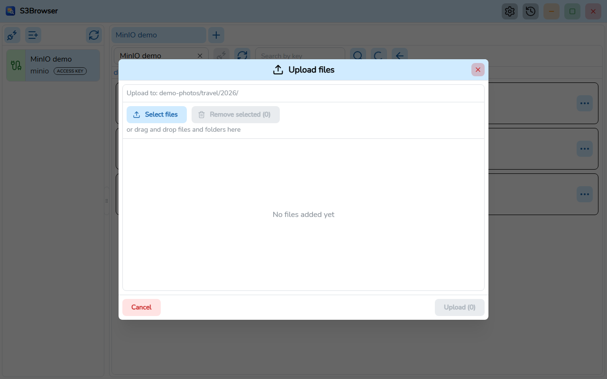

- Click **Select files** and choose files in the dialog of your system, or drag files and folders into the window.
- The list shows every file with its size. Untick a file to leave it out, click the trash icon to remove it from the list, or use **Remove selected**.
- When you opened the dialog from the bucket list, choose the target bucket first.
- Click **Upload** to start.

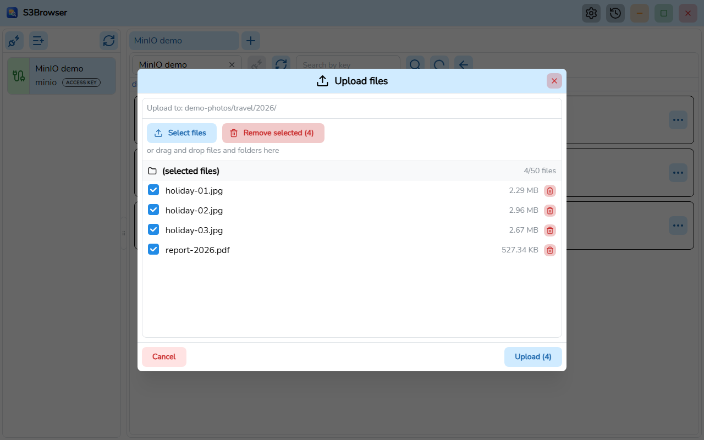

The following limits apply, to keep a transfer manageable:

| Limit | Value |
| --- | --- |
| Files from one folder per upload | 50 |
| Large files (over 10 GiB) from one folder | 4 |
| Files per upload | 1000 |
| Uploads at the same time | 1 (wait until the running upload finishes) |

When a dropped folder is over a limit, the window **Choose files to upload** lets you tick the files to upload; folders within the limits are uploaded in full. Items that cannot be uploaded (unreadable files, symbolic links) are skipped, and you are told how many.

The **Uploading** window appears at the bottom right with the progress of each file (the percentage ring, **Uploaded** and **Remaining**). Click **Cancel** on a file, or **Cancel all** at the top, to stop. The window can be closed and reopened from its button.

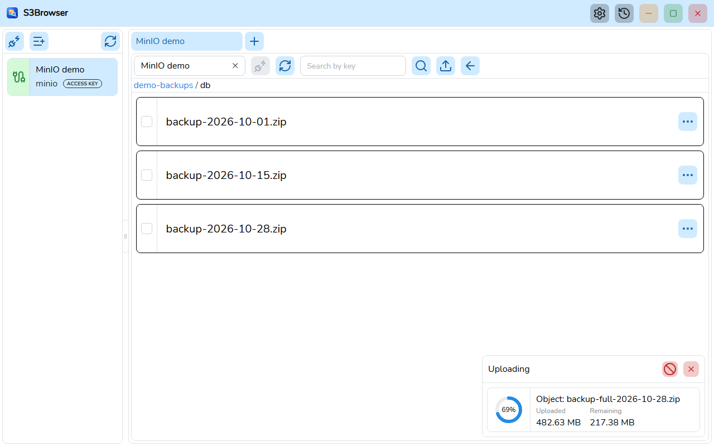

When the upload is done, click **Refresh** to see the new objects.

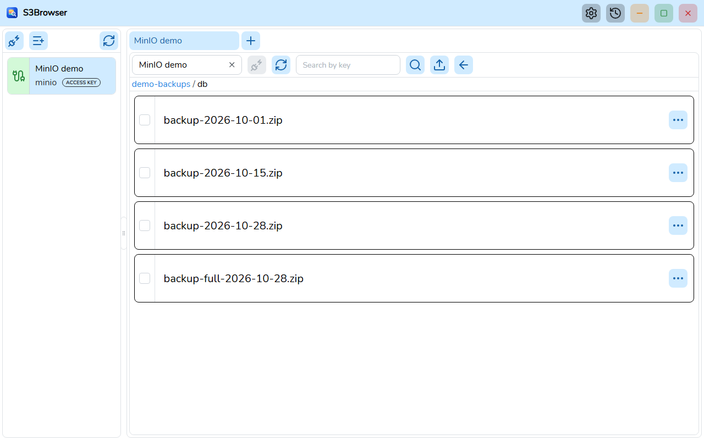

### 9.2 Download

- For one object, open the **More actions** menu (three dots) at the end of its row and choose **Download**. A dialog asks where to save the file.
- For several objects, tick them (up to 5), then click **Download selected** in the toolbar. A dialog asks for the destination folder.

Folders cannot be downloaded; they are left out of the selection.

The **Downloading** window shows the progress of each file (**Downloaded** and **Remaining**) and has **Cancel** and **Cancel all** buttons. The image below shows the window.

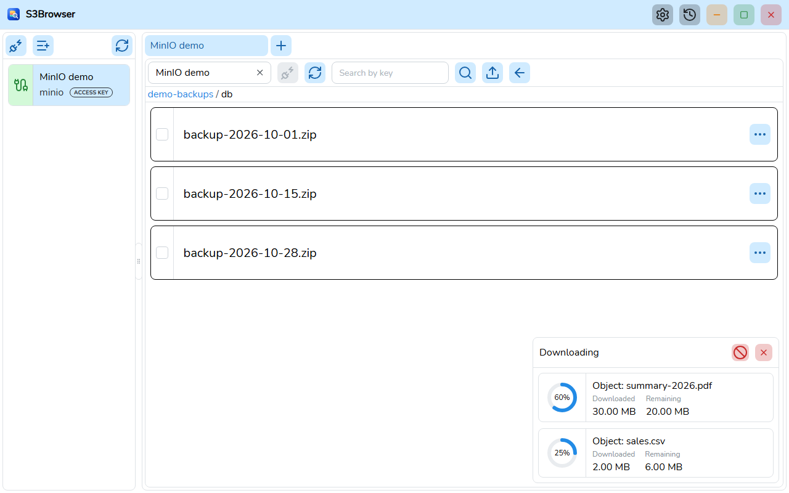

Click the clock button at the top right to open the **Download history**: every download with its size, time, status and destination path.

### 9.3 Select several objects

Tick the check boxes at the start of the rows. The toolbar then shows **Clear selected**, **Download selected** and **Delete selected**. You can select at most 5 objects at a time for download or delete.

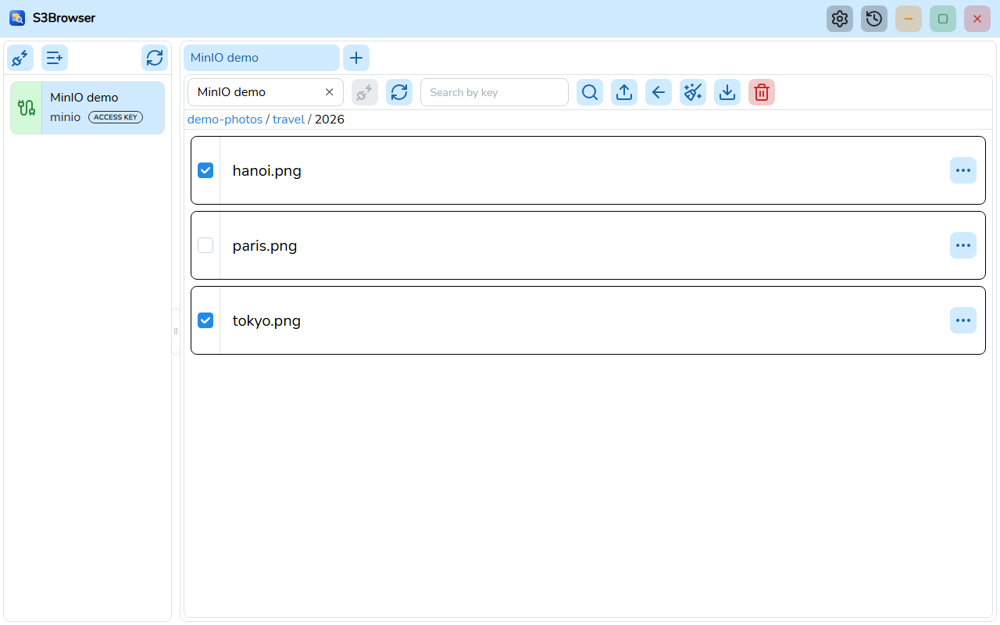

### 9.4 Delete

Open the **More actions** menu of the object and choose **Delete**, or select objects and click **Delete selected**. A confirmation window shows what will be deleted; click **Delete (n)** to confirm, where n is the number of selected items.

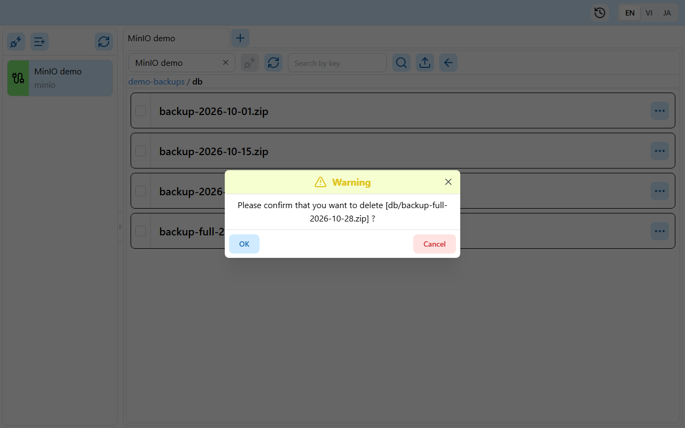

Deleting a **folder** removes the folder **and everything inside it**. The confirmation says so, and the action cannot be undone. If some objects cannot be deleted, the message tells you how many failed and how many were deleted.

## 10. Settings and updates

### 10.1 Settings

Click the **Settings** button (gear icon) at the top right, left of the download history button.

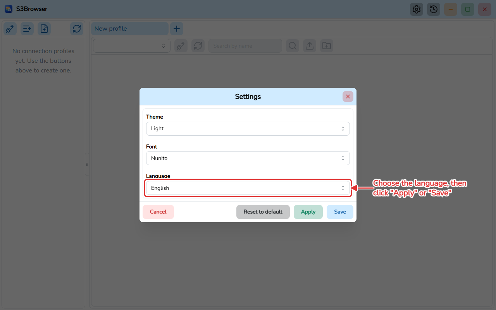

- **Theme**: Light, Dark or Follow system.
- **Font**: Nunito, System UI, Segoe UI, Arial, Roboto, Be Vietnam Pro, Verdana, Meiryo UI, Monospace or JetBrains Mono.
- **Language**: English, Tiếng Việt, 日本語, 简体中文, 繁體中文, Русский or Deutsch. The whole interface changes, including messages.
- **Launch on Windows startup**: start S3Browser when you sign in to Windows. Only shown in the installed Windows version (not the portable one).
- **Automatically check for and download updates** and **Receive beta (pre-release) versions**: see [Updates](#102-updates). These two switches take effect as soon as you change them, without **Apply** or **Save**; only **Save** keeps them after you restart the app.

Every change is previewed immediately. Then choose:

- **Save**: keep the settings, also after restarting the app.
- **Apply**: keep the settings until you close the app, including the two update switches; the dialog stays open. Launch on Windows startup is written to Windows at once by Apply, and Cancel does not undo it.
- **Cancel**: undo the changes made since the last Apply or Save, including the two update switches. The dialog closes.
- **Reset to default**: put the form back to the defaults (Light, Nunito, English, **Launch on Windows startup** off). The two update switches are also reset at once, like a manual change: **Automatically check for and download updates** on and **Receive beta (pre-release) versions** off. Click **Save** to keep the defaults; **Cancel** undoes the reset.

If you close the window with **X**, the Esc key or a click outside it while some changes are neither saved nor applied, the warning **Unsaved settings** appears ("You have settings that are not saved or applied. What do you want to do?"): **Go back** keeps the window open with your changes, **Discard changes** undoes them and closes the window, and **Save** saves them (the window stays open if saving fails). Without changes, the window just closes.

Settings are loaded when the app starts, before the window content appears.

### 10.2 Updates

The installed version can update itself from GitHub Releases. The **Update** section of the Settings window is shown there; the portable version does not update itself.

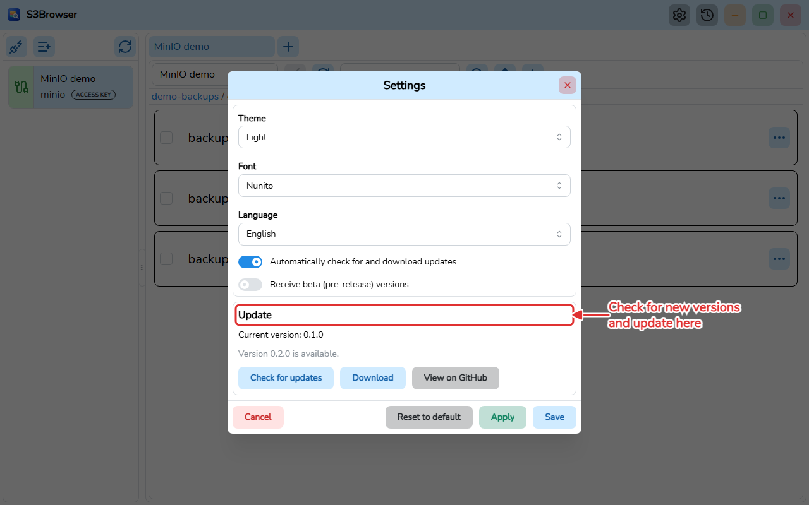

- **Automatically check for and download updates**: when on, the application checks for a new version and downloads it in the background.
- **Receive beta (pre-release) versions**: also offers the versions marked Pre-release.
- **Check for updates** checks now. The line below **Current version** tells you the result (for example **Version ... is available.** or **You are on the latest version.**).
- **Download** downloads the new version, **Update now** installs it once it is downloaded, and **View on GitHub** opens the release page.

When a new version is available, a notice at the top of the window offers **Download**; while downloading it shows the progress, and once the download is finished it offers **Update**. The downloaded file is checked before it is installed.

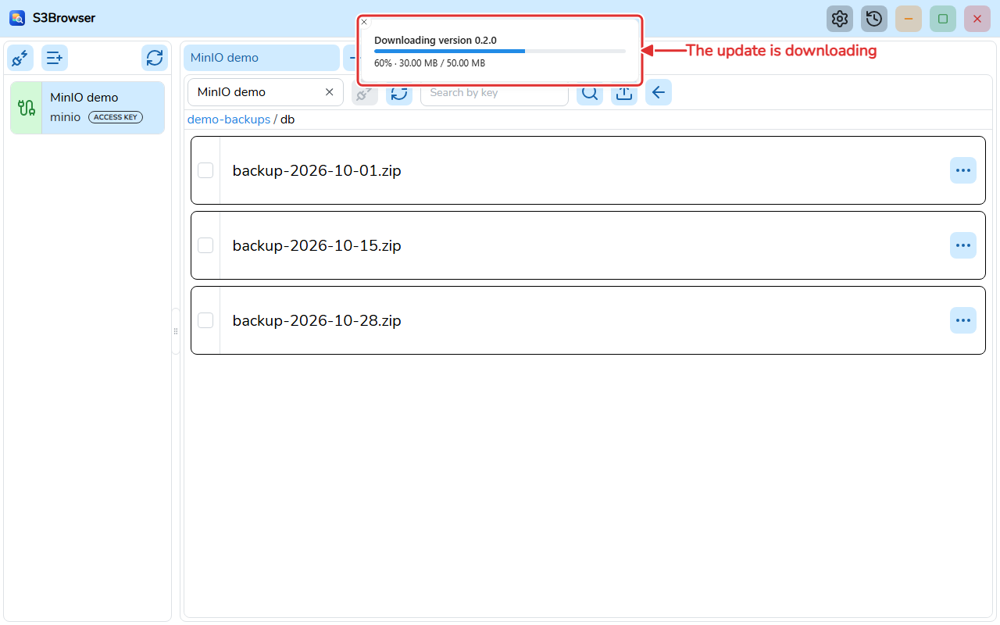

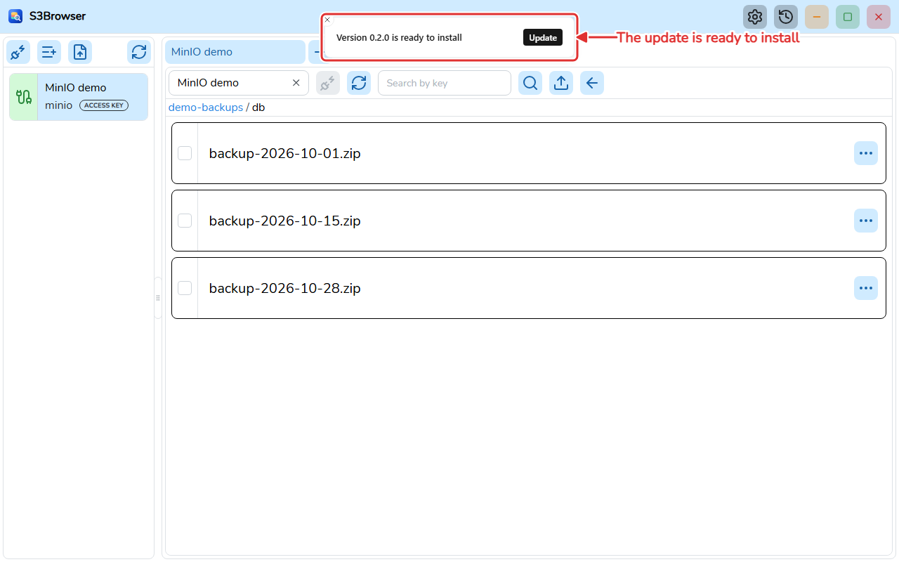

A real update cannot be shown in a screenshot: the images above show the notice with sample values.

## 11. Troubleshooting

Messages appear at the top of the window. These are the ones you may meet most often.

| Message | Cause and what to do |
| --- | --- |
| Access key or secret key is not valid for this endpoint. | The keys are wrong or belong to another server. Check them in the profile and use **Test connection**. |
| Timed out reaching the endpoint, check the address and whether the server is running. | The endpoint is wrong, the server is stopped, a firewall or the network blocks it. Check the address (with `http://` or `https://`) and the port. |
| The endpoint rejected. / Error while connect to S3 bucket. | The server answered but refused the connection. Check the endpoint, the region and **Path style** (needed for MinIO). |
| Profile: {name} is not connected. | The connection was closed. Connect the profile again. |
| Get list bucket error / Get list object error | The account may not be allowed to list buckets or the bucket, or the connection was lost. Check the permissions of the keys and reconnect. |
| Access bucket is limited. | Your account cannot list all buckets. Ask for the missing permission, or open a bucket you are allowed to use. |
| Another upload is running, please wait until it finishes. | Only one upload runs at a time. Wait for it, or cancel it from the **Uploading** window. |
| Folder ... has more than 50 files to upload. / Upload at most 1000 files at a time. | See the limits in section 9.1. Split the upload or choose fewer files. |
| Profile [{name}] has uploads or downloads in progress, cannot delete. | Wait for the transfers to finish or cancel them, then delete the profile. |
| Please disconnect before action! | Disconnect the profile (right-click, **Disconnect**) before editing or deleting it. |
| Maximum item selected is 5! | Select at most 5 objects for download or delete. |
| Destination ... not exists. | The folder chosen for a download is not available. Choose another location. |

If a message is not listed here, it contains the name of the operation and the reason reported by the server. The reason (for example `AccessDenied` or `NoSuchBucket`) is the message of S3 itself and tells you what to fix on the server side.

The screenshots of the two connection errors below were taken with **Test connection**.

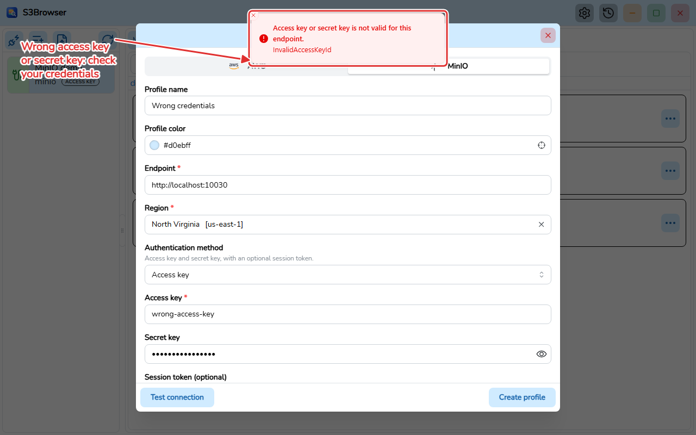

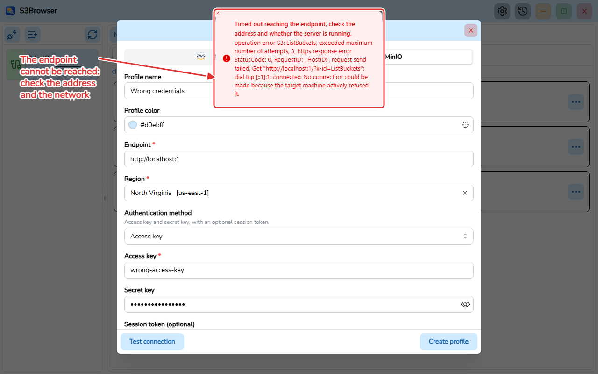
