# S3 Browser ユーザーガイド

バージョン 0.0.1-beta.1

## 1. はじめに

S3 Browser は、**AWS S3** および **MinIO** などの S3 互換サーバー上のバケットとオブジェクトを閲覧・管理するデスクトップアプリケーションです。次のことができます。

- 接続プロファイルを保存し、複数のアカウントに同時に接続する（接続ごとに 1 つのタブ）
- アクセスキー、ロールの引き受け、AWS SSO、MinIO STS、LDAP、OpenID Connect（OIDC）、クライアント証明書でサインインする
- バケット、フォルダー、オブジェクトを閲覧し、検索する
- バケットを作成し、詳細を確認し、権限を変更し、削除する
- オブジェクトの詳細を確認する
- ファイルやフォルダーをアップロードする（ドラッグ＆ドロップまたはダイアログ）。進捗はリアルタイムで表示されます
- オブジェクトをダウンロードし、ダウンロード履歴を確認する
- オブジェクトやフォルダー全体を削除する
- GitHub Releases からアプリを最新の状態に保つ

画面は英語、ベトナム語、日本語、簡体字中国語、繁体字中国語、ロシア語、ドイツ語に対応しています。

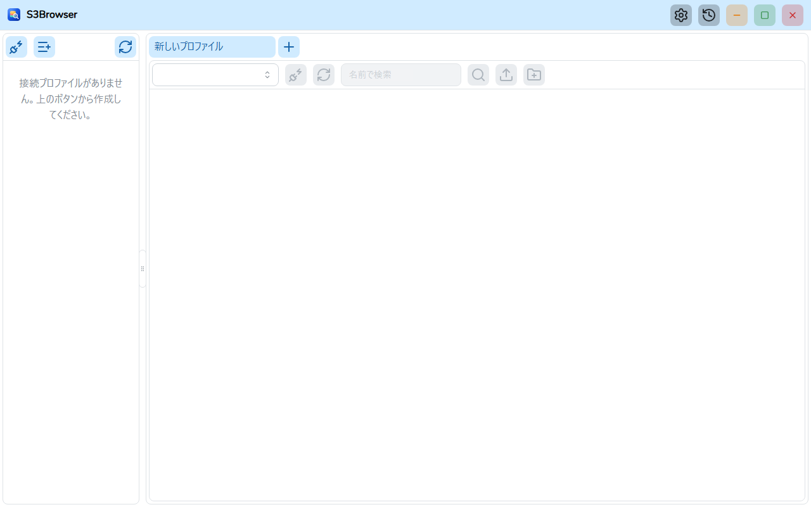

ウィンドウは 3 つの領域で構成されています。左側の**プロファイル一覧**、右側の**タブ**（各タブに 1 つの接続のバケットとオブジェクトを表示）、上部の**設定**ボタンとダウンロード履歴ボタンがある**ヘッダー**です。

> これはベータ版（0.0.1-beta.1）です。オブジェクトを削除する前に、重要なデータのコピーを保管してください。削除は元に戻せません。

## 2. インストール

Windows では 2 通りの方法があります。

- **インストーラー**: [GitHub Releases](https://github.com/TranMinhTruyen/s3-browser/releases) のページから `S3Browser-<バージョン>-windows-amd64-installer.exe` をダウンロードして実行し、手順に従います。**Latest** が安定版で、**Pre-release** と表示されているものはベータ版です。その後、スタートメニューからアプリを起動できます。プロファイルとダウンロード履歴はユーザープロファイル内に保存されます。自動アップデートできるのはインストール版のみです（[アップデート](#102-アップデート)を参照）。
- **ポータブル版**: ポータブルフォルダーを任意の場所（USB メモリなど）にコピーし、`S3Browser.exe` を実行します。`webview2` フォルダーに含まれる WebView2 ランタイムを使用し、データはプログラムの隣の `data` フォルダーに保存されるため、他の場所には何も書き込まれません。`webview2` フォルダーと `data` フォルダーをプログラムから離さないでください。

## 3. AWS S3 または MinIO に接続する

プロファイル一覧の上にある 2 番目のボタン **接続プロファイルを作成** をクリックします。**接続プロファイル** ウィンドウが開きます。

### 3.1 プロファイルのフォーム

| 項目 | 説明 |
| --- | --- |
| AWS / MinIO | サーバーの種類を選びます。MinIO を選ぶと **パススタイル** が自動的にオンになります。選べる認証方式はこの選択によって変わります。 |
| プロファイル名 | プロファイル一覧とタブに表示される名前です。 |
| プロファイルの色 | 一覧でのプロファイルの色です。 |
| エンドポイント | サーバーのアドレスです。例: `https://s3.amazonaws.com`、`http://localhost:9000`。 |
| リージョン | アカウントのリージョンです。例: `North Virginia [us-east-1]`。AWS の設定から読み取る一部の方式を除き、必須です。 |
| 認証方式 | アプリのサインイン方法です（[認証方式](#32-認証方式)を参照）。下の項目は方式によって変わります。 |
| アクセスキー | アカウントのアクセスキーです。 |
| シークレットキー | アカウントのシークレットキーです。目のアイコンをクリックすると表示されます。 |
| セッショントークン (任意) | 一時的な認証情報のセッショントークンです。 |
| CA 証明書ファイル（任意） | [MinIO 用の CA 証明書](#33-minio-用の-ca-証明書)を参照してください。 |
| パススタイル | バケットを `bucket.endpoint` ではなく `endpoint/bucket` の形式で指定します。MinIO やほとんどのセルフホスト型サーバーで必要です。 |
| シークレットを保存 | シークレットを暗号化してプロファイルに保存します。オフの場合、接続のたびに入力する必要があります。 |
| 自動接続 | アプリ起動時にプロファイルへ自動的に接続します。**シークレットを保存** がオンの場合のみ使用でき、接続のたびに入力が必要な方式（OIDC や MFA コードなど）では使えません。 |

下部には 2 つのボタンがあります。

- **接続テスト**: 何も保存せずに入力内容を確認します。保存済みのシークレットは再表示されないため、テストのときは再入力してください。緑のメッセージはテスト成功、赤のメッセージは問題の内容を示します（[トラブルシューティング](#11-トラブルシューティング)を参照）。
- **プロファイルを作成**: プロファイルを保存します（既存のプロファイルからウィンドウを開いた場合、ボタンは **プロファイルを更新** になります）。

> シークレットキーが写っているスクリーンショットは共有しないでください。このガイドのキー欄にはダミーの値のみが入っています。

### 3.2 認証方式

**認証方式** で方式を選びます。選べる方式はサーバーの種類によって変わります。

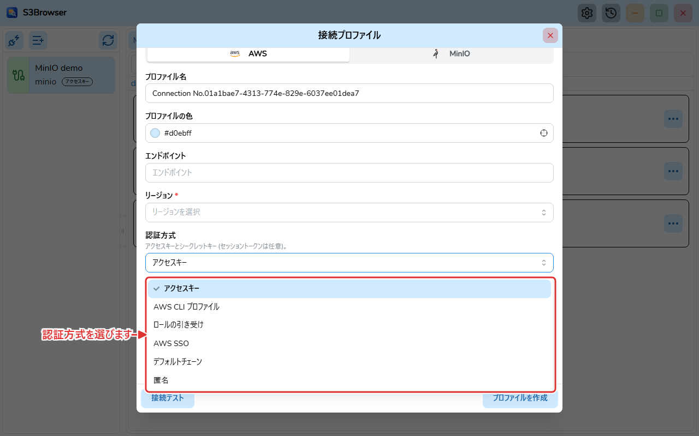

| 方式 | サーバー | 入力する内容 |
| --- | --- | --- |
| アクセスキー | AWS、MinIO | アクセスキー、シークレットキー、任意のセッショントークン。 |
| AWS CLI プロファイル | AWS | AWS CLI のファイル（`~/.aws`）にあるプロファイル。任意で **AWS 設定ファイル (任意)** と **AWS 認証情報ファイル (任意)** のパス（既定: `~/.aws/config`、`~/.aws/credentials`）。 |
| ロールの引き受け | AWS | **ロール ARN**、引き受けに使う認証情報（**アクセスキー** または **AWS CLI プロファイル**）、任意で **外部 ID (任意)**、**セッション名 (任意)**、**有効期間 (秒)**、**MFA デバイスのシリアル (任意)**。**MFA コード** は接続時に入力し、保存されません。 |
| AWS SSO | AWS | サインイン済みの AWS CLI プロファイル。先に `aws sso login --profile <profile>` を実行してください。 |
| デフォルトチェーン | AWS | 入力は不要です。環境にある認証情報（環境変数、共有ファイル、インスタンスロール）を使います。 |
| 匿名 | AWS、MinIO | 開きたい公開バケットの名前のみ（匿名ではバケット一覧を取得できません）。 |
| MinIO STS | MinIO | アクセスキー、シークレットキー、任意で **ロール ARN（任意）**、**有効期間（秒、任意）**、**インラインポリシー（JSON、任意）**。 |
| LDAP | MinIO | **LDAP ユーザー名** と **LDAP パスワード**、任意で **有効期間（秒、任意）** と **インラインポリシー（JSON、任意）**。 |
| OIDC | MinIO | **クライアント ID**、**発行者 URL**、**スコープ（任意）**、**コールバックポート**。 |
| クライアント証明書 | MinIO | **クライアント証明書ファイル** と **秘密鍵ファイル**。必要なら **秘密鍵にパスワードがある** にチェックします。エンドポイントは `https://` を使う必要があります。 |

追加の項目が必要な方式を下に示します（値はダミーです）。

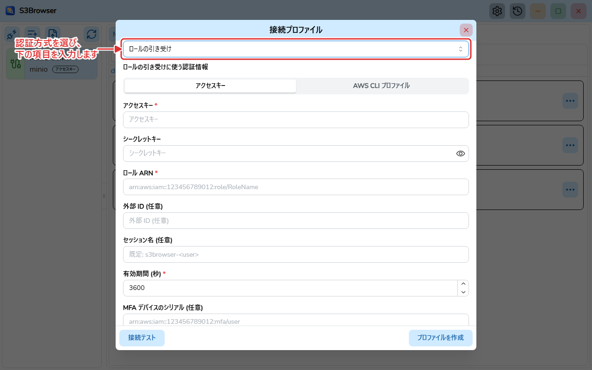

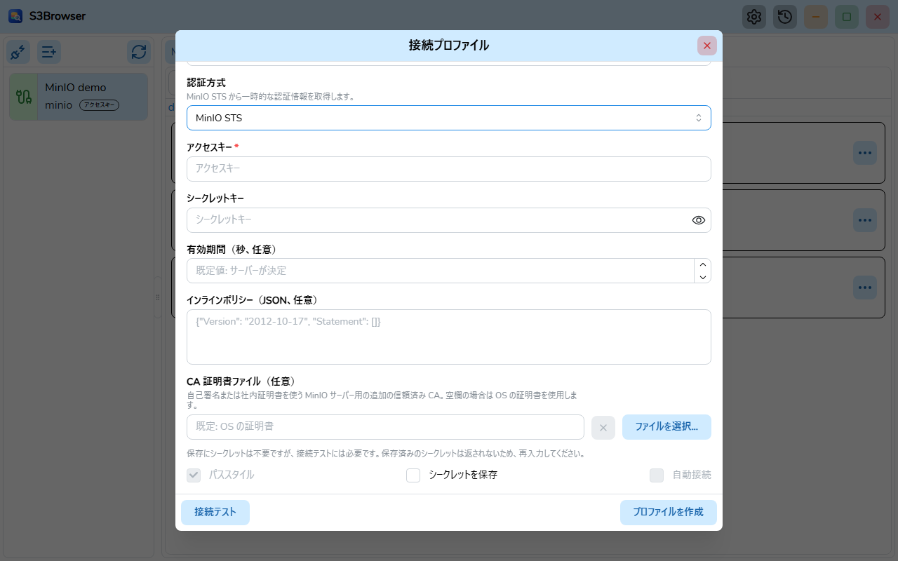

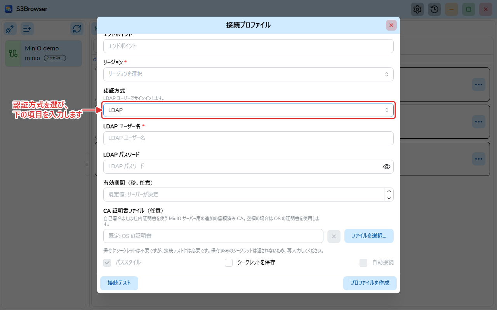

**OIDC。** フォームに表示される **リダイレクト URI** を（**コピー** ボタンで）コピーし、ID プロバイダーのクライアントのリダイレクト URI として登録します。**サインイン** をクリックすると Web ブラウザが開き、そこでサインインします。フォームには **ブラウザでのサインインを待っています...**、続いて **サインイン済み、... まで有効** と表示され、**サインインをキャンセル** で待機を中止できます。サインインは一度だけ使用され、保存されません。有効期限が切れると **サインインの有効期限が切れました。もう一度サインインしてください** と表示されます。ブラウザのウィンドウはスクリーンショットでは示せません。

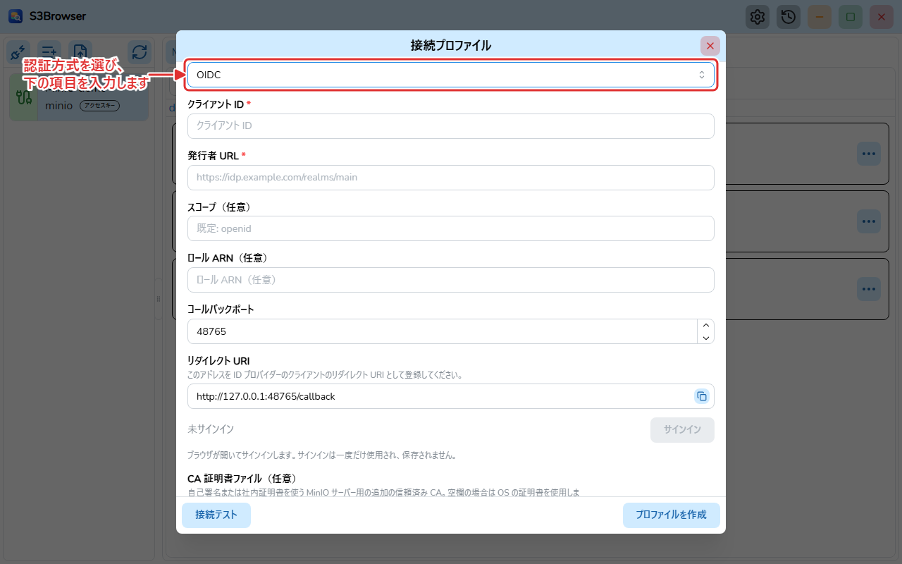

**クライアント証明書。** ファイル欄の横の **ファイルを選択...** をクリックし、システムのダイアログでファイルを選びます（ダイアログはスクリーンショットでは示せません）。**ファイルをクリア** で欄を空にできます。ファイルは接続時に読み込まれ、内容は保存されません。

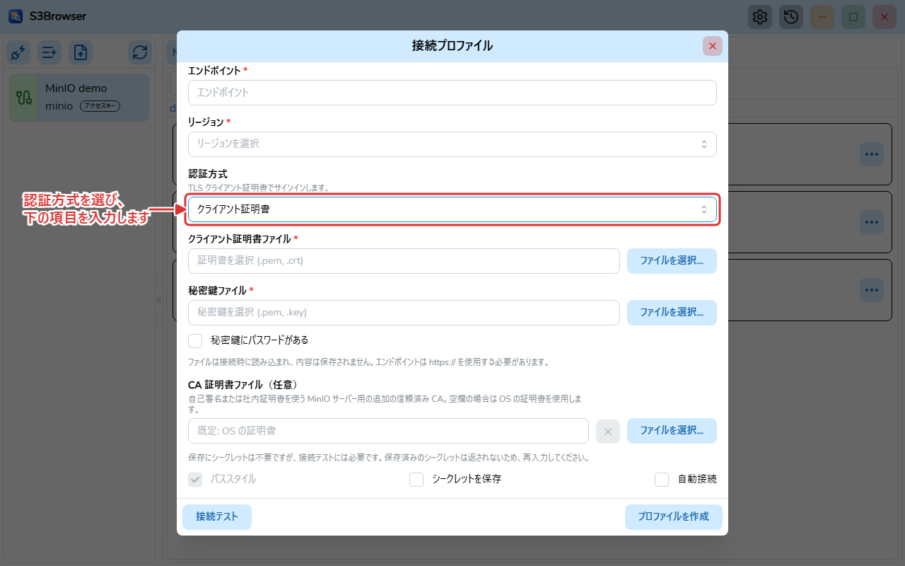

一部の認証情報には有効期限があります。期限の少し前に、アプリが更新を求めます。MFA コード（ロールの引き受け）、再サインイン（OIDC、SSO）、または切断して再接続のいずれかです。

### 3.3 MinIO 用の CA 証明書

自己署名または社内の証明書を使う MinIO サーバーには、追加の信頼済み CA が必要です。**CA 証明書ファイル（任意）** の **ファイルを選択...** をクリックし、CA 証明書（`.pem` または `.crt`）を選びます。空欄の場合は OS の証明書を使用します。このファイルは MinIO への接続にのみ適用され、OIDC の ID プロバイダーには適用されません。

## 4. プロファイルを管理する

プロファイルを作成すると、プロファイル一覧に表示されます。

プロファイルを右クリックするとメニューが開きます。

- **接続**: 接続を開きます。接続中のプロファイルには緑のアイコンが表示されます。
- **切断**: 接続を閉じます。プロファイルを編集・削除する前に切断してください。
- **編集**: プロファイルを変更します（ウィンドウのタイトルは同じく **接続プロファイル**、ボタンは **プロファイルを更新** です）。更新の確認が表示されます。
- **エクスポート**: プロファイルを JSON ファイルに保存します。[4.1 プロファイルをエクスポートする](#41-プロファイルをエクスポートする)を参照してください。
- **削除**: 確認後にプロファイルを削除します。

アップロードまたはダウンロードが実行中のプロファイルは削除できません。転送が終わるのを待つか、キャンセルしてください。

一覧の上にある最初のボタン（**接続**）は、同じウィンドウを **接続** ボタン付きで開きます。プロファイルを保存せずに一度だけ接続するときに使います。**接続プロファイル一覧を再読み込み** ボタンは一覧を更新します。

### 4.1 プロファイルをエクスポートする

エクスポートは、プロファイルをファイルにコピーします。たとえば別のコンピューターで使うときに便利です。プロファイルを右クリックして **エクスポート** を選びます。

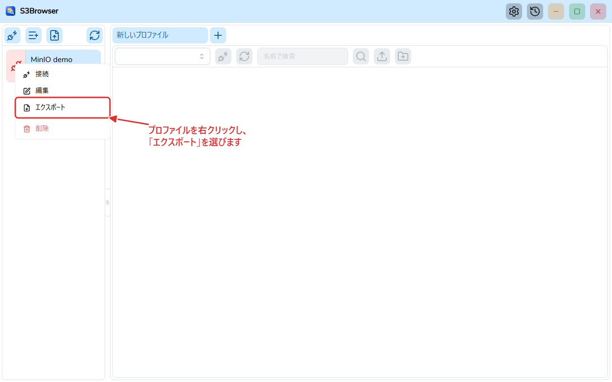

**プロファイルのエクスポート** ウィンドウが開きます。

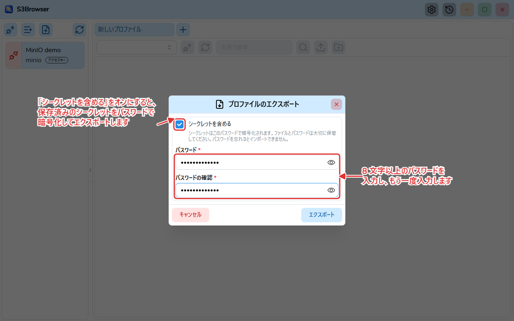

- シークレット（シークレットキー、セッショントークン、LDAP パスワード、キーのパスフレーズ）を含めずにエクスポートするには、**シークレットを含める** をオフのままにします。続行する前に、プロファイルに保存済みのシークレットがある場合はアプリが警告します。「プロファイル [名前] に保存されている認証情報はエクスポートされません。インポート後に再入力する必要があります。認証情報なしでエクスポートしますか？」 確認するとエクスポートされ、キャンセルすると戻ります。インポート後は、プロファイルを編集してシークレットを再入力してください。
- 保存済みのシークレットも含めるには、**シークレットを含める** をオンにします。8 文字以上の **パスワード** を入力し、**パスワードの確認** にもう一度入力します。シークレットはこのパスワードで暗号化され（PBKDF2 と AES-GCM）、平文のままファイルに書き込まれることはありません。保存済みのシークレットがないプロファイルでは、このオプションは無効になります（「このプロファイルには保存されたシークレットがありません。」）。

**エクスポート** をクリックします。Windows の保存ダイアログが開き、プロファイル名から作られたファイル名が提案されます。小文字、数字、アンダースコアのみで、たとえば `minio_demo.json` です。保存先を選びます。ファイルが書き込まれるとメッセージが表示されます。保存ダイアログを閉じた場合は何も書き込まれず、**プロファイルのエクスポート** ウィンドウは開いたままです。

ファイルには、プロファイルの接続設定（名前、色、プロバイダー、エンドポイント、リージョン、アクセスキー、パススタイル、自動接続、認証方法とそのオプション）が含まれます。プロファイル ID や日時などの内部データは含まれません。証明書ファイルとキーファイルはパスのみがエクスポートされ、ファイル自体は含まれません。

ファイルとパスワードは大切に保管してください。パスワードはどこにも保存されないため、忘れるとファイルをインポートできません。シークレットを含むファイルを手作業で編集しないでください。プロバイダー、エンドポイント、認証方法を変更すると、インポートが「パスワードが正しくないか、ファイルが破損しています。」で失敗します。

### 4.2 プロファイルをインポートする

**接続プロファイルをインポート** ボタン（プロファイル一覧の上、**接続プロファイルを作成** の隣）をクリックします。

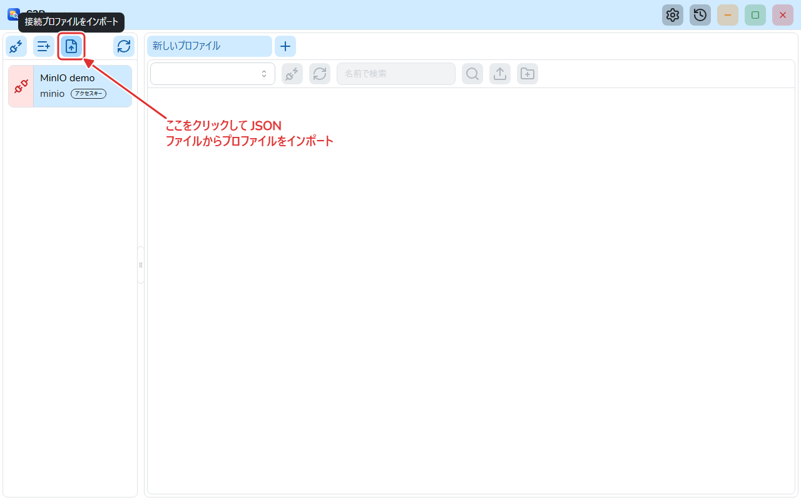

Windows のファイルを開くダイアログが表示されます。S3Browser がエクスポートした `.json` ファイル（最大 1 MiB）を選びます。アプリは何かを保存する前にファイルを検査します。たとえば「このファイルは有効な S3Browser プロファイルファイルではありません。」は、S3Browser がエクスポートしたプロファイルではないことを意味します。ファイルのバージョンが未対応の場合やファイルが大きすぎる場合もメッセージが表示されます。

- シークレットなしでエクスポートしたファイルは、すぐにインポートされます。
- シークレット付きでエクスポートしたファイルでは **プロファイルのインポート** ウィンドウが開きます。エクスポート時に使用したパスワードを入力し、**インポート** をクリックします。

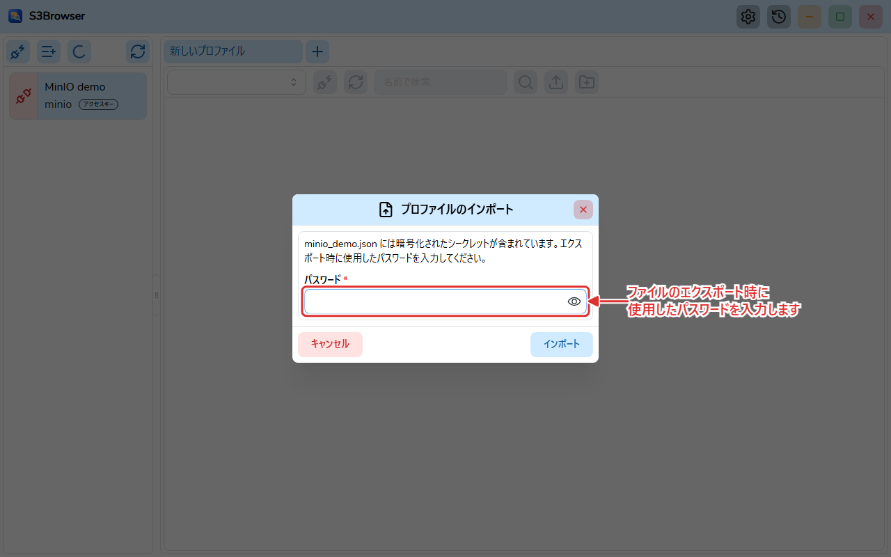

パスワードが正しくない場合は「パスワードが正しくないか、ファイルが破損しています。」と表示され、ウィンドウは開いたままなので、パスワードを入力し直すか **キャンセル** をクリックできます。パスワードが正しくなるまで何も保存されません。

インポートしたプロファイルは、新しいプロファイルとして一覧に追加されます。

- 同じ名前のプロファイルがすでにある場合、新しいプロファイルには番号が付きます。**名前 (2)**、**名前 (3)** のようになります。
- ファイルがこのコンピューターに存在しない場合、またはパスがネットワークパスやデバイスパス（`\\host\share`、`\\?\`、`\\.\` など）の場合（パスが存在していても）は空になります。対象は CA 証明書、**クライアント証明書** 方式の証明書と秘密鍵、AWS の config と credentials ファイルです。該当する項目は 1 つの警告に一覧表示されます。「プロファイル [名前] をインポートしました。次のファイルパスはこのコンピューターに存在しないため、クリアされました: {fields}。」 接続する前に、プロファイルを編集してファイルを選び直してください。
- インポートではプロファイルは接続されません。ファイルで **自動接続** がオンでも同様で、自動接続は次にアプリを起動したときから有効になります。
- シークレットなしでエクスポートしたプロファイルにはシークレットがありません。プロファイルを編集して入力してください。

Windows の保存ダイアログと開くダイアログはスクリーンショットに撮れません。**プロファイルのインポート** ウィンドウの画像は、サンプルのファイルで開いた状態を示しています。

## 5. バケットとオブジェクトを閲覧する

各タブは 1 つのプロファイルで動作します。タブでプロファイルを使うには、タブ左上のドロップダウンで選び、（まだ接続していなければ）隣の **接続** ボタンをクリックします。**+**（**タブを追加**）ボタンで別のタブを開けます。たとえば 2 つ目のアカウント用です。タブはドラッグして並べ替えられ（Ctrl+Shift+←/→ でも可）、開いているタブは次回のアプリ起動時にも記憶されています。

バケットの一覧が表示されます。

バケットをクリックするとオブジェクトが表示されます。フォルダーが先に表示され、クリックすると開きます。一覧の上のパス（例: `demo-photos / travel / 2026`）はクリックでき、矢印ボタンで 1 つ上の階層に戻ります（親フォルダー、またはバケットの最上位ではバケット一覧）。

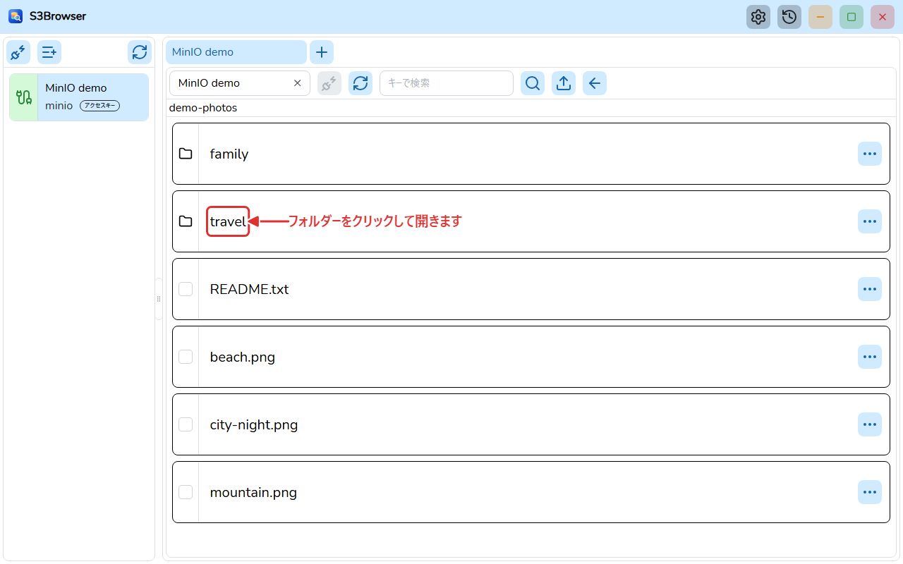

大きなバケットはページ単位で読み込まれ、下へスクロールすると自動的に続きが読み込まれます。**再読み込み**ボタン（**オブジェクト一覧を再読み込み** または **バケット一覧を再読み込み**）で現在の表示を更新します。

## 6. 検索

一覧の上の検索ボックスに入力し、Enter キーを押します（または虫眼鏡をクリックします）。

- バケット一覧では**名前**で検索します。
- バケット内では**キー**で検索します（現在のフォルダー内で、テキストを含むオブジェクトとフォルダーの名前が対象です。大文字小文字は区別せず、サブフォルダーの中は検索しません）。

結果一覧の末尾に **さらに検索** が表示されたら、クリックして検索を続けます。検索ボックスの **x** で検索をクリアします。

## 7. オブジェクトの詳細

ファイルをクリックすると、右側に **オブジェクトの詳細** パネルが開きます。名前、キー、サイズ、最終更新日時、ETag、コンテンツタイプ、ストレージクラス、メタデータが表示されます。キーと ETag の横のコピーボタンで値をクリップボードにコピーできます。詳細を読み込めない場合は **再試行** をクリックします。**閉じる** ボタンでパネルを閉じます。

## 8. バケットを管理する

### 8.1 ポリシーのバッジとバケットのメニュー

一覧の各バケットには、ポリシーの種類を示すバッジが表示されます。**プライベート**（バケットポリシーなし）、**パブリック**（誰でもオブジェクトを読み取り・一覧表示できる）、**カスタム**（カスタムポリシーあり）です。バッジにポインターを合わせると意味が表示されます。アクセスできないバケットにはその旨の表示が付きます。

バケット行の右端の **その他の操作**（3 つの点）メニューを開きます。

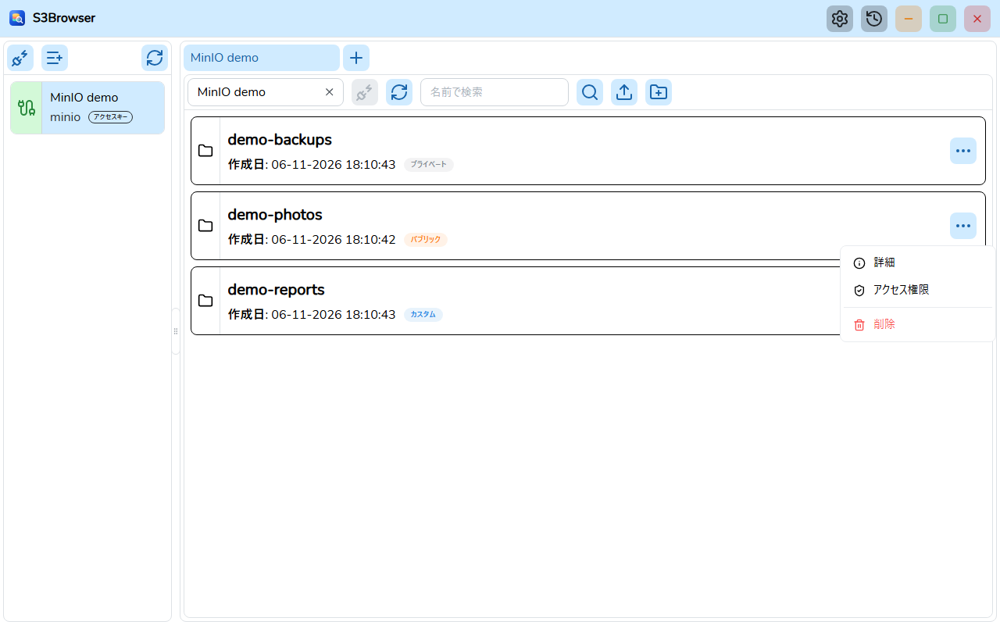

- **詳細**: バケットの詳細を開きます。
- **アクセス権限**: バケットにアクセスできる人を変更します。
- **削除**: バケットを削除します。

アカウントに権限がない場合、**アクセス権限** と **削除** は表示されません。**匿名** 方式では **詳細** のみが表示されます。

### 8.2 バケットの詳細

**詳細** を選ぶと、右側に **バケットの詳細** パネルが開きます。

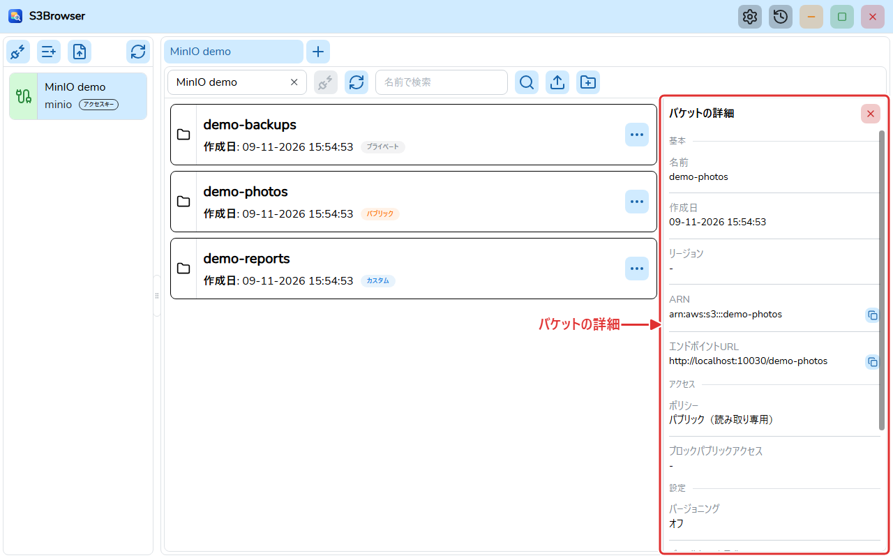

- **基本**: **名前**、**作成日**、**リージョン**、**ARN**、**エンドポイントURL**。
- **アクセス**: **ポリシー**（**プライベート**、**パブリック（読み取り専用）**、**カスタム**）と **ブロックパブリックアクセス**（オンまたはオフ）。
- **設定**: **バージョニング**、**デフォルトの暗号化**、**オブジェクトロック**、**タグ**、**ルートのオブジェクト数**。ルートのオブジェクト数は 10,000 で止まり、`10,000+` と表示されます。

詳細を読み込めない場合は **再試行** をクリックします。**閉じる** ボタンでパネルを閉じます。

### 8.3 バケットを作成する

バケット一覧の上の **バケットを作成** ボタンをクリックします。

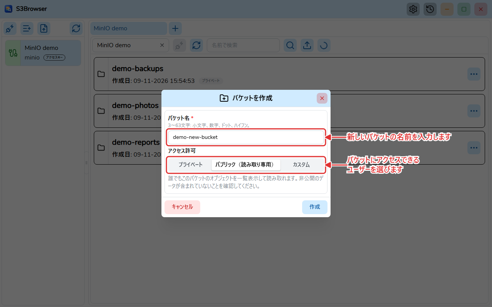

- **バケット名**: 3〜63文字: 小文字、数字、ドット、ハイフン。
- **アクセス許可**: **プライベート**、**パブリック（読み取り専用）**、**カスタム**（ポリシーを JSON で入力）。
- AWS では新しいバケットはデフォルトでパブリックアクセスがブロックされるため、ブロックパブリックアクセスを無効にするまでパブリックポリシーは拒否されることがあります。その場合もバケットは作成され、権限が適用されなかったことが警告で示されます。
- AWS では新しいバケットのリージョンを選ぶ **リージョン** 欄も表示されます（既定はプロファイルのリージョン）。実際の AWS アカウントが必要なため、この部分はスクリーンショットでは示せません。

**作成** をクリックします。バケット一覧が更新されます。

### 8.4 権限を変更する

バケットのメニューで **アクセス権限** を選びます。

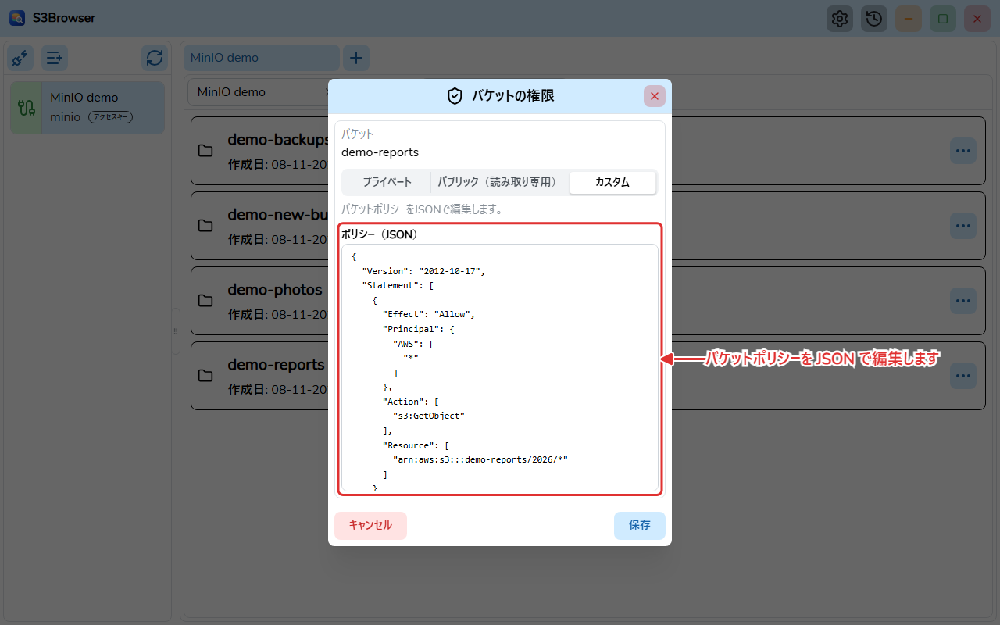

| モード | 意味 |
| --- | --- |
| プライベート | バケットポリシーはありません。許可されたユーザーのみがこのバケットにアクセスできます。 |
| パブリック（読み取り専用） | 誰でもこのバケットのオブジェクトを一覧表示して読み取れます。非公開のデータが含まれていないことを確認してください。 |
| カスタム | バケットポリシーを JSON で編集します。 |

バケットでブロックパブリックアクセスが有効な場合（パブリックポリシーは拒否されます）や、アカウントに権限を変更する権限がない場合は、ウィンドウに警告が表示されます。**保存** をクリックします。

### 8.5 バケットを削除する

バケットのメニューで **削除** を選びます。

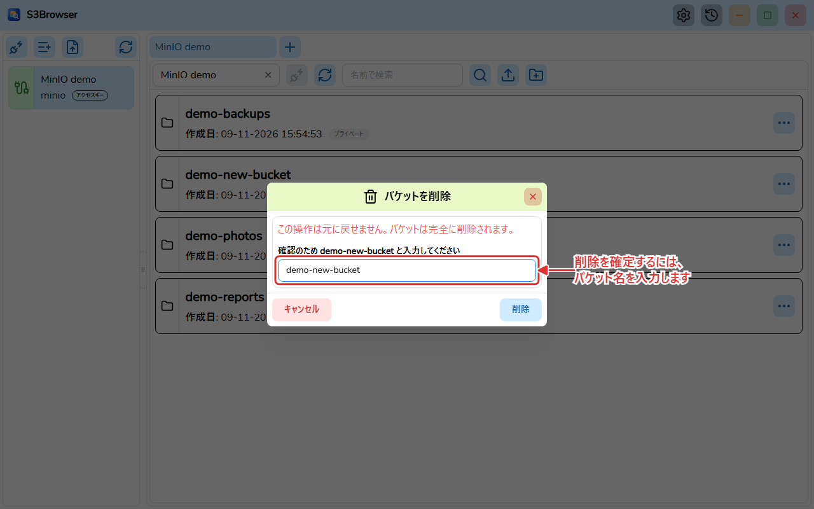

- 確認のためバケット名を入力し、**削除** をクリックします。
- 空ではないバケットは先に空にされます。**すべてのオブジェクトが削除され**（バージョニングが有効な場合はすべてのバージョンと削除マーカーも）、元に戻せません。
- オブジェクトロックが有効で空ではないバケットは削除できません。
- 削除は取り消せず、終わるまでウィンドウを閉じられません。大きなバケットでは長い時間がかかることがあります。完了後に更新されるのは現在のタブのみです。

## 9. 転送と削除

### 9.1 アップロード

表示しているフォルダー（またはバケット）へのアップロード方法は 2 通りあります。

**ドラッグ＆ドロップ。** ファイルマネージャーからファイルやフォルダーをオブジェクト一覧にドラッグします。フォルダーをドロップすると、フォルダー構造を保ったまま中のすべてのファイルがアップロードされます。ドラッグ操作はスクリーンショットでは示せません。

**アップロードダイアログ。** 一覧の上の **ファイルをアップロード** ボタン（上向き矢印）をクリックします。**ファイルをアップロード** ウィンドウが開き、保存先（**アップロード先: ...**）が表示されます。

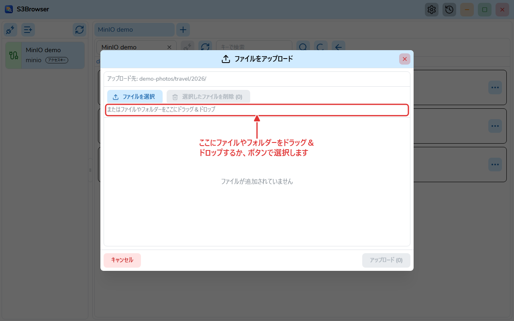

- **ファイルを選択** をクリックしてシステムのダイアログでファイルを選ぶか、ウィンドウにファイルやフォルダーをドラッグします。
- 一覧にはサイズ付きですべてのファイルが表示されます。チェックを外すとそのファイルは除外され、ごみ箱アイコンで一覧から削除でき、**選択したファイルを削除** も使えます。
- バケット一覧からダイアログを開いた場合は、先にアップロード先のバケットを選びます。
- **アップロード** をクリックして開始します。

転送を管理しやすくするため、次の上限があります。

| 上限 | 値 |
| --- | --- |
| 1 回のアップロードで 1 フォルダーから | 50 ファイル |
| 1 フォルダー内の大きなファイル（10 GiB 超） | 4 ファイル |
| 1 回のアップロードのファイル数 | 1000 |
| 同時に実行できるアップロード | 1（実行中のアップロードが終わるまで待ちます） |

ドロップしたフォルダーが上限を超える場合、**アップロードするファイルを選択** ウィンドウでアップロードするファイルを選べます。上限内のフォルダーはすべてアップロードされます。アップロードできない項目（読み取れないファイル、シンボリックリンク）はスキップされ、件数が通知されます。

画面右下に **アップロード中** ウィンドウが表示され、ファイルごとの進捗（パーセントのリング、**アップロード済み**、**残り**）が分かります。停止するにはファイルの **キャンセル**、または上部の **すべてキャンセル** をクリックします。ウィンドウは閉じてもボタンから再度開けます。

アップロードが完了したら、**再読み込み** をクリックして新しいオブジェクトを確認します。

### 9.2 ダウンロード

- 1 つのオブジェクトは、行の右端の **その他の操作**（3 つの点）メニューを開き、**ダウンロード** を選びます。保存先を尋ねるダイアログが表示されます。
- 複数のオブジェクトは、チェックを付け（最大 5 件）、ツールバーの **選択項目をダウンロード** をクリックします。保存先フォルダーを尋ねるダイアログが表示されます。

フォルダーはダウンロードできません。選択からは除外されます。

**ダウンロード中** ウィンドウにはファイルごとの進捗（**ダウンロード済み**、**残り**）と **キャンセル**、**すべてキャンセル** ボタンがあります。下の画像はこのウィンドウです。

右上の時計ボタンをクリックすると **ダウンロード履歴** が開き、サイズ、日時、ステータス、保存先パスとともにすべてのダウンロードが表示されます。

### 9.3 複数のオブジェクトを選択する

行の先頭のチェックボックスをオンにします。ツールバーに **選択を解除**、**選択項目をダウンロード**、**選択項目を削除** が表示されます。ダウンロードや削除のために一度に選択できるのは最大 5 件です。

### 9.4 削除

オブジェクトの **その他の操作** メニューで **削除** を選ぶか、オブジェクトを選択して **選択項目を削除** をクリックします。確認ウィンドウに削除される内容が表示されます。**削除 (n)** をクリックして確定します（n は選択した項目の数）。

**フォルダー** を削除すると、フォルダー**とその中のすべての内容**が削除されます。確認ウィンドウにもその旨が表示され、操作は元に戻せません。削除できないオブジェクトがある場合は、失敗した件数と削除された件数がメッセージで示されます。

## 10. 設定とアップデート

### 10.1 設定

右上のダウンロード履歴ボタンの左にある **設定** ボタン（歯車アイコン）をクリックします。

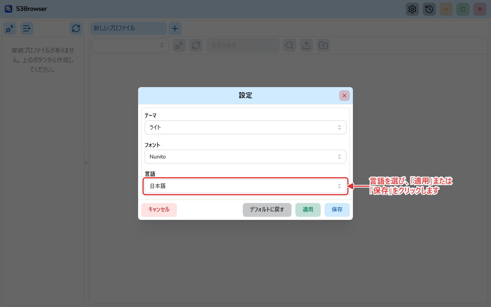

- **テーマ**: ライト、ダーク、システムに合わせる。
- **フォント**: Nunito、System UI、Segoe UI、Arial、Roboto、Be Vietnam Pro、Verdana、Meiryo UI、Monospace、JetBrains Mono。
- **言語**: English、Tiếng Việt、日本語、简体中文、繁體中文、Русский、Deutsch。メッセージを含む画面全体が切り替わります。
- **Windows 起動時に自動起動**: Windows にサインインしたときに S3Browser を起動します。Windows のインストール版でのみ表示されます（ポータブル版にはありません）。
- **アップデートを自動的に確認してダウンロードする** と **ベータ版 (プレリリース) を受け取る**: [アップデート](#102-アップデート)を参照してください。この 2 つのスイッチは切り替えた時点で有効になり、**適用** や **保存** は不要です。アプリを再起動しても残るのは **保存** したときだけです。

変更はすぐにプレビューされます。その後、次のいずれかを選びます。

- **保存**: 設定を保持します。アプリを再起動しても残ります。
- **適用**: 2 つのアップデートのスイッチを含め、アプリを閉じるまで設定を保持します。ダイアログは開いたままです。自動起動は適用した時点で Windows に書き込まれ、キャンセルでは元に戻りません。
- **キャンセル**: 最後の適用または保存以降の変更を、2 つのアップデートのスイッチも含めて取り消します。ダイアログは閉じます。
- **デフォルトに戻す**: フォームを初期値（ライト、Nunito、English、**Windows 起動時に自動起動** はオフ）に戻します。2 つのアップデートのスイッチも、手動で切り替えたときと同様にすぐ初期値に戻ります（**アップデートを自動的に確認してダウンロードする** はオン、**ベータ版 (プレリリース) を受け取る** はオフ）。初期値を保持するには **保存** をクリックします。**キャンセル** で元に戻せます。

保存も適用もされていない変更があるときに **X**、Esc キー、またはウィンドウの外側のクリックで閉じようとすると、警告 **未保存の設定** が表示されます（「保存も適用もされていない設定があります。どうしますか？」）。**戻る** は変更を残したままウィンドウを開いておき、**変更を破棄** は変更を取り消してウィンドウを閉じ、**保存** は変更を保存します（保存に失敗した場合はウィンドウは開いたままです）。変更がなければ、そのままウィンドウが閉じます。

設定はアプリ起動時、ウィンドウの内容が表示される前に読み込まれます。

### 10.2 アップデート

インストール版は GitHub Releases から自動的にアップデートできます。設定ウィンドウの **アップデート** セクションはこの版にのみ表示され、ポータブル版は自動アップデートしません。

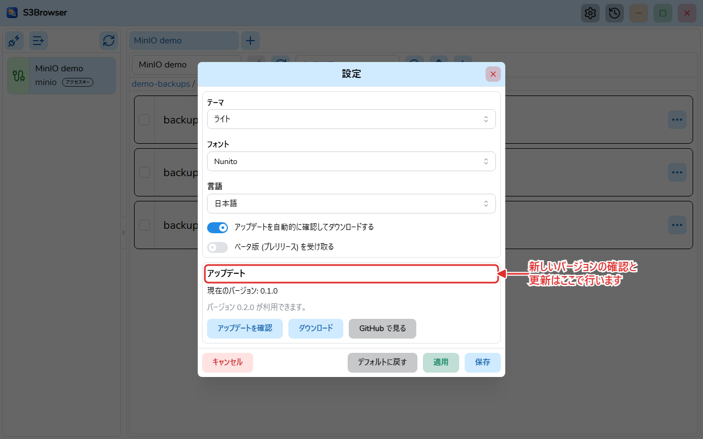

- **アップデートを自動的に確認してダウンロードする**: オンにすると、新しいバージョンを確認し、バックグラウンドでダウンロードします。
- **ベータ版 (プレリリース) を受け取る**: Pre-release と表示されたバージョンも対象になります。
- **アップデートを確認** はすぐに確認します。**現在のバージョン** の下の行に結果（例: **バージョン ... が利用できます。**、**最新バージョンです。**）が表示されます。
- **ダウンロード** で新しいバージョンをダウンロードし、ダウンロード後は **今すぐアップデート** でインストールします。**GitHub で見る** はリリースページを開きます。

新しいバージョンがあると、ウィンドウ上部の通知で **ダウンロード** が案内され、ダウンロード中は進捗が表示され、完了すると **アップデート** が案内されます。ダウンロードしたファイルはインストール前に検証されます。

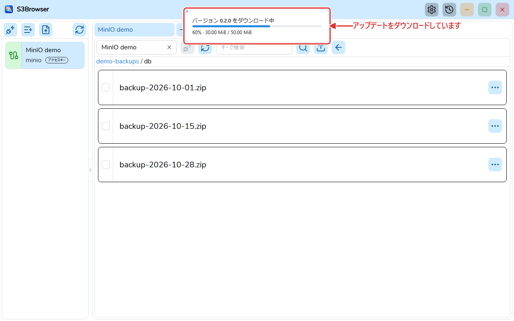

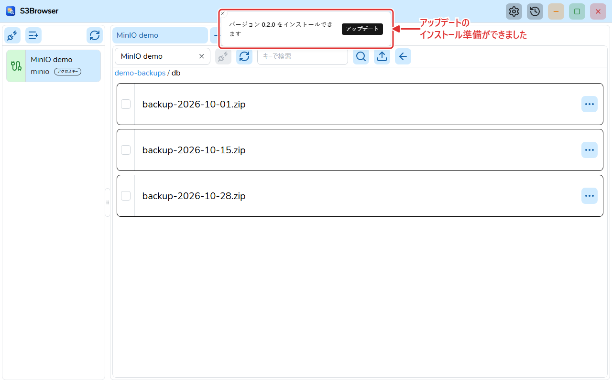

実際のアップデートはスクリーンショットでは示せません。上の画像はダミーの値で通知を表示したものです。

## 11. トラブルシューティング

メッセージはウィンドウの上部に表示されます。よく見かけるものは次のとおりです。

| メッセージ | 原因と対処 |
| --- | --- |
| アクセスキーまたはシークレットキーがこのエンドポイントに対して無効です | キーが間違っているか、別のサーバーのものです。プロファイルを確認し、**接続テスト** を使ってください。 |
| エンドポイントへの接続がタイムアウトしました。アドレスとサーバーが起動しているかを確認してください | エンドポイントが違う、サーバーが停止している、またはファイアウォールやネットワークが遮断しています。アドレス（`http://` または `https://` を含む）とポートを確認してください。 |
| エンドポイントに拒否されました / S3バケットへの接続中にエラーが発生しました | サーバーは応答しましたが接続を拒否しました。エンドポイント、リージョン、**パススタイル**（MinIO では必要）を確認してください。 |
| プロファイル: {name} は接続されていません | 接続が閉じられています。プロファイルに再接続してください。 |
| バケット一覧の取得に失敗しました / オブジェクト一覧の取得に失敗しました | アカウントにバケットやオブジェクトの一覧権限がないか、接続が切れた可能性があります。キーの権限を確認し、再接続してください。 |
| バケットへのアクセスが制限されています | アカウントですべてのバケットを一覧表示できません。不足している権限を依頼するか、使用が許可されているバケットを開いてください。 |
| 別のアップロードが実行中です。完了までお待ちください。 | アップロードは同時に 1 つだけ実行されます。終わるのを待つか、**アップロード中** ウィンドウからキャンセルしてください。 |
| フォルダー ... にアップロードするファイルが 50 個を超えています。 / 一度にアップロードできるのは最大 1000 ファイルです。 | 9.1 の上限を参照してください。アップロードを分割するか、ファイル数を減らしてください。 |
| プロファイル [{name}] はアップロードまたはダウンロード中のため削除できません | 転送が終わるのを待つかキャンセルしてから、プロファイルを削除してください。 |
| 操作の前に切断してください！ | 編集や削除の前に、プロファイルを切断してください（右クリックして **切断**）。 |
| 選択できるのは最大5件までです！ | ダウンロードや削除のために選択できるのは最大 5 件です。 |
| 保存先 ... が存在しません | ダウンロード用に選んだフォルダーが利用できません。別の場所を選んでください。 |

一覧にないメッセージには、操作名とサーバーが報告した理由が含まれます。その理由（例: `AccessDenied`、`NoSuchBucket`）は S3 自身のメッセージで、サーバー側で何を直すべきかを示しています。

下の 2 つのスクリーンショットは、**接続テスト** で取得した接続エラーです。

