# S3 Browser ユーザーガイド

バージョン 0.0.1-beta.1

## 1. はじめに

S3 Browser は、**AWS S3** および **MinIO** などの S3 互換サーバー上のバケットとオブジェクトを閲覧・管理するデスクトップアプリケーションです。次のことができます。

- 接続プロファイルを保存し、複数のアカウントに同時に接続する（接続ごとに 1 つのタブ）
- バケット、フォルダー、オブジェクトを閲覧し、検索する
- オブジェクトの詳細を確認する
- ファイルやフォルダーをアップロードする（ドラッグ＆ドロップまたはダイアログ）。進捗はリアルタイムで表示されます
- オブジェクトをダウンロードし、ダウンロード履歴を確認する
- オブジェクトやフォルダー全体を削除する

画面は英語、ベトナム語、日本語に対応しています。

ウィンドウは 3 つの領域で構成されています。左側の**プロファイル一覧**、右側の**タブ**（各タブに 1 つの接続のバケットとオブジェクトを表示）、上部のダウンロード履歴ボタンと言語切り替えがある**ヘッダー**です。

> これはベータ版（0.0.1-beta.1）です。オブジェクトを削除する前に、重要なデータのコピーを保管してください。削除は元に戻せません。

## 2. インストール

Windows では 2 通りの方法があります。

- **インストーラー**: インストーラーを実行し、手順に従います。その後、スタートメニューからアプリを起動できます。プロファイルとダウンロード履歴はユーザープロファイル内に保存されます。
- **ポータブル版**: ポータブルフォルダーを任意の場所（USB メモリなど）にコピーし、`S3Browser.exe` を実行します。`webview2` フォルダーに含まれる WebView2 ランタイムを使用し、データはプログラムの隣の `data` フォルダーに保存されるため、他の場所には何も書き込まれません。`webview2` フォルダーと `data` フォルダーをプログラムから離さないでください。

## 3. AWS S3 または MinIO に接続する

プロファイル一覧の上にある 2 番目のボタン **接続プロファイルを作成** をクリックします。**接続プロファイル** ウィンドウが開きます。

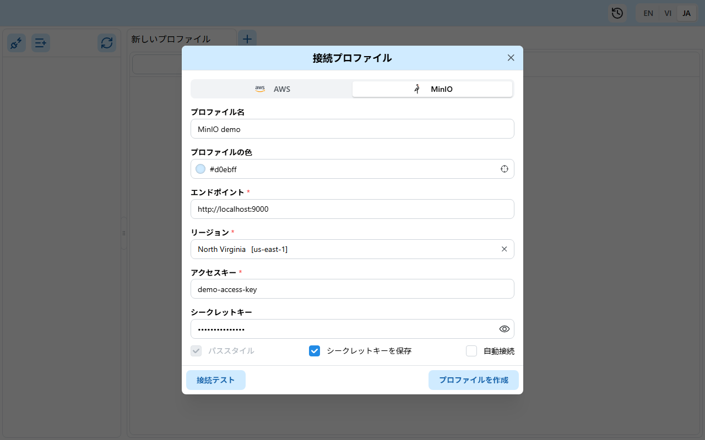

| 項目 | 説明 |
| --- | --- |
| AWS / MinIO | サーバーの種類を選びます。MinIO を選ぶと **パススタイル** が自動的にオンになります。 |
| プロファイル名 | プロファイル一覧とタブに表示される名前です。 |
| プロファイルの色 | 一覧でのプロファイルの色です。 |
| エンドポイント | サーバーのアドレスです。例: `https://s3.amazonaws.com`、`http://localhost:9000`。必須です。 |
| リージョン | アカウントのリージョンです。例: `North Virginia [us-east-1]`。必須です。 |
| アクセスキー | アカウントのアクセスキーです。必須です。 |
| シークレットキー | アカウントのシークレットキーです。目のアイコンをクリックすると表示されます。 |
| パススタイル | バケットを `bucket.endpoint` ではなく `endpoint/bucket` の形式で指定します。MinIO やほとんどのセルフホスト型サーバーで必要です。 |
| シークレットキーを保存 | シークレットキーを暗号化してプロファイルに保存します。オフの場合、接続のたびにシークレットキーを入力する必要があります。 |
| 自動接続 | アプリ起動時にプロファイルへ自動的に接続します。**シークレットキーを保存** がオンの場合のみ使用できます。 |

下部には 2 つのボタンがあります。

- **接続テスト**: 何も保存せずに入力内容を確認します。緑のメッセージはテスト成功、赤のメッセージは問題の内容を示します（[トラブルシューティング](#10-トラブルシューティング)を参照）。
- **プロファイルを作成**: プロファイルを保存します（既存のプロファイルからウィンドウを開いた場合、ボタンは **プロファイルを更新** になります）。

> シークレットキーが写っているスクリーンショットは共有しないでください。このガイドのキー欄にはダミーの値のみが入っています。

## 4. プロファイルを管理する

プロファイルを作成すると、プロファイル一覧に表示されます。

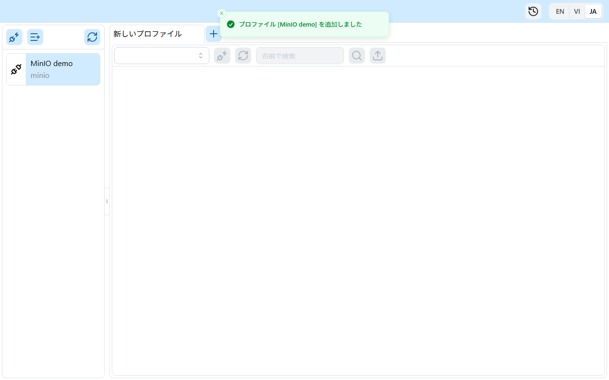

プロファイルを右クリックするとメニューが開きます。

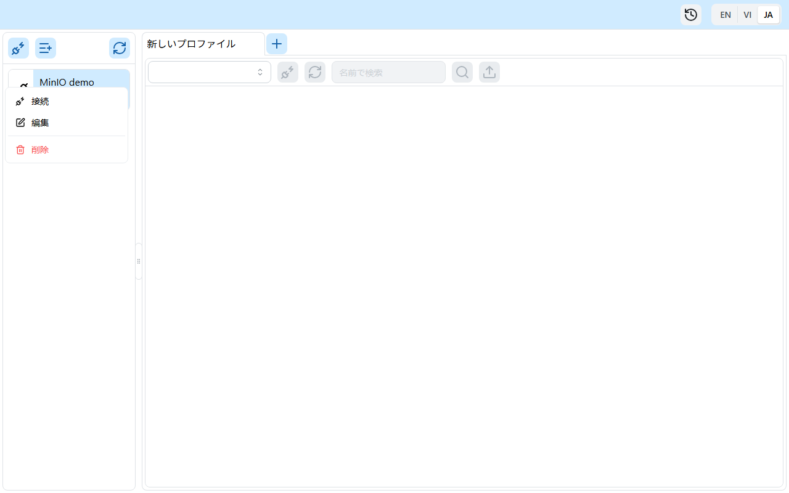

- **接続**: 接続を開きます。接続中のプロファイルには緑のアイコンが表示されます。
- **切断**: 接続を閉じます。プロファイルを編集・削除する前に切断してください。
- **編集**: プロファイルを変更します（ウィンドウのタイトルは同じく **接続プロファイル**、ボタンは **プロファイルを更新** です）。更新の確認が表示されます。
- **削除**: 確認後にプロファイルを削除します。

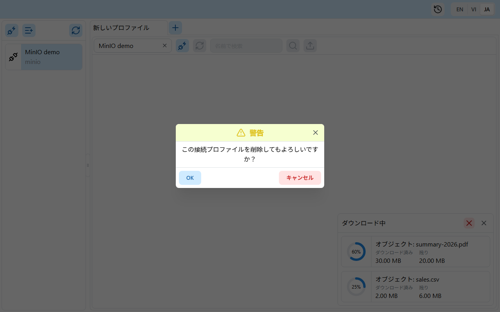

アップロードまたはダウンロードが実行中のプロファイルは削除できません。転送が終わるのを待つか、キャンセルしてください。

一覧の上にある最初のボタン（**接続**）は、同じウィンドウを **接続** ボタン付きで開きます。プロファイルを保存せずに一度だけ接続するときに使います。**接続プロファイル一覧を再読み込み** ボタンは一覧を更新します。

## 5. バケットとオブジェクトを閲覧する

各タブは 1 つのプロファイルで動作します。タブでプロファイルを使うには、タブ左上のドロップダウンで選び、（まだ接続していなければ）隣の **接続** ボタンをクリックします。**+**（**タブを追加**）ボタンで別のタブを開けます。たとえば 2 つ目のアカウント用です。

バケットの一覧が表示されます。

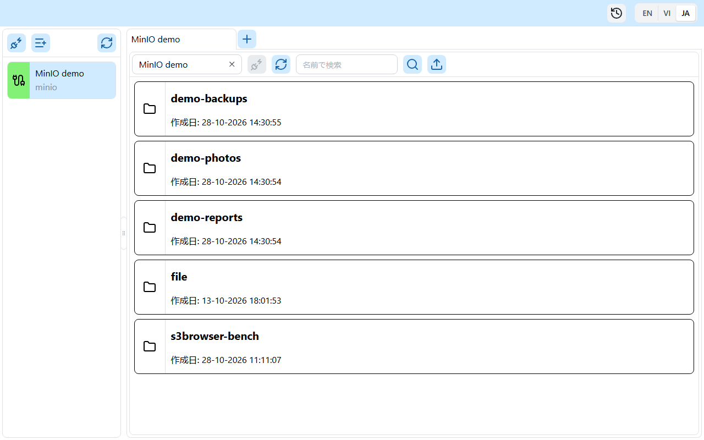

バケットをクリックするとオブジェクトが表示されます。フォルダーが先に表示され、クリックすると開きます。一覧の上のパス（例: `demo-photos / travel / 2026`）はクリックでき、矢印ボタンで 1 つ上の階層に戻ります（親フォルダー、またはバケットの最上位ではバケット一覧）。

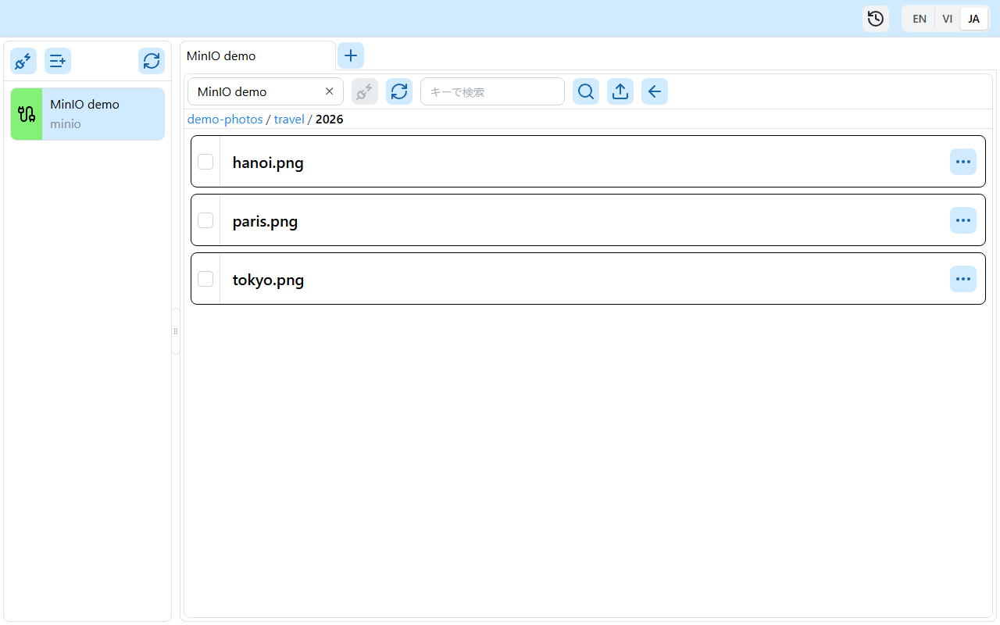

大きなバケットはページ単位で読み込まれ、下へスクロールすると自動的に続きが読み込まれます。**再読み込み**ボタン（**オブジェクト一覧を再読み込み** または **バケット一覧を再読み込み**）で現在の表示を更新します。

## 6. 検索

一覧の上の検索ボックスに入力し、Enter キーを押します（または虫眼鏡をクリックします）。

- バケット一覧では**名前**で検索します。
- バケット内では**キー**で検索します（現在のフォルダー内で、テキストを含むオブジェクトとフォルダーの名前が対象です。大文字小文字は区別せず、サブフォルダーの中は検索しません）。

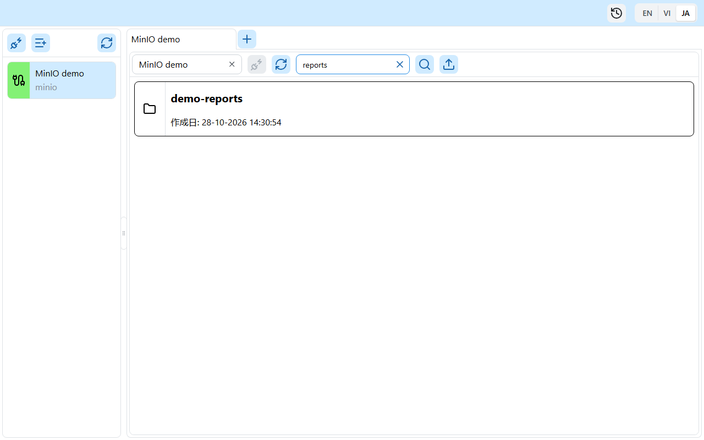

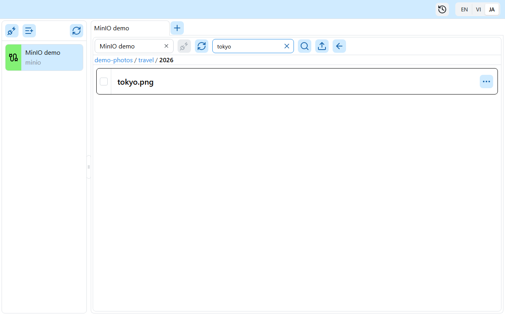

結果一覧の末尾に **さらに検索** が表示されたら、クリックして検索を続けます。検索ボックスの **x** で検索をクリアします。

## 7. オブジェクトの詳細

ファイルをクリックすると、右側に **オブジェクトの詳細** パネルが開きます。名前、キー、サイズ、最終更新日時、ETag、コンテンツタイプ、ストレージクラス、メタデータが表示されます。キーと ETag の横のコピーボタンで値をクリップボードにコピーできます。詳細を読み込めない場合は **再試行** をクリックします。**閉じる** ボタンでパネルを閉じます。

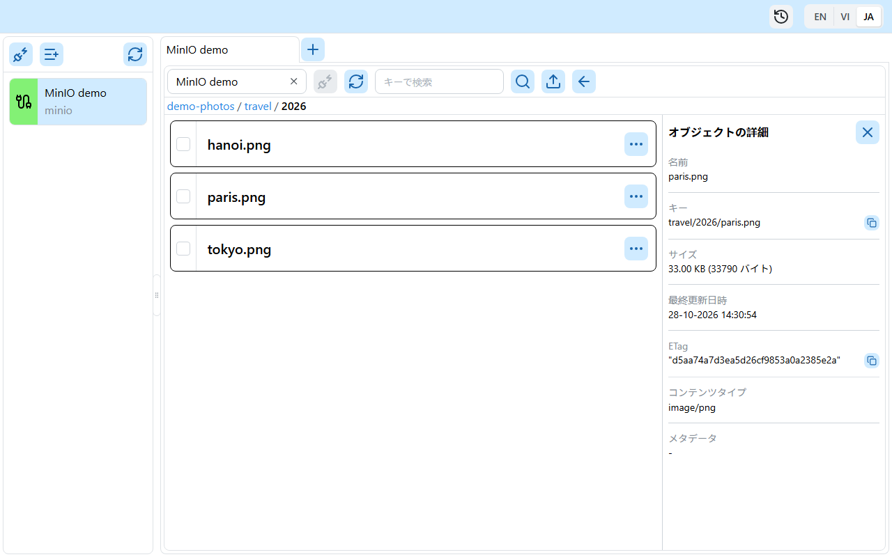

## 8. 転送と削除

### 8.1 アップロード

表示しているフォルダー（またはバケット）へのアップロード方法は 2 通りあります。

**ドラッグ＆ドロップ。** ファイルマネージャーからファイルやフォルダーをオブジェクト一覧にドラッグします。フォルダーをドロップすると、フォルダー構造を保ったまま中のすべてのファイルがアップロードされます。ドラッグ操作はスクリーンショットでは示せません。

**アップロードダイアログ。** 一覧の上の **ファイルをアップロード** ボタン（上向き矢印）をクリックします。**ファイルをアップロード** ウィンドウが開き、保存先（**アップロード先: ...**）が表示されます。

- **ファイルを選択** をクリックしてシステムのダイアログでファイルを選ぶか、ウィンドウにファイルやフォルダーをドラッグします。
- 一覧にはサイズ付きですべてのファイルが表示されます。チェックを外すとそのファイルは除外され、ごみ箱アイコンで一覧から削除でき、**選択したファイルを削除** も使えます。
- バケット一覧からダイアログを開いた場合は、先にアップロード先のバケットを選びます。
- **アップロード** をクリックして開始します。

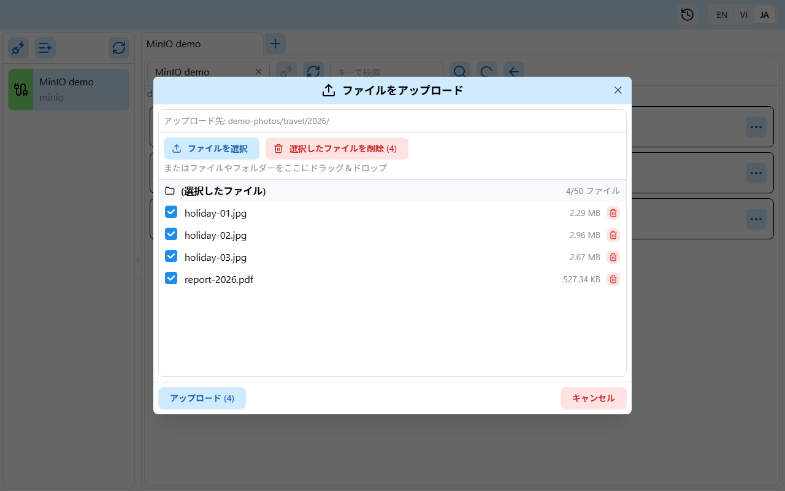

転送を管理しやすくするため、次の上限があります。

| 上限 | 値 |
| --- | --- |
| 1 回のアップロードで 1 フォルダーから | 50 ファイル |
| 1 フォルダー内の大きなファイル（10 GiB 超） | 4 ファイル |
| 1 回のアップロードのファイル数 | 1000 |
| 同時に実行できるアップロード | 1（実行中のアップロードが終わるまで待ちます） |

ドロップしたフォルダーが上限を超える場合、**アップロードするファイルを選択** ウィンドウでアップロードするファイルを選べます。上限内のフォルダーはすべてアップロードされます。アップロードできない項目（読み取れないファイル、シンボリックリンク）はスキップされ、件数が通知されます。

画面右下に **アップロード中** ウィンドウが表示され、ファイルごとの進捗（パーセントのリング、**アップロード済み**、**残り**）が分かります。停止するにはファイルの **キャンセル**、または上部の **すべてキャンセル** をクリックします。ウィンドウは閉じてもボタンから再度開けます。

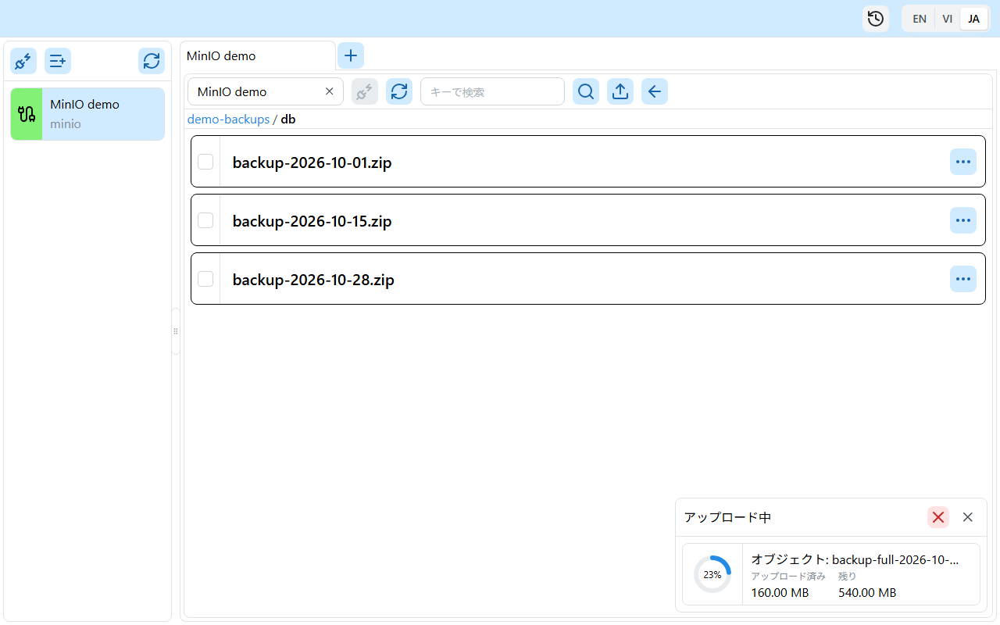

アップロードが完了したら、**再読み込み** をクリックして新しいオブジェクトを確認します。

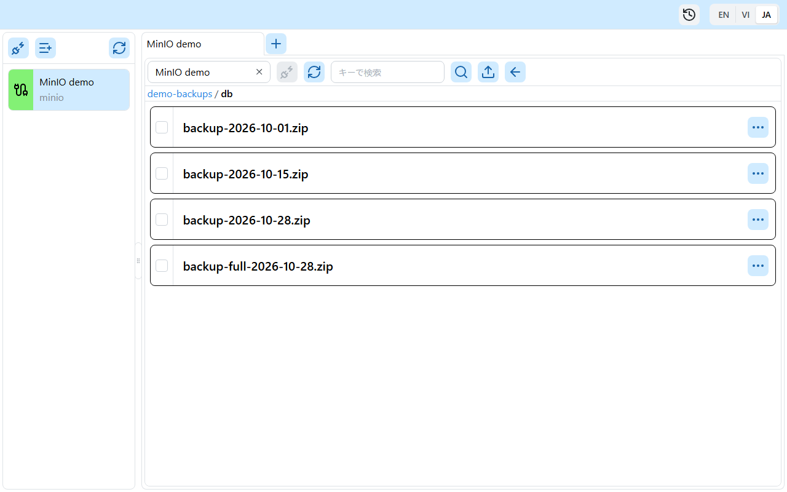

### 8.2 ダウンロード

- 1 つのオブジェクトは、行の右端の **その他の操作**（3 つの点）メニューを開き、**ダウンロード** を選びます。保存先を尋ねるダイアログが表示されます。
- 複数のオブジェクトは、チェックを付け（最大 5 件）、ツールバーの **選択項目をダウンロード** をクリックします。保存先フォルダーを尋ねるダイアログが表示されます。

フォルダーはダウンロードできません。選択からは除外されます。

**ダウンロード中** ウィンドウにはファイルごとの進捗（**ダウンロード済み**、**残り**）と **キャンセル**、**すべてキャンセル** ボタンがあります。下の画像はこのウィンドウです。

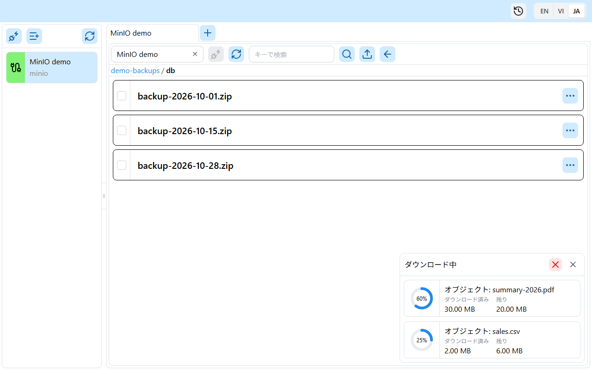

右上の時計ボタンをクリックすると **ダウンロード履歴** が開き、サイズ、日時、ステータス、保存先パスとともにすべてのダウンロードが表示されます。

### 8.3 複数のオブジェクトを選択する

行の先頭のチェックボックスをオンにします。ツールバーに **選択を解除**、**選択項目をダウンロード**、**選択項目を削除** が表示されます。ダウンロードや削除のために一度に選択できるのは最大 5 件です。

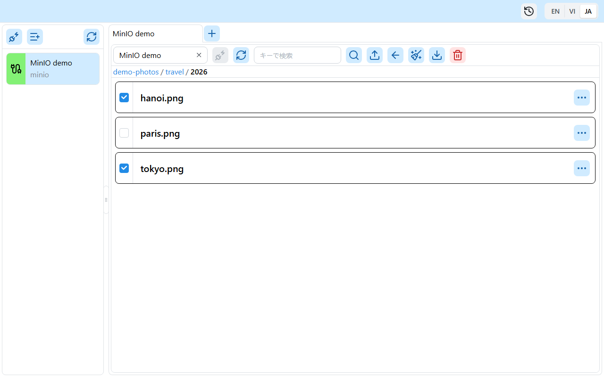

### 8.4 削除

オブジェクトの **その他の操作** メニューで **削除** を選ぶか、オブジェクトを選択して **選択項目を削除** をクリックします。確認ウィンドウに削除される内容が表示されます。**OK** をクリックして確定します。

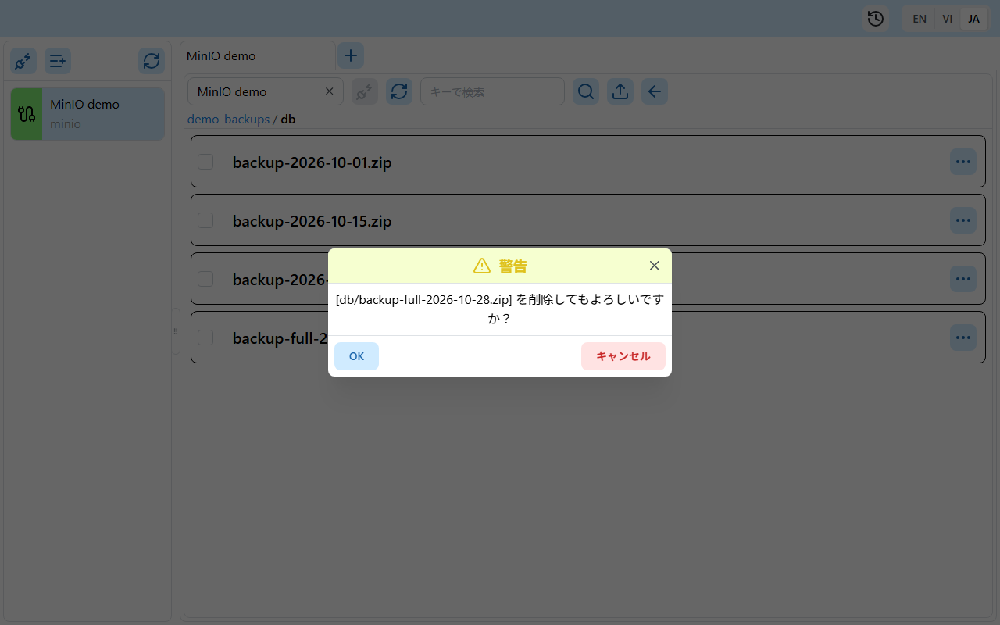

**フォルダー** を削除すると、フォルダー**とその中のすべての内容**が削除されます。確認ウィンドウにもその旨が表示され、操作は元に戻せません。削除できないオブジェクトがある場合は、失敗した件数と削除された件数がメッセージで示されます。

## 9. 言語を変更する

右上の **EN / VI / JA** スイッチを使います。メッセージを含む画面全体がすぐに切り替わります。アプリは起動するたびに英語で始まります。別の言語がよければ、もう一度切り替えてください。

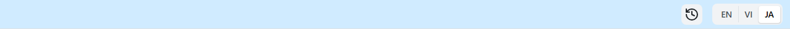

## 10. トラブルシューティング

メッセージはウィンドウの上部に表示されます。よく見かけるものは次のとおりです。

| メッセージ | 原因と対処 |
| --- | --- |
| アクセスキーまたはシークレットキーがこのエンドポイントに対して無効です | キーが間違っているか、別のサーバーのものです。プロファイルを確認し、**接続テスト** を使ってください。 |
| エンドポイントへの接続がタイムアウトしました。アドレスとサーバーが起動しているかを確認してください | エンドポイントが違う、サーバーが停止している、またはファイアウォールやネットワークが遮断しています。アドレス（`http://` または `https://` を含む）とポートを確認してください。 |
| エンドポイントに拒否されました / S3バケットへの接続中にエラーが発生しました | サーバーは応答しましたが接続を拒否しました。エンドポイント、リージョン、**パススタイル**（MinIO では必要）を確認してください。 |
| プロファイル: {name} は接続されていません | 接続が閉じられています。プロファイルに再接続してください。 |
| バケット一覧の取得に失敗しました / オブジェクト一覧の取得に失敗しました | アカウントにバケットやオブジェクトの一覧権限がないか、接続が切れた可能性があります。キーの権限を確認し、再接続してください。 |
| バケットへのアクセスが制限されています | アカウントですべてのバケットを一覧表示できません。不足している権限を依頼するか、使用が許可されているバケットを開いてください。 |
| 別のアップロードが実行中です。完了までお待ちください。 | アップロードは同時に 1 つだけ実行されます。終わるのを待つか、**アップロード中** ウィンドウからキャンセルしてください。 |
| フォルダー ... にアップロードするファイルが 50 個を超えています。 / 一度にアップロードできるのは最大 1000 ファイルです。 | 8.1 の上限を参照してください。アップロードを分割するか、ファイル数を減らしてください。 |
| プロファイル [{name}] はアップロードまたはダウンロード中のため削除できません | 転送が終わるのを待つかキャンセルしてから、プロファイルを削除してください。 |
| 操作の前に切断してください！ | 編集や削除の前に、プロファイルを切断してください（右クリックして **切断**）。 |
| 選択できるのは最大5件までです！ | ダウンロードや削除のために選択できるのは最大 5 件です。 |
| 保存先 ... が存在しません | ダウンロード用に選んだフォルダーが利用できません。別の場所を選んでください。 |

一覧にないメッセージには、操作名とサーバーが報告した理由が含まれます。その理由（例: `AccessDenied`、`NoSuchBucket`）は S3 自身のメッセージで、サーバー側で何を直すべきかを示しています。

下の 2 つのスクリーンショットは、**接続テスト** で取得した接続エラーです。

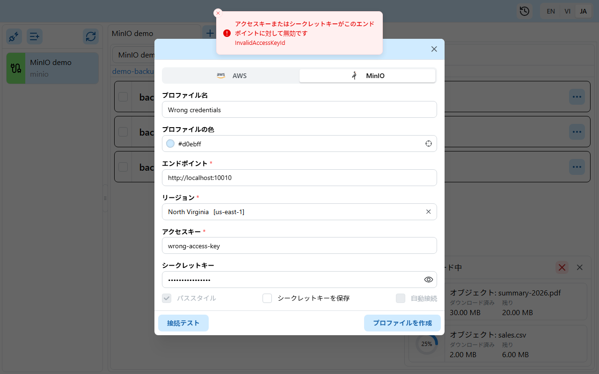

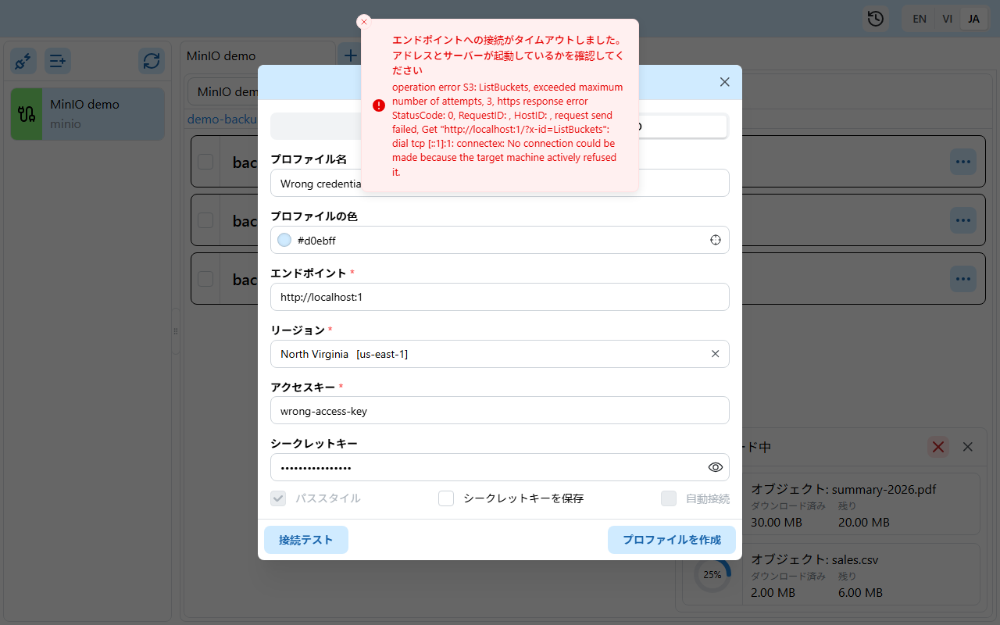
