# Руководство пользователя S3 Browser

Версия 0.0.1-beta.1

> Этот перевод ещё не проверен носителем языка.

## 1. Введение

S3 Browser — это настольное приложение для просмотра бакетов и объектов и управления ими на **AWS S3** и на S3-совместимых серверах, таких как **MinIO**. С его помощью вы можете:

- сохранять профили подключения и подключаться к нескольким учётным записям одновременно (одна вкладка на подключение);
- входить с помощью ключа доступа, принятия роли, AWS SSO, MinIO STS, LDAP, OpenID Connect (OIDC) или клиентского сертификата;
- просматривать бакеты, папки и объекты и искать их;
- создавать и просматривать бакеты, менять их права доступа и удалять их;
- просматривать сведения об объекте;
- загружать файлы и папки (перетаскиванием или через диалог) с окном хода выполнения в реальном времени;
- скачивать объекты и просматривать историю скачиваний;
- удалять объекты и целые папки;
- поддерживать приложение в актуальном состоянии через GitHub Releases.

Интерфейс доступен на английском, вьетнамском, японском, упрощённом китайском, традиционном китайском, русском и немецком языках.

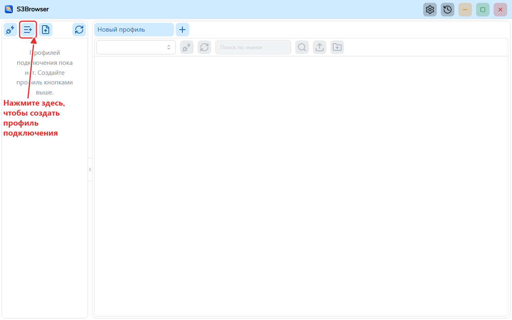

Окно состоит из трёх областей: **списка профилей** слева, **вкладок** справа (каждая вкладка показывает бакеты и объекты одного подключения) и **заголовка** сверху с кнопкой **Настройки** и кнопкой истории скачиваний.

> Это бета-версия (0.0.1-beta.1). Прежде чем удалять объекты, сохраните копию важных данных: удаление нельзя отменить.

## 2. Установка

В Windows есть два способа получить приложение.

- **Установщик**: скачайте `S3Browser-<version>-windows-amd64-installer.exe` со страницы [GitHub Releases](https://github.com/TranMinhTruyen/s3-browser/releases), запустите его и следуйте шагам. Выпуск **Latest** — стабильная версия; версии с пометкой **Pre-release** — бета-версии. После установки приложение доступно в меню «Пуск». Профили и история скачиваний хранятся в вашем профиле пользователя. Обновляться самостоятельно может только установленная версия (см. [Обновления](#102-обновления)).
- **Портативная версия**: скопируйте портативную папку в любое место (например, на USB-накопитель) и запустите `S3Browser.exe`. Она использует среду WebView2 из папки `webview2` и хранит данные в папке `data` рядом с программой, поэтому нигде больше ничего не записывается. Не переносите папки `webview2` и `data` отдельно от программы.

## 3. Подключение к AWS S3 или MinIO

Нажмите кнопку **Создать профиль подключения** (вторая кнопка над списком профилей). Откроется окно **Профиль подключения**.

### 3.1 Форма профиля

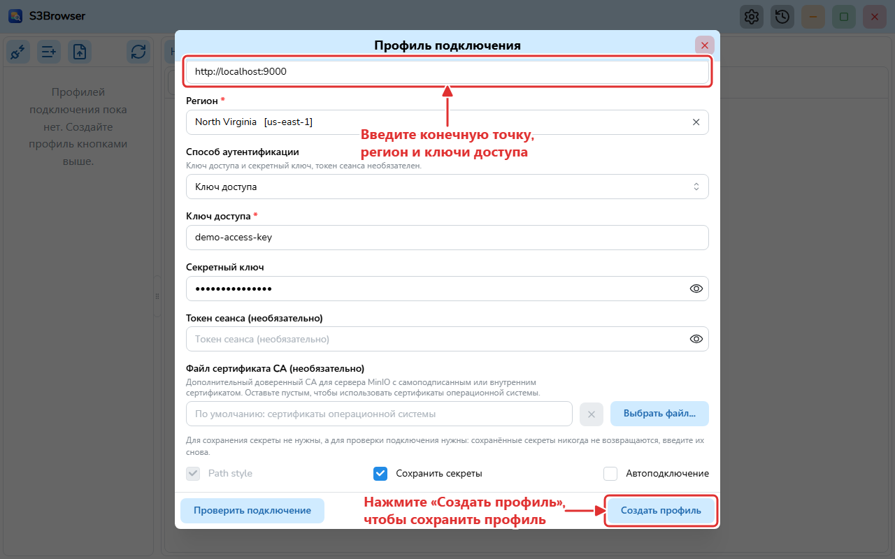

| Поле | Описание |
| --- | --- |
| AWS / MinIO | Выберите тип сервера. При выборе MinIO автоматически включается **Path style**. От этого зависят доступные способы аутентификации. |
| Имя профиля | Имя, которое показывается в списке профилей и на вкладке. |
| Цвет профиля | Цвет профиля в списке. |
| Конечная точка | Адрес сервера, например `https://s3.amazonaws.com` или `http://localhost:9000`. |
| Регион | Регион вашей учётной записи, например `North Virginia [us-east-1]`. Обязательное поле, кроме способов, которые читают его из конфигурации AWS. |
| Способ аутентификации | Как приложение входит в систему (см. [Способы аутентификации](#32-способы-аутентификации)). Поля ниже зависят от способа. |
| Ключ доступа | Ключ доступа вашей учётной записи. |
| Секретный ключ | Секретный ключ вашей учётной записи. Нажмите на значок глаза, чтобы показать его. |
| Токен сеанса (необязательно) | Токен сеанса временных учётных данных. |
| Файл сертификата CA (необязательно) | См. [Сертификат CA для MinIO](#33-сертификат-ca-для-minio). |
| Path style | Обращение к бакетам как `endpoint/bucket` вместо `bucket.endpoint`. Нужно для MinIO и большинства собственных серверов. |
| Сохранить секреты | Сохраняет секреты (в зашифрованном виде) в профиле. Без этого их нужно вводить при каждом подключении. |
| Автоподключение | Подключает профиль при запуске приложения. Доступно только при включённом **Сохранить секреты** и не для способов, требующих ввода при каждом подключении (например, OIDC или код MFA). |

Внизу есть две кнопки:

- **Проверить подключение** проверяет значения, ничего не сохраняя. Сохранённые секреты больше не показываются, поэтому для проверки введите их заново. Зелёное сообщение означает, что проверка прошла успешно; красное сообщение объясняет проблему (см. [Устранение неполадок](#11-устранение-неполадок)).
- **Создать профиль** сохраняет профиль (если окно открыто из существующего профиля, кнопка называется **Обновить профиль**).

> Никогда не публикуйте снимок экрана, на котором виден ваш секретный ключ. Поля ключей в этом руководстве содержат только условные значения.

### 3.2 Способы аутентификации

Выберите способ в поле **Способ аутентификации**. Список зависит от типа сервера.

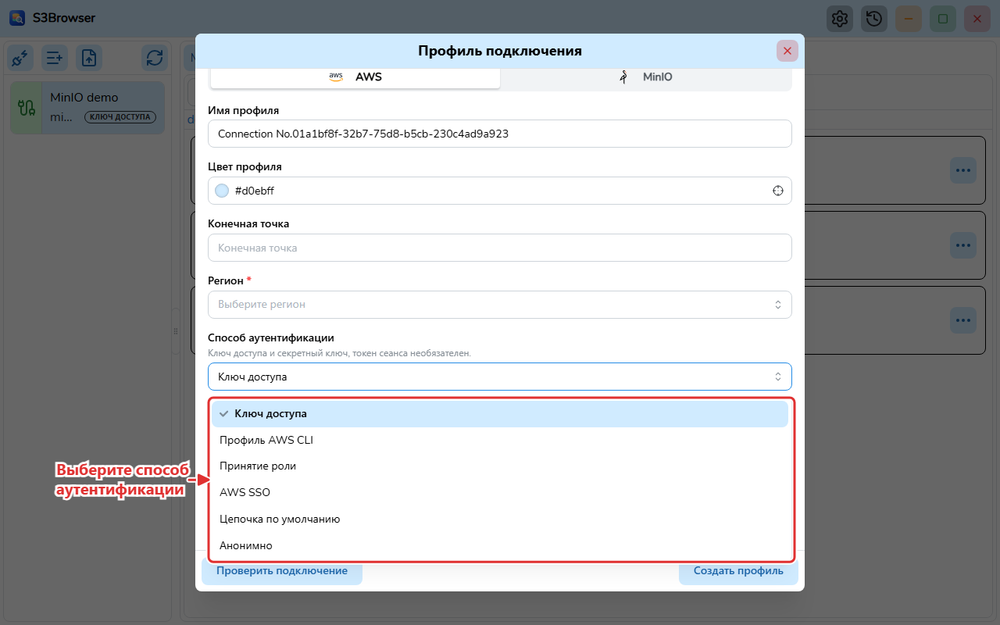

| Способ | Сервер | Что ввести |
| --- | --- | --- |
| Ключ доступа | AWS, MinIO | Ключ доступа, секретный ключ и необязательный токен сеанса. |
| Профиль AWS CLI | AWS | Профиль из файлов AWS CLI (`~/.aws`) и, при необходимости, пути **Файл конфигурации AWS (необязательно)** и **Файл учётных данных AWS (необязательно)** (по умолчанию: `~/.aws/config`, `~/.aws/credentials`). |
| Принятие роли | AWS | **ARN роли**, учётные данные для её принятия (**Ключ доступа** или **Профиль AWS CLI**) и, при необходимости, **Внешний ID (необязательно)**, **Имя сеанса (необязательно)**, **Длительность (секунды)** и **Серийный номер MFA-устройства (необязательно)**. **Код MFA** запрашивается при подключении и никогда не сохраняется. |
| AWS SSO | AWS | Профиль AWS CLI, в котором уже выполнен вход. Сначала выполните `aws sso login --profile <profile>`. |
| Цепочка по умолчанию | AWS | Ничего: используются учётные данные из окружения (переменные окружения, общие файлы или роль экземпляра). |
| Анонимно | AWS, MinIO | Только имена публичных бакетов, которые нужно открыть (анонимный пользователь не может получить список бакетов). |
| MinIO STS | MinIO | Ключ доступа, секретный ключ и, при необходимости, **ARN роли (необязательно)**, **Длительность (секунды, необязательно)** и **Встроенная политика (JSON, необязательно)**. |
| LDAP | MinIO | **Имя пользователя LDAP** и **Пароль LDAP** и, при необходимости, **Длительность (секунды, необязательно)** и **Встроенная политика (JSON, необязательно)**. |
| OIDC | MinIO | **ID клиента**, **URL эмитента**, необязательный **Scope (необязательно)** и **Порт обратного вызова**. |
| Клиентский сертификат | MinIO | **Файл клиентского сертификата** и **Файл закрытого ключа**; при необходимости отметьте **Закрытый ключ защищён паролем**. Конечная точка должна использовать `https://`. |

Способы, которым нужно больше полей, показаны ниже (значения условные).

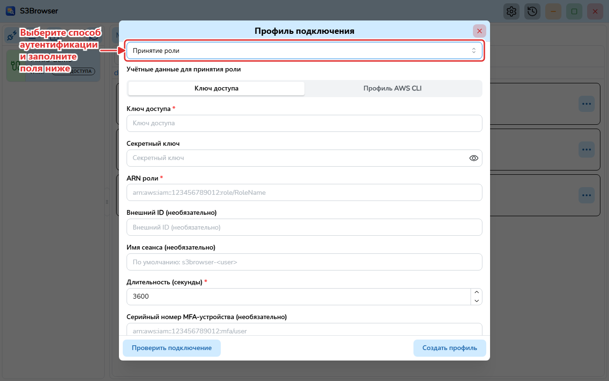

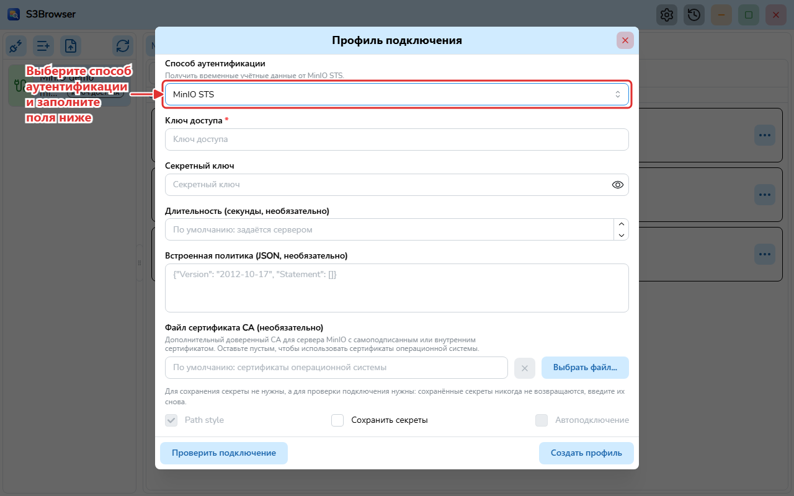

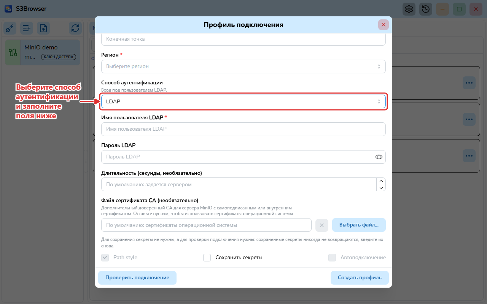

**OIDC.** Скопируйте **URI перенаправления**, показанный в форме (кнопка **Копировать**), и зарегистрируйте его как URI перенаправления клиента у вашего поставщика удостоверений. Нажмите **Войти**: откроется веб-браузер, и вы войдёте в нём. Форма показывает **Ожидание входа в браузере...**, а затем **Вход выполнен, действует до ...**; кнопка **Отменить вход** прекращает ожидание. Вход используется один раз и никогда не сохраняется. Когда срок его действия истекает, форма показывает **Срок действия входа истёк, войдите снова**. Окно браузера нельзя показать на снимке экрана.

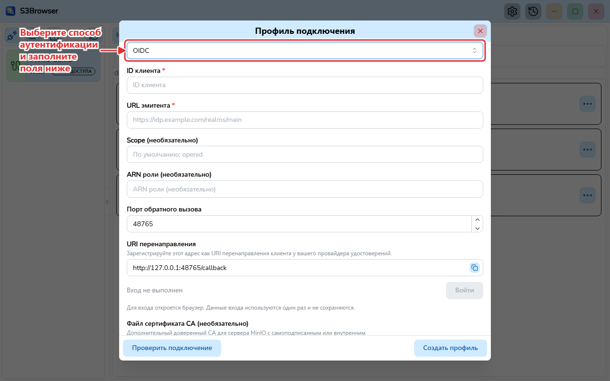

**Клиентский сертификат.** Нажмите **Выбрать файл...** рядом с полем файла и выберите файл в диалоге вашей системы (диалог нельзя показать на снимке экрана); **Очистить файл** очищает поле. Файлы читаются при подключении, а их содержимое не сохраняется.

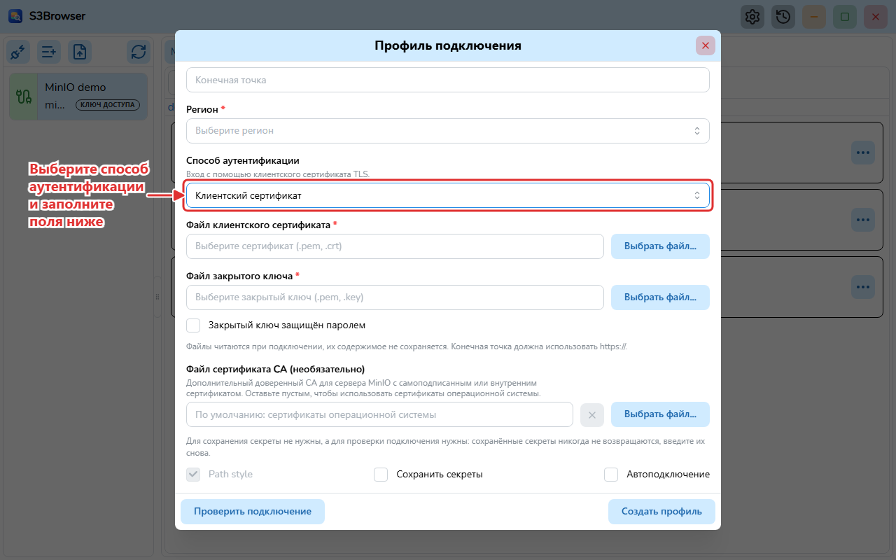

Срок действия некоторых учётных данных ограничен. Незадолго до его истечения приложение предложит их обновить: с помощью кода MFA (принятие роли), повторным входом (OIDC, SSO) или отключением и повторным подключением.

### 3.3 Сертификат CA для MinIO

Серверу MinIO с самоподписанным или внутренним сертификатом нужен дополнительный доверенный CA. В поле **Файл сертификата CA (необязательно)** нажмите **Выбрать файл...** и выберите сертификат CA (`.pem` или `.crt`). Оставьте поле пустым, чтобы использовать сертификаты операционной системы. Файл применяется только к подключению к MinIO, но не к поставщику удостоверений OIDC.

## 4. Управление профилями

После создания профиль появляется в списке профилей.

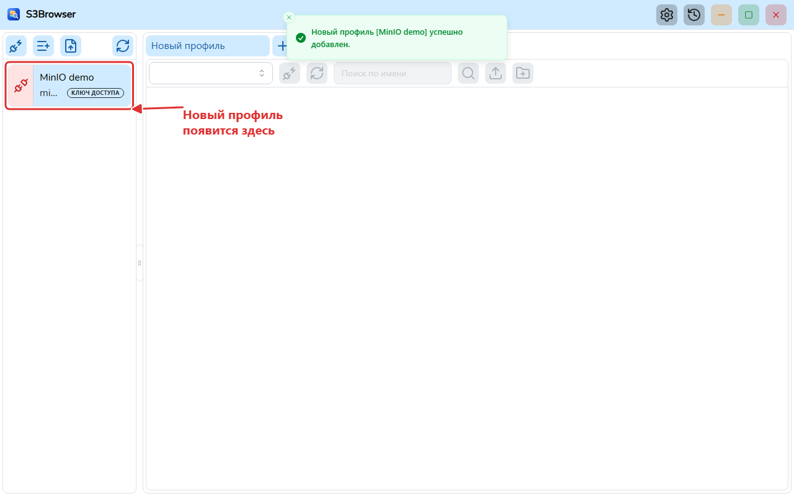

Щёлкните профиль правой кнопкой мыши, чтобы открыть его меню.

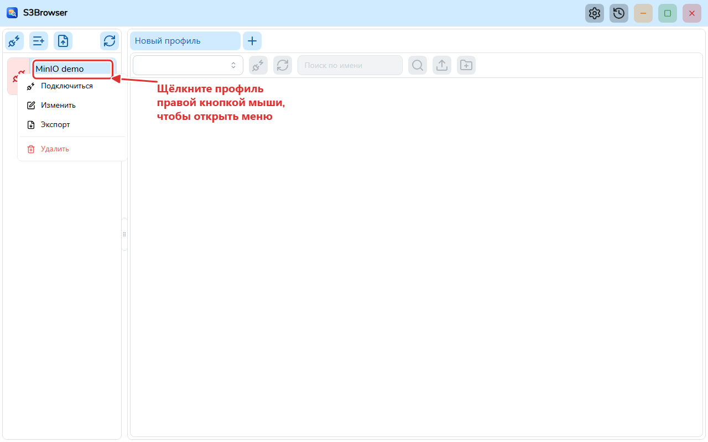

- **Подключиться**: открывает подключение. Подключённый профиль помечен зелёным значком.
- **Отключиться**: закрывает подключение. Перед изменением или удалением профиля сначала отключитесь.
- **Изменить**: изменяет профиль (заголовок окна снова **Профиль подключения**, а кнопка — **Обновить профиль**). Вас попросят подтвердить обновление.
- **Удалить**: удаляет профиль после подтверждения.

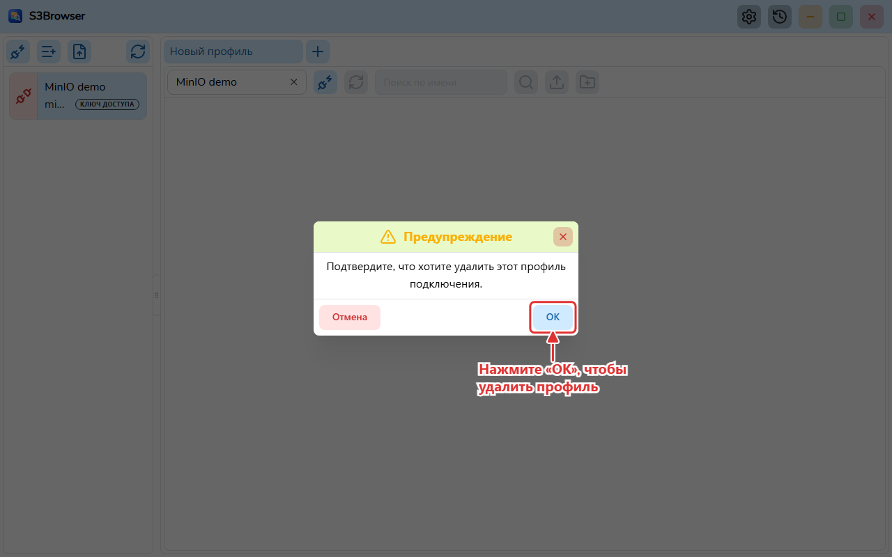

Профиль, у которого ещё выполняется загрузка или скачивание, удалить нельзя. Дождитесь завершения передач или сначала отмените их.

Первая кнопка над списком (**Подключиться**) открывает то же окно с кнопкой **Подключиться** — чтобы подключиться один раз без сохранения профиля, а кнопка **Обновить список профилей подключения** перезагружает список.

### 4.1 Экспорт профиля

Экспорт копирует профиль в файл, например чтобы использовать его на другом компьютере. Щёлкните профиль правой кнопкой мыши и выберите **Экспорт**.

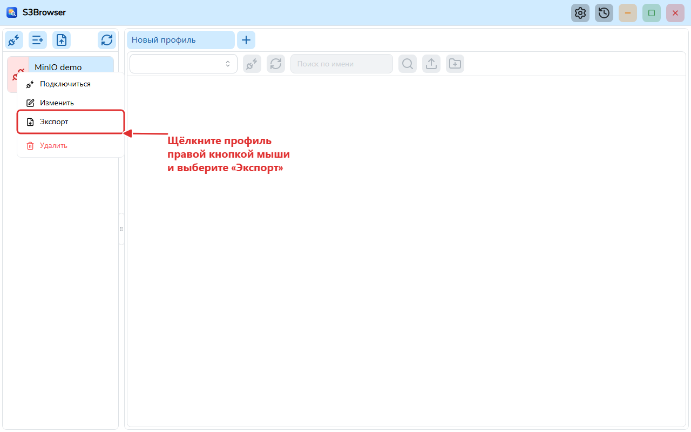

Откроется окно **Экспорт профиля**.

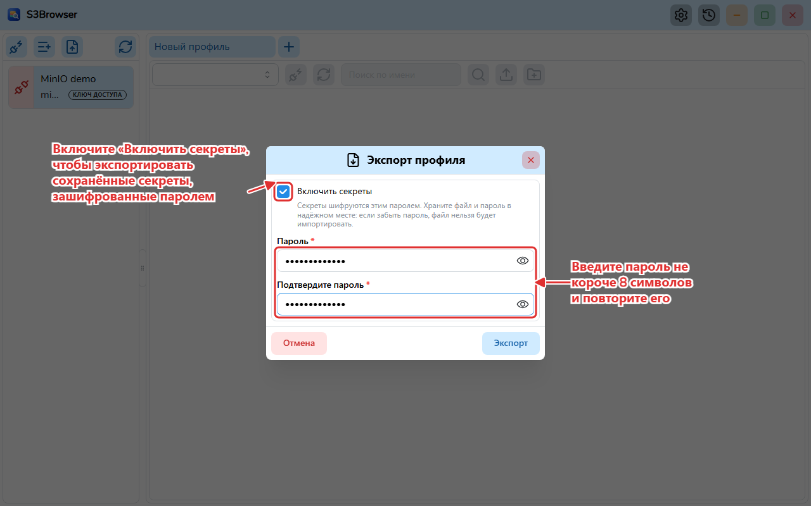

- Оставьте **Включить секреты** выключенным, чтобы экспортировать профиль без секретов (секретный ключ, токен сеанса, пароль LDAP, парольная фраза ключа). Прежде чем продолжить, приложение предупредит вас, если в профиле есть сохранённые секреты: «В профиле [имя] есть сохранённые секреты, которые НЕ будут экспортированы. После импорта их потребуется ввести заново. Экспортировать без секретов?» Подтвердите, чтобы экспортировать, или отмените, чтобы вернуться. После импорта измените профиль и снова введите секреты.
- Включите **Включить секреты**, чтобы экспортировать и сохранённые секреты. Введите **Пароль** не короче 8 символов и повторите его в поле **Подтвердите пароль**. Секреты шифруются этим паролем (PBKDF2 и AES-GCM): в файл они никогда не записываются открытым текстом. Если в профиле нет сохранённых секретов, параметр недоступен («В этом профиле нет сохранённых секретов.»).

Нажмите **Экспорт**. Откроется диалог сохранения Windows с предлагаемым именем файла, составленным из имени профиля: только строчные буквы, цифры и подчёркивания, например `minio_demo.json`. Выберите, куда сохранить файл. Когда файл записан, появится сообщение. Если закрыть диалог сохранения, ничего не записывается, а окно **Экспорт профиля** остаётся открытым.

В файле хранятся параметры подключения профиля (имя, цвет, провайдер, конечная точка, регион, ключ доступа, path style, автоподключение, способ аутентификации и его параметры), но не внутренние данные, такие как идентификатор или даты профиля. Экспортируются только пути к файлам сертификата и ключа, а не сами файлы.

Храните файл и пароль в надёжном месте. Пароль нигде не сохраняется: если его забыть, файл нельзя будет импортировать. Не редактируйте вручную файл с секретами. Если в нём изменить провайдера, конечную точку или способ аутентификации, импорт завершится ошибкой «Неверный пароль или файл повреждён.»

### 4.2 Импорт профиля

Нажмите кнопку **Импортировать профиль подключения** (над списком профилей, рядом с кнопкой **Создать профиль подключения**).

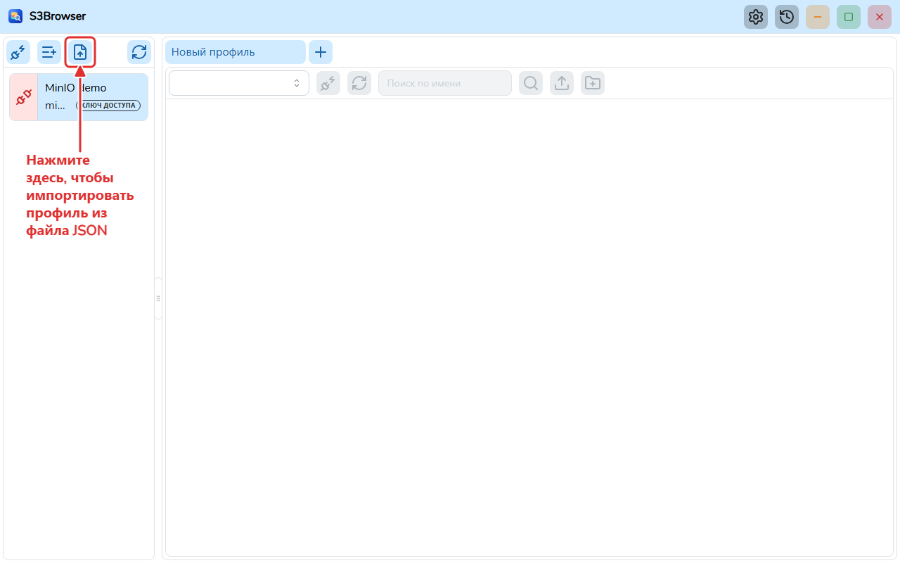

Появится диалог открытия файла Windows: выберите файл `.json`, экспортированный из S3Browser (не больше 1 МБ). Приложение проверяет файл, прежде чем что-либо сохранить. Например, «Файл не является допустимым файлом профиля S3Browser.» означает, что файл не является профилем, экспортированным из S3Browser; сообщение также появится, если версия файла не поддерживается или файл слишком большой.

- Файл, экспортированный без секретов, импортируется сразу.
- Для файла, экспортированного с секретами, откроется окно **Импорт профиля**: введите пароль, использованный при экспорте, и нажмите **Импорт**.

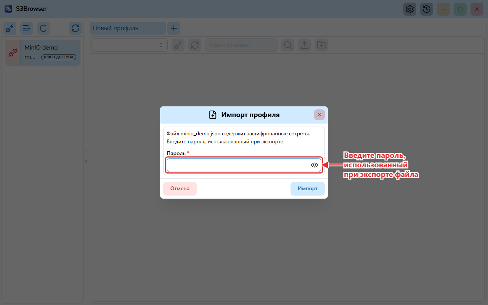

Если пароль неверный, появится сообщение «Неверный пароль или файл повреждён.», а окно останется открытым: можно ввести пароль ещё раз или нажать **Отмена**. Пока пароль не верен, ничего не сохраняется.

Импортированный профиль добавляется в список как новый:

- Если профиль с таким именем уже есть, к новому добавляется номер: **имя (2)**, **имя (3)** и так далее.
- Путь к файлу, которого нет на этом компьютере (сертификат ЦС, клиентский сертификат или ключ, файл config или credentials AWS), очищается, а одно предупреждение перечисляет эти поля: «Профиль [имя] импортирован. Следующие пути к файлам не существуют на этом компьютере и были очищены: {fields}.» Перед подключением измените профиль и выберите файлы заново. Это относится и к сертификату и ключу способа «клиентский сертификат TLS».
- Импорт не подключает профиль, даже если в файле включено **автоподключение**; автоподключение начнёт действовать при следующем запуске приложения.
- В профиле, экспортированном без секретов, секретов нет: измените его и введите их.

Диалоги сохранения и открытия файла Windows нельзя показать на снимке экрана. На изображении окна **Импорт профиля** показано окно, открытое с примером файла.

## 5. Просмотр бакетов и объектов

Каждая вкладка работает с одним профилем. Чтобы использовать профиль на вкладке, выберите его в раскрывающемся списке вверху слева на вкладке, затем нажмите рядом кнопку **Подключиться** (если профиль ещё не подключён). Кнопка **+** (**Добавить вкладку**) открывает ещё одну вкладку, например для второй учётной записи. Перетащите вкладку, чтобы изменить порядок (или нажмите Ctrl+Shift+влево/вправо); открытые вкладки запоминаются до следующего запуска приложения.

Показывается список бакетов:

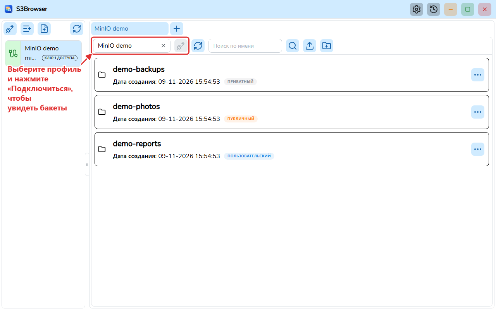

Щёлкните бакет, чтобы увидеть его объекты. Сначала показываются папки; щёлкните папку, чтобы открыть её. Путь над списком (например, `demo-photos / travel / 2026`) кликабелен, а кнопка со стрелкой возвращает на один уровень (в родительскую папку или из корня бакета в список бакетов).

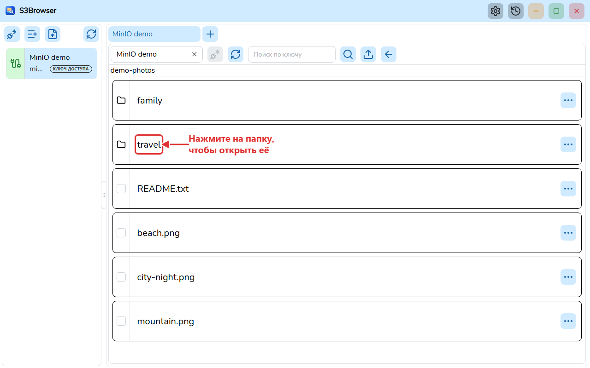

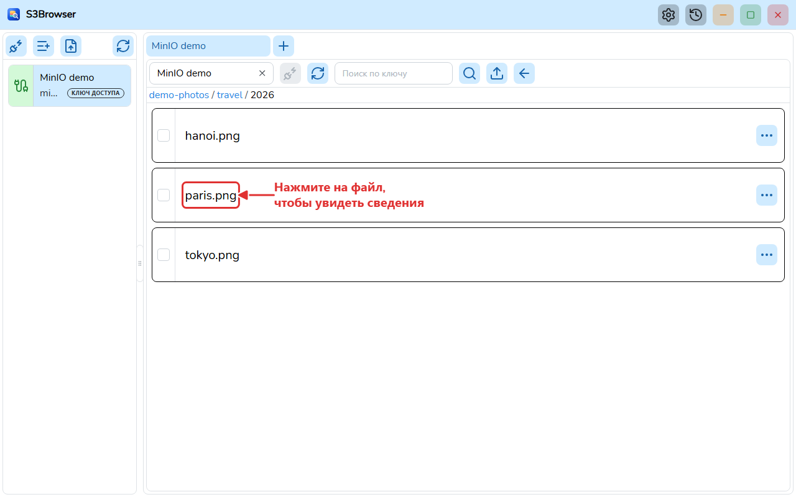

Большие бакеты загружаются постранично; при прокрутке вниз новые объекты подгружаются автоматически. Кнопка **Обновить** (**Обновить: список объектов** или **Обновить: список бакетов**) перезагружает текущее представление.

## 6. Поиск

Введите текст в поле поиска над списком и нажмите Enter (или щёлкните лупу).

- В списке бакетов поиск идёт по **имени**.
- Внутри бакета поиск идёт по **ключу** (по имени объектов и папок текущей папки, содержащих этот текст; регистр не учитывается, вложенные папки не просматриваются).

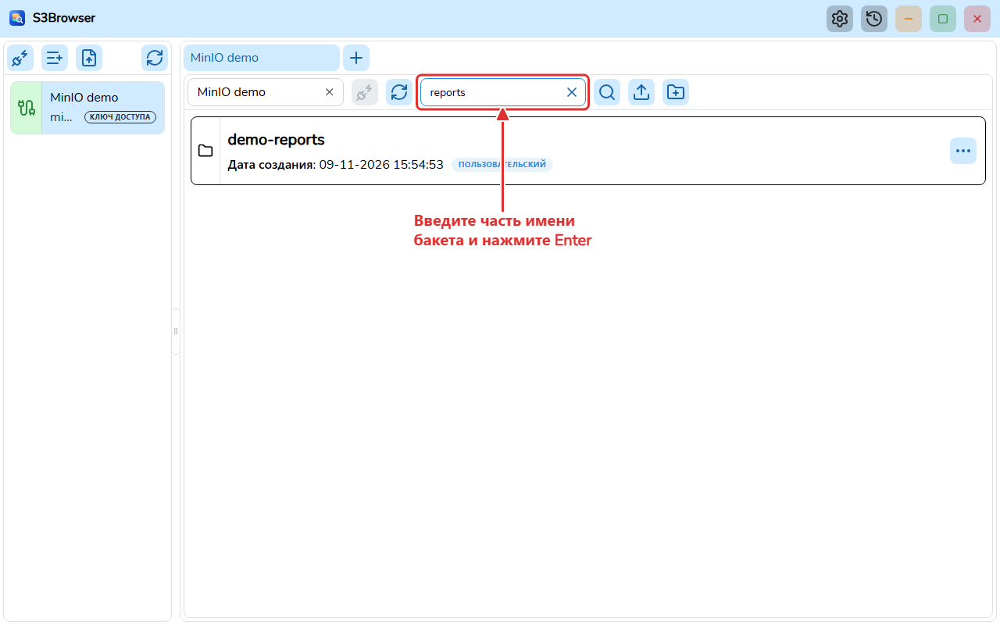

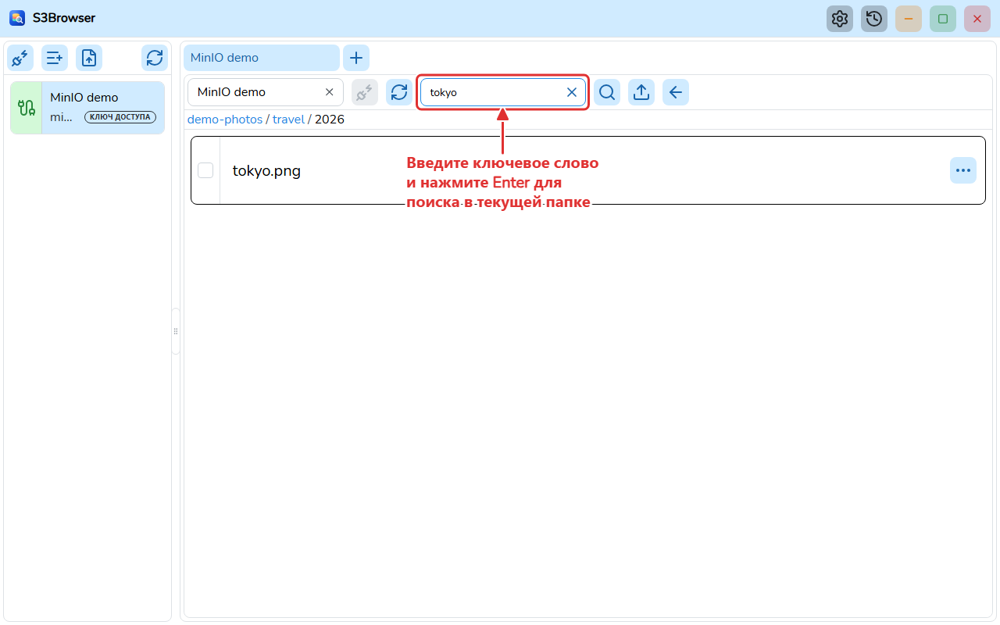

Если список результатов заканчивается пунктом **Искать дальше**, щёлкните его, чтобы продолжить поиск. Значок **x** в поле поиска сбрасывает поиск.

## 7. Сведения об объекте

Щёлкните файл, чтобы справа открылась панель **Сведения об объекте**. В ней показаны имя, ключ, размер, дата изменения, ETag, тип содержимого, класс хранения и метаданные объекта. Кнопки копирования рядом с ключом и ETag копируют значение в буфер обмена. Если сведения не удалось загрузить, нажмите **Повторить**. Закройте панель кнопкой **Закрыть**.

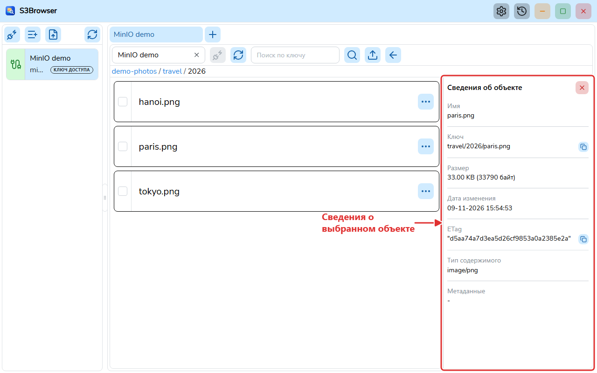

## 8. Управление бакетами

### 8.1 Значок политики и меню бакета

Каждый бакет в списке показывает значок с типом политики: **Приватный** (нет политики бакета), **Публичный** (любой может читать объекты и получать их список) или **Пользовательский** (пользовательская политика). Наведите указатель на значок, чтобы прочитать, что он означает. Бакет, к которому у вас нет доступа, помечается соответствующим образом.

Откройте меню **Другие действия** (три точки) в конце строки бакета:

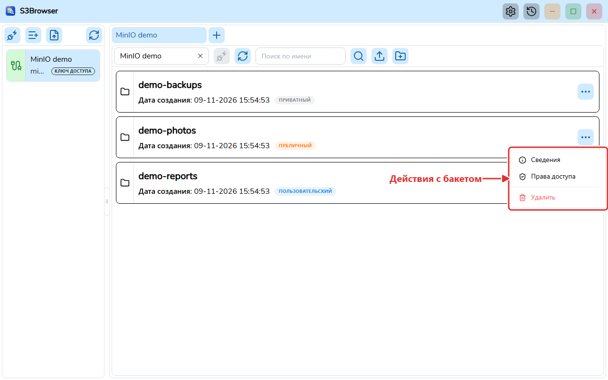

- **Сведения**: открывает сведения о бакете.
- **Права доступа**: изменяет, кто может получить доступ к бакету.
- **Удалить**: удаляет бакет.

**Права доступа** и **Удалить** скрыты, если учётной записи не разрешено ими пользоваться; при способе **Анонимно** доступны только **Сведения**.

### 8.2 Сведения о бакете

Выберите **Сведения**, чтобы справа открылась панель **Сведения о бакете**.

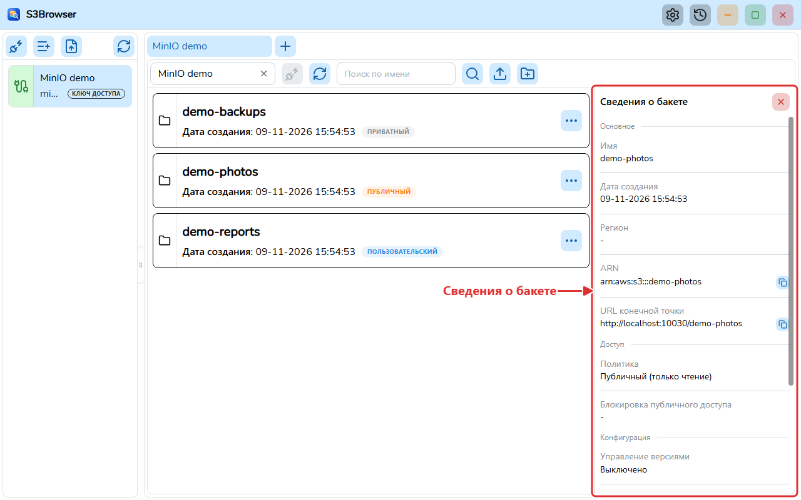

- **Основное**: **Имя**, **Дата создания**, **Регион**, **ARN** и **URL конечной точки**.
- **Доступ**: **Политика** (**Приватный**, **Публичный (только чтение)** или **Пользовательский**) и **Блокировка публичного доступа** (**Вкл.** или **Выкл.**).
- **Конфигурация**: **Управление версиями**, **Шифрование по умолчанию**, **Блокировка объектов**, **Теги** и **Объектов в корне**. Счётчик объектов в корне останавливается на 10 000, после чего показывает `10,000+`.

Если сведения не удалось загрузить, нажмите **Повторить**. Закройте панель кнопкой **Закрыть**.

### 8.3 Создание бакета

Нажмите кнопку **Создать бакет** над списком бакетов.

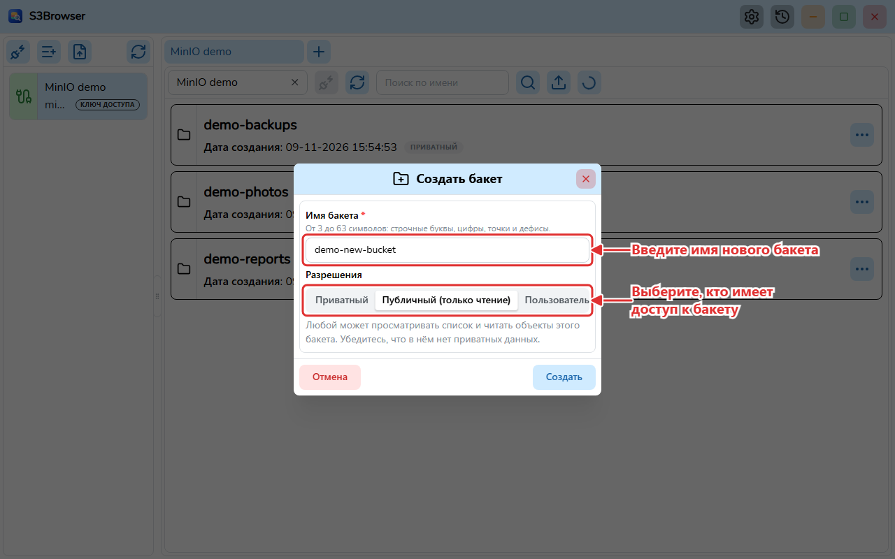

- **Имя бакета**: от 3 до 63 символов: строчные буквы, цифры, точки и дефисы.
- **Разрешения**: **Приватный**, **Публичный (только чтение)** или **Пользовательский** (тогда введите политику в формате JSON).
- В AWS новые бакеты по умолчанию блокируют публичный доступ, поэтому публичная политика может быть отклонена, пока не отключена блокировка публичного доступа. Бакет всё равно создаётся, а предупреждение сообщает, что разрешения не были применены.
- В AWS также есть поле **Регион** для выбора региона нового бакета (по умолчанию — регион профиля); это нельзя показать на снимке экрана, так как для этого нужна настоящая учётная запись AWS.

Нажмите **Создать**. Список бакетов обновится.

### 8.4 Изменение прав доступа

Выберите **Права доступа** в меню бакета.

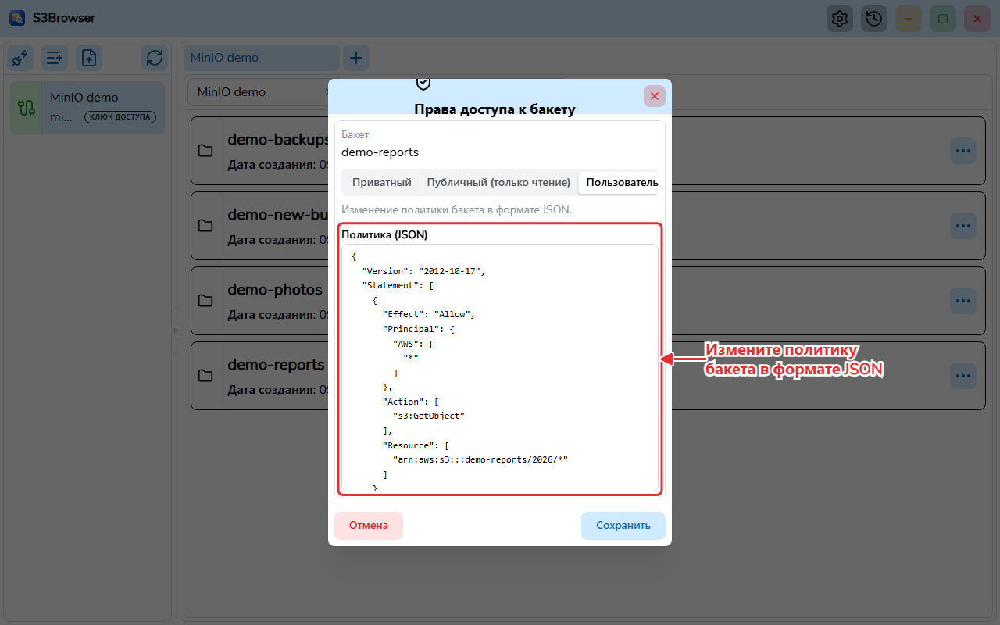

| Режим | Значение |
| --- | --- |
| Приватный | Политики бакета нет. Доступ к бакету есть только у авторизованных пользователей. |
| Публичный (только чтение) | Любой может просматривать список и читать объекты этого бакета. Убедитесь, что в нём нет приватных данных. |
| Пользовательский | Изменение политики бакета в формате JSON. |

Окно предупреждает, если для бакета включена блокировка публичного доступа (публичная политика будет отклонена) или если вашей учётной записи не разрешено менять права доступа. Нажмите **Сохранить**.

### 8.5 Удаление бакета

Выберите **Удалить** в меню бакета.

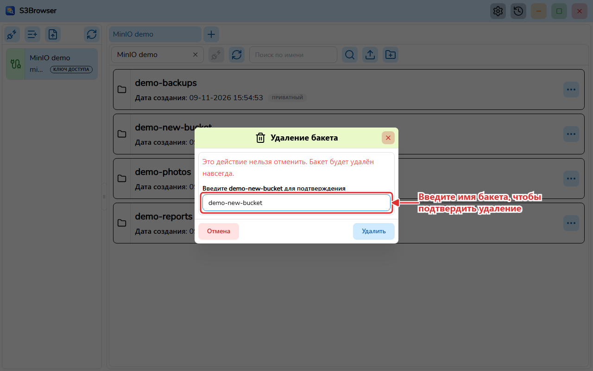

- Введите имя бакета для подтверждения, затем нажмите **Удалить**.
- Непустой бакет сначала очищается: **удаляются все его объекты** (при включённом управлении версиями — также все версии и маркеры удаления). Это действие нельзя отменить.
- Непустой бакет с блокировкой объектов удалить нельзя.
- Удаление нельзя отменить, а окно нельзя закрыть до его завершения; для большого бакета это может занять много времени. После этого обновляется только текущая вкладка.

## 9. Передача и удаление объектов

### 9.1 Загрузка

Загрузить файлы в просматриваемую папку (или бакет) можно двумя способами.

**Перетаскивание.** Перетащите файлы и папки из файлового менеджера на список объектов. При перетаскивании папки загружаются все файлы в ней с сохранением структуры папок. Перетаскивание нельзя показать на снимке экрана.

**Диалог загрузки.** Нажмите кнопку **Загрузить файлы** (стрелка вверх над списком). Откроется окно **Загрузка файлов** с целевым расположением (**Загрузить в: ...**).

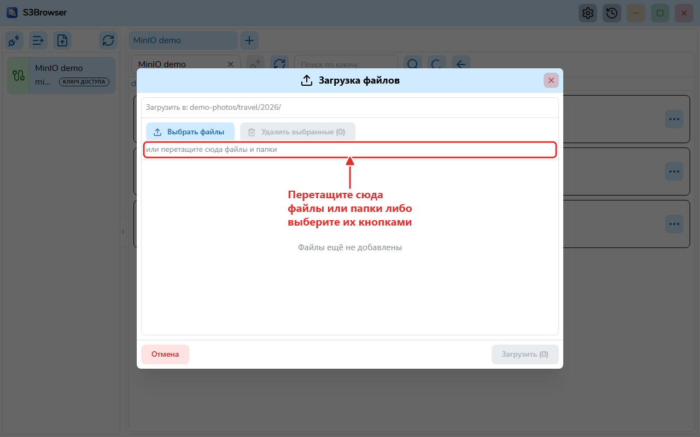

- Нажмите **Выбрать файлы** и выберите файлы в диалоге вашей системы либо перетащите файлы и папки в окно.
- В списке показан каждый файл с его размером. Снимите отметку с файла, чтобы исключить его, нажмите значок корзины, чтобы убрать его из списка, или используйте **Удалить выбранные**.
- Если вы открыли диалог из списка бакетов, сначала выберите целевой бакет.
- Нажмите **Загрузить**, чтобы начать.

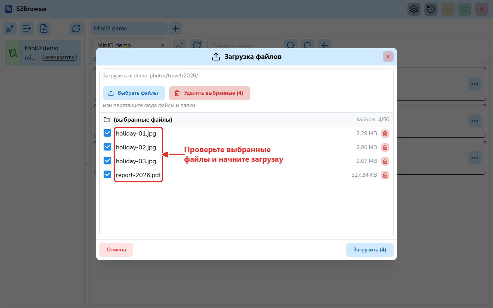

Чтобы передача оставалась управляемой, действуют следующие ограничения:

| Ограничение | Значение |
| --- | --- |
| Файлов из одной папки за одну загрузку | 50 |
| Больших файлов (более 10 ГиБ) из одной папки | 4 |
| Файлов за одну загрузку | 1000 |
| Одновременных загрузок | 1 (дождитесь завершения текущей загрузки) |

Если перетащенная папка превышает ограничение, окно **Выберите файлы для загрузки** позволяет отметить файлы для загрузки; папки в пределах ограничений загружаются целиком. Элементы, которые нельзя загрузить (нечитаемые файлы, символические ссылки), пропускаются, и вам сообщают, сколько их было.

Окно **Загрузка** появляется внизу справа и показывает ход выполнения по каждому файлу (кольцо с процентами, **Загружено** и **Осталось**). Нажмите **Отмена** у файла или **Отменить все** вверху, чтобы остановить. Окно можно закрыть и снова открыть его кнопкой.

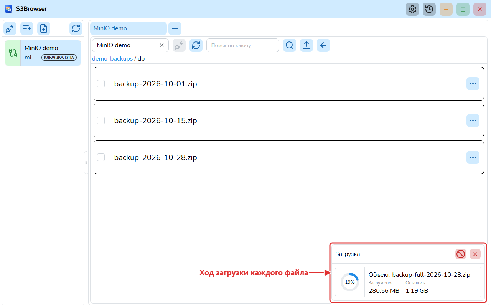

Когда загрузка завершена, нажмите **Обновить**, чтобы увидеть новые объекты.

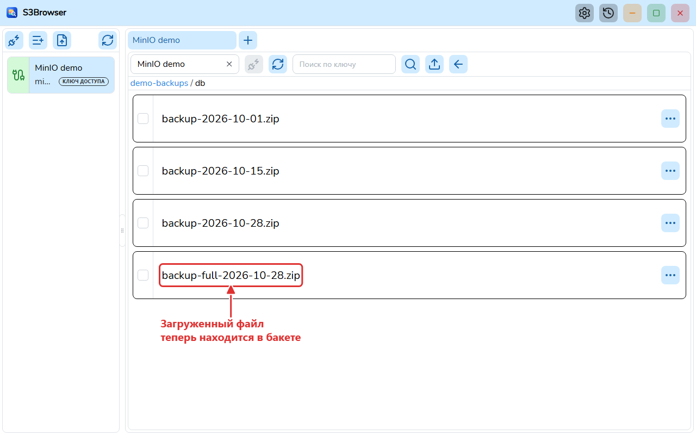

### 9.2 Скачивание

- Чтобы скачать один объект, откройте меню **Другие действия** (три точки) в конце его строки и выберите **Скачать**. Диалог спросит, куда сохранить файл.
- Чтобы скачать несколько объектов, отметьте их (не более 5), затем нажмите **Скачать выбранное** на панели инструментов. Диалог запросит папку назначения.

Папки скачать нельзя; они исключаются из выбора.

Окно **Скачивание** показывает ход выполнения по каждому файлу (**Скачано** и **Осталось**) и содержит кнопки **Отмена** и **Отменить все**. Окно показано на рисунке ниже.

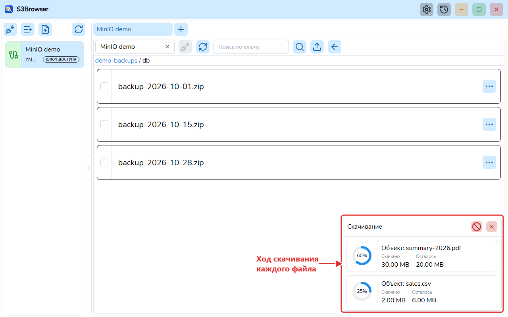

Нажмите кнопку с часами вверху справа, чтобы открыть **История скачиваний**: каждое скачивание с размером, временем, статусом и путём назначения.

### 9.3 Выбор нескольких объектов

Отметьте флажки в начале строк. На панели инструментов появятся **Снять выделение**, **Скачать выбранное** и **Удалить выбранное**. Для скачивания или удаления можно выбрать не более 5 объектов за раз.

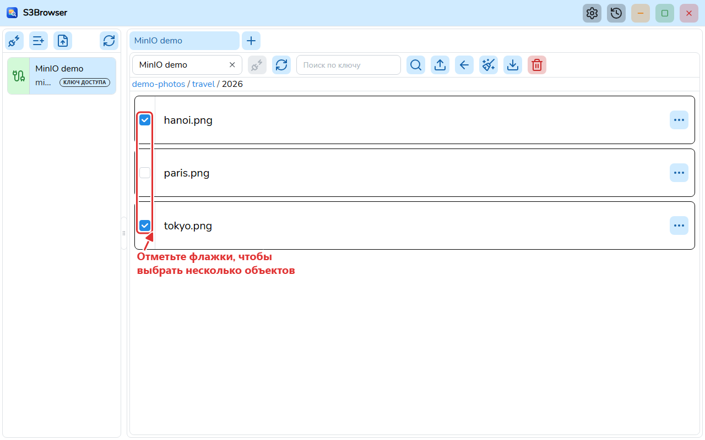

### 9.4 Удаление

Откройте меню **Другие действия** объекта и выберите **Удалить** либо выберите объекты и нажмите **Удалить выбранное**. В окне подтверждения показано, что будет удалено; нажмите **Удалить (n)** для подтверждения, где n — число выбранных элементов.

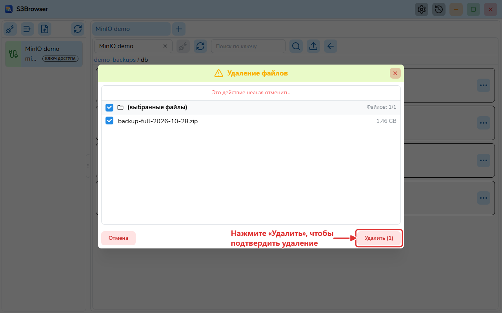

Удаление **папки** удаляет папку **и всё её содержимое**. В окне подтверждения об этом сказано, и это действие нельзя отменить. Если какие-то объекты не удалось удалить, в сообщении указано, сколько не удалось удалить и сколько удалено.

## 10. Настройки и обновления

### 10.1 Настройки

Нажмите кнопку **Настройки** (значок шестерёнки) вверху справа, слева от кнопки истории скачиваний.

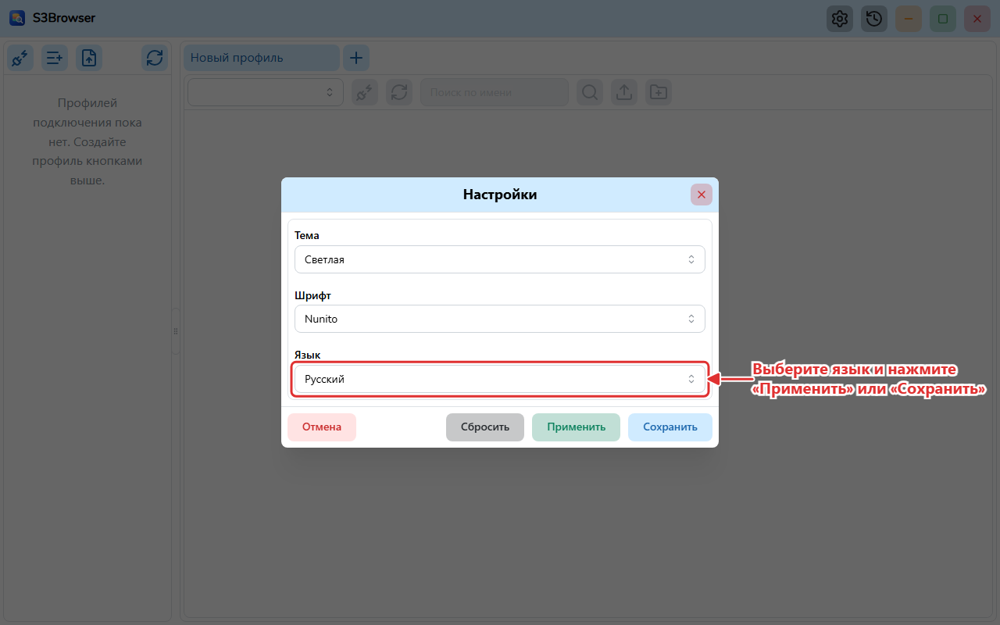

- **Тема**: Светлая, Тёмная или Как в системе.
- **Шрифт**: Nunito, Системный, Segoe UI, Arial, Roboto, Be Vietnam Pro, Verdana, Meiryo UI, Моноширинный или JetBrains Mono.
- **Язык**: English, Tiếng Việt, 日本語, 简体中文, 繁體中文, Русский или Deutsch. Меняется весь интерфейс, включая сообщения.
- **Запускать при старте Windows**: запускает S3Browser при входе в Windows. Показывается только в установленной версии для Windows (не в портативной).
- **Автоматически проверять и скачивать обновления** и **Получать бета-версии (предварительные выпуски)**: см. [Обновления](#102-обновления). Эти два переключателя действуют сразу после переключения, без **Применить** или **Сохранить**; после перезапуска приложения они сохраняются только через **Сохранить**.

Каждое изменение сразу показывается для предварительного просмотра. Затем выберите:

- **Сохранить**: сохранить настройки, в том числе после перезапуска приложения.
- **Применить**: сохранить настройки до закрытия приложения, включая два переключателя обновлений; диалог остаётся открытым. «Запускать при старте Windows» кнопкой «Применить» не меняется.
- **Отмена**: отменить изменения, сделанные после последнего «Применить» или «Сохранить», включая два переключателя обновлений. Диалог закрывается.
- **Сбросить**: вернуть форму к значениям по умолчанию (Светлая, Nunito, English, выключено). Нажмите **Сохранить**, чтобы сохранить их.

Если закрыть окно кнопкой **X**, клавишей Esc или щелчком вне окна, пока есть изменения, которые не сохранены и не применены, появится предупреждение **Настройки не сохранены** («Есть настройки, которые не сохранены и не применены. Что сделать?»): **Назад** оставляет окно открытым с вашими изменениями, **Отменить изменения** отменяет их и закрывает окно, **Сохранить** сохраняет их (если сохранить не удалось, окно остаётся открытым). Если изменений нет, окно просто закрывается.

Настройки загружаются при запуске приложения, до появления содержимого окна.

### 10.2 Обновления

Установленная версия может обновляться самостоятельно через GitHub Releases. В окне настроек там показан раздел **Обновление**; портативная версия самостоятельно не обновляется.

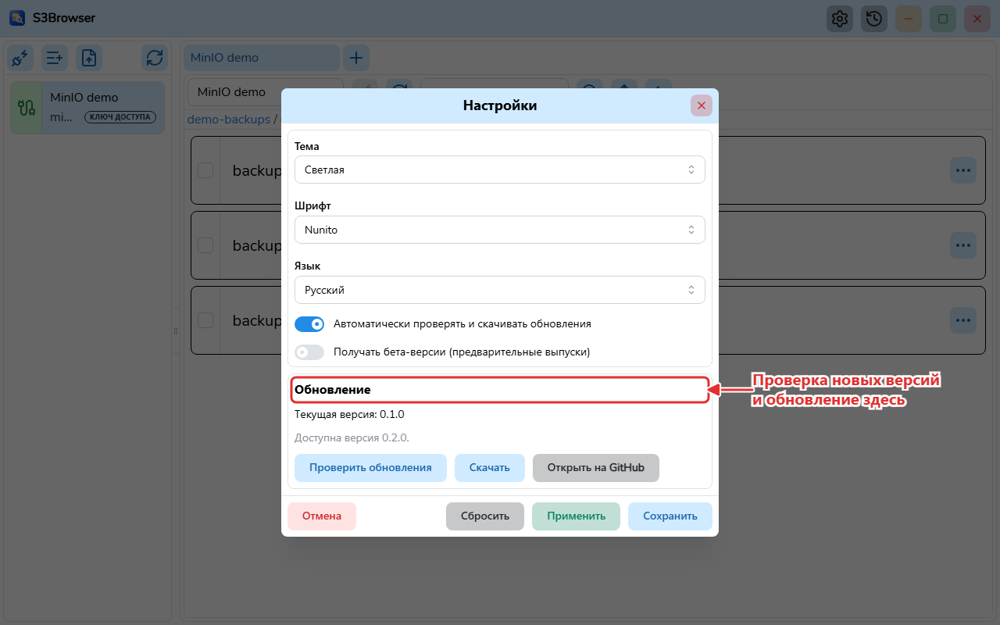

- **Автоматически проверять и скачивать обновления**: если включено, приложение проверяет наличие новой версии и скачивает её в фоне.
- **Получать бета-версии (предварительные выпуски)**: также предлагает версии с пометкой Pre-release.
- **Проверить обновления** выполняет проверку сразу. Строка под **Текущая версия** сообщает результат (например, **Доступна версия ....** или **У вас последняя версия.**).
- **Скачать** скачивает новую версию, **Обновить сейчас** устанавливает её после скачивания, а **Открыть на GitHub** открывает страницу выпуска.

Когда доступна новая версия, уведомление вверху окна предлагает **Скачать**; во время скачивания оно показывает ход выполнения, а по завершении предлагает **Обновить**. Скачанный файл проверяется перед установкой.

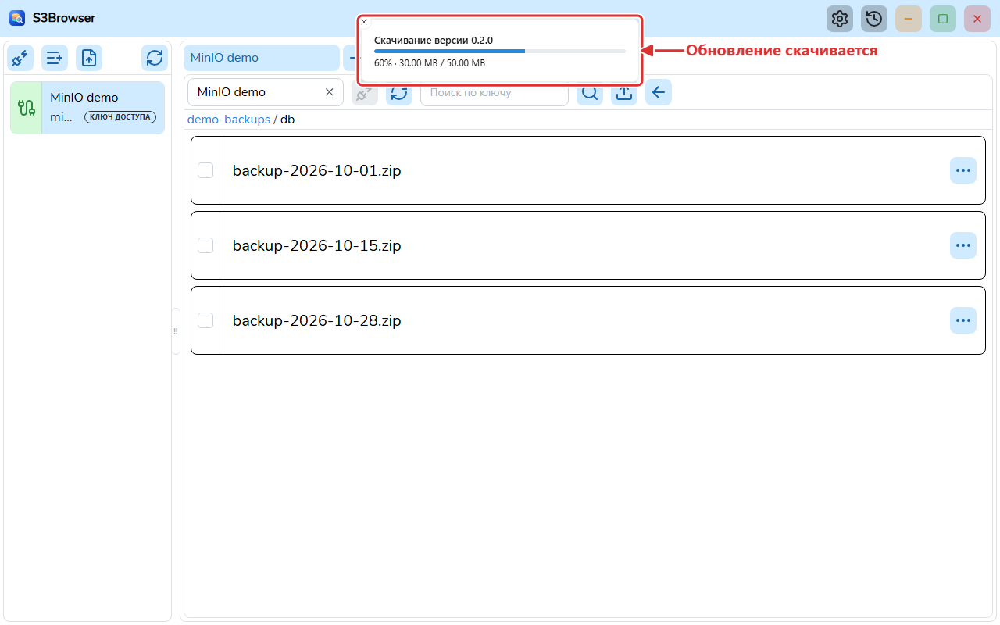

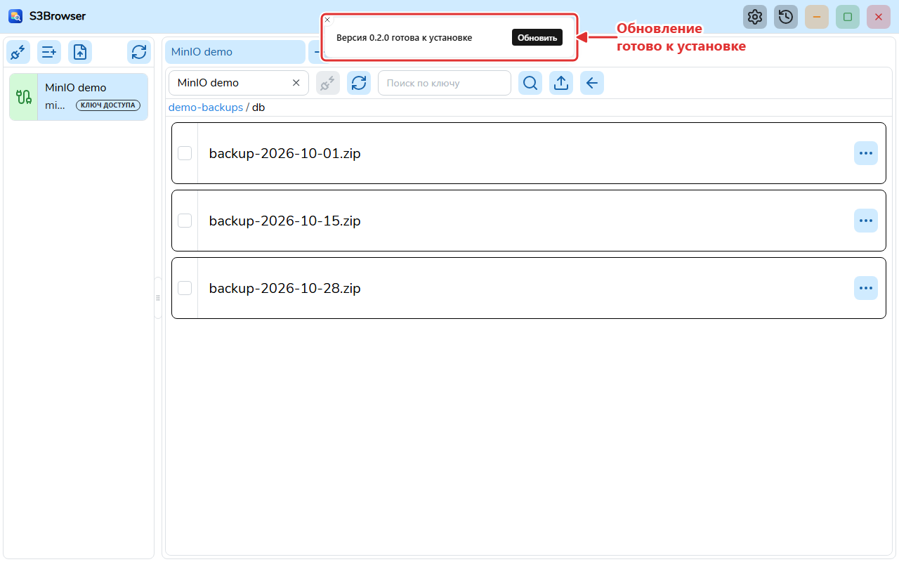

Настоящее обновление нельзя показать на снимке экрана: на рисунках выше уведомление показано с условными значениями.

## 11. Устранение неполадок

Сообщения появляются вверху окна. Ниже приведены те, которые вы можете встретить чаще всего.

| Сообщение | Причина и что делать |
| --- | --- |
| Ключ доступа или секретный ключ недействителен для этой конечной точки. | Ключи неверны или относятся к другому серверу. Проверьте их в профиле и используйте **Проверить подключение**. |
| Время ожидания ответа от конечной точки истекло, проверьте адрес и запущен ли сервер. | Конечная точка неверна, сервер остановлен либо доступ блокирует брандмауэр или сеть. Проверьте адрес (с `http://` или `https://`) и порт. |
| Конечная точка отклонила запрос. / Ошибка при подключении к бакету S3. | Сервер ответил, но отклонил подключение. Проверьте конечную точку, регион и **Path style** (нужен для MinIO). |
| Профиль {name} не подключён. | Подключение было закрыто. Подключите профиль снова. |
| Ошибка получения списка бакетов / Ошибка получения списка объектов | Возможно, учётной записи не разрешено получать список бакетов или данного бакета, либо соединение потеряно. Проверьте права ключей и подключитесь заново. |
| Доступ к бакету ограничен. | Ваша учётная запись не может получить список всех бакетов. Запросите недостающее разрешение или откройте бакет, которым вам разрешено пользоваться. |
| Выполняется другая загрузка, дождитесь её завершения. | Одновременно выполняется только одна загрузка. Дождитесь её или отмените её в окне **Загрузка**. |
| В папке ... более 50 файлов для загрузки. / Одновременно можно загрузить не более 1000 файлов. | См. ограничения в разделе 9.1. Разделите загрузку или выберите меньше файлов. |
| У профиля [{name}] есть незавершённые загрузки или скачивания, удаление невозможно. | Дождитесь завершения передач или отмените их, затем удалите профиль. |
| Сначала отключитесь! | Отключите профиль (правая кнопка мыши, **Отключиться**) перед его изменением или удалением. |
| Можно выбрать не более 5 элементов! | Выберите не более 5 объектов для скачивания или удаления. |
| Путь назначения ... не существует. | Папка, выбранная для скачивания, недоступна. Выберите другое расположение. |

Если сообщения нет в этом списке, оно содержит название операции и причину, сообщённую сервером. Эта причина (например, `AccessDenied` или `NoSuchBucket`) — собственное сообщение S3, и она подсказывает, что нужно исправить на стороне сервера.

Снимки экрана двух ошибок подключения ниже сделаны с помощью **Проверить подключение**.

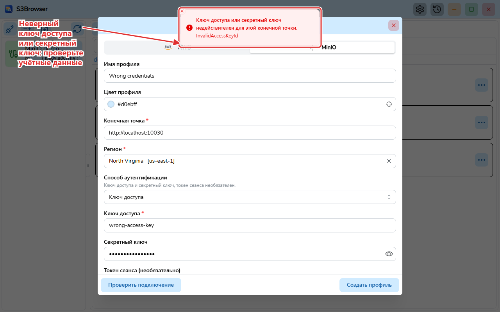

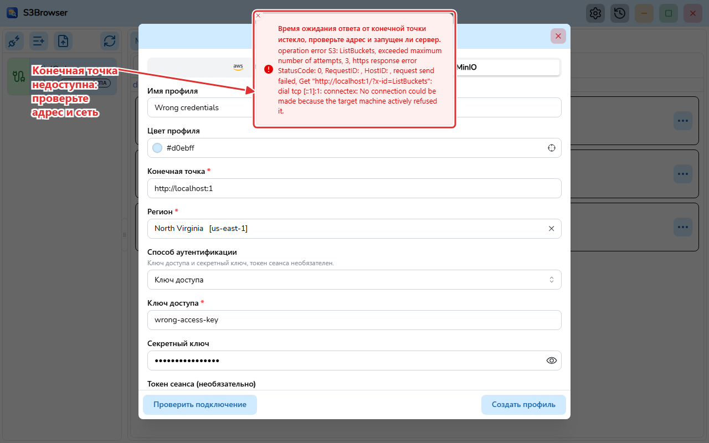
