# Hướng dẫn sử dụng S3 Browser

Phiên bản 0.0.1-beta.1

## 1. Giới thiệu

S3 Browser là ứng dụng máy tính để duyệt và quản lý bucket, object trên **AWS S3** và các máy chủ tương thích S3 như **MinIO**. Với ứng dụng, bạn có thể:

- lưu hồ sơ kết nối và kết nối đồng thời nhiều tài khoản (mỗi kết nối một tab);
- đăng nhập bằng access key, assume role, AWS SSO, MinIO STS, LDAP, OpenID Connect (OIDC) hoặc chứng chỉ client;
- duyệt bucket, thư mục, object và tìm kiếm;
- tạo, xem chi tiết, đổi quyền và xóa bucket;
- xem chi tiết một object;
- tải file và thư mục lên (kéo thả hoặc qua hộp thoại), có cửa sổ tiến độ theo thời gian thực;
- tải object xuống và xem lịch sử tải xuống;
- xóa object và cả thư mục;
- cập nhật ứng dụng từ GitHub Releases.

Giao diện có tiếng Anh, tiếng Việt, tiếng Nhật, tiếng Trung giản thể, tiếng Trung phồn thể, tiếng Nga và tiếng Đức.

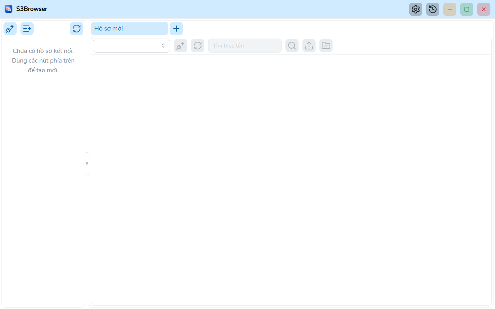

Cửa sổ gồm ba khu vực: **danh sách hồ sơ** bên trái, **các tab** bên phải (mỗi tab hiển thị bucket và object của một kết nối) và **thanh trên cùng** có nút **Cài đặt** và nút lịch sử tải xuống.

> Đây là bản beta (0.0.1-beta.1). Hãy sao lưu dữ liệu quan trọng trước khi xóa object: thao tác xóa không thể hoàn tác.

## 2. Cài đặt

Trên Windows có hai cách dùng ứng dụng.

- **Bản cài đặt**: tải `S3Browser-<phiên bản>-windows-amd64-installer.exe` từ trang [GitHub Releases](https://github.com/TranMinhTruyen/s3-browser/releases), chạy file và làm theo các bước. Bản **Latest** là bản ổn định; các bản đánh dấu **Pre-release** là bản beta. Sau đó mở ứng dụng từ menu Start. Hồ sơ và lịch sử tải xuống được lưu trong thư mục người dùng của bạn. Chỉ bản cài đặt mới tự cập nhật được (xem [Cập nhật](#102-cập-nhật)).
- **Bản portable**: sao chép thư mục portable đến nơi bất kỳ (ví dụ USB) rồi chạy `S3Browser.exe`. Ứng dụng dùng WebView2 trong thư mục `webview2` và lưu dữ liệu trong thư mục `data` cạnh chương trình nên không ghi gì ra nơi khác. Đừng tách thư mục `webview2` và `data` khỏi chương trình.

## 3. Kết nối AWS S3 hoặc MinIO

Bấm nút **Tạo hồ sơ kết nối** (nút thứ hai phía trên danh sách hồ sơ). Cửa sổ **Hồ sơ kết nối** mở ra.

### 3.1 Form hồ sơ

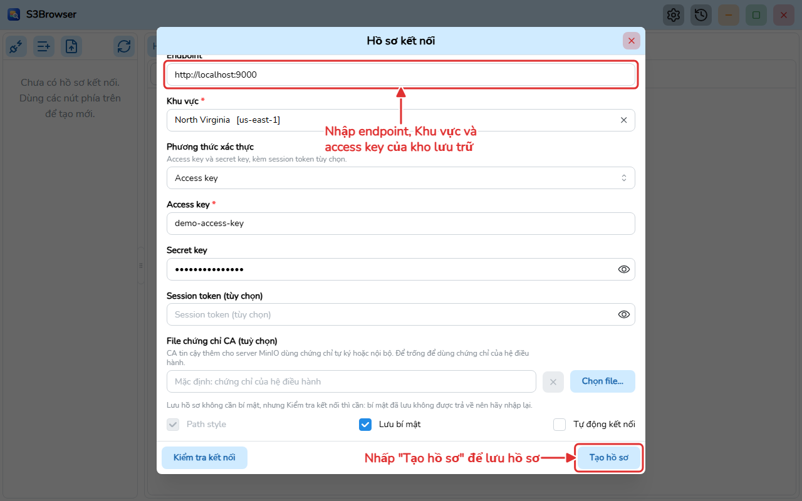

| Trường | Mô tả |
| --- | --- |
| AWS / MinIO | Chọn loại máy chủ. Chọn MinIO sẽ tự bật **Path style**. Danh sách phương thức xác thực phụ thuộc vào lựa chọn này. |
| Tên hồ sơ | Tên hiển thị trong danh sách hồ sơ và trên tab. |
| Màu hồ sơ | Màu của hồ sơ trong danh sách. |
| Endpoint | Địa chỉ máy chủ, ví dụ `https://s3.amazonaws.com` hoặc `http://localhost:9000`. |
| Khu vực | Khu vực của tài khoản, ví dụ `North Virginia [us-east-1]`. Bắt buộc, trừ một số phương thức lấy khu vực từ cấu hình AWS. |
| Phương thức xác thực | Cách ứng dụng đăng nhập (xem [Các phương thức xác thực](#32-các-phương-thức-xác-thực)). Các trường bên dưới thay đổi theo phương thức. |
| Access key | Access key của tài khoản. |
| Secret key | Secret key của tài khoản. Bấm biểu tượng con mắt để hiện. |
| Session token (tùy chọn) | Session token của thông tin xác thực tạm thời. |
| File chứng chỉ CA (tuỳ chọn) | Xem [Chứng chỉ CA cho MinIO](#33-chứng-chỉ-ca-cho-minio). |
| Path style | Truy cập bucket dạng `endpoint/bucket` thay vì `bucket.endpoint`. MinIO và hầu hết máy chủ tự dựng cần bật. |
| Lưu bí mật | Lưu các bí mật (đã mã hóa) trong hồ sơ. Nếu không chọn, bạn phải nhập lại mỗi lần kết nối. |
| Tự động kết nối | Tự kết nối hồ sơ khi mở ứng dụng. Chỉ dùng được khi đã chọn **Lưu bí mật**, và không dùng được với phương thức cần nhập thông tin mỗi lần kết nối (ví dụ OIDC hoặc mã MFA). |

Hai nút ở cuối cửa sổ:

- **Kiểm tra kết nối** kiểm tra các giá trị mà không lưu gì. Bí mật đã lưu không bao giờ được hiển thị lại, nên hãy nhập lại khi kiểm tra. Thông báo màu xanh cho biết kết nối thành công; thông báo màu đỏ giải thích vấn đề (xem [Xử lý sự cố](#11-xử-lý-sự-cố)).
- **Tạo hồ sơ** lưu hồ sơ (khi mở cửa sổ từ một hồ sơ có sẵn, nút này là **Cập nhật hồ sơ**).

> Không chia sẻ ảnh chụp có lộ secret key. Các trường khóa trong tài liệu này chỉ chứa giá trị mẫu.

### 3.2 Các phương thức xác thực

Chọn phương thức ở ô **Phương thức xác thực**. Danh sách phụ thuộc vào loại máy chủ.

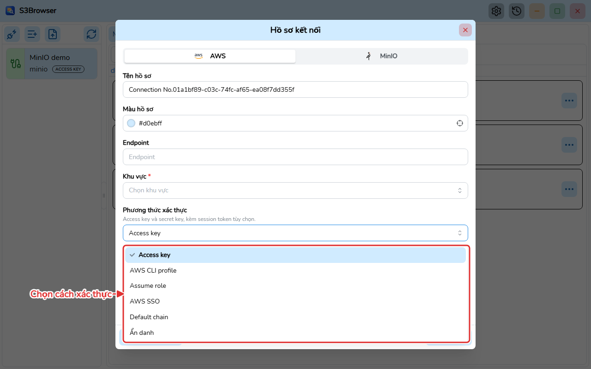

| Phương thức | Máy chủ | Cần nhập |
| --- | --- | --- |
| Access key | AWS, MinIO | Access key, secret key và session token tùy chọn. |
| AWS CLI profile | AWS | Một profile trong các file của AWS CLI (`~/.aws`), kèm đường dẫn tùy chọn của **Tệp cấu hình AWS** và **Tệp credentials AWS** (mặc định: `~/.aws/config`, `~/.aws/credentials`). |
| Assume role | AWS | **Role ARN**, thông tin xác thực dùng để assume role (**Access key** hoặc **AWS CLI profile**) và tùy chọn **External ID**, **Tên phiên**, **Thời hạn (giây)**, **Serial thiết bị MFA (tùy chọn)**. **Mã MFA** được hỏi khi kết nối và không bao giờ được lưu. |
| AWS SSO | AWS | Một AWS CLI profile đã đăng nhập. Hãy chạy `aws sso login --profile <profile>` trước. |
| Default chain | AWS | Không cần nhập: dùng thông tin xác thực tìm thấy trong môi trường (biến môi trường, file dùng chung hoặc role của instance). |
| Ẩn danh | AWS, MinIO | Chỉ cần tên các bucket công khai cần mở (người dùng ẩn danh không liệt kê được bucket). |
| MinIO STS | MinIO | Access key, secret key và tùy chọn **Role ARN (tuỳ chọn)**, **Thời hạn (giây, tùy chọn)**, **Policy nội tuyến (JSON, tùy chọn)**. |
| LDAP | MinIO | **Tên đăng nhập LDAP** và **Mật khẩu LDAP**, tùy chọn **Thời hạn (giây, tùy chọn)** và **Policy nội tuyến (JSON, tùy chọn)**. |
| OIDC | MinIO | **Client ID**, **Issuer URL**, **Scope (tuỳ chọn)** và **Cổng callback**. |
| Chứng chỉ client | MinIO | **File chứng chỉ client** và **File private key**; chọn **Private key có mật khẩu** nếu cần. Endpoint phải dùng `https://`. |

Các phương thức cần thêm trường được minh họa dưới đây (giá trị chỉ là mẫu).

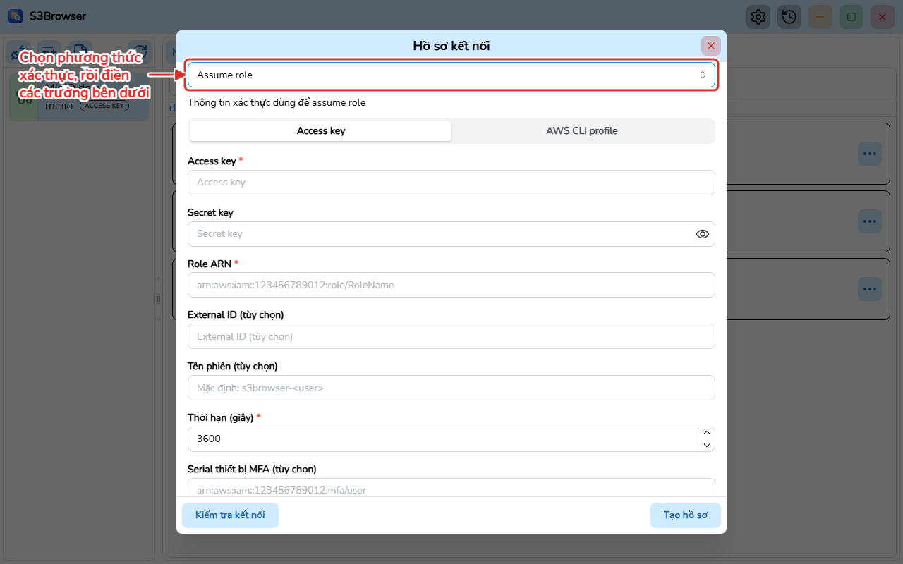

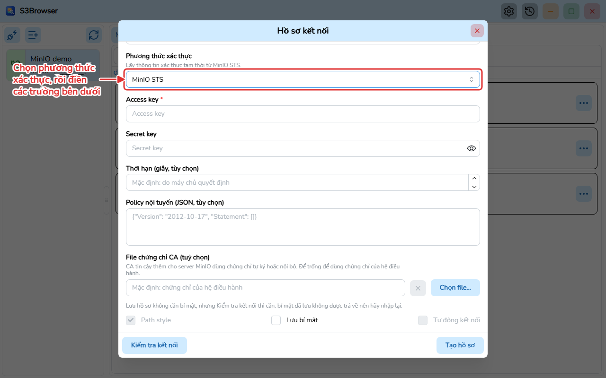

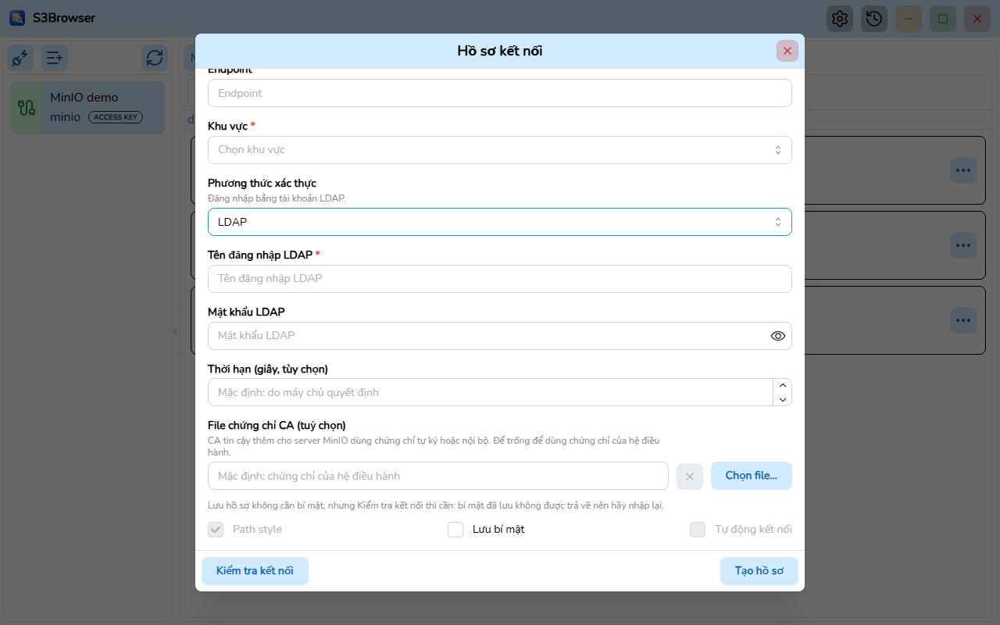

**OIDC.** Sao chép **Redirect URI** hiển thị trong form (nút **Sao chép**) và đăng ký làm redirect URI của client trong nhà cung cấp danh tính. Bấm **Đăng nhập**: trình duyệt web mở ra và bạn đăng nhập ở đó. Form hiển thị **Đang chờ đăng nhập trên trình duyệt...** rồi **Đã đăng nhập, còn hiệu lực đến ...**; **Huỷ đăng nhập** dừng việc chờ. Phiên đăng nhập chỉ dùng một lần và không được lưu. Khi hết hạn, form báo **Phiên đăng nhập đã hết hạn, hãy đăng nhập lại**. Không thể chụp ảnh cửa sổ trình duyệt.

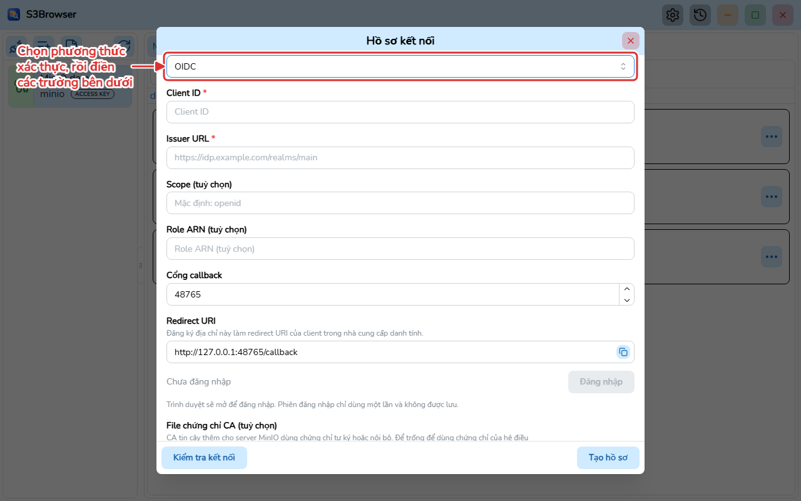

**Chứng chỉ client.** Bấm **Chọn file...** cạnh ô file và chọn file trong hộp thoại của hệ thống (không thể chụp ảnh hộp thoại này); **Xoá file** làm trống ô. File chỉ được đọc khi kết nối và nội dung không được lưu.

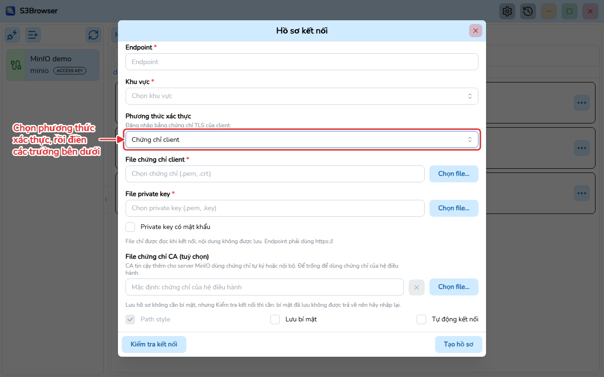

Một số thông tin xác thực sẽ hết hạn. Trước đó ít lâu, ứng dụng yêu cầu bạn gia hạn: bằng mã MFA (assume role), bằng cách đăng nhập lại (OIDC, SSO), hoặc ngắt kết nối rồi kết nối lại.

### 3.3 Chứng chỉ CA cho MinIO

Máy chủ MinIO dùng chứng chỉ tự ký hoặc chứng chỉ nội bộ cần thêm một CA tin cậy. Ở ô **File chứng chỉ CA (tuỳ chọn)**, bấm **Chọn file...** và chọn chứng chỉ CA (`.pem` hoặc `.crt`). Để trống để dùng chứng chỉ của hệ điều hành. File này chỉ áp dụng cho kết nối tới MinIO, không áp dụng cho nhà cung cấp danh tính OIDC.

## 4. Quản lý hồ sơ

Sau khi tạo, hồ sơ xuất hiện trong danh sách hồ sơ.

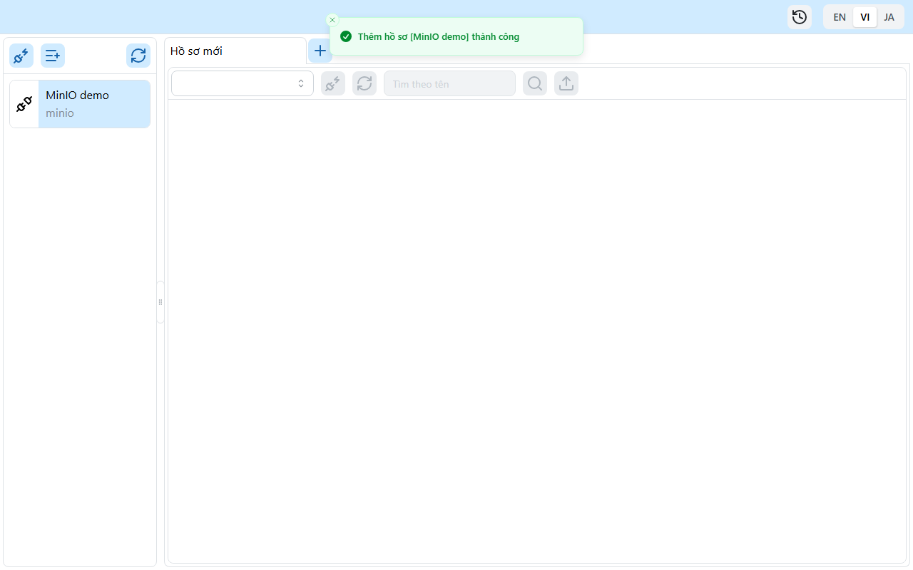

Bấm chuột phải vào hồ sơ để mở menu.

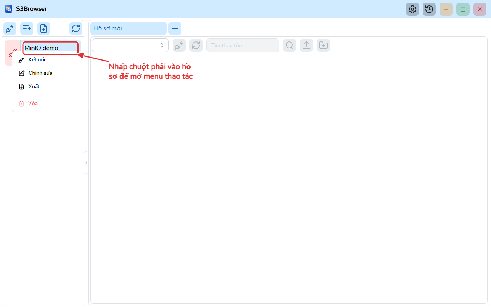

- **Kết nối**: mở kết nối. Hồ sơ đang kết nối có biểu tượng màu xanh lá.
- **Ngắt kết nối**: đóng kết nối. Cần ngắt kết nối trước khi chỉnh sửa hoặc xóa hồ sơ.
- **Chỉnh sửa**: sửa hồ sơ (tiêu đề cửa sổ vẫn là **Hồ sơ kết nối**, nút là **Cập nhật hồ sơ**). Bạn được yêu cầu xác nhận việc cập nhật.
- **Xuất**: lưu hồ sơ ra tệp JSON; xem [4.1 Xuất hồ sơ](#41-xuất-hồ-sơ).
- **Xóa**: xóa hồ sơ sau khi bạn xác nhận.

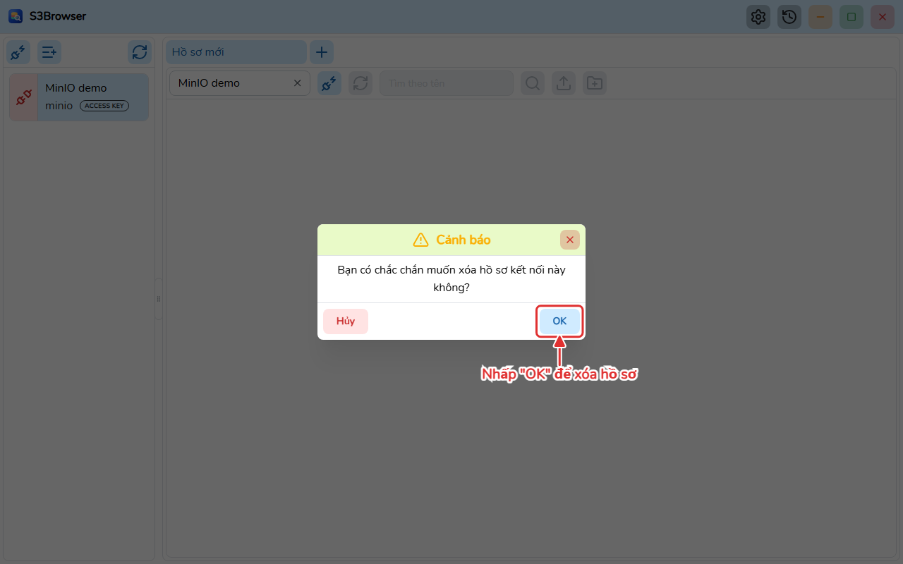

Hồ sơ đang có tác vụ tải lên hoặc tải xuống thì không thể xóa. Hãy chờ các tác vụ kết thúc hoặc hủy chúng trước.

Nút đầu tiên phía trên danh sách (**Kết nối**) mở cùng cửa sổ này nhưng có nút **Kết nối**, dùng để kết nối một lần mà không lưu hồ sơ; nút **Làm mới danh sách hồ sơ kết nối** tải lại danh sách.

### 4.1 Xuất hồ sơ

Xuất sao chép hồ sơ ra một tệp, ví dụ để dùng trên máy tính khác. Bấm chuột phải vào hồ sơ rồi chọn **Xuất**.

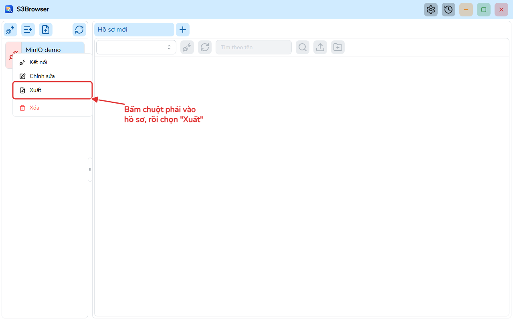

Cửa sổ **Xuất hồ sơ** mở ra.

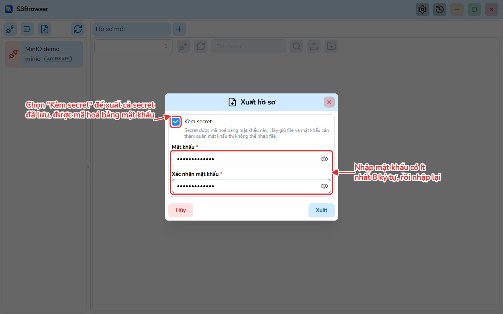

- Để **Kèm secret** ở trạng thái tắt để xuất hồ sơ không kèm secret (secret key, session token, mật khẩu LDAP, cụm mật khẩu của khóa). Trước khi tiếp tục, ứng dụng cảnh báo nếu hồ sơ có secret đã lưu: "Profile [tên] có secret đã lưu sẽ KHÔNG được xuất. Sau khi nhập, bạn cần nhập lại chúng. Xuất không kèm secret?" Xác nhận để xuất, hoặc hủy để quay lại. Sau khi nhập hồ sơ, hãy chỉnh sửa hồ sơ và nhập lại secret.
- Chọn **Kèm secret** để xuất cả secret đã lưu. Nhập **Mật khẩu** có ít nhất 8 ký tự và nhập lại vào **Xác nhận mật khẩu**. Secret được mã hóa bằng mật khẩu này (PBKDF2 và AES-GCM): chúng không bao giờ được ghi vào tệp dưới dạng văn bản thường. Tùy chọn này bị tắt ("Hồ sơ này không lưu secret nào.") khi hồ sơ không có secret đã lưu.

Bấm **Xuất**. Hộp thoại lưu tệp của Windows mở ra với tên tệp gợi ý lấy từ tên hồ sơ: chỉ gồm chữ thường, chữ số và dấu gạch dưới, ví dụ `minio_demo.json`. Chọn nơi lưu tệp. Khi tệp được ghi xong, một thông báo cho bạn biết. Nếu đóng hộp thoại lưu, không có gì được ghi và cửa sổ **Xuất hồ sơ** vẫn mở.

Tệp chứa các thiết lập kết nối của hồ sơ (tên, màu, nhà cung cấp, endpoint, region, access key, path style, tự động kết nối, phương thức xác thực và các tùy chọn của nó), không chứa dữ liệu nội bộ như ID hay ngày giờ của hồ sơ. Chỉ đường dẫn của tệp chứng chỉ và khóa được xuất, không xuất chính các tệp đó.

Hãy giữ tệp và mật khẩu cẩn thận. Mật khẩu không được lưu ở đâu cả: quên mật khẩu thì không thể nhập tệp. Đừng sửa tay tệp có chứa secret. Nếu nhà cung cấp, endpoint hoặc phương thức xác thực bị đổi, việc nhập tệp sẽ lỗi với thông báo "Sai mật khẩu hoặc tệp bị hỏng."

### 4.2 Nhập hồ sơ

Bấm nút **Nhập hồ sơ kết nối** (cạnh nút **Tạo hồ sơ kết nối**, phía trên danh sách hồ sơ).

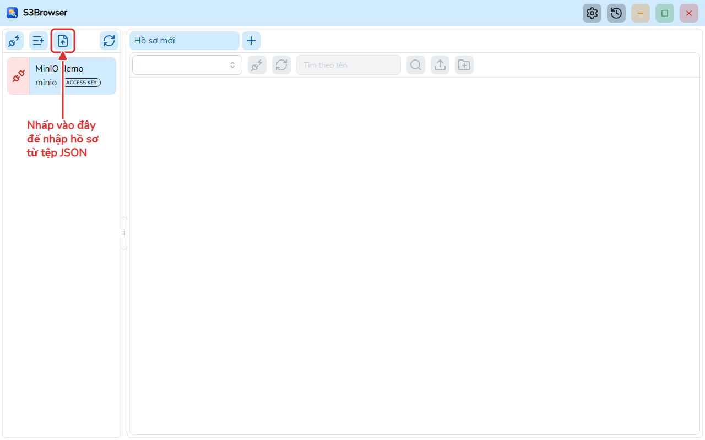

Hộp thoại mở tệp của Windows xuất hiện: chọn tệp `.json` do S3Browser xuất (tối đa 1 MiB). Ứng dụng kiểm tra tệp trước khi lưu bất cứ thứ gì. Ví dụ, "Tệp không phải là tệp hồ sơ S3Browser hợp lệ." nghĩa là tệp không phải hồ sơ do S3Browser xuất; cũng có thông báo khi phiên bản của tệp không được hỗ trợ hoặc tệp quá lớn.

- Tệp xuất không kèm secret được nhập ngay.
- Tệp xuất kèm secret sẽ mở cửa sổ **Nhập hồ sơ**: nhập mật khẩu đã dùng khi xuất tệp, rồi bấm **Nhập**.

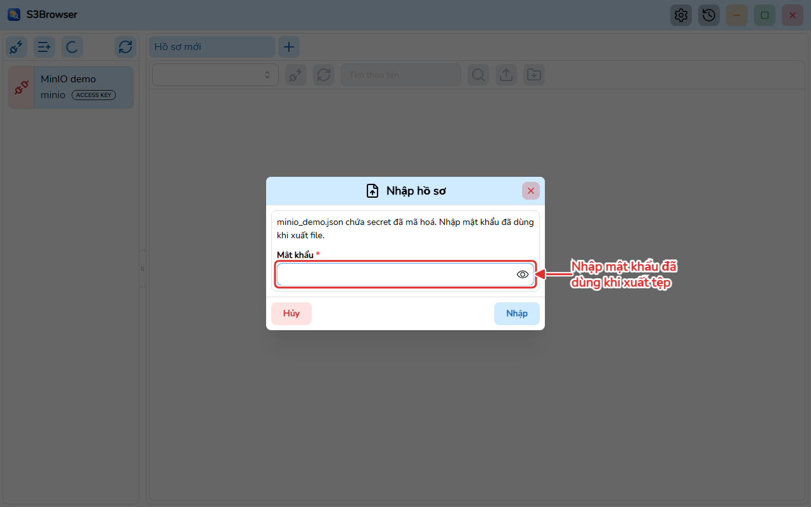

Nếu mật khẩu sai, thông báo "Sai mật khẩu hoặc tệp bị hỏng." xuất hiện và cửa sổ vẫn mở để bạn nhập lại mật khẩu hoặc bấm **Hủy**. Không có gì được lưu cho tới khi mật khẩu đúng.

Hồ sơ được nhập sẽ thêm vào danh sách như một hồ sơ mới:

- Nếu đã có hồ sơ cùng tên, hồ sơ mới được đặt tên kèm số: **tên (2)**, **tên (3)**, v.v.
- Đường dẫn bị để trống khi tệp không tồn tại trên máy tính này, hoặc khi đó là đường dẫn mạng hay thiết bị (như `\\host\share`, `\\?\` hay `\\.\`), kể cả khi đường dẫn đó tồn tại. Điều này áp dụng cho chứng chỉ CA, chứng chỉ và khóa riêng của phương thức **Chứng chỉ client**, cùng tệp config và credentials của AWS. Một cảnh báo liệt kê các trường đó: "Đã nhập hồ sơ [tên]. Các đường dẫn tệp sau không tồn tại trên máy này và đã được xóa trống: {fields}." Hãy chỉnh sửa hồ sơ và chọn lại các tệp trước khi kết nối.
- Việc nhập không tự kết nối hồ sơ, kể cả khi tệp bật tự động kết nối; tự động kết nối có hiệu lực từ lần khởi động ứng dụng sau.
- Hồ sơ xuất không kèm secret thì không có secret: hãy chỉnh sửa và nhập chúng.

Hộp thoại lưu và mở tệp của Windows không thể hiện trong ảnh chụp màn hình. Ảnh của cửa sổ **Nhập hồ sơ** cho thấy cửa sổ mở ra với một tệp mẫu.

## 5. Duyệt bucket và object

Mỗi tab làm việc với một hồ sơ. Để dùng hồ sơ trong tab, chọn nó ở ô chọn phía trên bên trái của tab, rồi bấm nút **Kết nối** bên cạnh (nếu hồ sơ chưa kết nối). Bấm nút **+** (**Thêm tab**) để mở thêm tab, ví dụ cho tài khoản thứ hai. Kéo một tab để đổi vị trí (hoặc nhấn Ctrl+Shift+Trái/Phải); các tab đang mở được ghi nhớ cho lần mở ứng dụng sau.

Danh sách bucket được hiển thị:

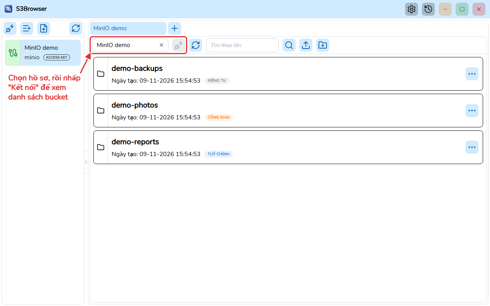

Bấm vào bucket để xem các object. Thư mục hiển thị trước; bấm vào thư mục để mở. Đường dẫn phía trên danh sách (ví dụ `demo-photos / travel / 2026`) có thể bấm được, và nút mũi tên quay lại một cấp (về thư mục cha, hoặc về danh sách bucket khi đang ở gốc của bucket).

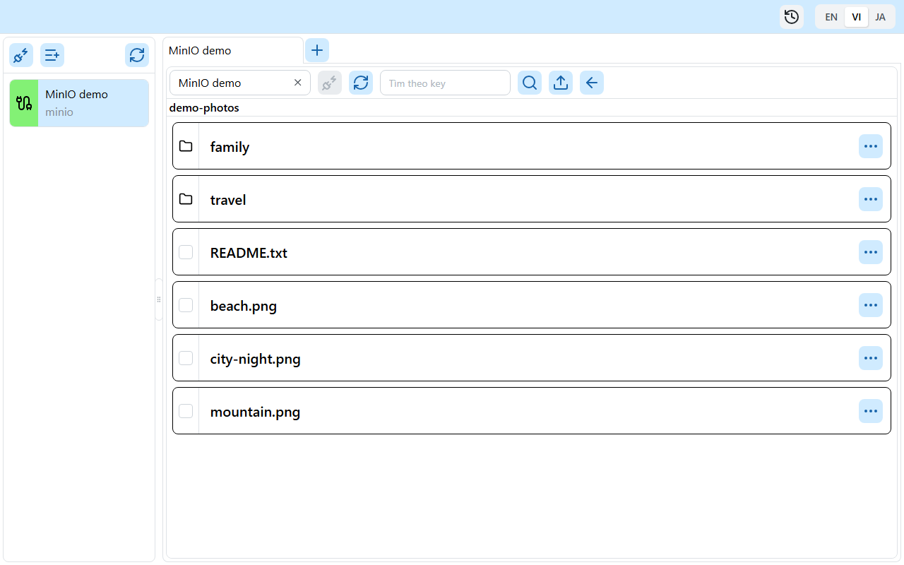

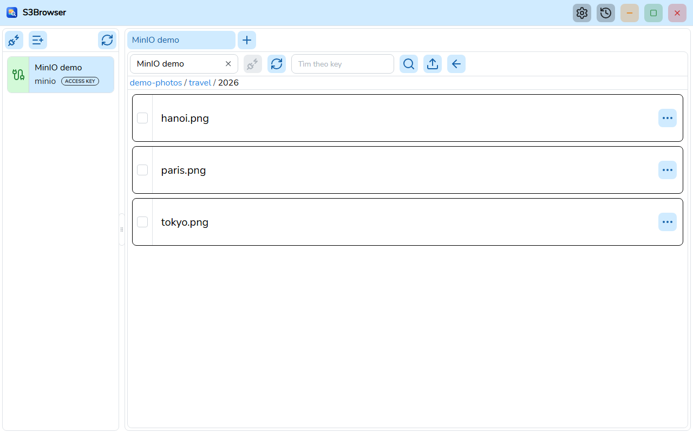

Bucket lớn được tải theo từng trang; thêm object được tải tự động khi bạn cuộn xuống. Dùng nút làm mới (**Làm mới danh sách object** hoặc **Làm mới danh sách bucket**) để tải lại màn hình hiện tại.

## 6. Tìm kiếm

Nhập vào ô tìm kiếm phía trên danh sách rồi nhấn Enter (hoặc bấm biểu tượng kính lúp).

- Ở danh sách bucket, bạn tìm theo **tên**.
- Bên trong bucket, bạn tìm theo **key** (tên các object và thư mục trong thư mục hiện tại có chứa đoạn văn bản; không phân biệt hoa thường và không tìm vào thư mục con).

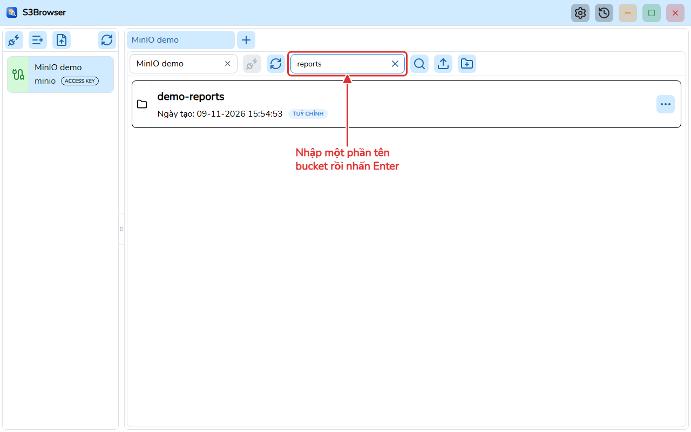

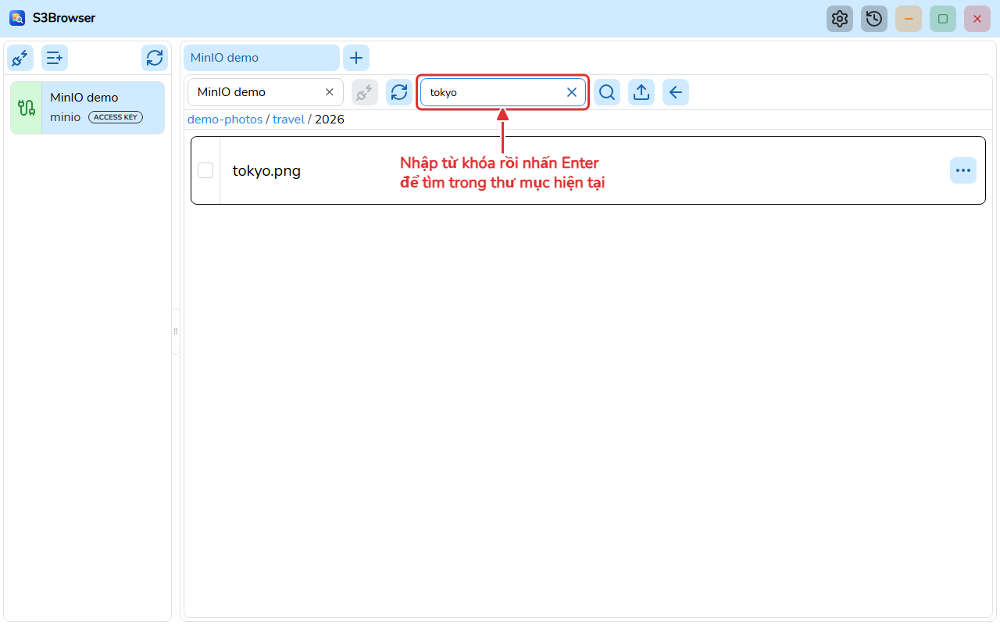

Khi danh sách kết quả kết thúc bằng **Tìm tiếp**, bấm vào để tiếp tục tìm. Dấu **x** trong ô tìm kiếm sẽ xóa tìm kiếm.

## 7. Chi tiết object

Bấm vào một file để mở bảng **Chi tiết đối tượng** bên phải. Bảng hiển thị tên, khóa (key), dung lượng, ngày sửa đổi lần cuối, ETag, loại nội dung, lớp lưu trữ và metadata của object. Các nút sao chép cạnh key và ETag sẽ sao chép giá trị vào clipboard. Nếu không tải được chi tiết, bấm **Thử lại**. Đóng bảng bằng nút **Đóng**.

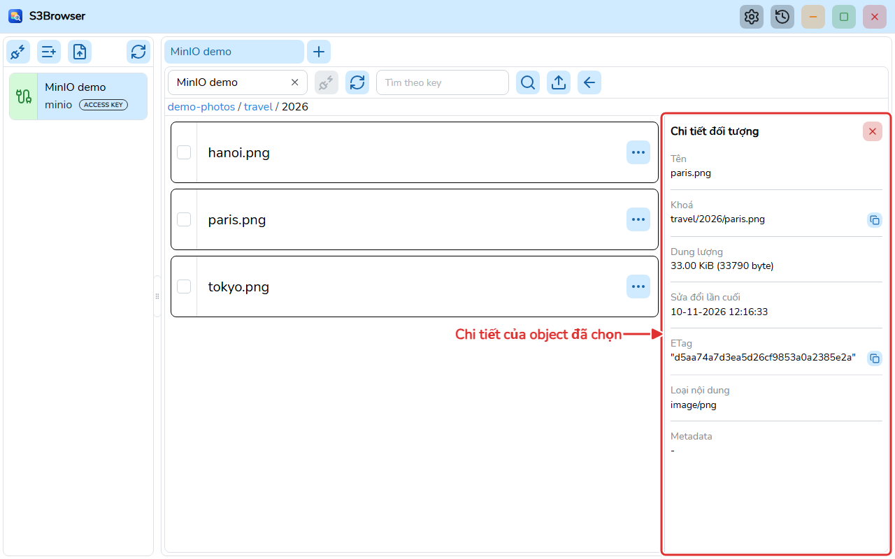

## 8. Quản lý bucket

### 8.1 Badge policy và menu bucket

Mỗi bucket trong danh sách có một badge cho biết loại policy: **Riêng tư** (không có bucket policy), **Công khai** (ai cũng đọc và liệt kê được object) hoặc **Tuỳ chỉnh** (policy tuỳ chỉnh). Rê chuột vào badge để đọc ý nghĩa. Bucket không truy cập được sẽ được đánh dấu.

Mở menu **Thao tác khác** (ba chấm) ở cuối dòng bucket:

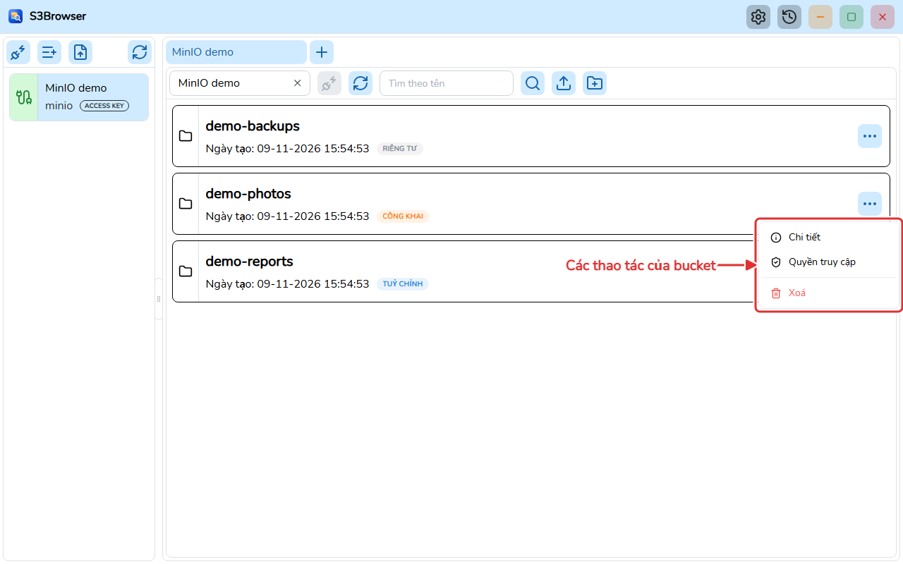

- **Chi tiết**: mở chi tiết bucket.
- **Quyền truy cập**: đổi người được truy cập bucket.
- **Xoá**: xóa bucket.

**Quyền truy cập** và **Xoá** bị ẩn khi tài khoản không được phép dùng; với phương thức **Ẩn danh** chỉ có **Chi tiết**.

### 8.2 Chi tiết bucket

Chọn **Chi tiết** để mở bảng **Chi tiết bucket** bên phải.

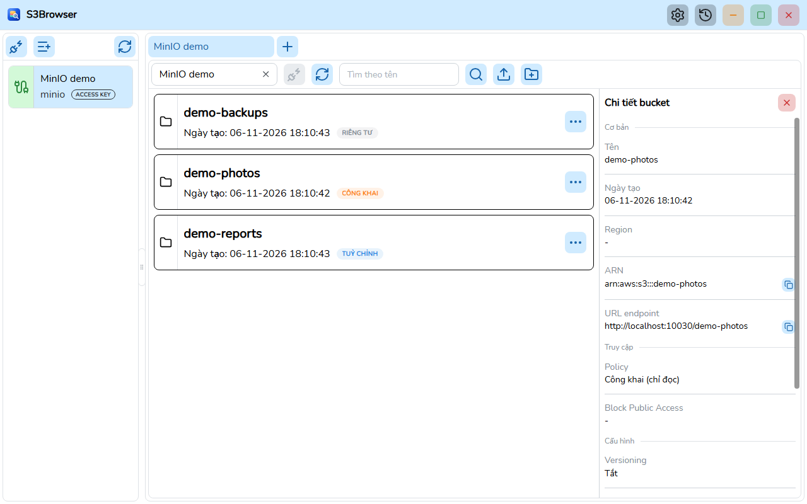

- **Cơ bản**: **Tên**, **Ngày tạo**, **Region**, **ARN** và **URL endpoint**.
- **Truy cập**: **Policy** (**Riêng tư**, **Công khai (chỉ đọc)** hoặc **Tuỳ chỉnh**) và **Block Public Access** (bật hoặc tắt).
- **Cấu hình**: **Versioning**, **Mã hoá mặc định**, **Object lock**, **Tag** và **Object ở gốc**. Số object ở gốc dừng ở 10.000 rồi hiển thị `10,000+`.

Nếu không tải được chi tiết, bấm **Thử lại**. Đóng bảng bằng nút **Đóng**.

### 8.3 Tạo bucket

Bấm nút **Tạo bucket** phía trên danh sách bucket.

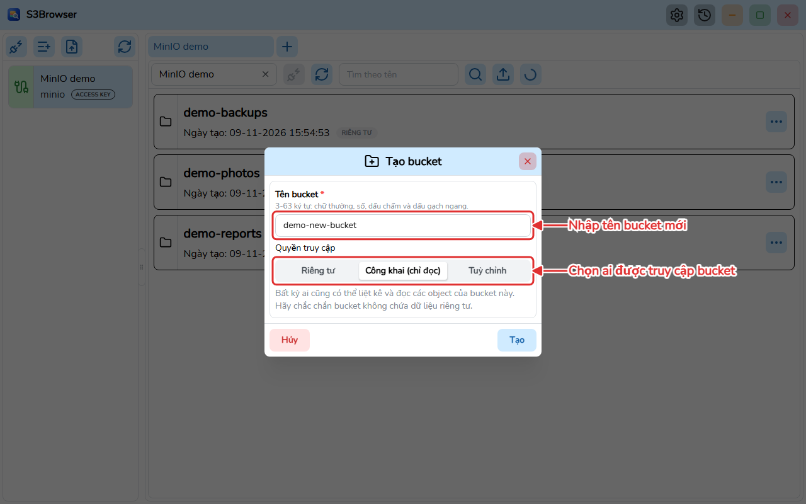

- **Tên bucket**: 3-63 ký tự: chữ thường, số, dấu chấm và dấu gạch ngang.
- **Quyền truy cập**: **Riêng tư**, **Công khai (chỉ đọc)** hoặc **Tuỳ chỉnh** (rồi nhập policy dạng JSON).
- Trên AWS, bucket mới mặc định chặn truy cập công khai nên policy công khai có thể bị từ chối cho tới khi tắt Block Public Access. Bucket vẫn được tạo và một cảnh báo cho biết quyền chưa được áp dụng.
- Trên AWS còn có ô **Khu vực** để chọn khu vực của bucket mới (mặc định là khu vực của hồ sơ); không thể chụp ảnh phần này vì cần tài khoản AWS thật.

Bấm **Tạo**. Danh sách bucket được làm mới.

### 8.4 Đổi quyền truy cập

Chọn **Quyền truy cập** trong menu bucket.

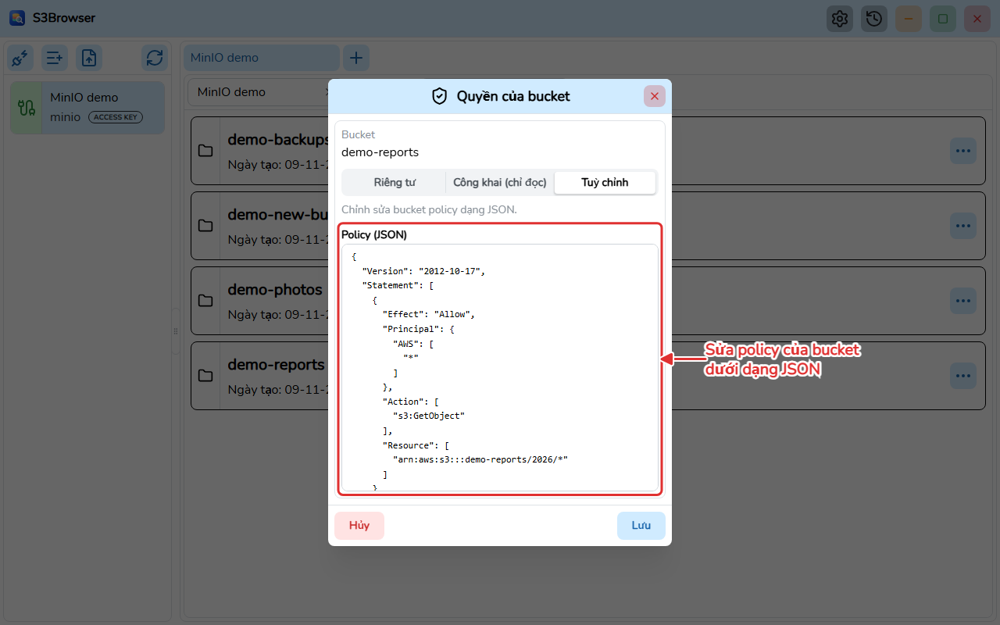

| Chế độ | Ý nghĩa |
| --- | --- |
| Riêng tư | Không có bucket policy. Chỉ người dùng được cấp quyền mới truy cập được bucket này. |
| Công khai (chỉ đọc) | Bất kỳ ai cũng có thể liệt kê và đọc các object của bucket này. Hãy chắc chắn bucket không chứa dữ liệu riêng tư. |
| Tuỳ chỉnh | Chỉnh sửa bucket policy dạng JSON. |

Cửa sổ cảnh báo khi Block Public Access đang bật cho bucket (policy công khai sẽ bị từ chối) hoặc khi tài khoản không được phép đổi quyền. Bấm **Lưu**.

### 8.5 Xóa bucket

Chọn **Xoá** trong menu bucket.

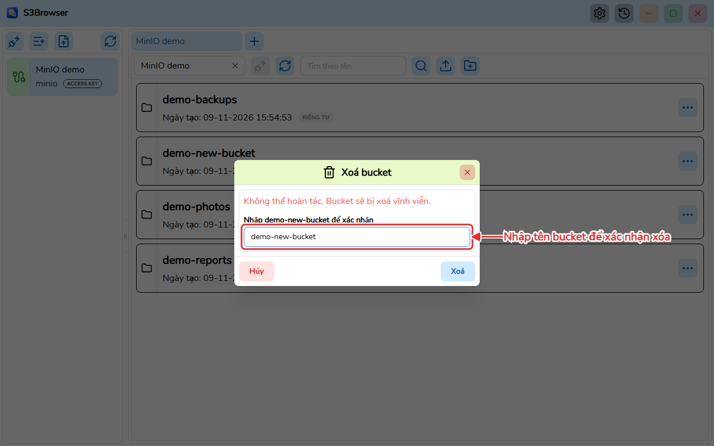

- Nhập tên bucket để xác nhận, rồi bấm **Xoá**.
- Bucket không rỗng sẽ được dọn trước: **toàn bộ object bị xóa** (nếu bật versioning thì mọi version và delete marker cũng bị xóa). Không thể hoàn tác.
- Bucket có Object Lock và không rỗng thì không thể xóa.
- Không thể hủy việc xóa, và không thể đóng cửa sổ cho tới khi xóa xong; với bucket lớn có thể mất nhiều thời gian. Sau đó chỉ tab hiện tại được làm mới.

## 9. Tải lên, tải xuống và xóa object

### 9.1 Tải lên

Có hai cách tải lên thư mục (hoặc bucket) bạn đang xem.

**Kéo thả.** Kéo file và thư mục từ trình quản lý file vào danh sách object. Thả một thư mục sẽ tải toàn bộ file bên trong và giữ nguyên cấu trúc thư mục. Không thể chụp ảnh thao tác kéo thả.

**Hộp thoại tải lên.** Bấm nút **Tải file lên** (mũi tên hướng lên phía trên danh sách). Cửa sổ **Tải file lên** mở ra và hiển thị đích (**Tải lên: ...**).

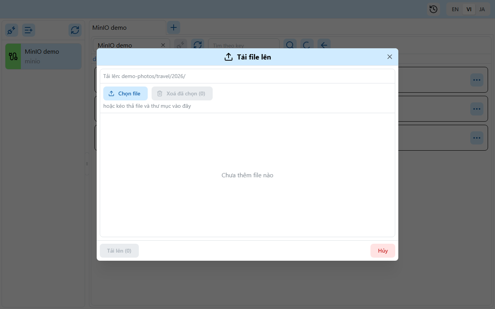

- Bấm **Chọn file** và chọn file trong hộp thoại của hệ thống, hoặc kéo file và thư mục vào cửa sổ.
- Danh sách hiển thị từng file kèm dung lượng. Bỏ chọn một file để không tải file đó, bấm biểu tượng thùng rác để xóa khỏi danh sách, hoặc dùng **Xoá đã chọn**.
- Nếu mở hộp thoại từ danh sách bucket, hãy chọn bucket đích trước.
- Bấm **Tải lên** để bắt đầu.

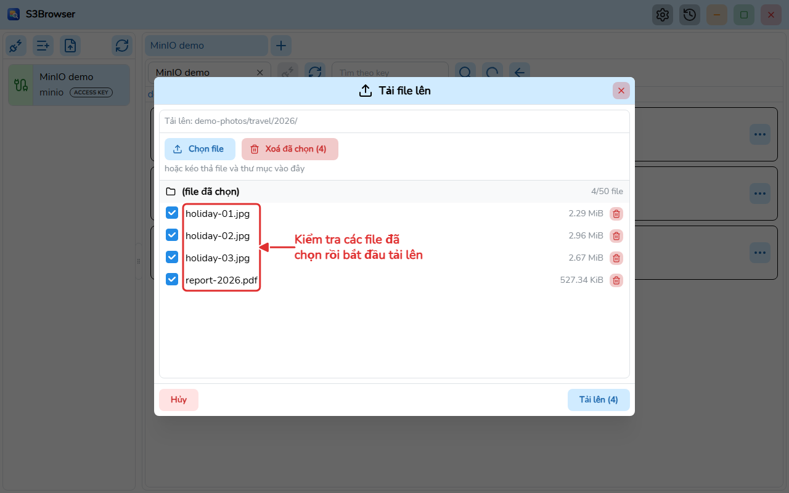

Các giới hạn sau được áp dụng để mỗi lần tải lên dễ kiểm soát:

| Giới hạn | Giá trị |
| --- | --- |
| Số file từ một thư mục trong một lần tải lên | 50 |
| Số file lớn (trên 10 GiB) từ một thư mục | 4 |
| Số file mỗi lần tải lên | 1000 |
| Số lần tải lên cùng lúc | 1 (chờ lần đang chạy kết thúc) |

Khi một thư mục được thả vượt giới hạn, cửa sổ **Chọn file để tải lên** cho phép bạn chọn các file cần tải; thư mục trong giới hạn được tải đầy đủ. Các mục không thể tải lên (file không đọc được, liên kết tượng trưng) bị bỏ qua và bạn được thông báo số lượng.

Cửa sổ **Đang tải lên** xuất hiện ở góc dưới bên phải với tiến độ từng file (vòng phần trăm, **Đã tải lên** và **Còn lại**). Bấm **Hủy** ở một file, hoặc **Huỷ tất cả** ở phía trên để dừng. Có thể đóng cửa sổ và mở lại bằng nút của nó.

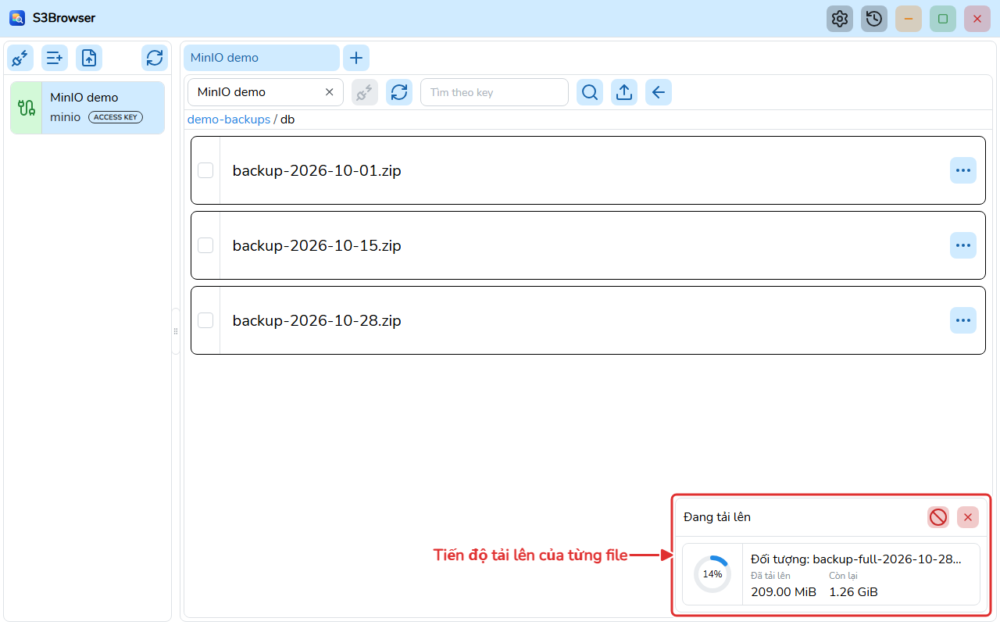

Khi tải lên xong, bấm nút làm mới để thấy object mới.

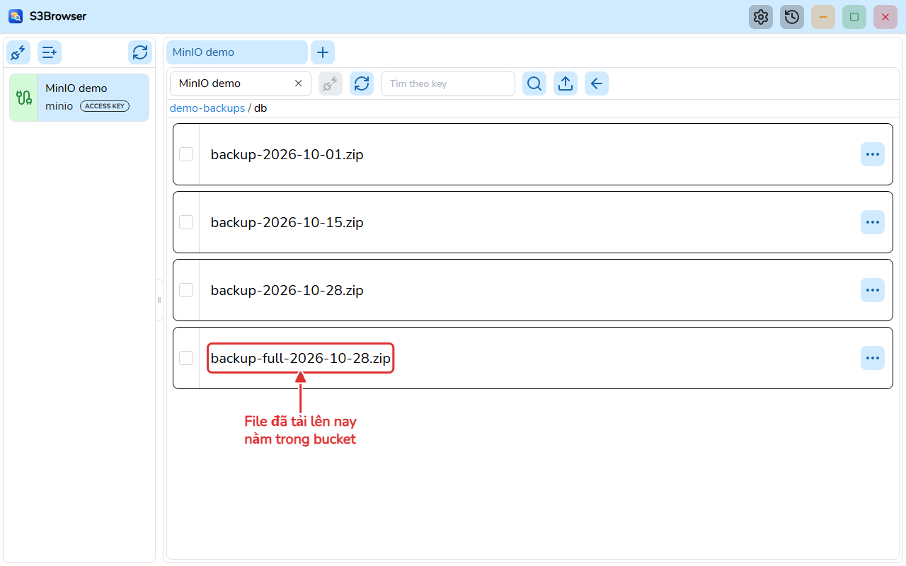

### 9.2 Tải xuống

- Với một object, mở menu **Thao tác khác** (ba chấm) ở cuối dòng và chọn **Tải xuống**. Một hộp thoại hỏi nơi lưu file.
- Với nhiều object, chọn chúng (tối đa 5) rồi bấm **Tải xuống mục đã chọn** trên thanh công cụ. Một hộp thoại hỏi thư mục đích.

Thư mục không thể tải xuống; chúng bị loại khỏi phần đã chọn.

Cửa sổ **Đang tải xuống** hiển thị tiến độ từng file (**Đã tải xuống** và **Còn lại**) cùng các nút **Hủy** và **Huỷ tất cả**. Ảnh dưới đây minh họa cửa sổ này.

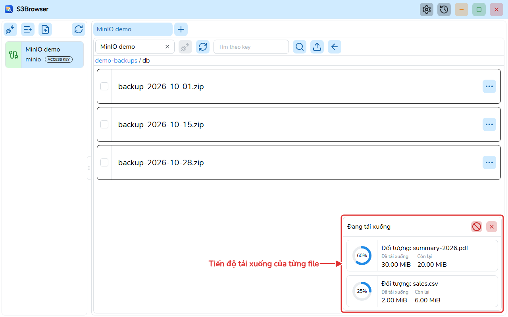

Bấm nút đồng hồ ở góc trên bên phải để mở **Lịch sử tải xuống**: mọi lần tải xuống kèm kích thước, thời gian, trạng thái và đường dẫn lưu.

### 9.3 Chọn nhiều object

Đánh dấu các ô ở đầu dòng. Thanh công cụ sẽ hiển thị **Bỏ chọn**, **Tải xuống mục đã chọn** và **Xoá mục đã chọn**. Mỗi lần chỉ chọn tối đa 5 object để tải xuống hoặc xóa.

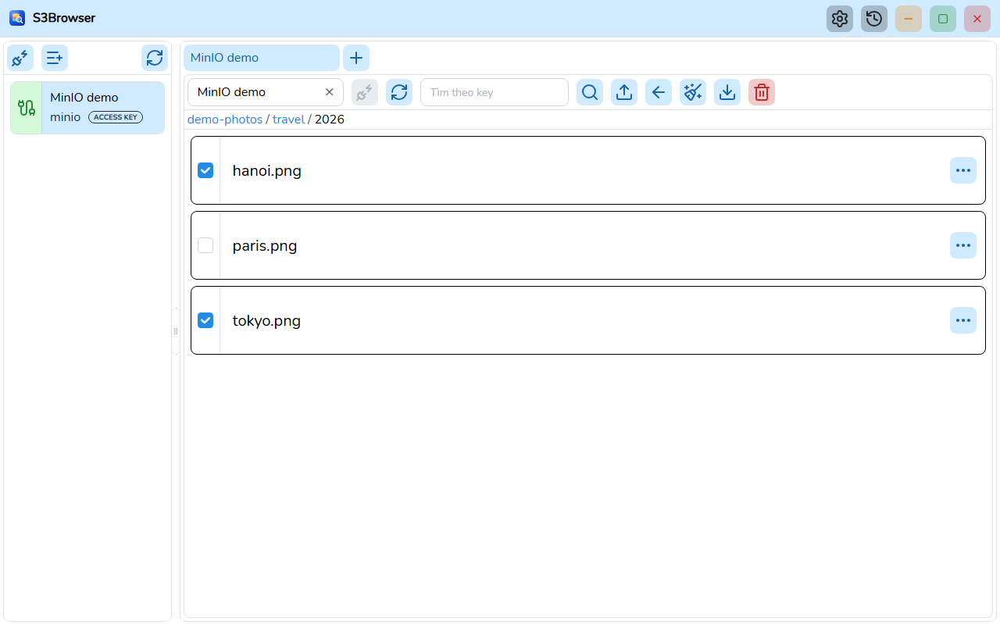

### 9.4 Xóa

Mở menu **Thao tác khác** của object và chọn **Xoá**, hoặc chọn các object rồi bấm **Xoá mục đã chọn**. Cửa sổ xác nhận cho biết những gì sẽ bị xóa; bấm **Xóa (n)** để xác nhận, n là số mục đã chọn.

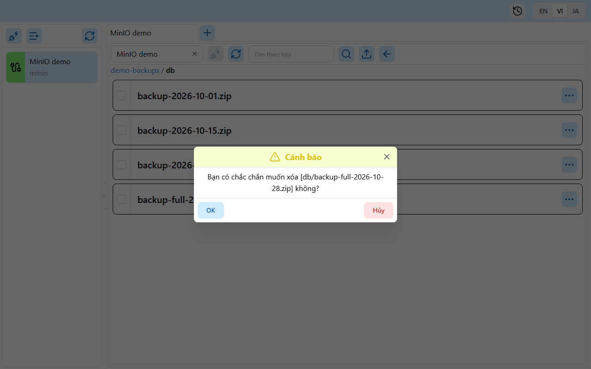

Xóa một **thư mục** sẽ xóa thư mục **và toàn bộ nội dung bên trong**. Cửa sổ xác nhận có nói rõ điều này và thao tác không thể hoàn tác. Nếu có object không xóa được, thông báo cho biết bao nhiêu object lỗi và bao nhiêu đã xóa.

## 10. Cài đặt và cập nhật

### 10.1 Cài đặt

Bấm nút **Cài đặt** (biểu tượng bánh răng) ở góc trên bên phải, bên trái nút lịch sử tải xuống.

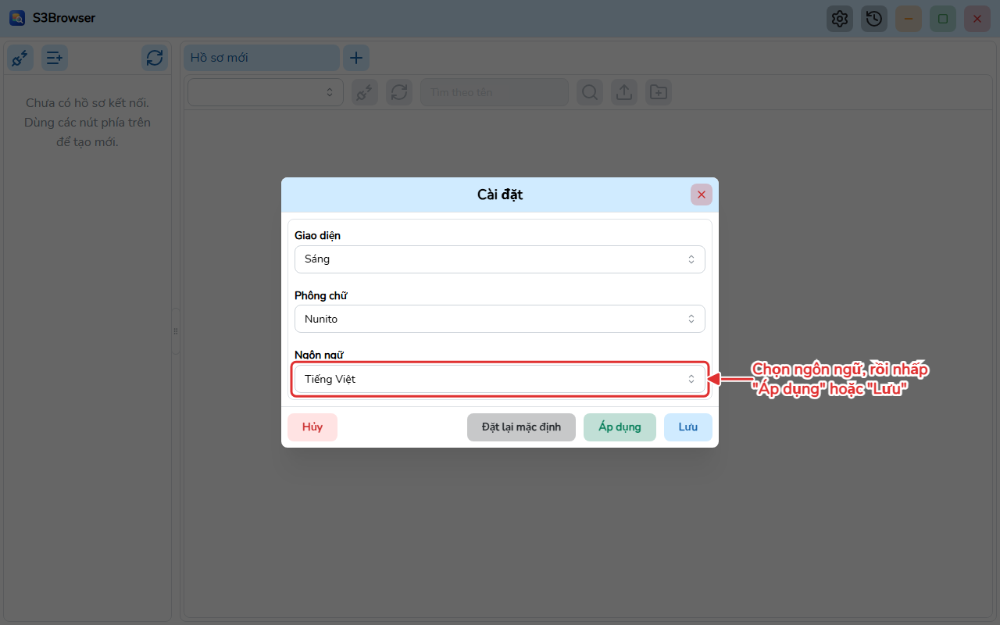

- **Giao diện**: Sáng, Tối hoặc Theo hệ thống.
- **Phông chữ**: Nunito, System UI, Segoe UI, Arial, Roboto, Be Vietnam Pro, Verdana, Meiryo UI, Monospace hoặc JetBrains Mono.
- **Ngôn ngữ**: English, Tiếng Việt, 日本語, 简体中文, 繁體中文, Русский hoặc Deutsch. Toàn bộ giao diện, kể cả thông báo, đổi theo.
- **Khởi động cùng Windows**: mở S3Browser khi đăng nhập Windows. Chỉ hiện ở bản cài đặt trên Windows (không có ở bản portable).
- **Tự động kiểm tra và tải bản cập nhật** và **Nhận bản beta (thử nghiệm)**: xem [Cập nhật](#102-cập-nhật). Hai công tắc này có hiệu lực ngay khi bạn gạt, không cần **Áp dụng** hay **Lưu**; chỉ **Lưu** mới giữ chúng sau khi mở lại app.

Mọi thay đổi được xem trước ngay. Sau đó chọn:

- **Lưu**: giữ cài đặt, kể cả sau khi mở lại app.
- **Áp dụng**: giữ cài đặt đến khi đóng app, gồm cả hai công tắc cập nhật; hộp thoại vẫn mở. Áp dụng ghi tùy chọn Khởi động cùng Windows vào Windows ngay, và Hủy không hoàn tác được.
- **Hủy**: bỏ các thay đổi kể từ lần Áp dụng hoặc Lưu gần nhất, gồm cả hai công tắc cập nhật. Hộp thoại đóng lại.
- **Đặt lại mặc định**: đưa form về mặc định (Sáng, Nunito, English, **Khởi động cùng Windows** tắt). Hai công tắc cập nhật cũng được đặt lại ngay, như khi bạn gạt tay: **Tự động kiểm tra và tải bản cập nhật** bật và **Nhận bản beta (thử nghiệm)** tắt. Bấm **Lưu** để giữ mặc định; **Hủy** hoàn tác việc đặt lại.

Nếu bạn đóng cửa sổ bằng **X**, phím Esc hoặc nhấp ra ngoài khi còn thay đổi chưa lưu và chưa áp dụng, cảnh báo **Cài đặt chưa được lưu** xuất hiện ("Bạn có thay đổi cài đặt chưa được lưu hoặc áp dụng. Bạn muốn làm gì?"): **Quay lại** giữ cửa sổ mở cùng các thay đổi, **Bỏ thay đổi** hoàn tác chúng và đóng cửa sổ, **Lưu** lưu chúng (cửa sổ vẫn mở nếu lưu lỗi). Không có thay đổi thì cửa sổ đóng ngay.

Cài đặt được nạp khi app khởi động, trước khi nội dung cửa sổ hiện ra.

### 10.2 Cập nhật

Bản cài đặt có thể tự cập nhật từ GitHub Releases. Phần **Cập nhật** của cửa sổ Cài đặt chỉ hiện ở bản này; bản portable không tự cập nhật.

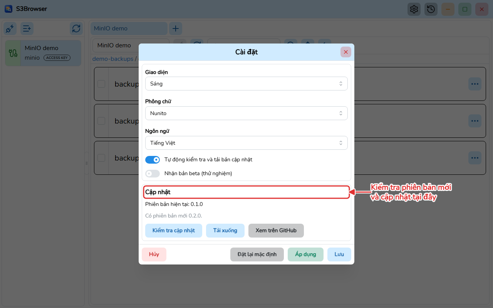

- **Tự động kiểm tra và tải bản cập nhật**: khi bật, ứng dụng kiểm tra phiên bản mới và tải ngầm.
- **Nhận bản beta (thử nghiệm)**: cũng đề xuất các bản đánh dấu Pre-release.
- **Kiểm tra cập nhật** kiểm tra ngay. Dòng bên dưới **Phiên bản hiện tại** cho biết kết quả (ví dụ **Có phiên bản mới ...** hoặc **Bạn đang dùng phiên bản mới nhất.**).
- **Tải xuống** tải bản mới, **Cập nhật ngay** cài đặt sau khi đã tải xong, và **Xem trên GitHub** mở trang phát hành.

Khi có bản mới, một thông báo ở phía trên cửa sổ đề xuất **Tải xuống**; khi đang tải, thông báo hiển thị tiến độ, và khi tải xong thì đề xuất **Cập nhật**. File đã tải được kiểm tra trước khi cài đặt.

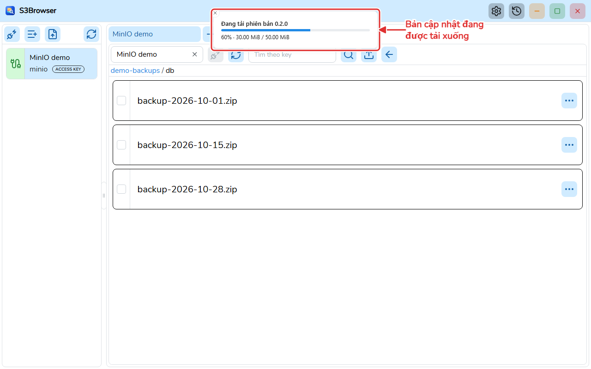

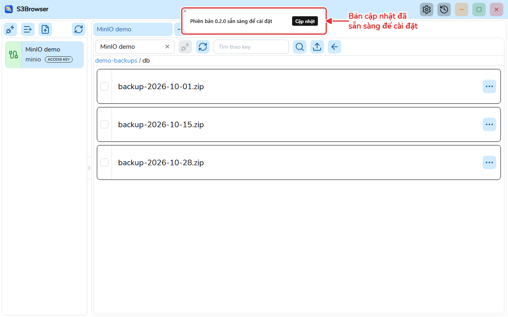

Không thể chụp ảnh một lần cập nhật thật: các ảnh trên hiển thị thông báo với giá trị mẫu.

## 11. Xử lý sự cố

Thông báo hiện ở phía trên cửa sổ. Dưới đây là những thông báo bạn có thể gặp nhiều nhất.

| Thông báo | Nguyên nhân và cách xử lý |
| --- | --- |
| Access key hoặc secret key không hợp lệ với endpoint này | Khóa sai hoặc thuộc máy chủ khác. Kiểm tra trong hồ sơ và dùng **Kiểm tra kết nối**. |
| Hết thời gian chờ khi kết nối tới endpoint, hãy kiểm tra địa chỉ và máy chủ có đang chạy hay không | Endpoint sai, máy chủ đã dừng, tường lửa hoặc mạng chặn. Kiểm tra địa chỉ (có `http://` hoặc `https://`) và cổng. |
| Endpoint từ chối kết nối / Lỗi khi kết nối tới S3 bucket | Máy chủ phản hồi nhưng từ chối kết nối. Kiểm tra endpoint, khu vực và **Path style** (MinIO cần bật). |
| Hồ sơ: {name} chưa được kết nối | Kết nối đã đóng. Kết nối lại hồ sơ. |
| Lỗi khi lấy danh sách bucket / Lỗi khi lấy danh sách object | Tài khoản có thể không được phép liệt kê bucket hoặc object, hoặc mất kết nối. Kiểm tra quyền của khóa và kết nối lại. |
| Quyền truy cập bucket bị giới hạn | Tài khoản không liệt kê được mọi bucket. Xin cấp thêm quyền, hoặc mở bucket mà bạn được phép dùng. |
| Đang có tiến trình tải lên khác, vui lòng chờ hoàn tất. | Chỉ một lần tải lên chạy tại một thời điểm. Hãy chờ, hoặc hủy từ cửa sổ **Đang tải lên**. |
| Thư mục ... có hơn 50 file cần tải lên. / Chỉ được tải lên tối đa 1000 file mỗi lần. | Xem các giới hạn ở mục 9.1. Chia nhỏ lần tải hoặc chọn ít file hơn. |
| Hồ sơ [{name}] đang có tác vụ tải lên/tải xuống, không thể xóa | Chờ các tác vụ kết thúc hoặc hủy chúng, rồi xóa hồ sơ. |
| Vui lòng ngắt kết nối trước khi thực hiện! | Ngắt kết nối hồ sơ (chuột phải, **Ngắt kết nối**) trước khi chỉnh sửa hoặc xóa. |
| Chỉ được chọn tối đa 5 mục! | Chọn tối đa 5 object để tải xuống hoặc xóa. |
| Thư mục lưu ... không tồn tại | Thư mục đã chọn để tải xuống không dùng được. Hãy chọn nơi khác. |

Nếu thông báo không có trong bảng, nội dung của nó gồm tên thao tác và lý do do máy chủ trả về. Lý do đó (ví dụ `AccessDenied` hoặc `NoSuchBucket`) là thông báo của chính S3 và cho biết cần sửa gì ở phía máy chủ.

Hai ảnh dưới đây là các lỗi kết nối, chụp bằng **Kiểm tra kết nối**.

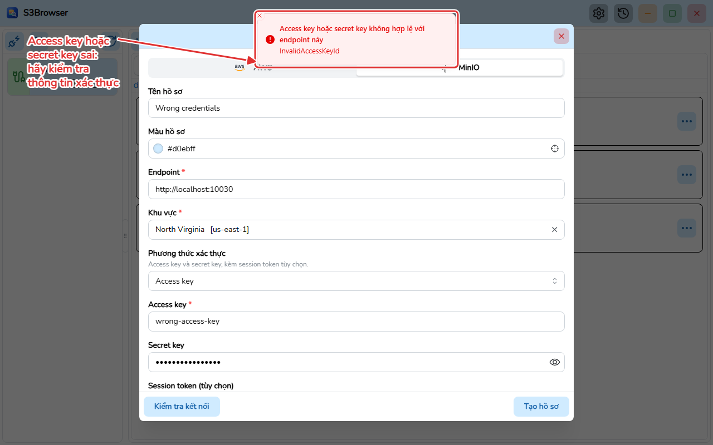

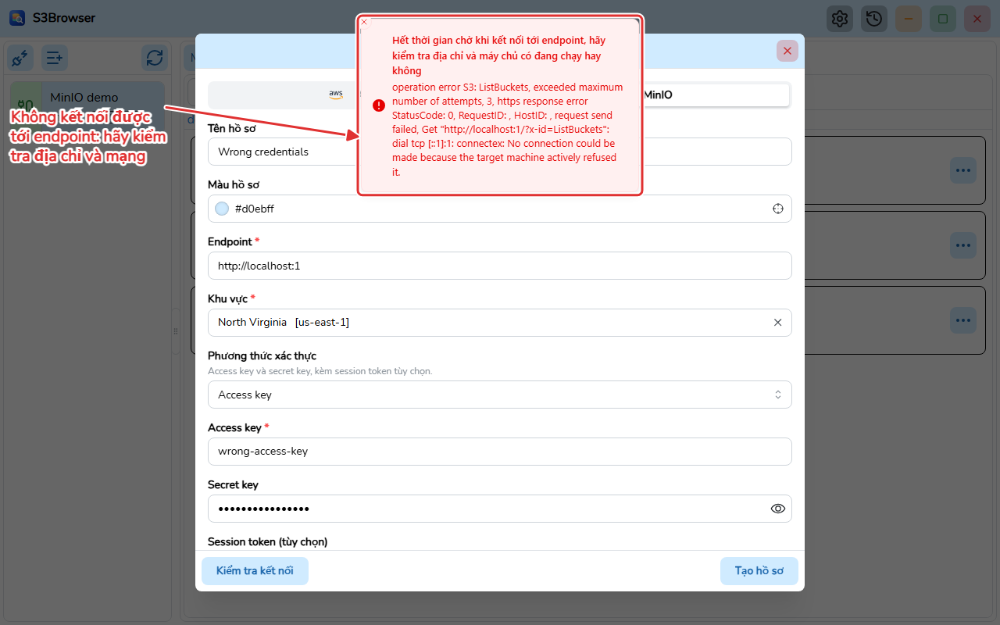
