# S3 Browser 用户指南

版本 0.0.1-beta.1

> 本译文尚未经过母语人士审校。

## 1. 简介

S3 Browser 是一款桌面应用程序，用于浏览和管理 **AWS S3** 以及 **MinIO** 等兼容 S3 的服务器上的存储桶和对象。你可以：

- 保存连接配置文件，并同时连接多个账户（每个连接一个标签页）；
- 使用访问密钥、担任角色、AWS SSO、MinIO STS、LDAP、OpenID Connect (OIDC) 或客户端证书登录；
- 浏览存储桶、文件夹和对象，并进行搜索；
- 创建、查看、更改权限和删除存储桶；
- 查看对象的详情；
- 上传文件和文件夹（拖放或使用对话框），并有实时进度窗口；
- 下载对象并查看下载历史；
- 删除对象和整个文件夹；
- 通过 GitHub Releases 使应用保持最新。

界面支持英语、越南语、日语、简体中文、繁体中文、俄语和德语。

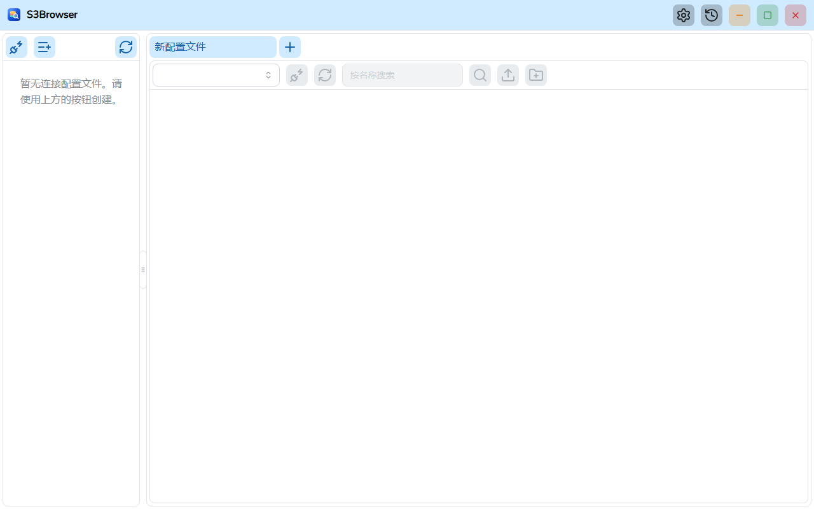

窗口分为三个区域：左侧的**配置文件列表**、右侧的**标签页**（每个标签页显示一个连接的存储桶和对象），以及顶部的**标题栏**，其中有**设置**按钮和下载历史按钮。

> 这是测试版 (0.0.1-beta.1)。删除对象前请备份重要数据：删除后无法撤销。

## 2. 安装

在 Windows 上有两种获取应用的方式。

- **安装程序**：从 [GitHub Releases](https://github.com/TranMinhTruyen/s3-browser/releases) 页面下载 `S3Browser-<version>-windows-amd64-installer.exe` 并运行，然后按步骤操作。**Latest** 版本是稳定版；标有 **Pre-release** 的是测试版。安装后可从开始菜单启动应用。配置文件和下载历史保存在你的用户配置文件中。只有安装版可以自动更新（见[更新](#102-更新)）。
- **便携版**：将便携版文件夹复制到任意位置（例如 U 盘），然后运行 `S3Browser.exe`。它使用 `webview2` 文件夹中附带的 WebView2 运行时，并将数据保存在程序旁边的 `data` 文件夹中，因此不会在其他位置写入任何内容。请勿将 `webview2` 和 `data` 文件夹从程序旁移走。

## 3. 连接到 AWS S3 或 MinIO

点击**创建连接配置文件**按钮（配置文件列表上方的第二个按钮），将打开**连接配置文件**窗口。

### 3.1 配置文件表单

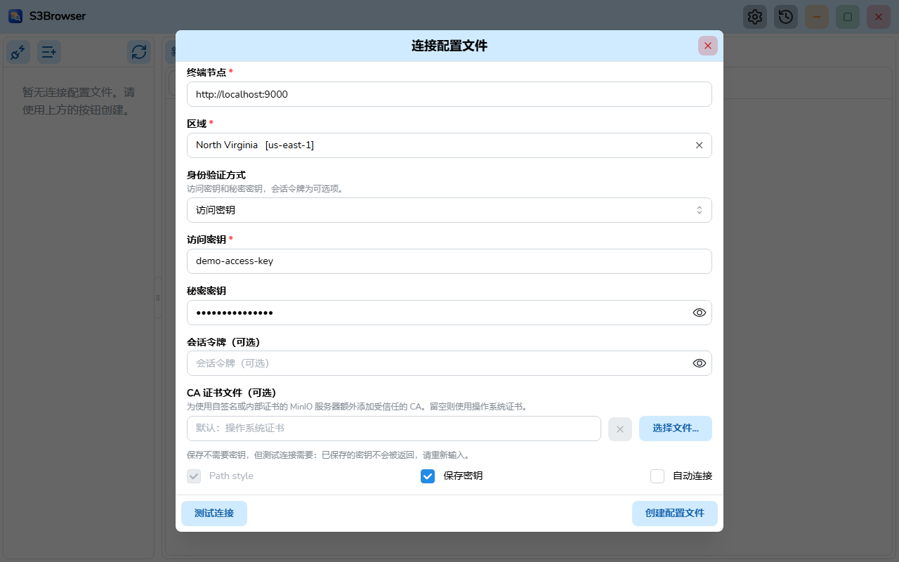

| 字段 | 说明 |
| --- | --- |
| AWS / MinIO | 选择服务器类型。选择 MinIO 会自动开启 **Path style**。可用的身份验证方式取决于此项。 |
| 配置文件名称 | 在配置文件列表和标签页中显示的名称。 |
| 配置文件颜色 | 配置文件在列表中的颜色。 |
| 终端节点 | 服务器地址，例如 `https://s3.amazonaws.com` 或 `http://localhost:9000`。 |
| 区域 | 你的账户所在区域，例如 `North Virginia [us-east-1]`。必填，但部分方式会从 AWS 配置中读取。 |
| 身份验证方式 | 应用的登录方式（见[身份验证方式](#32-身份验证方式)）。其下的字段会随方式而变化。 |
| 访问密钥 | 你的账户的访问密钥。 |
| 秘密密钥 | 你的账户的秘密密钥。点击眼睛图标可显示。 |
| 会话令牌（可选） | 临时凭证的会话令牌。 |
| CA 证书文件（可选） | 见 [MinIO 的 CA 证书](#33-minio-的-ca-证书)。 |
| Path style | 以 `endpoint/bucket` 而不是 `bucket.endpoint` 的方式访问存储桶。MinIO 和大多数自建服务器都需要。 |
| 保存密钥 | 将密钥（加密后）保存到配置文件中。不勾选则每次连接都必须输入。 |
| 自动连接 | 应用启动时自动连接该配置文件。仅在勾选**保存密钥**时可用，并且不适用于每次连接都需要输入的方式（例如 OIDC 或 MFA 代码）。 |

底部有两个按钮：

- **测试连接**：检查所填的值，不保存任何内容。已保存的密钥不会再次显示，因此测试时请重新输入。绿色消息表示测试成功；红色消息会说明问题（见[故障排除](#11-故障排除)）。
- **创建配置文件**：保存配置文件（从已有配置文件打开窗口时，按钮为**更新配置文件**）。

> 切勿分享显示了你的秘密密钥的截图。本指南中的密钥字段只包含占位值。

### 3.2 身份验证方式

在**身份验证方式**中选择方式。列表取决于服务器类型。

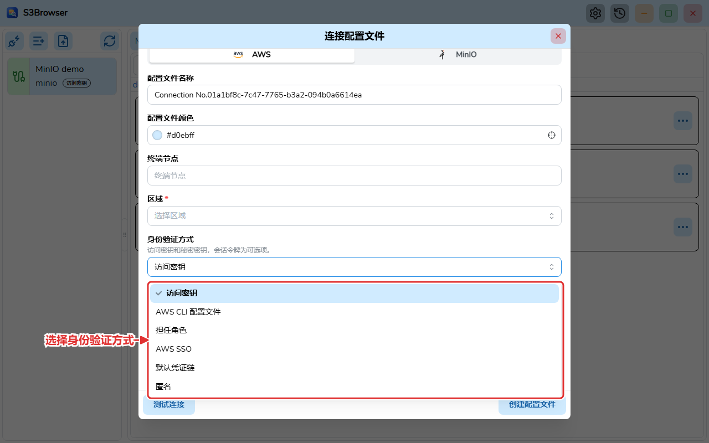

| 方式 | 服务器 | 需要填写的内容 |
| --- | --- | --- |
| 访问密钥 | AWS、MinIO | 访问密钥、秘密密钥和可选的会话令牌。 |
| AWS CLI 配置文件 | AWS | AWS CLI 文件 (`~/.aws`) 中的一个配置文件，以及可选的 **AWS 配置文件（可选）** 和 **AWS 凭证文件（可选）** 路径（默认：`~/.aws/config`、`~/.aws/credentials`）。 |
| 担任角色 | AWS | **角色 ARN**、用于担任该角色的凭证（**访问密钥**或 **AWS CLI 配置文件**），以及可选的 **外部 ID（可选）**、**会话名称（可选）**、**持续时间（秒）** 和 **MFA 设备序列号（可选）**。**MFA 代码**在连接时询问，不会被保存。 |
| AWS SSO | AWS | 一个已登录的 AWS CLI 配置文件。请先运行 `aws sso login --profile <profile>`。 |
| 默认凭证链 | AWS | 无需填写：使用环境中找到的凭证（环境变量、共享文件或实例角色）。 |
| 匿名 | AWS、MinIO | 只需填写要打开的公共存储桶的名称（匿名用户无法列出存储桶）。 |
| MinIO STS | MinIO | 访问密钥、秘密密钥，以及可选的 **角色 ARN（可选）**、**持续时间（秒，可选）** 和 **内联策略（JSON，可选）**。 |
| LDAP | MinIO | **LDAP 用户名** 和 **LDAP 密码**，以及可选的 **持续时间（秒，可选）** 和 **内联策略（JSON，可选）**。 |
| OIDC | MinIO | **客户端 ID**、**颁发者 URL**、可选的 **范围（可选）** 和 **回调端口**。 |
| 客户端证书 | MinIO | **客户端证书文件** 和 **私钥文件**；如有需要，勾选 **私钥设有密码**。终端节点必须使用 `https://`。 |

需要更多字段的方式如下所示（值均为占位值）。

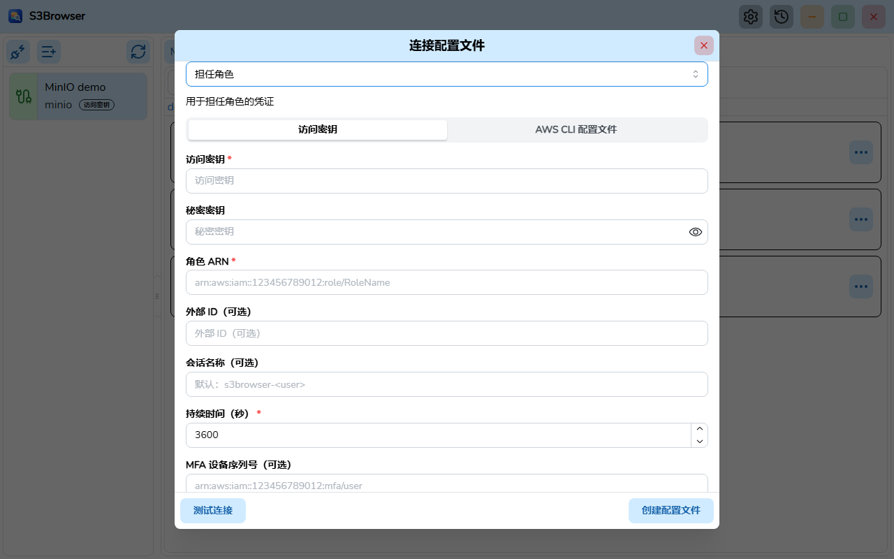

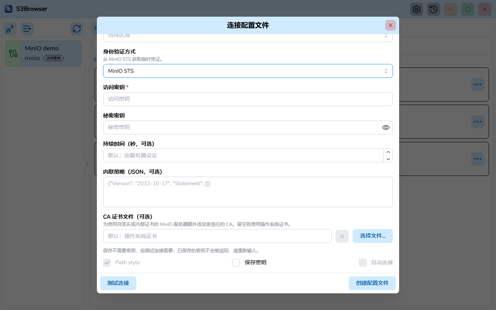

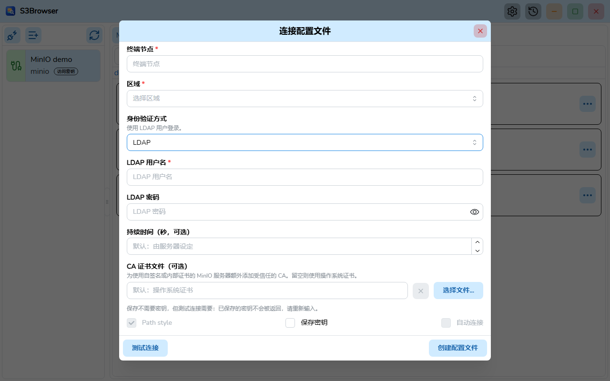

**OIDC。** 复制表单中显示的 **重定向 URI**（**复制**按钮），并将其注册为身份提供商中该客户端的重定向 URI。点击**登录**：会打开你的网页浏览器，在其中登录。表单会显示**正在等待在浏览器中完成登录...**，然后显示**已登录，有效期至 ...**；**取消登录**会停止等待。登录信息仅使用一次，不会被保存。过期后表单会显示**登录已过期，请重新登录**。浏览器窗口无法在截图中显示。

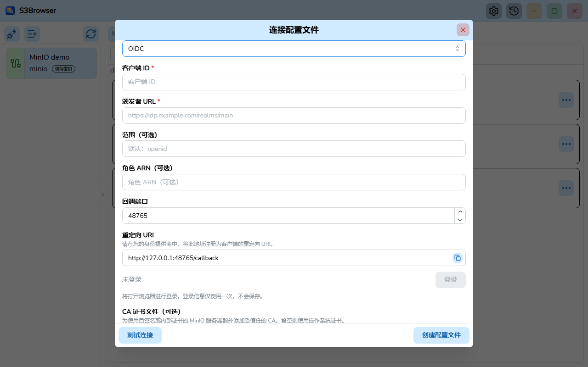

**客户端证书。** 点击文件字段旁的**选择文件...**，并在系统对话框中选择文件（对话框无法在截图中显示）；**清除文件**会清空该字段。文件在连接时读取，其内容不会被保存。

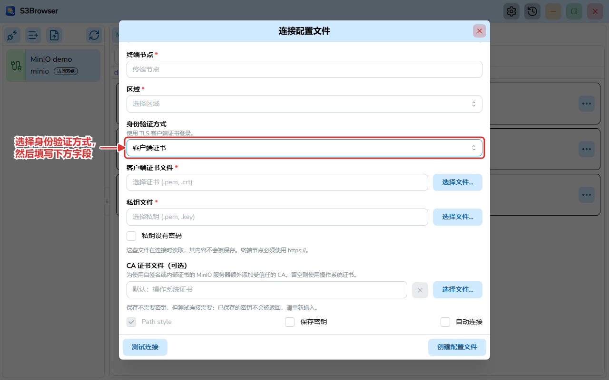

部分凭证会过期。过期前不久，应用会提示你续期：使用 MFA 代码（担任角色）、重新登录（OIDC、SSO），或断开连接后再连接。

### 3.3 MinIO 的 CA 证书

使用自签名或内部证书的 MinIO 服务器需要额外添加受信任的 CA。在 **CA 证书文件（可选）** 中，点击**选择文件...**并选择 CA 证书（`.pem` 或 `.crt`）。留空则使用操作系统的证书。该文件仅用于连接 MinIO，不用于 OIDC 身份提供商。

## 4. 管理配置文件

创建配置文件后，它会出现在配置文件列表中。

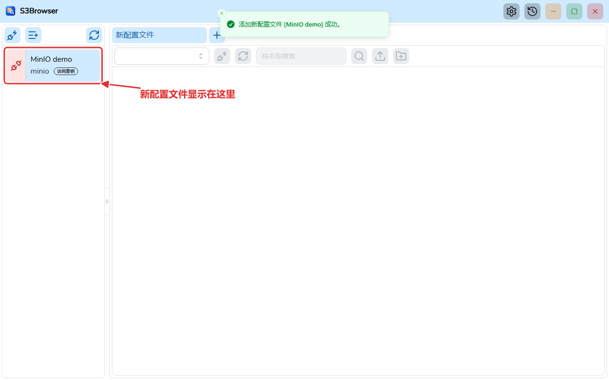

右键点击配置文件可打开其菜单。

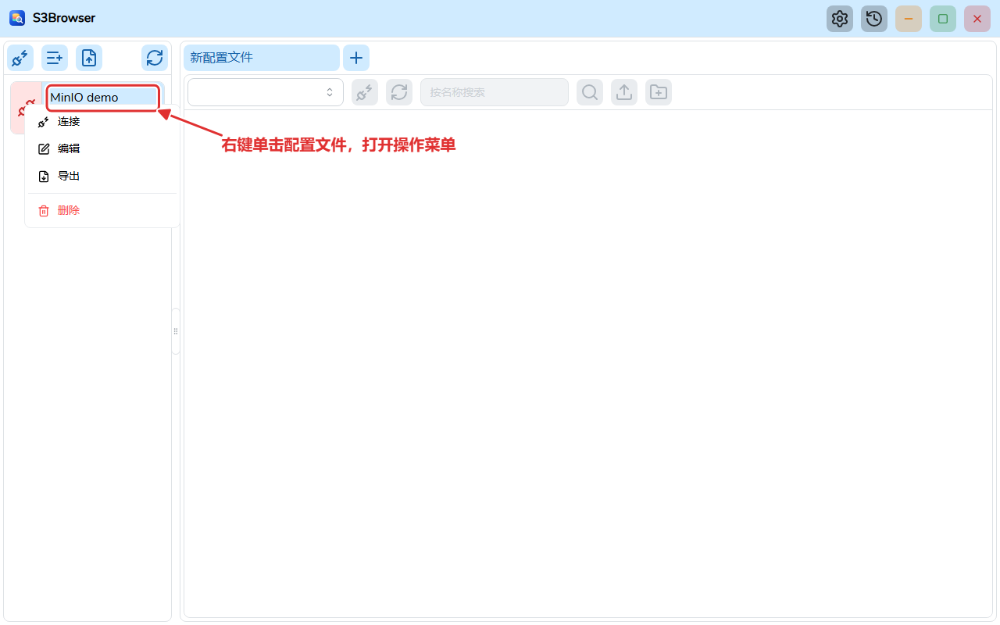

- **连接**：打开连接。已连接的配置文件会显示绿色图标。
- **断开连接**：关闭连接。编辑或删除配置文件前，请先断开连接。
- **编辑**：更改配置文件（窗口标题仍为**连接配置文件**，按钮为**更新配置文件**）。系统会请你确认更新。
- **导出**：将配置文件保存为 JSON 文件；见 [4.1 导出配置文件](#41-导出配置文件)。
- **删除**：确认后删除配置文件。

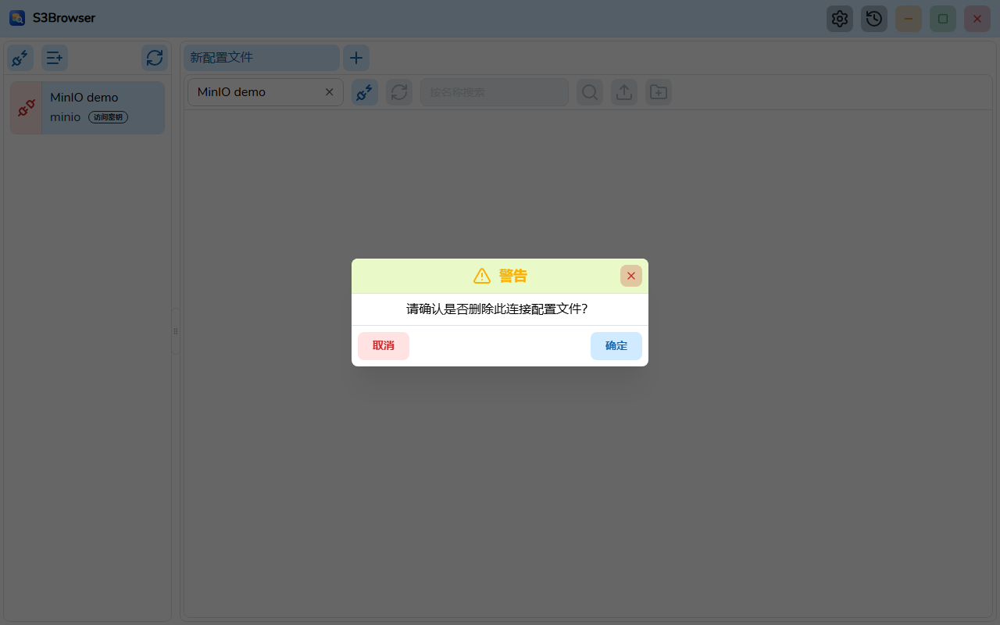

仍有上传或下载在进行的配置文件无法删除。请等待传输完成或先取消它们。

列表上方的第一个按钮（**连接**）会打开同一个窗口，其中有**连接**按钮，用于只连接一次而不保存配置文件；**刷新连接配置文件列表**按钮用于重新加载列表。

### 4.1 导出配置文件

导出会把配置文件复制到一个文件中，例如用于在另一台计算机上使用。右键点击配置文件，选择**导出**。

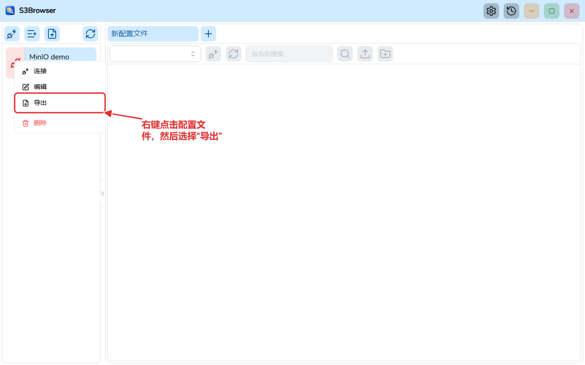

**导出配置文件**窗口随即打开。

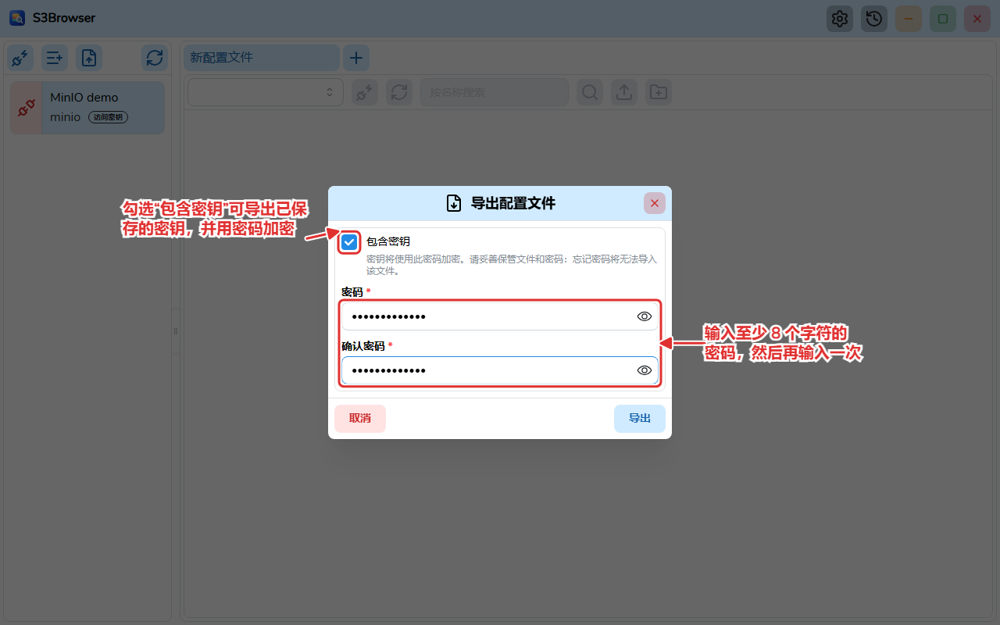

- 保持**包含密钥**关闭，则导出的配置文件不含密钥（Secret Key、会话令牌、LDAP 密码、密钥口令）。继续之前，如果配置文件有已保存的密钥，应用会发出警告：“配置文件 [名称] 中已保存的密钥将不会被导出。导入后需要重新输入。是否在不含密钥的情况下导出？”确认则导出，取消则返回。导入后，请编辑该配置文件并重新输入密钥。
- 勾选**包含密钥**，则一并导出已保存的密钥。输入至少 8 个字符的**密码**，并在**确认密码**中再输入一次。密钥会用此密码加密（PBKDF2 和 AES-GCM）：文件中绝不会以明文写入密钥。当配置文件没有已保存的密钥时，该选项不可用（“此配置文件没有已保存的密钥。”）。

点击**导出**。Windows 保存对话框随即打开，并根据配置文件名称给出建议的文件名：仅含小写字母、数字和下划线，例如 `minio_demo.json`。选择保存位置。文件写入后会显示一条消息。如果关闭保存对话框，则不会写入任何内容，**导出配置文件**窗口保持打开。

文件包含配置文件的连接设置（名称、颜色、提供商、终端节点、区域、访问密钥、路径样式、自动连接、身份验证方法及其选项），不包含配置文件 ID、日期等内部数据。证书和密钥文件只导出路径，不导出文件本身。

请妥善保管文件和密码。密码不会存储在任何地方：忘记密码，就无法导入该文件。请勿手动编辑含有密钥的文件。如果其中的提供商、终端节点或身份验证方法被修改，导入将失败，并提示“密码错误，或文件已损坏。”

### 4.2 导入配置文件

点击**导入连接配置文件**按钮（位于配置文件列表上方，在**创建连接配置文件**旁边）。

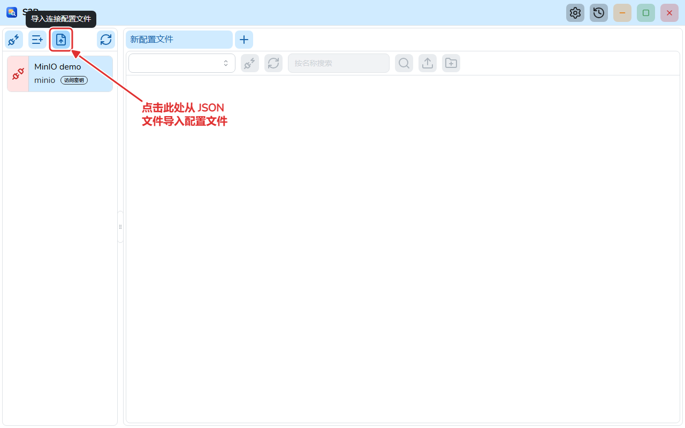

Windows 打开文件对话框随即出现：选择由 S3Browser 导出的 `.json` 文件（最大 1 MiB）。应用会先检查文件，然后才保存任何内容。例如，“该文件不是有效的 S3Browser 配置文件。”表示该文件不是 S3Browser 导出的配置文件；文件版本不受支持或文件过大时也会有消息提示。

- 不含密钥导出的文件会立即导入。
- 含密钥导出的文件会打开**导入配置文件**窗口：输入导出该文件时使用的密码，然后点击**导入**。

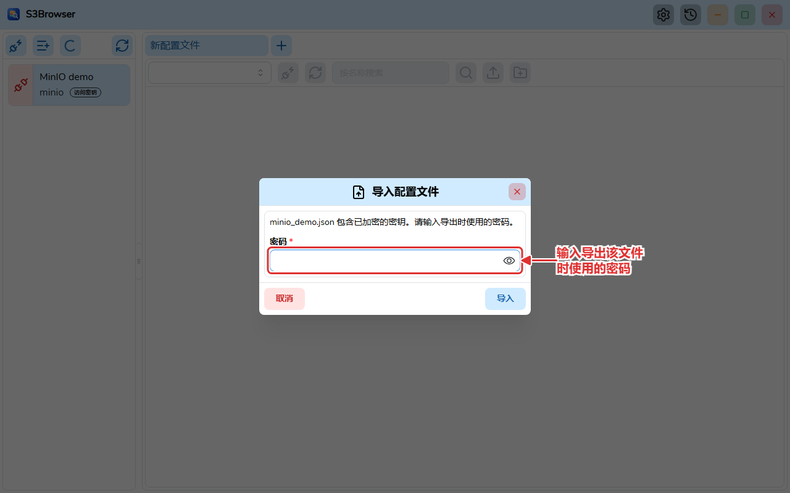

如果密码错误，会显示“密码错误，或文件已损坏。”，窗口保持打开，你可以重新输入密码或点击**取消**。在密码正确之前不会保存任何内容。

导入的配置文件会作为新的配置文件添加到列表中：

- 如果已有同名配置文件，新配置文件会加上编号：**名称 (2)**、**名称 (3)**，依此类推。
- 如果文件在此计算机上不存在，或路径是网络路径或设备路径（如 `\\host\share`、`\\?\`、`\\.\`，即使该路径存在），该路径都会被清空。这适用于 CA 证书、**客户端证书**方式的证书和私钥，以及 AWS config 和 credentials 文件。一条警告会列出这些字段：“已导入配置文件 [名称]。以下文件路径在此计算机上不存在，已被清空：{fields}。”连接之前，请编辑配置文件并重新选择这些文件。
- 导入不会连接该配置文件，即使文件中开启了**自动连接**；自动连接在应用下次启动时生效。
- 不含密钥导出的配置文件没有密钥：请编辑并输入。

Windows 的保存和打开对话框无法在截图中显示。**导入配置文件**窗口的图片展示的是用示例文件打开的窗口。

## 5. 浏览存储桶和对象

每个标签页对应一个配置文件。要在标签页中使用某个配置文件，请在标签页左上角的下拉列表中选择它，然后（如果该配置文件尚未连接）点击旁边的**连接**按钮。使用 **+** 按钮（**添加标签页**）打开另一个标签页，例如用于第二个账户。拖动标签页可重新排序（或按 Ctrl+Shift+左/右）；已打开的标签页会在下次启动应用时恢复。

显示存储桶列表：

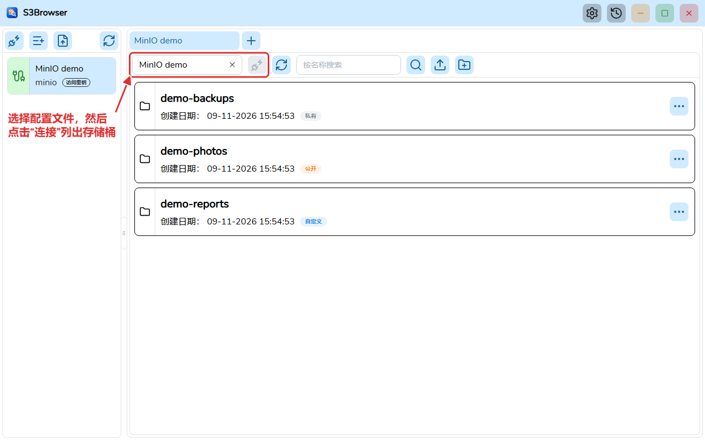

点击存储桶可查看其中的对象。文件夹显示在最前；点击文件夹即可打开。列表上方的路径（例如 `demo-photos / travel / 2026`）可以点击，箭头按钮返回上一级（返回上级文件夹，在存储桶顶层则返回存储桶列表）。

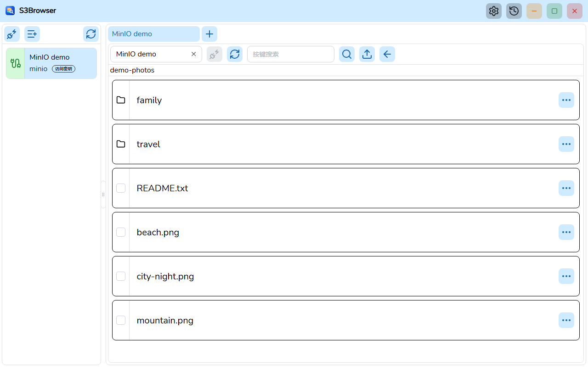

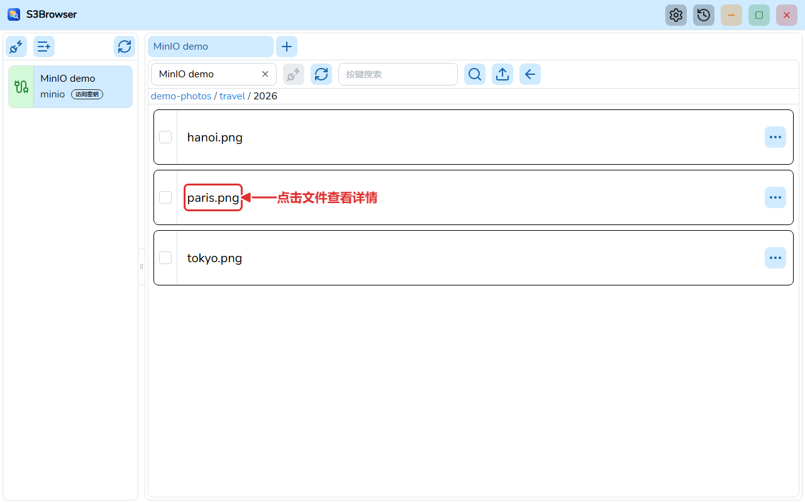

大型存储桶会分页加载；向下滚动时会自动加载更多对象。使用**刷新**按钮（**刷新对象列表**或**刷新存储桶列表**）可重新加载当前视图。

## 6. 搜索

在列表上方的搜索框中输入内容，然后按 Enter（或点击放大镜）。

- 在存储桶列表中按**名称**搜索。
- 在存储桶内按**键**搜索（即当前文件夹中名称包含该文本的对象和文件夹；搜索不区分大小写，也不会进入子文件夹）。

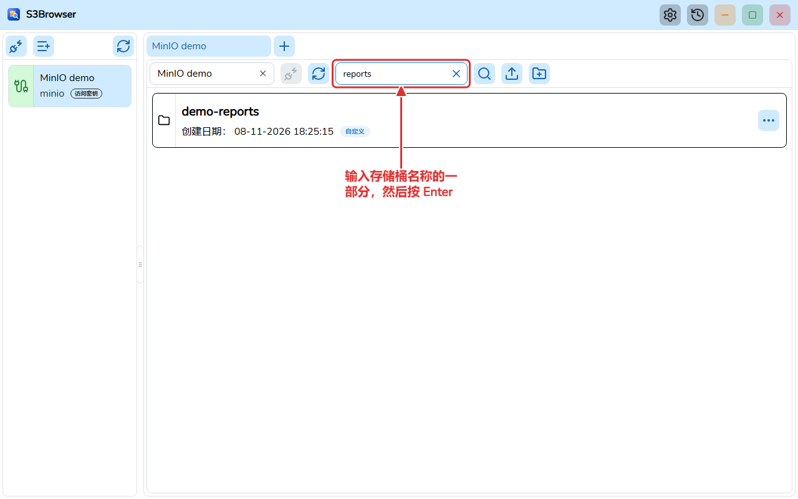

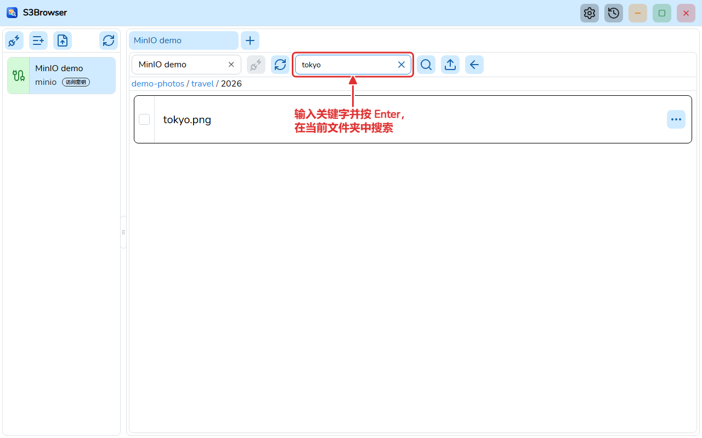

当结果列表末尾出现**搜索更多**时，点击它可继续搜索。搜索框中的 **x** 用于清除搜索。

## 7. 对象详情

点击文件，右侧会打开**对象详情**面板。它显示对象的名称、键、大小、最后修改时间、ETag、内容类型、存储类和元数据。键和 ETag 旁的复制按钮会将值复制到剪贴板。如果无法加载详情，请点击**重试**。使用**关闭**按钮关闭面板。

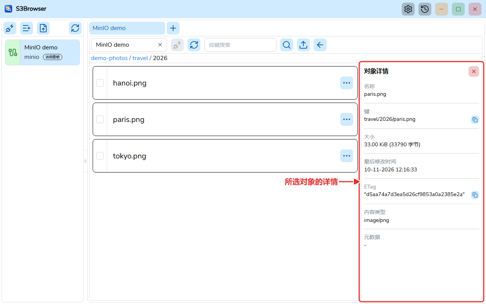

## 8. 管理存储桶

### 8.1 策略徽章和存储桶菜单

列表中的每个存储桶都会显示一个表示其策略类型的徽章：**私有**（没有存储桶策略）、**公开**（任何人都可以读取和列出对象）或**自定义**（自定义策略）。将鼠标指向徽章可查看其含义。无法访问的存储桶会有相应标记。

打开存储桶行末尾的**更多操作**菜单（三个点）：

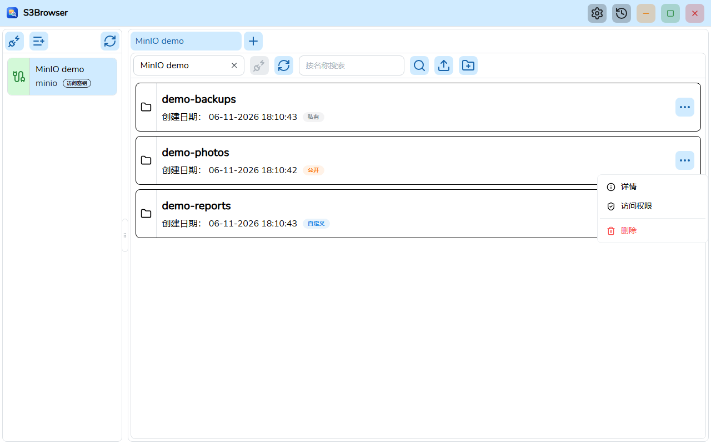

- **详情**：打开存储桶详情。
- **访问权限**：更改谁可以访问该存储桶。
- **删除**：删除存储桶。

当账户无权使用**访问权限**和**删除**时，这两项会被隐藏；使用**匿名**方式时只提供**详情**。

### 8.2 存储桶详情

选择**详情**，右侧会打开**存储桶详情**面板。

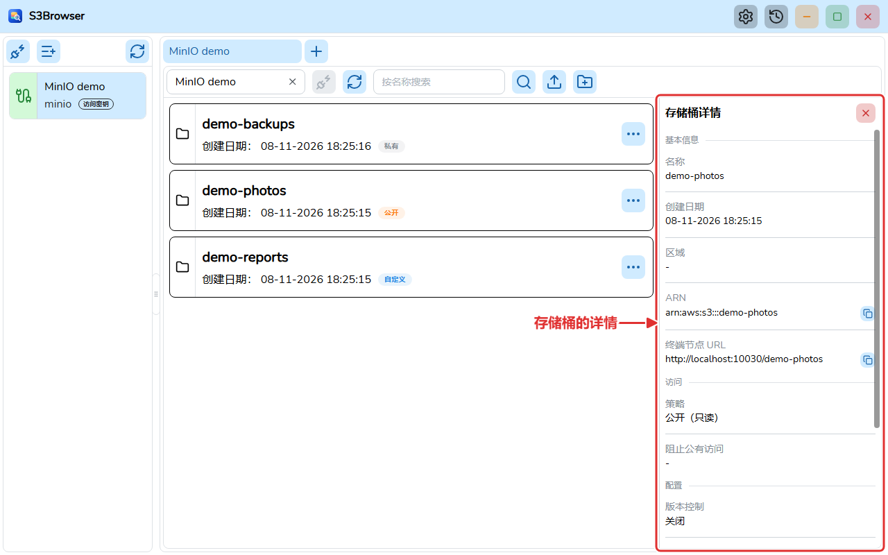

- **基本信息**：**名称**、**创建日期**、**区域**、**ARN** 和 **终端节点 URL**。
- **访问**：**策略**（**私有**、**公开（只读）**或**自定义**）和**阻止公有访问**（**开启**或**关闭**）。
- **配置**：**版本控制**、**默认加密**、**对象锁定**、**标签**和**根目录对象数**。根目录对象数最多计到 10,000，之后显示 `10,000+`。

如果无法加载详情，请点击**重试**。使用**关闭**按钮关闭面板。

### 8.3 创建存储桶

点击存储桶列表上方的**创建存储桶**按钮。

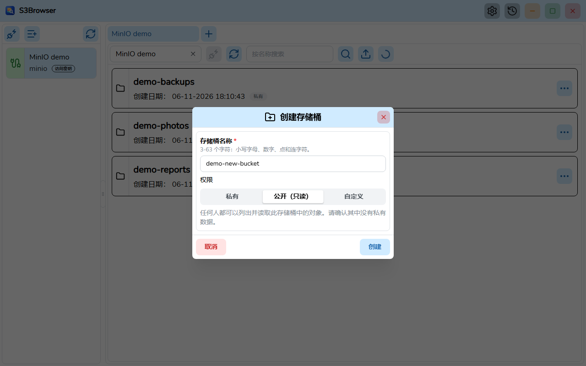

- **存储桶名称**：3-63 个字符：小写字母、数字、点和连字符。
- **权限**：**私有**、**公开（只读）**或**自定义**（然后以 JSON 输入策略）。
- 在 AWS 上，新存储桶默认阻止公共访问，因此在关闭“阻止公共访问”之前，公开策略可能会被拒绝。存储桶仍会被创建，并有警告告诉你权限未被应用。
- 在 AWS 上，还会显示**区域**字段，用于选择新存储桶的区域（默认为配置文件的区域）；由于需要真实的 AWS 账户，这一点无法在截图中显示。

点击**创建**，存储桶列表会刷新。

### 8.4 更改权限

在存储桶菜单中选择**访问权限**。

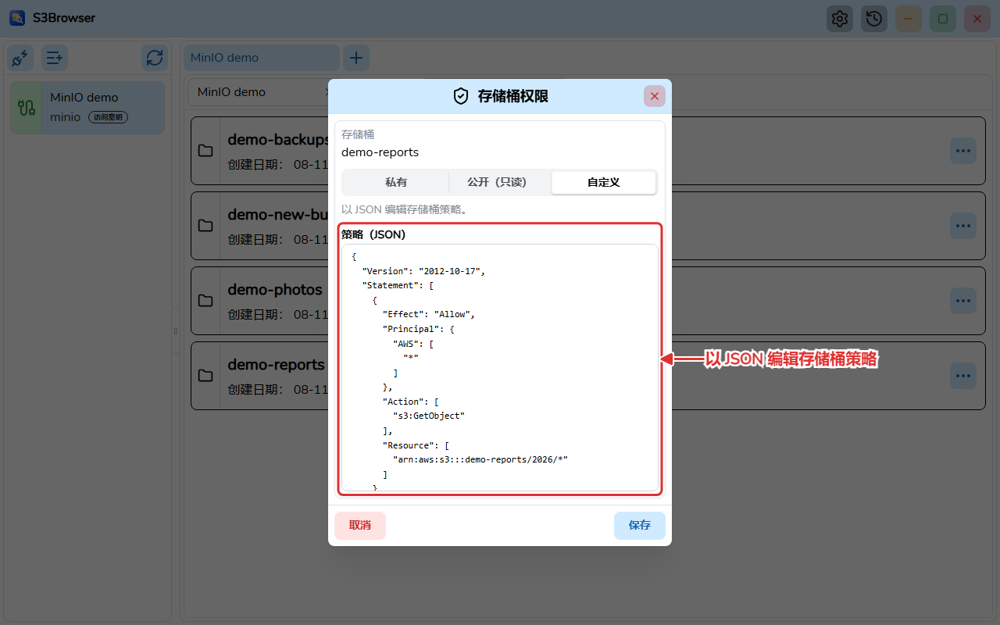

| 模式 | 含义 |
| --- | --- |
| 私有 | 没有存储桶策略。只有获得授权的用户才能访问此存储桶。 |
| 公开（只读） | 任何人都可以列出并读取此存储桶中的对象。请确认其中没有私有数据。 |
| 自定义 | 以 JSON 编辑存储桶策略。 |

当存储桶已启用阻止公有访问（公开策略将被拒绝），或你的账户无权更改权限时，窗口会给出警告。点击**保存**。

### 8.5 删除存储桶

在存储桶菜单中选择**删除**。

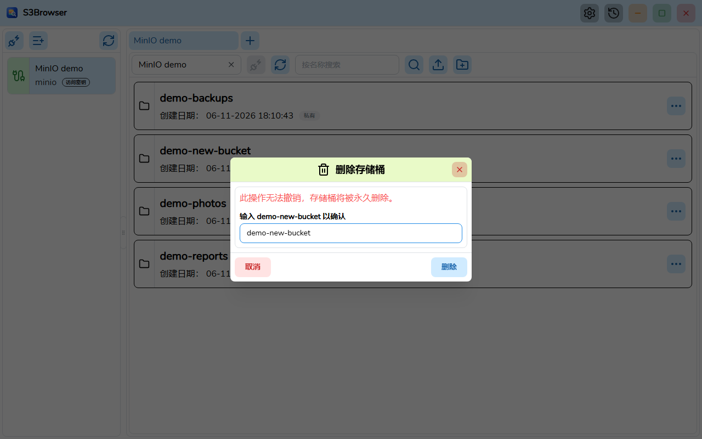

- 输入存储桶名称以确认，然后点击**删除**。
- 不为空的存储桶会先被清空：**其中所有对象都会被删除**（启用版本控制时，还包括每个版本和删除标记）。此操作无法撤销。
- 启用了对象锁定且不为空的存储桶无法删除。
- 删除无法取消，在结束前窗口也无法关闭；对于大型存储桶，这可能需要很长时间。之后只会刷新当前标签页。

## 9. 传输和删除对象

### 9.1 上传

有两种方式上传到你当前查看的文件夹（或存储桶）。

**拖放。** 将文件和文件夹从文件管理器拖到对象列表上。拖入文件夹会上传其中的所有文件，并保持文件夹结构。拖动操作无法在截图中显示。

**上传对话框。** 点击**上传文件**按钮（列表上方向上的箭头）。**上传文件**窗口随即打开，并显示目标位置（**上传到：...**）。

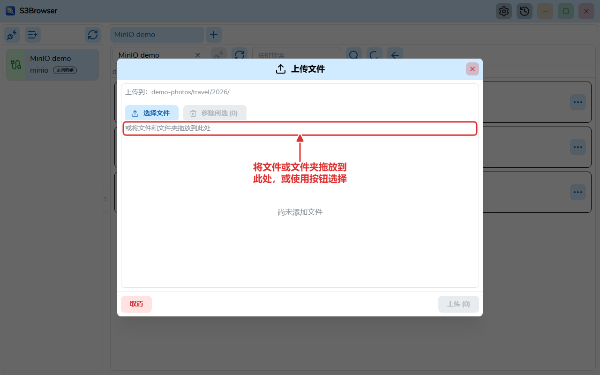

- 点击**选择文件**并在系统对话框中选择文件，或将文件和文件夹拖入窗口。
- 列表显示每个文件及其大小。取消勾选某个文件可将其排除，点击垃圾桶图标可将其从列表中移除，也可以使用**移除所选**。
- 如果是从存储桶列表打开的对话框，请先选择目标存储桶。
- 点击**上传**开始。

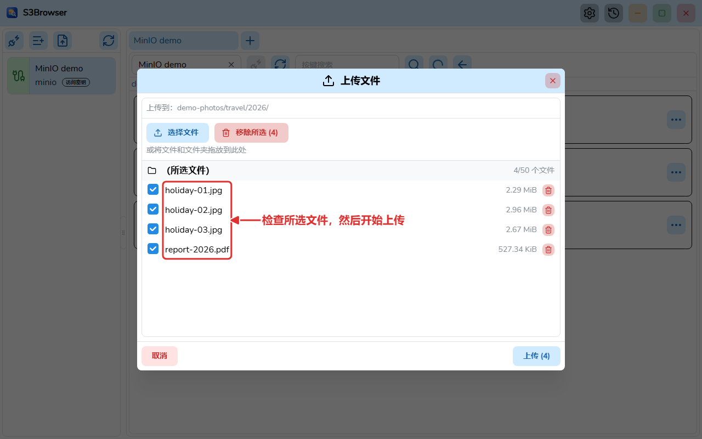

为使传输易于管理，适用以下限制：

| 限制 | 值 |
| --- | --- |
| 每次上传中来自同一文件夹的文件数 | 50 |
| 来自同一文件夹的大文件（超过 10 GiB）数 | 4 |
| 每次上传的文件数 | 1000 |
| 同时进行的上传数 | 1（请等待正在进行的上传完成） |

当拖入的文件夹超出限制时，**选择要上传的文件**窗口会让你勾选要上传的文件；未超出限制的文件夹会完整上传。无法上传的项目（无法读取的文件、符号链接）会被跳过，并告诉你跳过了多少个。

**正在上传**窗口出现在右下角，显示每个文件的进度（百分比圆环、**已上传**和**剩余**）。点击某个文件上的**取消**，或顶部的**全部取消**即可停止。该窗口可以关闭，并可通过它的按钮重新打开。

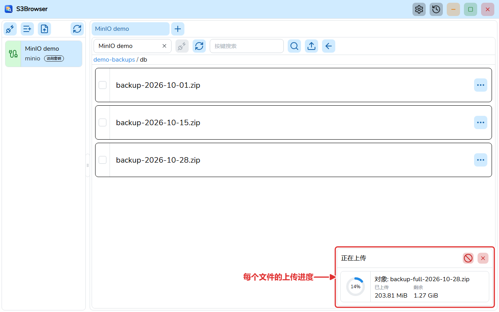

上传完成后，点击**刷新**即可看到新对象。

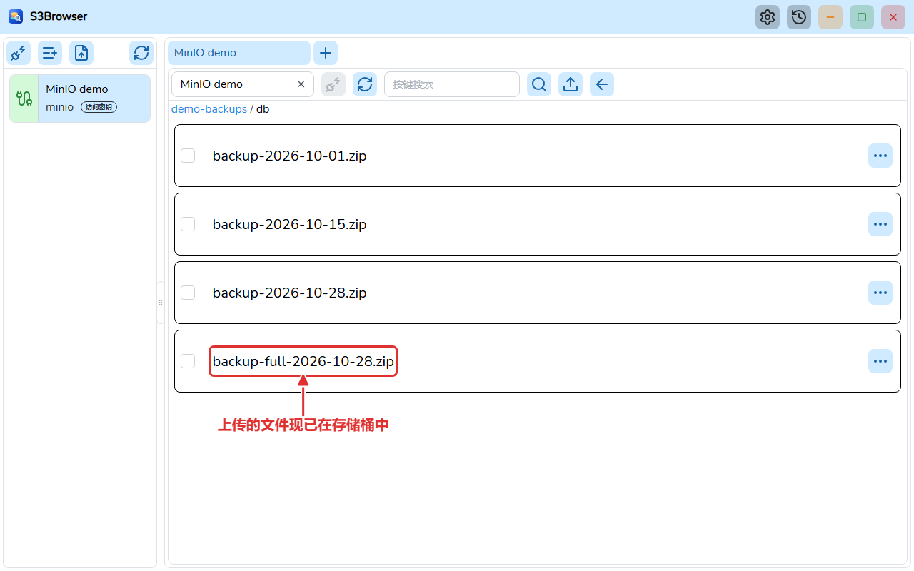

### 9.2 下载

- 下载单个对象：打开其行末尾的**更多操作**菜单（三个点），选择**下载**。对话框会询问保存位置。
- 下载多个对象：勾选它们（最多 5 个），然后点击工具栏中的**下载所选项**。对话框会询问目标文件夹。

文件夹无法下载；它们会从所选项中排除。

**正在下载**窗口显示每个文件的进度（**已下载**和**剩余**），并有**取消**和**全部取消**按钮。下图显示了该窗口。

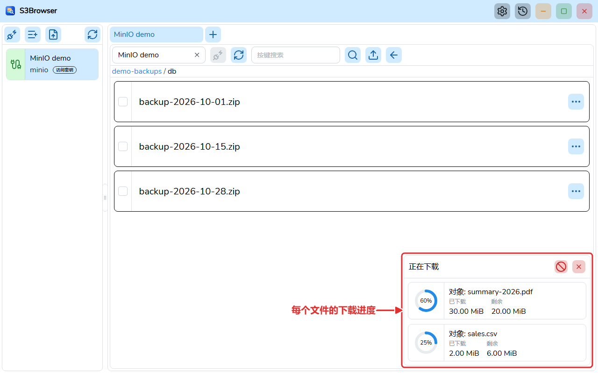

点击右上角的时钟按钮可打开**下载历史**：包含每次下载的大小、时间、状态和目标路径。

### 9.3 选择多个对象

勾选各行开头的复选框。工具栏随后会显示**取消选择**、**下载所选项**和**删除所选项**。下载或删除时，一次最多可选择 5 个对象。

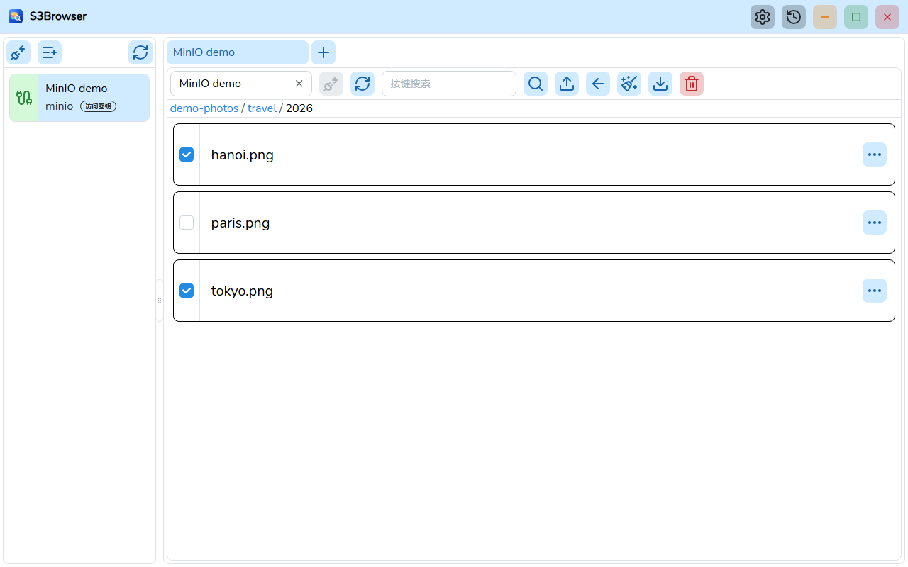

### 9.4 删除

打开对象的**更多操作**菜单并选择**删除**，或选择多个对象后点击**删除所选项**。确认窗口会显示将被删除的内容；点击**删除 (n)**确认，n 为所选项目数。

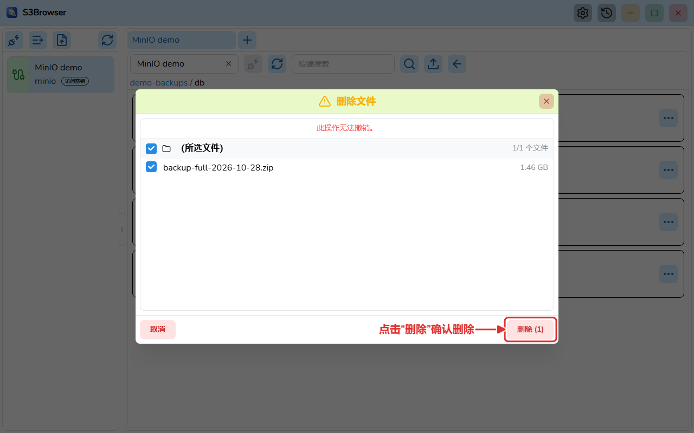

删除**文件夹**会删除该文件夹**及其中的所有内容**。确认窗口会说明这一点，且此操作无法撤销。如果部分对象无法删除，消息会告诉你失败了多少个、删除了多少个。

## 10. 设置和更新

### 10.1 设置

点击右上角、下载历史按钮左侧的**设置**按钮（齿轮图标）。

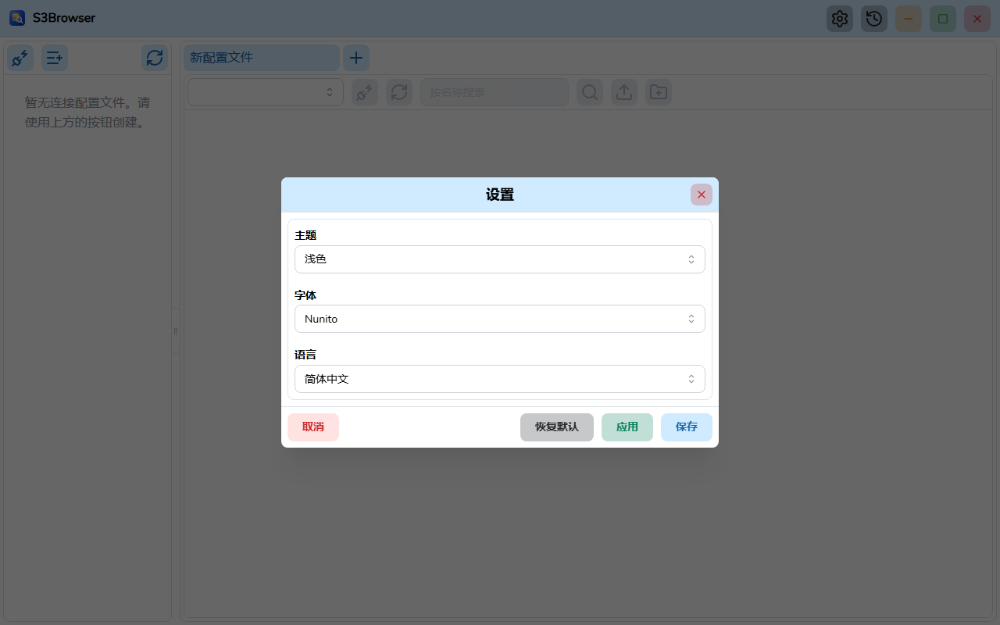

- **主题**：浅色、深色或跟随系统。
- **字体**：Nunito、系统界面、Segoe UI、Arial、Roboto、Be Vietnam Pro、Verdana、Meiryo UI、等宽或 JetBrains Mono。
- **语言**：English、Tiếng Việt、日本語、简体中文、繁體中文、Русский 或 Deutsch。整个界面（包括消息）都会改变。
- **随 Windows 启动**：登录 Windows 时启动 S3Browser。仅在 Windows 安装版中显示（便携版不显示）。
- **自动检查并下载更新** 和 **接收测试版 (预发布版本)**：见[更新](#102-更新)。这两个开关在切换后立即生效，无需**应用**或**保存**；只有**保存**才能让它们在重启应用后依然有效。

每项更改都会立即预览。然后选择：

- **保存**：保留设置，重启应用后依然有效。
- **应用**：保留设置直到关闭应用，包括两个更新开关；对话框保持打开。“随 Windows 启动”会在点击“应用”时立即写入 Windows，“取消”无法撤销。
- **取消**：撤销自上次“应用”或“保存”以来所做的更改，包括两个更新开关。对话框随即关闭。
- **恢复默认**：将表单恢复为默认值（浅色、Nunito、English，**随 Windows 启动**关闭）。两个更新开关也会像手动切换一样立即恢复默认：**自动检查并下载更新**开启，**接收测试版 (预发布版本)**关闭。点击**保存**以保留默认值；**取消**可撤销此重置。

如果在仍有未保存也未应用的更改时，通过 **X**、Esc 键或点击窗口外部关闭窗口，会出现警告**设置尚未保存**（“有设置尚未保存或应用。您要怎么做？”）：**返回**保持窗口打开并保留更改，**放弃更改**撤销更改并关闭窗口，**保存**保存更改（保存失败时窗口保持打开）。没有更改时，窗口直接关闭。

设置在应用启动时、窗口内容出现之前加载。

### 10.2 更新

安装版可以通过 GitHub Releases 自动更新。设置窗口中会显示**更新**部分；便携版不会自动更新。

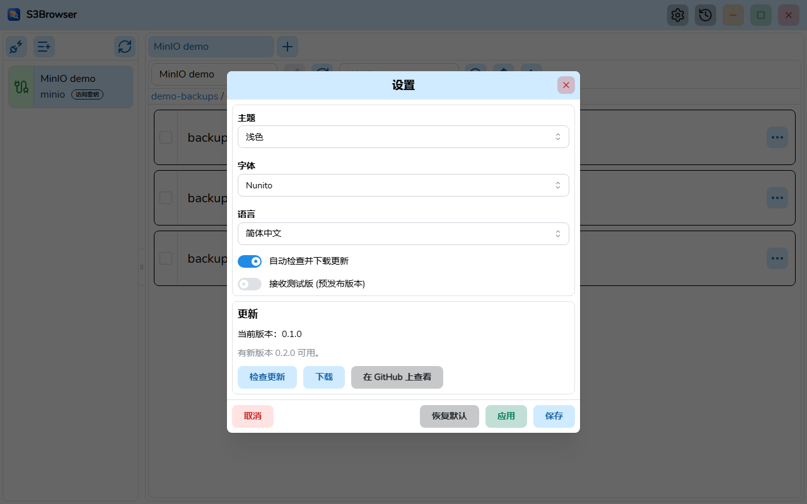

- **自动检查并下载更新**：开启后，应用会检查新版本并在后台下载。
- **接收测试版 (预发布版本)**：同时提供标为 Pre-release 的版本。
- **检查更新**：立即检查。**当前版本**下方的一行会告诉你结果（例如**有新版本 ... 可用。**或**已是最新版本。**）。
- **下载**用于下载新版本，**立即更新**用于在下载完成后安装，**在 GitHub 上查看**用于打开发布页面。

有新版本时，窗口顶部的提示会提供**下载**；下载期间会显示进度，下载完成后会提供**更新**。已下载的文件在安装前会经过校验。

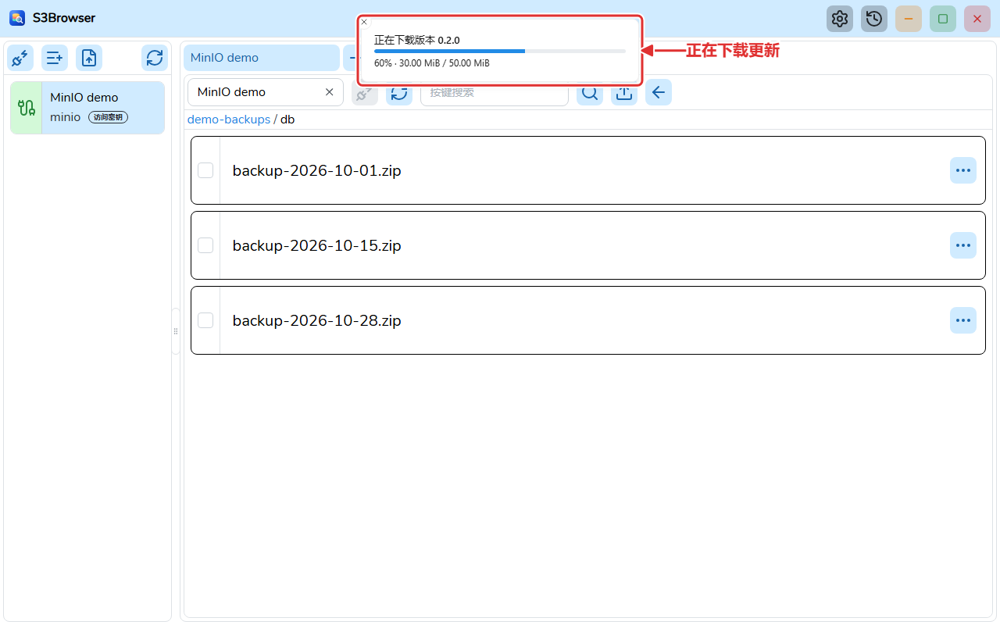

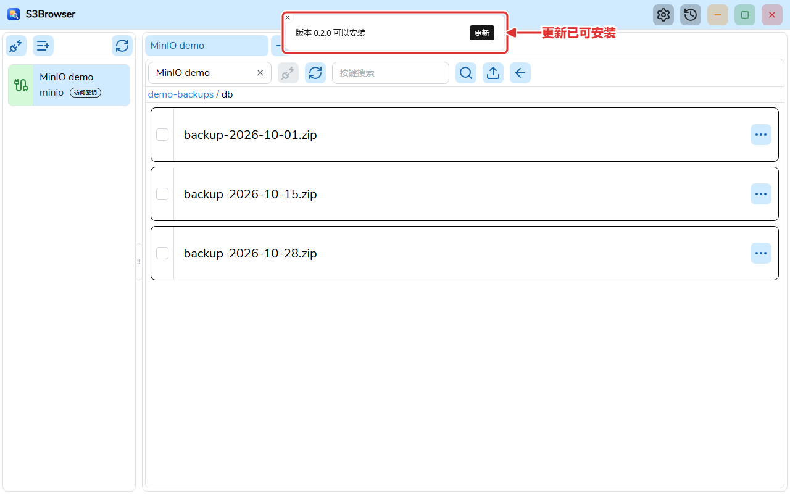

真实的更新无法在截图中显示：上图使用示例值显示该提示。

## 11. 故障排除

消息显示在窗口顶部。以下是你最常遇到的消息。

| 消息 | 原因及处理办法 |
| --- | --- |
| 访问密钥或秘密密钥对此终端节点无效。 | 密钥有误，或属于另一台服务器。请在配置文件中检查，并使用**测试连接**。 |
| 连接终端节点超时，请检查地址以及服务器是否正在运行。 | 终端节点有误、服务器已停止，或被防火墙或网络阻止。请检查地址（含 `http://` 或 `https://`）和端口。 |
| 终端节点拒绝了请求。 / 连接到 S3 存储桶时出错。 | 服务器有响应但拒绝了连接。请检查终端节点、区域和 **Path style**（MinIO 需要）。 |
| 配置文件 {name} 未连接。 | 连接已关闭。请重新连接该配置文件。 |
| 获取存储桶列表出错 / 获取对象列表出错 | 账户可能无权列出存储桶或该存储桶，或连接已断开。请检查密钥的权限并重新连接。 |
| 存储桶访问受限。 | 你的账户无法列出所有存储桶。请申请缺少的权限，或打开你有权使用的存储桶。 |
| 另一个上传正在进行，请等待其完成。 | 同一时间只能进行一个上传。请等待其完成，或在**正在上传**窗口中取消。 |
| 文件夹 ... 要上传的文件超过 50 个。 / 一次最多上传 1000 个文件。 | 见第 9.1 节的限制。请拆分上传或选择更少的文件。 |
| 配置文件 [{name}] 有正在进行的上传或下载，无法删除。 | 请等待传输完成或取消它们，然后再删除配置文件。 |
| 请先断开连接再执行此操作！ | 编辑或删除配置文件前，请先断开连接（右键点击，选择**断开连接**）。 |
| 最多只能选择 5 项！ | 下载或删除时最多选择 5 个对象。 |
| 目标位置 ... 不存在。 | 为下载选择的文件夹不可用。请选择其他位置。 |

如果某条消息未在此列出，它会包含操作名称和服务器报告的原因。该原因（例如 `AccessDenied` 或 `NoSuchBucket`）是 S3 自身的消息，会告诉你在服务器端需要修复什么。

下面两张连接错误的截图是通过**测试连接**截取的。

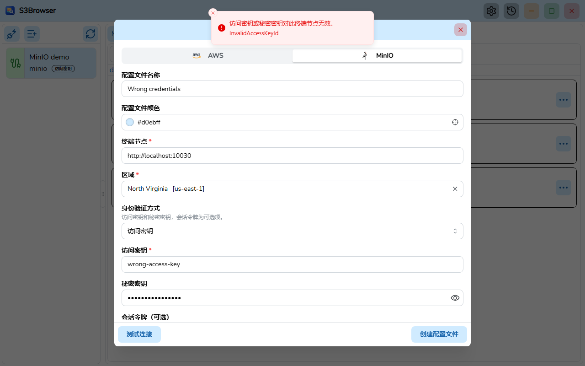

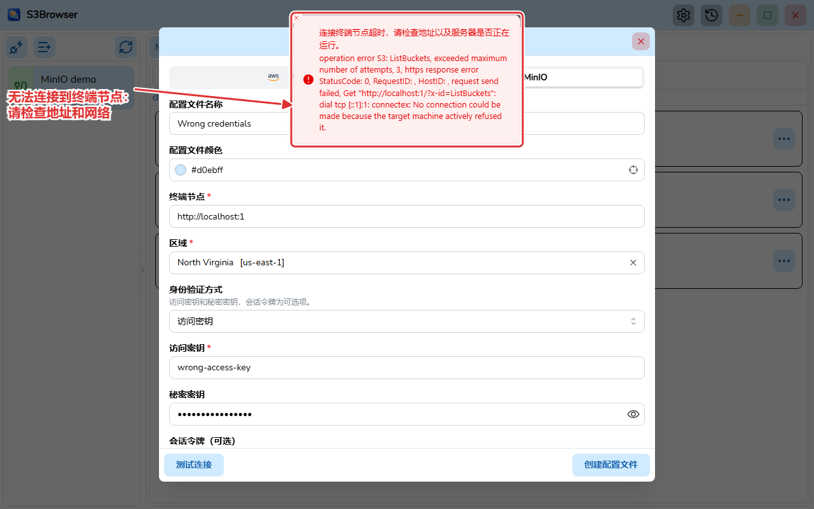
