# S3 Browser 使用者指南

版本 0.0.1-beta.1

> 本譯文尚未經過母語人士審校。

## 1. 簡介

S3 Browser 是一款桌面應用程式，用於瀏覽和管理 **AWS S3** 以及 **MinIO** 等相容 S3 的伺服器上的儲存貯體和物件。您可以：

- 儲存連線設定檔，並同時連線多個帳戶（每個連線一個索引標籤）；
- 使用存取金鑰、擔任角色、AWS SSO、MinIO STS、LDAP、OpenID Connect (OIDC) 或用戶端憑證登入；
- 瀏覽儲存貯體、資料夾和物件，並進行搜尋；
- 建立、檢視、變更權限和刪除儲存貯體；
- 檢視物件的詳細資訊；
- 上傳檔案和資料夾（拖放或使用對話方塊），並有即時進度視窗；
- 下載物件並檢視下載記錄；
- 刪除物件和整個資料夾；
- 透過 GitHub Releases 讓應用程式保持最新。

介面支援英文、越南文、日文、簡體中文、繁體中文、俄文和德文。

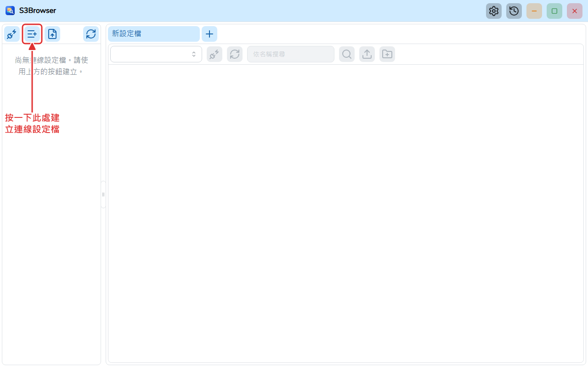

視窗分為三個區域：左側的**設定檔清單**、右側的**索引標籤**（每個索引標籤顯示一個連線的儲存貯體和物件），以及頂端的**標題列**，其中有**設定**按鈕和下載記錄按鈕。

> 這是測試版 (0.0.1-beta.1)。刪除物件前請備份重要資料：刪除後無法復原。

## 2. 安裝

在 Windows 上有兩種取得應用程式的方式。

- **安裝程式**：從 [GitHub Releases](https://github.com/TranMinhTruyen/s3-browser/releases) 頁面下載 `S3Browser-<version>-windows-amd64-installer.exe` 並執行，然後依步驟操作。**Latest** 版本是穩定版；標有 **Pre-release** 的是測試版。安裝後可從開始功能表啟動應用程式。設定檔和下載記錄儲存在您的使用者設定檔中。只有安裝版可以自動更新（請參閱[更新](#102-更新)）。
- **可攜版**：將可攜版資料夾複製到任何位置（例如隨身碟），然後執行 `S3Browser.exe`。它使用 `webview2` 資料夾中隨附的 WebView2 執行階段，並將資料儲存在程式旁邊的 `data` 資料夾中，因此不會在其他位置寫入任何內容。請勿將 `webview2` 和 `data` 資料夾從程式旁移走。

## 3. 連線至 AWS S3 或 MinIO

按一下**建立連線設定檔**按鈕（設定檔清單上方的第二個按鈕），將開啟**連線設定檔**視窗。

### 3.1 設定檔表單

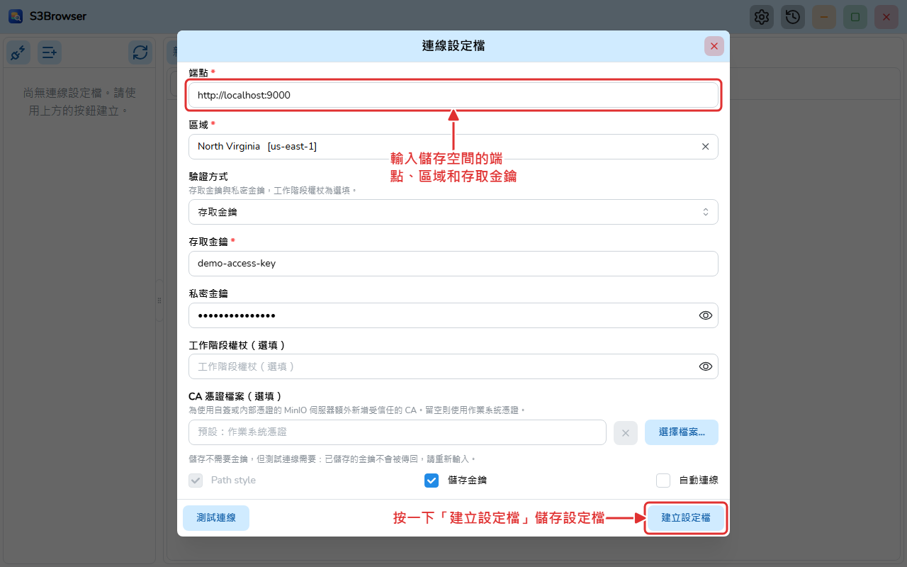

| 欄位 | 說明 |
| --- | --- |
| AWS / MinIO | 選擇伺服器類型。選擇 MinIO 會自動開啟 **Path style**。可用的驗證方式取決於此項。 |
| 設定檔名稱 | 在設定檔清單和索引標籤中顯示的名稱。 |
| 設定檔顏色 | 設定檔在清單中的顏色。 |
| 端點 | 伺服器位址，例如 `https://s3.amazonaws.com` 或 `http://localhost:9000`。 |
| 區域 | 您的帳戶所在區域，例如 `North Virginia [us-east-1]`。必填，但部分方式會從 AWS 組態中讀取。 |
| 驗證方式 | 應用程式的登入方式（請參閱[驗證方式](#32-驗證方式)）。其下的欄位會隨方式而變化。 |
| 存取金鑰 | 您的帳戶的存取金鑰。 |
| 私密金鑰 | 您的帳戶的私密金鑰。按一下眼睛圖示可顯示。 |
| 工作階段權杖（選填） | 臨時憑證的工作階段權杖。 |
| CA 憑證檔案（選填） | 請參閱 [MinIO 的 CA 憑證](#33-minio-的-ca-憑證)。 |
| Path style | 以 `endpoint/bucket` 而不是 `bucket.endpoint` 的方式存取儲存貯體。MinIO 和大多數自行架設的伺服器都需要。 |
| 儲存金鑰 | 將金鑰（加密後）儲存到設定檔中。不勾選則每次連線都必須輸入。 |
| 自動連線 | 應用程式啟動時自動連線該設定檔。僅在勾選**儲存金鑰**時可用，並且不適用於每次連線都需要輸入的方式（例如 OIDC 或 MFA 代碼）。 |

底部有兩個按鈕：

- **測試連線**：檢查所填的值，不儲存任何內容。已儲存的金鑰不會再次顯示，因此測試時請重新輸入。綠色訊息表示測試成功；紅色訊息會說明問題（請參閱[疑難排解](#11-疑難排解)）。
- **建立設定檔**：儲存設定檔（從既有設定檔開啟視窗時，按鈕為**更新設定檔**）。

> 切勿分享顯示了您的私密金鑰的螢幕擷圖。本指南中的金鑰欄位只包含預留位置值。

### 3.2 驗證方式

在**驗證方式**中選擇方式。清單取決於伺服器類型。

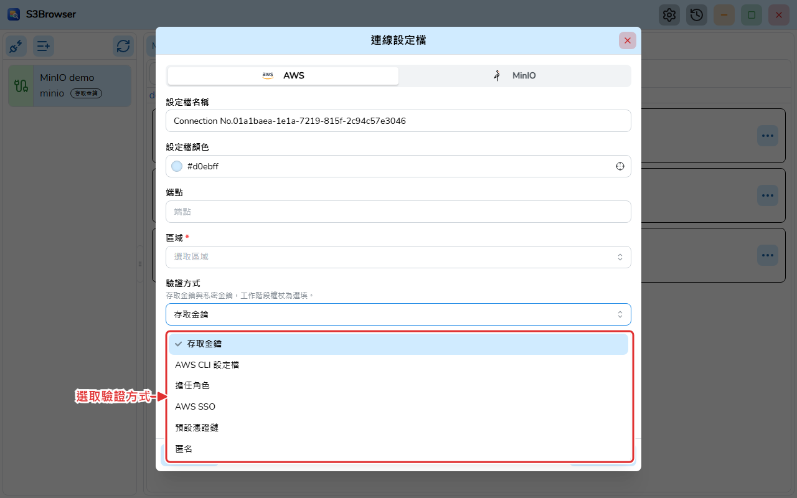

| 方式 | 伺服器 | 需要填寫的內容 |
| --- | --- | --- |
| 存取金鑰 | AWS、MinIO | 存取金鑰、私密金鑰和選填的工作階段權杖。 |
| AWS CLI 設定檔 | AWS | AWS CLI 檔案 (`~/.aws`) 中的一個設定檔，以及選填的 **AWS 組態檔（選填）** 和 **AWS 憑證檔案（選填）** 路徑（預設：`~/.aws/config`、`~/.aws/credentials`）。 |
| 擔任角色 | AWS | **角色 ARN**、用於擔任該角色的憑證（**存取金鑰**或 **AWS CLI 設定檔**），以及選填的 **外部 ID（選填）**、**工作階段名稱（選填）**、**持續時間（秒）** 和 **MFA 裝置序號（選填）**。**MFA 代碼**在連線時詢問，不會被儲存。 |
| AWS SSO | AWS | 一個已登入的 AWS CLI 設定檔。請先執行 `aws sso login --profile <profile>`。 |
| 預設憑證鏈 | AWS | 無需填寫：使用環境中找到的憑證（環境變數、共用檔案或執行個體角色）。 |
| 匿名 | AWS、MinIO | 只需填寫要開啟的公開儲存貯體名稱（匿名使用者無法列出儲存貯體）。 |
| MinIO STS | MinIO | 存取金鑰、私密金鑰，以及選填的 **角色 ARN（選填）**、**持續時間（秒，選填）** 和 **內嵌政策（JSON，選填）**。 |
| LDAP | MinIO | **LDAP 使用者名稱** 和 **LDAP 密碼**，以及選填的 **持續時間（秒，選填）** 和 **內嵌政策（JSON，選填）**。 |
| OIDC | MinIO | **用戶端 ID**、**簽發者 URL**、選填的 **範圍（選填）** 和 **回呼連接埠**。 |
| 用戶端憑證 | MinIO | **用戶端憑證檔案** 和 **私密金鑰檔案**；如有需要，勾選 **私密金鑰設有密碼**。端點必須使用 `https://`。 |

需要更多欄位的方式如下所示（值均為預留位置值）。

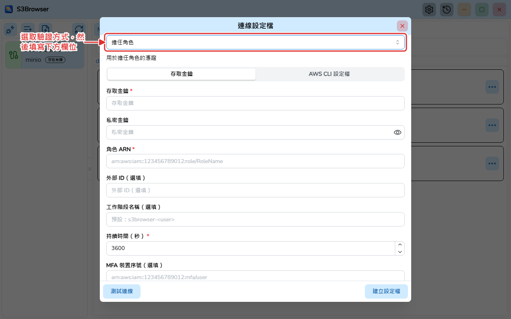

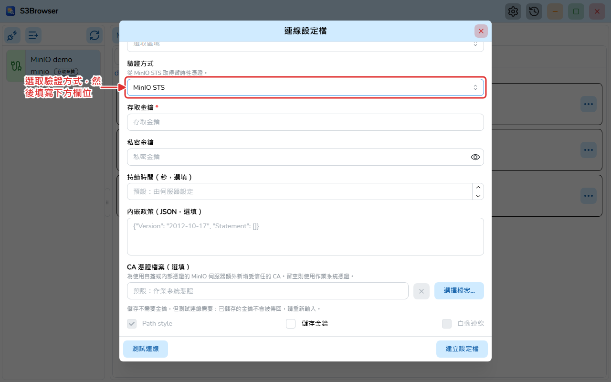

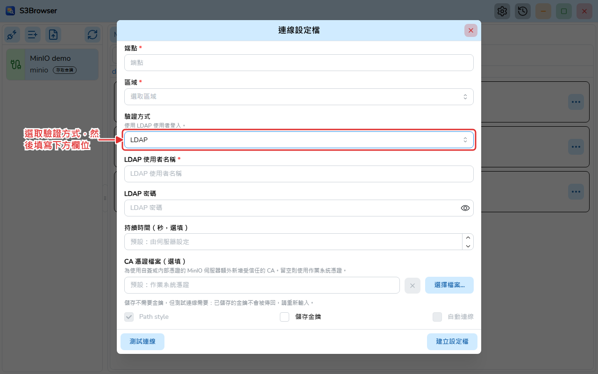

**OIDC。** 複製表單中顯示的 **重新導向 URI**（**複製**按鈕），並將其註冊為身分提供者中該用戶端的重新導向 URI。按一下**登入**：會開啟您的網頁瀏覽器，在其中登入。表單會顯示**正在等待在瀏覽器中完成登入...**，然後顯示**已登入，有效期限至 ...**；**取消登入**會停止等待。登入資訊僅使用一次，不會被儲存。過期後表單會顯示**登入已過期，請重新登入**。瀏覽器視窗無法在螢幕擷圖中顯示。

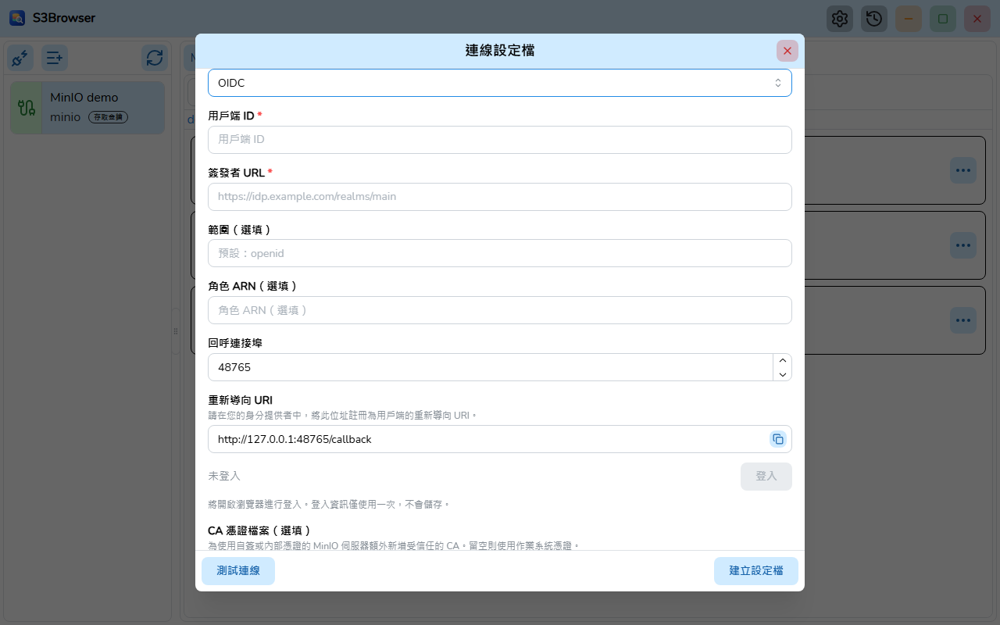

**用戶端憑證。** 按一下檔案欄位旁的**選擇檔案...**，並在系統對話方塊中選擇檔案（對話方塊無法在螢幕擷圖中顯示）；**清除檔案**會清空該欄位。檔案會在連線時讀取，其內容不會被儲存。

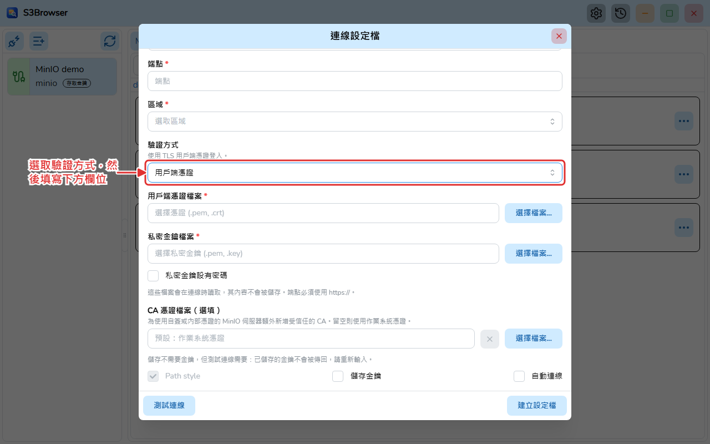

部分憑證會過期。過期前不久，應用程式會提示您更新：使用 MFA 代碼（擔任角色）、重新登入（OIDC、SSO），或中斷連線後再連線。

### 3.3 MinIO 的 CA 憑證

使用自簽或內部憑證的 MinIO 伺服器需要額外新增受信任的 CA。在 **CA 憑證檔案（選填）** 中，按一下**選擇檔案...**並選擇 CA 憑證（`.pem` 或 `.crt`）。留空則使用作業系統的憑證。該檔案僅用於連線 MinIO，不用於 OIDC 身分提供者。

## 4. 管理設定檔

建立設定檔後，它會出現在設定檔清單中。

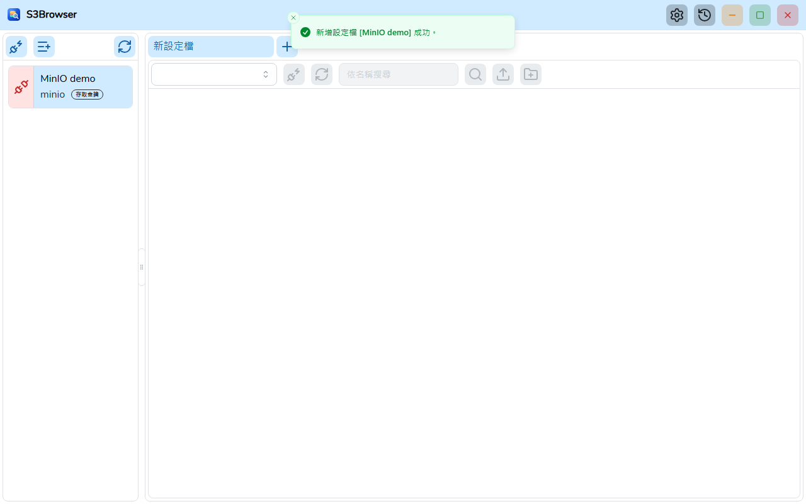

在設定檔上按一下滑鼠右鍵可開啟其功能表。

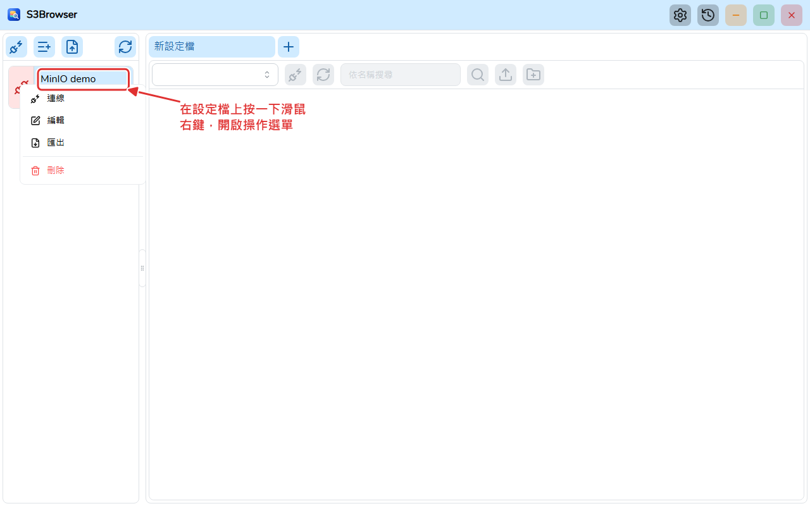

- **連線**：開啟連線。已連線的設定檔會顯示綠色圖示。
- **中斷連線**：關閉連線。編輯或刪除設定檔前，請先中斷連線。
- **編輯**：變更設定檔（視窗標題仍為**連線設定檔**，按鈕為**更新設定檔**）。系統會請您確認更新。
- **匯出**：將設定檔儲存為 JSON 檔案；請參閱 [4.1 匯出設定檔](#41-匯出設定檔)。
- **刪除**：確認後刪除設定檔。

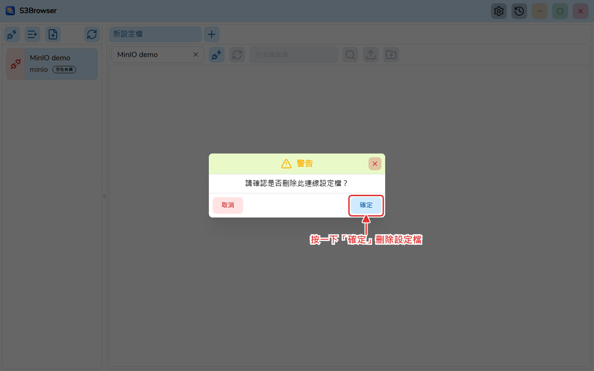

仍有上傳或下載在進行的設定檔無法刪除。請等待傳輸完成或先取消它們。

清單上方的第一個按鈕（**連線**）會開啟同一個視窗，其中有**連線**按鈕，用於只連線一次而不儲存設定檔；**重新整理連線設定檔清單**按鈕用於重新載入清單。

### 4.1 匯出設定檔

匯出會將設定檔複製到一個檔案中，例如用於在另一台電腦上使用。在設定檔上按一下滑鼠右鍵，然後選取**匯出**。

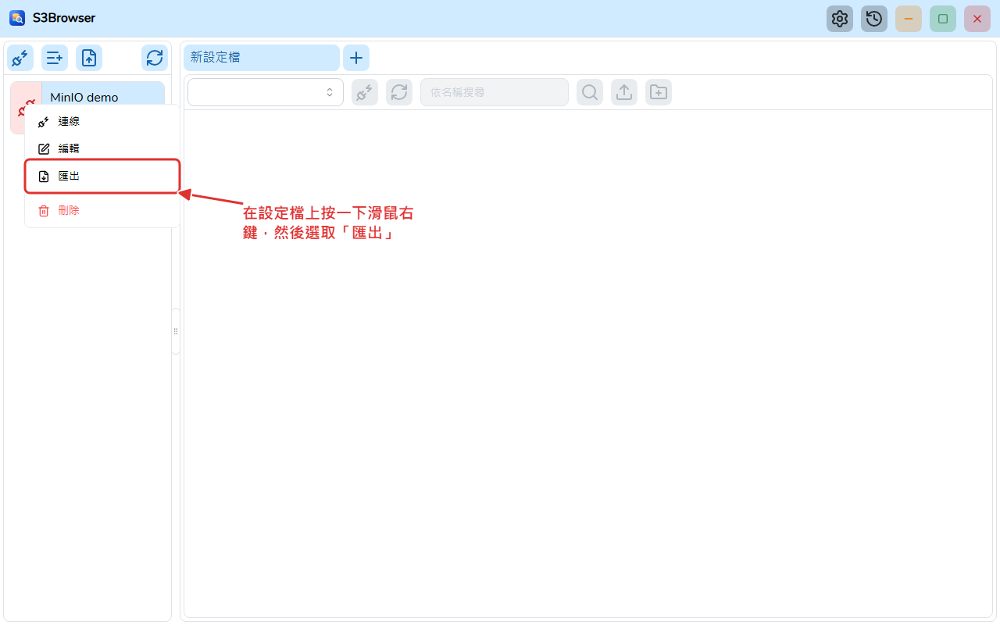

**匯出設定檔**視窗隨即開啟。

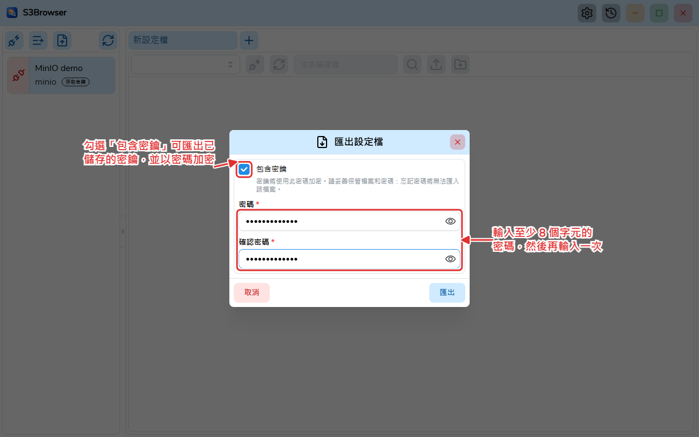

- 讓**包含密鑰**保持關閉，則匯出的設定檔不含密鑰（Secret Key、工作階段權杖、LDAP 密碼、金鑰通關密語）。繼續之前，如果設定檔有已儲存的密鑰，應用程式會發出警告：「設定檔 [名稱] 中已儲存的金鑰將不會被匯出。匯入後需要重新輸入。要在不含金鑰的情況下匯出嗎？」確認即匯出，取消則返回。匯入後，請編輯該設定檔並重新輸入密鑰。
- 勾選**包含密鑰**，則一併匯出已儲存的密鑰。輸入至少 8 個字元的**密碼**，並在**確認密碼**中再輸入一次。密鑰會以此密碼加密（PBKDF2 和 AES-GCM）：檔案中絕不會以明文寫入密鑰。當設定檔沒有已儲存的密鑰時，此選項無法使用（「此設定檔沒有已儲存的密鑰。」）。

按一下**匯出**。Windows 儲存對話方塊隨即開啟，並依設定檔名稱建議檔名：僅含小寫字母、數字和底線，例如 `minio_demo.json`。選取儲存位置。檔案寫入後會顯示一則訊息。如果關閉儲存對話方塊，則不會寫入任何內容，**匯出設定檔**視窗保持開啟。

檔案包含設定檔的連線設定（名稱、顏色、提供者、端點、區域、存取金鑰、路徑樣式、自動連線、驗證方法及其選項），不包含設定檔 ID、日期等內部資料。憑證和金鑰檔案只匯出路徑，不匯出檔案本身。

請妥善保管檔案和密碼。密碼不會儲存在任何地方：忘記密碼，就無法匯入該檔案。請勿手動編輯含有密鑰的檔案。如果其中的提供者、端點或驗證方法被修改，匯入將失敗，並提示「密碼錯誤，或檔案已損毀。」

### 4.2 匯入設定檔

按一下**匯入連線設定檔**按鈕（位於設定檔清單上方，在**建立連線設定檔**旁邊）。

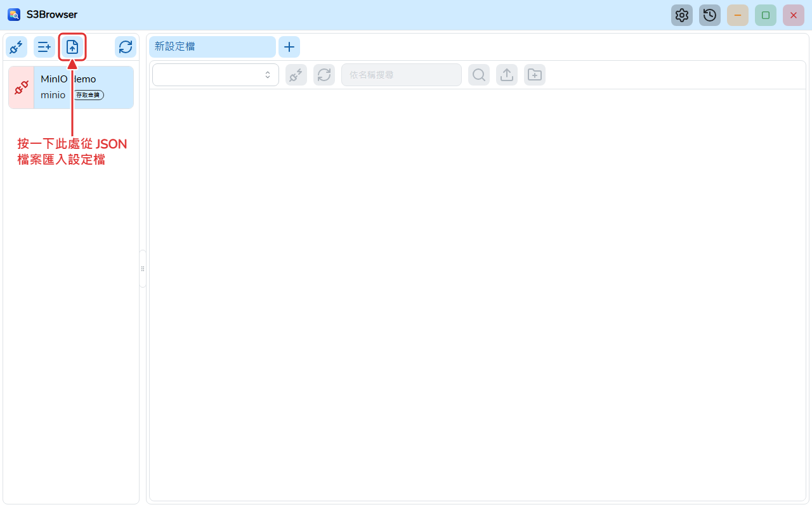

Windows 開啟檔案對話方塊隨即出現：選取由 S3Browser 匯出的 `.json` 檔案（最大 1 MB）。應用程式會先檢查檔案，然後才儲存任何內容。例如，「此檔案不是有效的 S3Browser 設定檔。」表示該檔案不是 S3Browser 匯出的設定檔；檔案版本不受支援或檔案過大時也會有訊息提示。

- 不含密鑰匯出的檔案會立即匯入。
- 含密鑰匯出的檔案會開啟**匯入設定檔**視窗：輸入匯出該檔案時使用的密碼，然後按一下**匯入**。

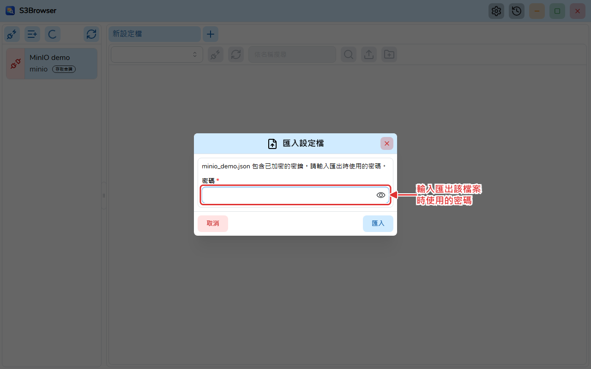

如果密碼錯誤，會顯示「密碼錯誤，或檔案已損毀。」，視窗保持開啟，您可以重新輸入密碼或按一下**取消**。在密碼正確之前不會儲存任何內容。

匯入的設定檔會作為新的設定檔加入清單：

- 如果已有同名設定檔，新設定檔會加上編號：**名稱 (2)**、**名稱 (3)**，依此類推。
- 如果檔案在此電腦上不存在，或路徑是網路路徑或裝置路徑（如 `\\host\share`、`\\?\`、`\\.\`，即使該路徑存在），該路徑都會被清空。這適用於 CA 憑證、**用戶端憑證**方式的憑證和私密金鑰，以及 AWS config 和 credentials 檔案。一則警告會列出這些欄位：「已匯入設定檔 [名稱]。下列檔案路徑在此電腦上不存在，已清除：{fields}。」連線之前，請編輯設定檔並重新選取這些檔案。
- 匯入不會連線該設定檔，即使檔案中開啟了**自動連線**；自動連線會在應用程式下次啟動時生效。
- 不含密鑰匯出的設定檔沒有密鑰：請編輯並輸入。

Windows 的儲存和開啟對話方塊無法在螢幕擷取畫面中顯示。**匯入設定檔**視窗的圖片呈現的是以範例檔案開啟的視窗。

## 5. 瀏覽儲存貯體和物件

每個索引標籤對應一個設定檔。要在索引標籤中使用某個設定檔，請在索引標籤左上角的下拉式清單中選擇它，然後（如果該設定檔尚未連線）按一下旁邊的**連線**按鈕。使用 **+** 按鈕（**新增索引標籤**）開啟另一個索引標籤，例如用於第二個帳戶。拖曳索引標籤可重新排序（或按 Ctrl+Shift+左/右）；已開啟的索引標籤會在下次啟動應用程式時還原。

顯示儲存貯體清單：

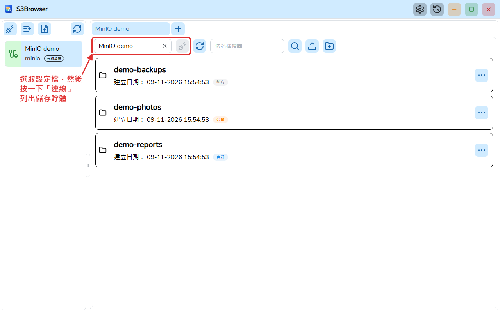

按一下儲存貯體可檢視其中的物件。資料夾顯示在最前；按一下資料夾即可開啟。清單上方的路徑（例如 `demo-photos / travel / 2026`）可以按一下，箭頭按鈕返回上一層（返回上層資料夾，在儲存貯體頂層則返回儲存貯體清單）。

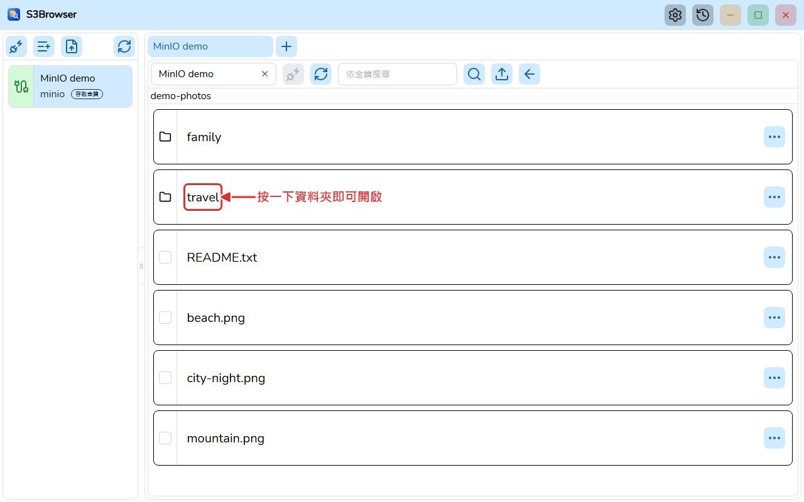

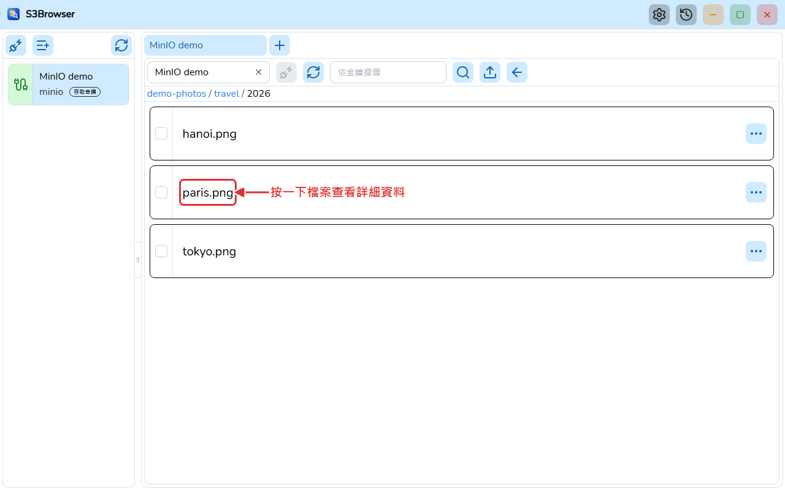

大型儲存貯體會分頁載入；向下捲動時會自動載入更多物件。使用**重新整理**按鈕（**重新整理物件清單**或**重新整理儲存貯體清單**）可重新載入目前的檢視。

## 6. 搜尋

在清單上方的搜尋方塊中輸入內容，然後按 Enter（或按一下放大鏡）。

- 在儲存貯體清單中依**名稱**搜尋。
- 在儲存貯體內依**金鑰**搜尋（即目前資料夾中名稱包含該文字的物件和資料夾；搜尋不區分大小寫，也不會進入子資料夾）。

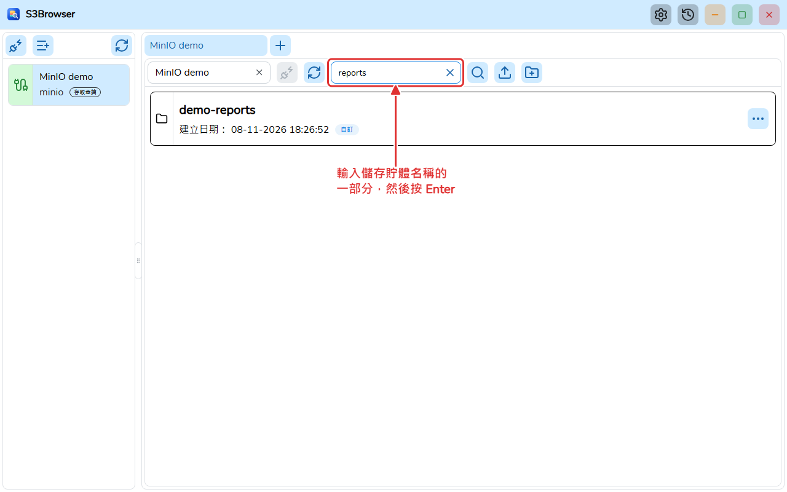

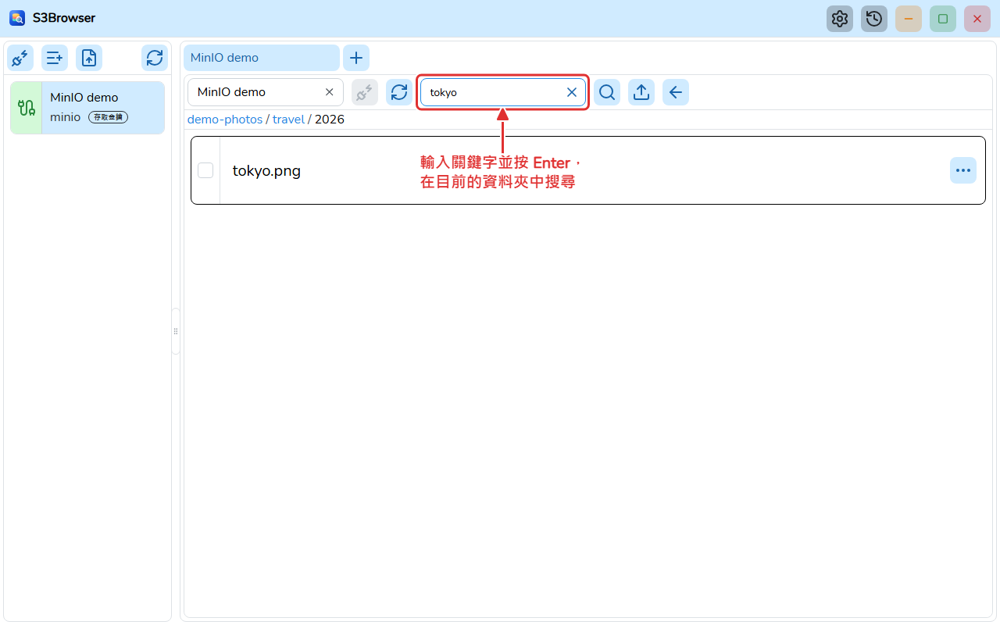

當結果清單末尾出現**搜尋更多**時，按一下它可繼續搜尋。搜尋方塊中的 **x** 用於清除搜尋。

## 7. 物件詳細資訊

按一下檔案，右側會開啟**物件詳細資訊**面板。它顯示物件的名稱、金鑰、大小、上次修改時間、ETag、內容類型、儲存類別和中繼資料。金鑰和 ETag 旁的複製按鈕會將值複製到剪貼簿。如果無法載入詳細資訊，請按一下**重試**。使用**關閉**按鈕關閉面板。

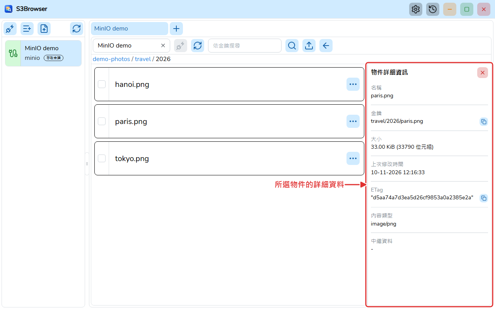

## 8. 管理儲存貯體

### 8.1 政策徽章和儲存貯體功能表

清單中的每個儲存貯體都會顯示一個表示其政策類型的徽章：**私有**（沒有儲存貯體政策）、**公開**（任何人都可以讀取和列出物件）或**自訂**（自訂政策）。將滑鼠指向徽章可檢視其含義。無法存取的儲存貯體會有相應標記。

開啟儲存貯體列末尾的**更多操作**功能表（三個點）：

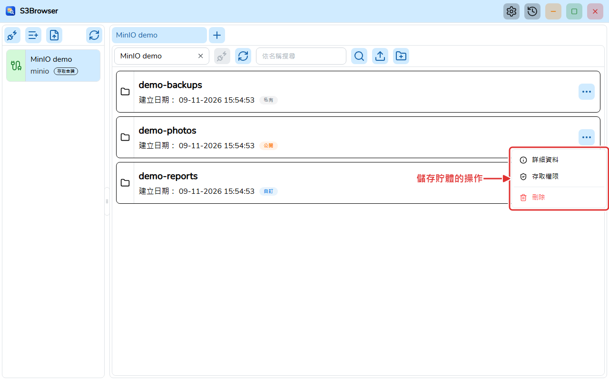

- **詳細資料**：開啟儲存貯體詳細資料。
- **存取權限**：變更誰可以存取該儲存貯體。
- **刪除**：刪除儲存貯體。

當帳戶無權使用**存取權限**和**刪除**時，這兩項會被隱藏；使用**匿名**方式時只提供**詳細資料**。

### 8.2 儲存貯體詳細資料

選擇**詳細資料**，右側會開啟**儲存貯體詳細資料**面板。

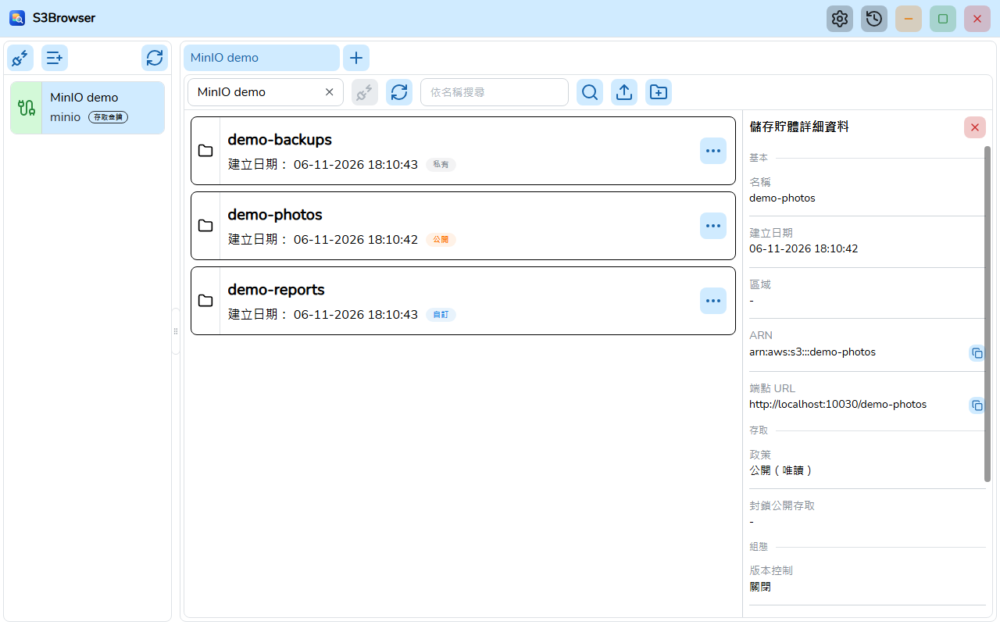

- **基本**：**名稱**、**建立日期**、**區域**、**ARN** 和 **端點 URL**。
- **存取**：**政策**（**私有**、**公開（唯讀）**或**自訂**）和**封鎖公開存取**（**開啟**或**關閉**）。
- **組態**：**版本控制**、**預設加密**、**物件鎖定**、**標籤**和**根目錄物件數**。根目錄物件數最多計到 10,000，之後顯示 `10,000+`。

如果無法載入詳細資料，請按一下**重試**。使用**關閉**按鈕關閉面板。

### 8.3 建立儲存貯體

按一下儲存貯體清單上方的**建立儲存貯體**按鈕。

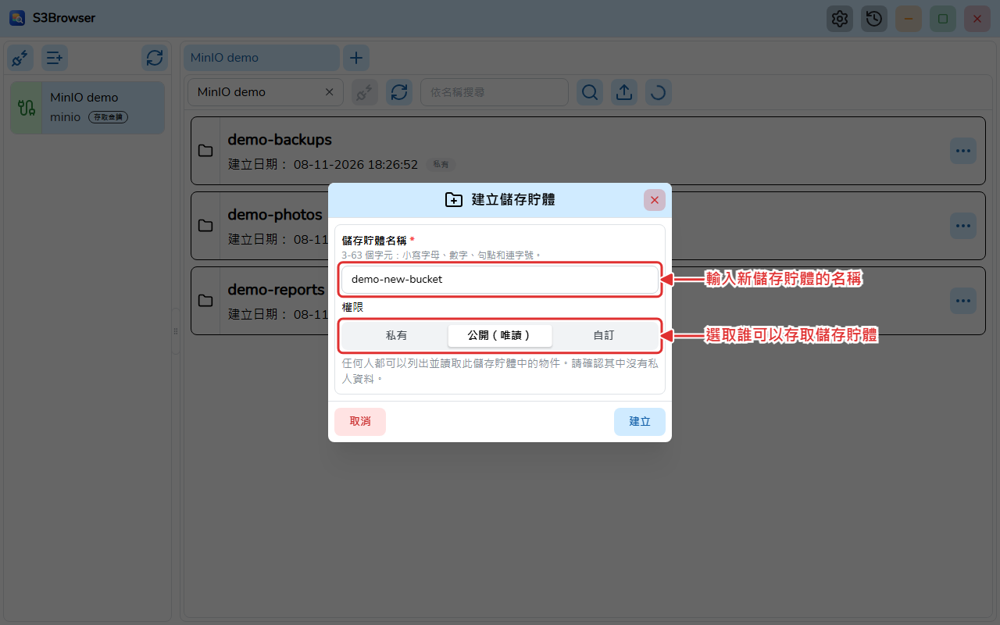

- **儲存貯體名稱**：3-63 個字元：小寫字母、數字、句點和連字號。
- **權限**：**私有**、**公開（唯讀）**或**自訂**（然後以 JSON 輸入政策）。
- 在 AWS 上，新的儲存貯體預設會封鎖公開存取，因此在關閉「封鎖公開存取」之前，公開政策可能會被拒絕。儲存貯體仍會被建立，並有警告告訴您權限未被套用。
- 在 AWS 上，還會顯示**區域**欄位，用於選擇新儲存貯體的區域（預設為設定檔的區域）；由於需要真實的 AWS 帳戶，這一點無法在螢幕擷圖中顯示。

按一下**建立**，儲存貯體清單會重新整理。

### 8.4 變更權限

在儲存貯體功能表中選擇**存取權限**。

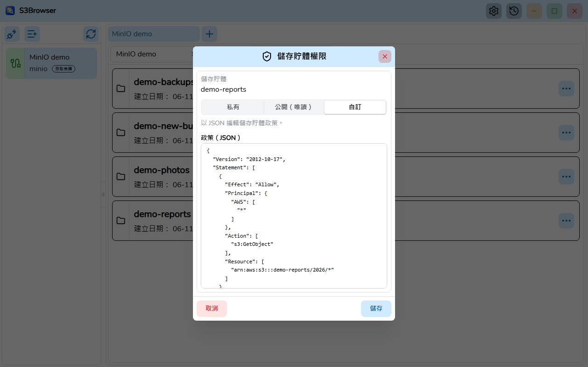

| 模式 | 含義 |
| --- | --- |
| 私有 | 沒有儲存貯體政策。只有獲得授權的使用者才能存取此儲存貯體。 |
| 公開（唯讀） | 任何人都可以列出並讀取此儲存貯體中的物件。請確認其中沒有私人資料。 |
| 自訂 | 以 JSON 編輯儲存貯體政策。 |

當儲存貯體已啟用封鎖公開存取（公開政策將被拒絕），或您的帳戶無權變更權限時，視窗會給出警告。按一下**儲存**。

### 8.5 刪除儲存貯體

在儲存貯體功能表中選擇**刪除**。

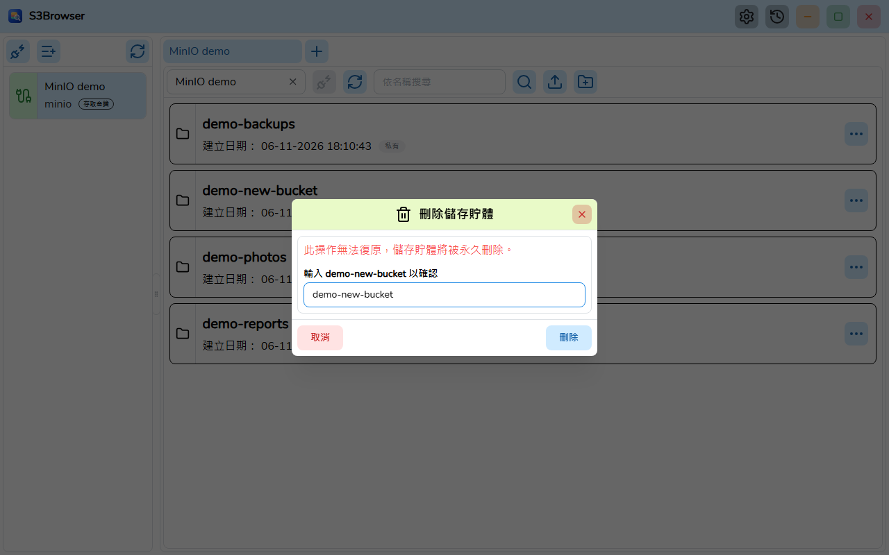

- 輸入儲存貯體名稱以確認，然後按一下**刪除**。
- 不是空的儲存貯體會先被清空：**其中所有物件都會被刪除**（啟用版本控制時，還包括每個版本和刪除標記）。此操作無法復原。
- 啟用了物件鎖定且不是空的儲存貯體無法刪除。
- 刪除無法取消，在結束前視窗也無法關閉；對於大型儲存貯體，這可能需要很長時間。之後只會重新整理目前的索引標籤。

## 9. 傳輸和刪除物件

### 9.1 上傳

有兩種方式上傳到您目前檢視的資料夾（或儲存貯體）。

**拖放。** 將檔案和資料夾從檔案總管拖到物件清單上。拖入資料夾會上傳其中的所有檔案，並保持資料夾結構。拖曳操作無法在螢幕擷圖中顯示。

**上傳對話方塊。** 按一下**上傳檔案**按鈕（清單上方向上的箭頭）。**上傳檔案**視窗隨即開啟，並顯示目的地（**上傳至：...**）。

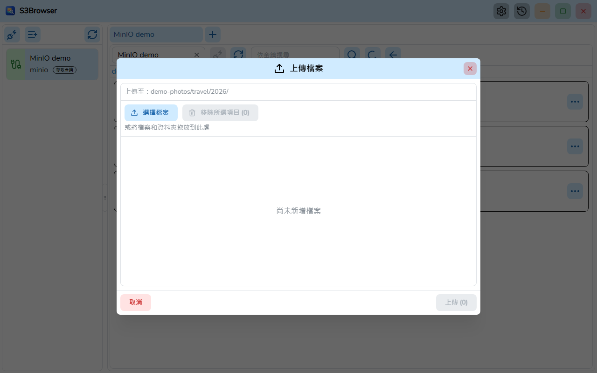

- 按一下**選擇檔案**並在系統對話方塊中選擇檔案，或將檔案和資料夾拖入視窗。
- 清單顯示每個檔案及其大小。取消勾選某個檔案可將其排除，按一下垃圾桶圖示可將其從清單中移除，也可以使用**移除所選項目**。
- 如果是從儲存貯體清單開啟的對話方塊，請先選擇目標儲存貯體。
- 按一下**上傳**開始。

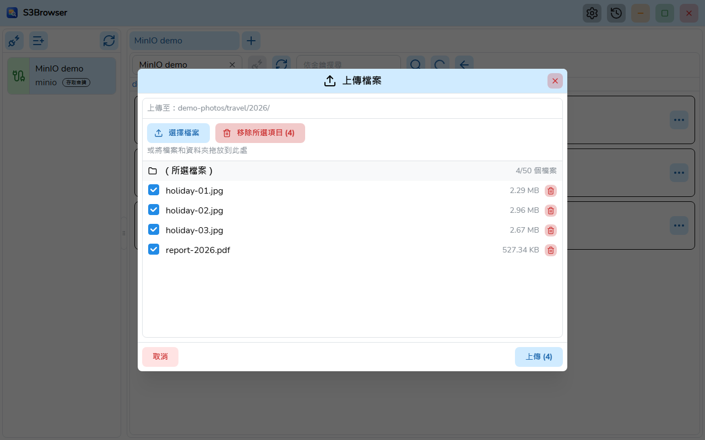

為使傳輸易於管理，適用以下限制：

| 限制 | 值 |
| --- | --- |
| 每次上傳中來自同一資料夾的檔案數 | 50 |
| 來自同一資料夾的大型檔案（超過 10 GiB）數 | 4 |
| 每次上傳的檔案數 | 1000 |
| 同時進行的上傳數 | 1（請等待正在進行的上傳完成） |

當拖入的資料夾超出限制時，**選擇要上傳的檔案**視窗會讓您勾選要上傳的檔案；未超出限制的資料夾會完整上傳。無法上傳的項目（無法讀取的檔案、符號連結）會被略過，並告訴您略過了多少個。

**上傳中**視窗出現在右下角，顯示每個檔案的進度（百分比圓環、**已上傳**和**剩餘**）。按一下某個檔案上的**取消**，或頂端的**全部取消**即可停止。該視窗可以關閉，並可透過它的按鈕重新開啟。

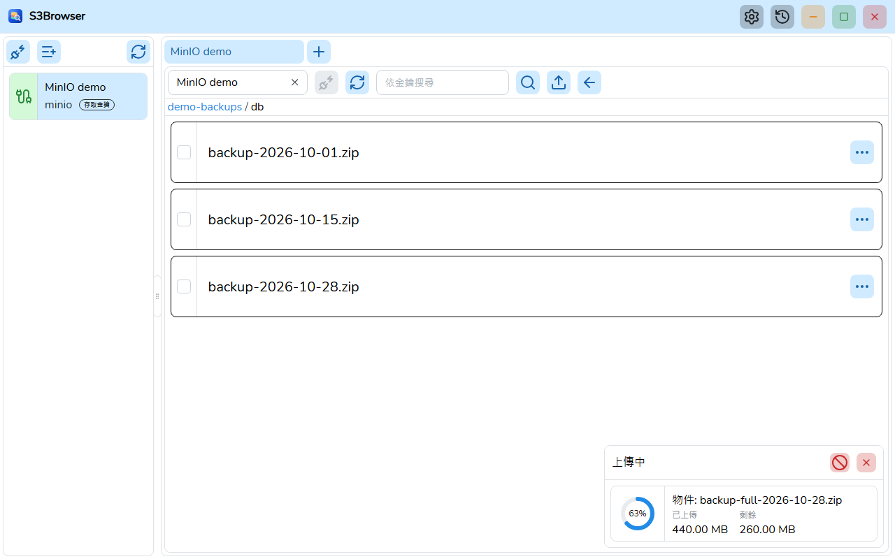

上傳完成後，按一下**重新整理**即可看到新物件。

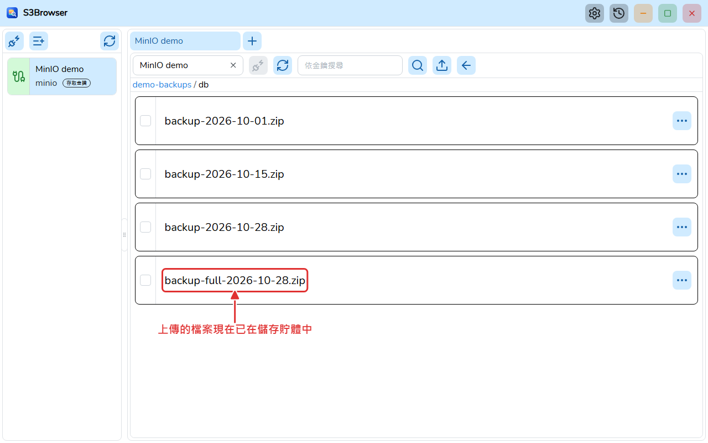

### 9.2 下載

- 下載單一物件：開啟其列末尾的**更多動作**功能表（三個點），選擇**下載**。對話方塊會詢問儲存位置。
- 下載多個物件：勾選它們（最多 5 個），然後按一下工具列中的**下載所選項目**。對話方塊會詢問目的地資料夾。

資料夾無法下載；它們會從所選項目中排除。

**下載中**視窗顯示每個檔案的進度（**已下載**和**剩餘**），並有**取消**和**全部取消**按鈕。下圖顯示了該視窗。

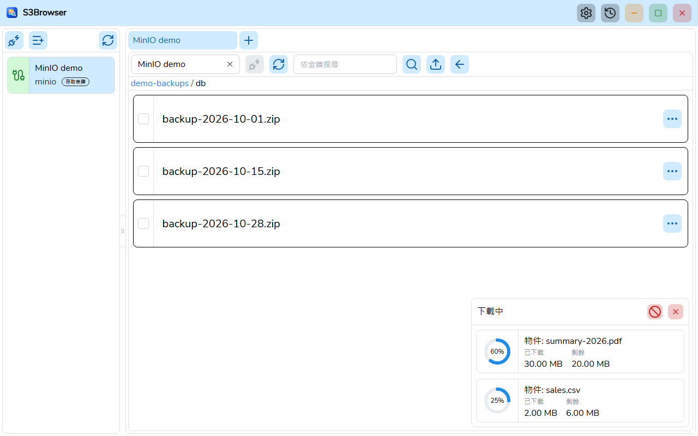

按一下右上角的時鐘按鈕可開啟**下載記錄**：包含每次下載的大小、時間、狀態和目的地路徑。

### 9.3 選取多個物件

勾選各列開頭的核取方塊。工具列隨後會顯示**取消選取**、**下載所選項目**和**刪除所選項目**。下載或刪除時，一次最多可選取 5 個物件。

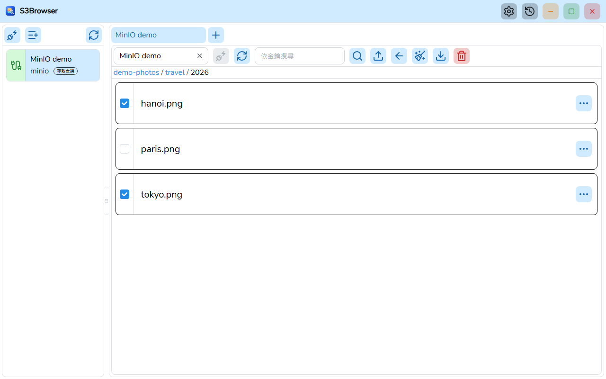

### 9.4 刪除

開啟物件的**更多動作**功能表並選擇**刪除**，或選取多個物件後按一下**刪除所選項目**。確認視窗會顯示將被刪除的內容；按一下**刪除 (n)**確認，n 為所選項目數。

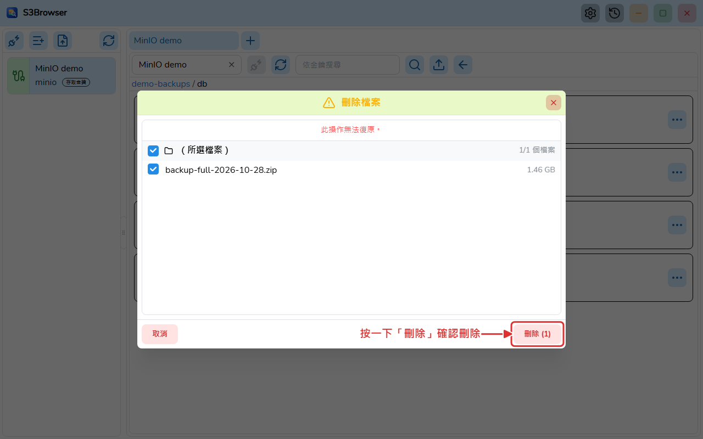

刪除**資料夾**會刪除該資料夾**及其中的所有內容**。確認視窗會說明這一點，且此操作無法復原。如果部分物件無法刪除，訊息會告訴您失敗了多少個、刪除了多少個。

## 10. 設定和更新

### 10.1 設定

按一下右上角、下載記錄按鈕左側的**設定**按鈕（齒輪圖示）。

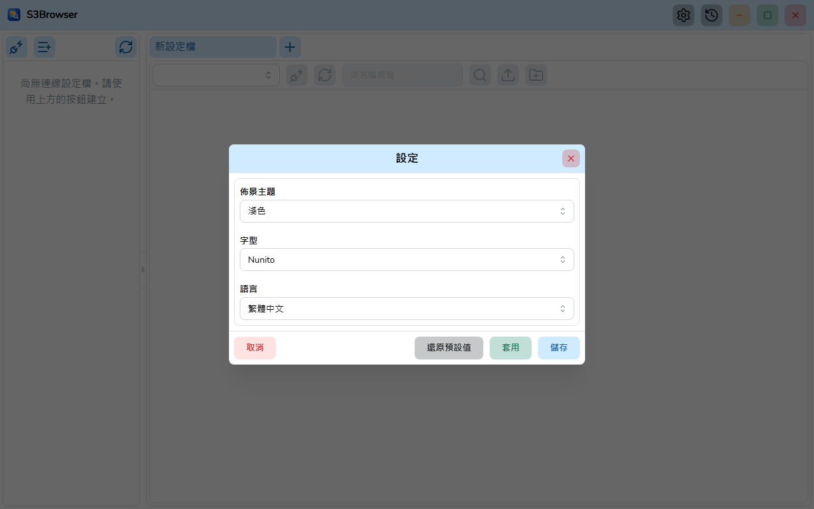

- **佈景主題**：淺色、深色或跟隨系統。
- **字型**：Nunito、系統介面、Segoe UI、Arial、Roboto、Be Vietnam Pro、Verdana、Meiryo UI、等寬或 JetBrains Mono。
- **語言**：English、Tiếng Việt、日本語、简体中文、繁體中文、Русский 或 Deutsch。整個介面（包括訊息）都會改變。
- **隨 Windows 啟動**：登入 Windows 時啟動 S3Browser。僅在 Windows 安裝版中顯示（可攜版不顯示）。
- **自動檢查並下載更新** 和 **接收測試版 (搶先發行版本)**：請參閱[更新](#102-更新)。這兩個開關在切換後立即生效，不需要**套用**或**儲存**；只有**儲存**才能讓它們在重新啟動應用程式後依然有效。

每項變更都會立即預覽。然後選擇：

- **儲存**：保留設定，重新啟動應用程式後依然有效。
- **套用**：保留設定直到關閉應用程式，包括兩個更新開關；對話方塊保持開啟。「隨 Windows 啟動」會在按下「套用」時立即寫入 Windows，「取消」無法復原。
- **取消**：復原自上次「套用」或「儲存」以來所做的變更，包括兩個更新開關。對話方塊隨即關閉。
- **還原預設值**：將表單還原為預設值（淺色、Nunito、English，**隨 Windows 啟動**關閉）。兩個更新開關也會像手動切換一樣立即還原為預設：**自動檢查並下載更新**開啟，**接收測試版 (搶先發行版本)**關閉。按一下**儲存**以保留預設值；**取消**可復原此還原。

如果在仍有未儲存也未套用的變更時，透過 **X**、Esc 鍵或按一下視窗外部關閉視窗，會出現警告**設定尚未儲存**（「有設定尚未儲存或套用。您要怎麼做？」）：**返回**保持視窗開啟並保留變更，**捨棄變更**復原變更並關閉視窗，**儲存**儲存變更（儲存失敗時視窗保持開啟）。沒有變更時，視窗直接關閉。

設定在應用程式啟動時、視窗內容出現之前載入。

### 10.2 更新

安裝版可以透過 GitHub Releases 自動更新。設定視窗中會顯示**更新**部分；可攜版不會自動更新。

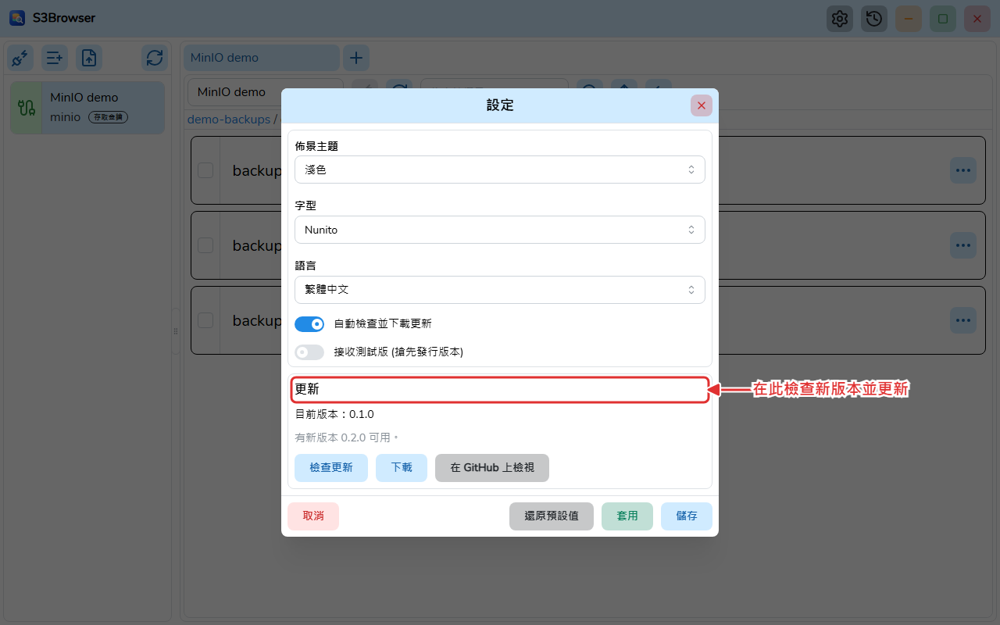

- **自動檢查並下載更新**：開啟後，應用程式會檢查新版本並在背景下載。
- **接收測試版 (搶先發行版本)**：同時提供標為 Pre-release 的版本。
- **檢查更新**：立即檢查。**目前版本**下方的一行會告訴您結果（例如**有新版本 ... 可用。**或**已是最新版本。**）。
- **下載**用於下載新版本，**立即更新**用於在下載完成後安裝，**在 GitHub 上檢視**用於開啟發行頁面。

有新版本時，視窗頂端的提示會提供**下載**；下載期間會顯示進度，下載完成後會提供**更新**。已下載的檔案在安裝前會經過驗證。

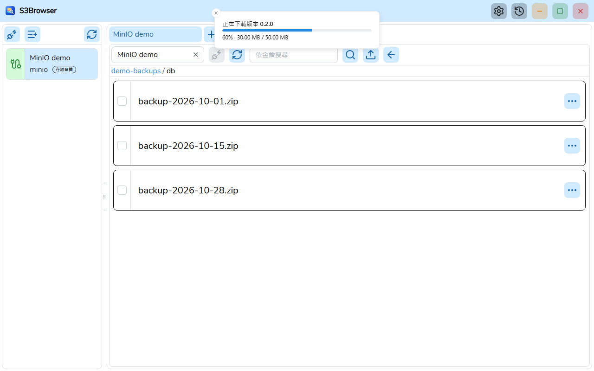

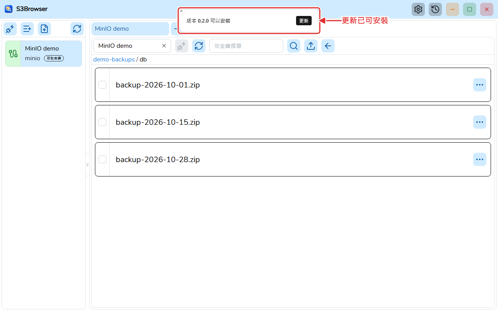

真實的更新無法在螢幕擷圖中顯示：上圖使用範例值顯示該提示。

## 11. 疑難排解

訊息顯示在視窗頂端。以下是您最常遇到的訊息。

| 訊息 | 原因及處理方式 |
| --- | --- |
| 存取金鑰或私密金鑰對此端點無效。 | 金鑰有誤，或屬於另一台伺服器。請在設定檔中檢查，並使用**測試連線**。 |
| 連線端點逾時，請檢查位址以及伺服器是否正在執行。 | 端點有誤、伺服器已停止，或被防火牆或網路封鎖。請檢查位址（含 `http://` 或 `https://`）和連接埠。 |
| 端點拒絕了請求。 / 連線至 S3 儲存貯體時發生錯誤。 | 伺服器有回應但拒絕了連線。請檢查端點、區域和 **Path style**（MinIO 需要）。 |
| 設定檔 {name} 尚未連線。 | 連線已關閉。請重新連線該設定檔。 |
| 取得儲存貯體清單時發生錯誤 / 取得物件清單時發生錯誤 | 帳戶可能無權列出儲存貯體或該儲存貯體，或連線已中斷。請檢查金鑰的權限並重新連線。 |
| 儲存貯體存取受限。 | 您的帳戶無法列出所有儲存貯體。請申請缺少的權限，或開啟您有權使用的儲存貯體。 |
| 另一個上傳正在進行，請等待其完成。 | 同一時間只能進行一個上傳。請等待其完成，或在**上傳中**視窗中取消。 |
| 資料夾 ... 要上傳的檔案超過 50 個。 / 一次最多上傳 1000 個檔案。 | 請參閱第 9.1 節的限制。請拆分上傳或選擇更少的檔案。 |
| 設定檔 [{name}] 有正在進行的上傳或下載，無法刪除。 | 請等待傳輸完成或取消它們，然後再刪除設定檔。 |
| 請先中斷連線再執行此操作！ | 編輯或刪除設定檔前，請先中斷連線（按一下滑鼠右鍵，選擇**中斷連線**）。 |
| 最多只能選取 5 個項目！ | 下載或刪除時最多選取 5 個物件。 |
| 目的地 ... 不存在。 | 為下載選擇的資料夾無法使用。請選擇其他位置。 |

如果某則訊息未在此列出，它會包含操作名稱和伺服器回報的原因。該原因（例如 `AccessDenied` 或 `NoSuchBucket`）是 S3 本身的訊息，會告訴您在伺服器端需要修正什麼。

下面兩張連線錯誤的螢幕擷圖是透過**測試連線**擷取的。

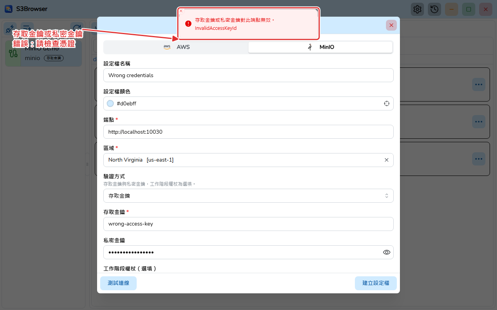

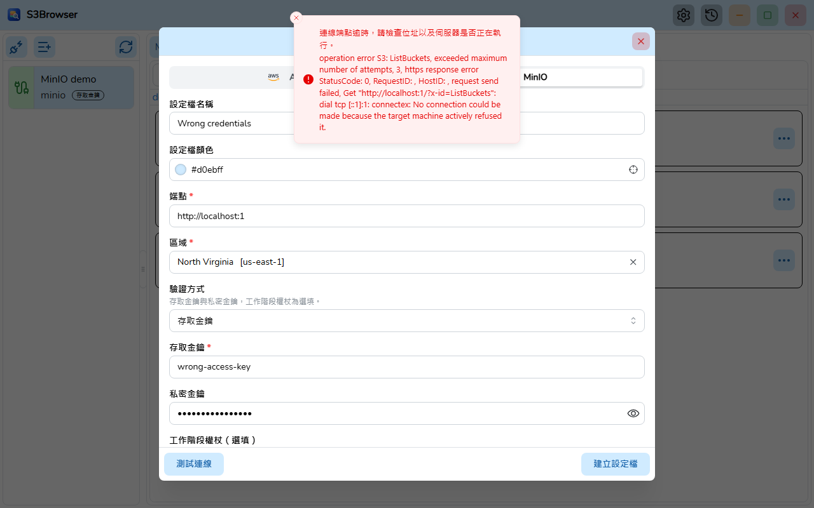
